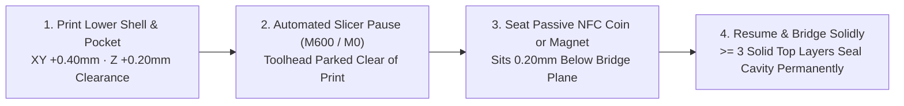

# Parametric Additive CAD & Physical Hardware Fixtures

Physical operational software only works as smoothly as the physical hardware mounting and tagging around it. Ruggedized handheld barcode computers need quick-draw desk cradles and protective sleeves; lockup key rings need indestructible RFID/NFC fobs that never peel off like cheap vinyl stickers; and edge infrastructure appliances need vented mounting brackets with clean cable routing.

Through **`Vulcan` (our Parametric CAD & Additive Fabrication specialist)**, Hathcock Labs treats physical fixtures as **version-controlled code** using **OpenSCAD Constructive Solid Geometry (CSG)**—bringing the same deterministic parameterization and tolerance discipline from TypeScript into fused deposition modeling (FDM) manufacturing.

---

## Why Parametric CSG-as-Code?

GUI mouse-driven CAD tools degrade quickly when dimensions shift across printer nozzles, filament shrinkage rates, or updated rugged protective device boots. Authoring geometry parametrically in OpenSCAD keeps physical hardware modular and reproducible:

- **Top-of-File Millimeter Contracts:** Every wall thickness, pocket clearance, chamfer angle, and mounting hole pitch sits explicitly at the top of the `.scad` file in millimeters.
- **Adaptive Tessellation (`$fn`):** Models switch cleanly between fast viewport previews and smooth production STL/3MF meshes (`$fn = $preview ? 32 : 96;`), compiled via CLI (`openscad -o fixture.stl fixture.scad`).
- **Non-Manifold Subtraction Hygiene:** Boolean `difference()` operations always extend cutting volumes past outer faces by `epsilon = 0.01` mm, eliminating zero-thickness coplanar faces ("z-fighting") that create non-manifold slicer warnings.

```openscad
// Parametric Pause-at-Layer NFC Keyfob Shell (all dimensions in mm)
$fn = $preview ? 32 : 96;
epsilon = 0.01;

tag_diam       = 25.4;
tag_thick      = 1.00;
layer_h        = 0.20;  // Standard Bambu/Orca slicing layer step
pocket_xy_clr  = 0.40;  // +0.40mm drop-in clearance
pocket_z_clr   = 0.20;  // +0.20mm bridge nozzle clearance
bottom_layers  = 1.20;  // 6 layers below tag
top_bridge_h   = 1.00;  // 5 solid top shell layers
wall_radial    = 3.00;
chamfer_ef     = 0.20;  // Elephant's foot first-layer relief

pocket_r  = (tag_diam + pocket_xy_clr) / 2;
outer_r   = pocket_r + wall_radial;
pocket_h  = tag_thick + pocket_z_clr;
total_h   = bottom_layers + pocket_h + top_bridge_h;
pause_z   = bottom_layers + pocket_h; // Pause right before first bridge layer at z = 2.40mm

module rounded_fob_body() {
    hull() {
        translate([0, 0, chamfer_ef]) cylinder(r = outer_r, h = total_h - chamfer_ef);
        cylinder(r1 = outer_r - chamfer_ef, r2 = outer_r, h = chamfer_ef);
        translate([outer_r + 3.5, 0, chamfer_ef]) cylinder(r = 5.5, h = total_h - chamfer_ef);
    }
}

difference() {
    rounded_fob_body();
    // Recessed NFC cavity: bottomed cleanly at z = bottom_layers, sealed above pause_z
    translate([0, 0, bottom_layers])
        cylinder(r = pocket_r, h = pocket_h);
    // Split-ring eyelet extending strictly +/- epsilon past Z boundaries (manifold clean)
    translate([outer_r + 3.5, 0, -epsilon])
        cylinder(r = 2.4, h = total_h + (2 * epsilon));
}
```

Note how `pause_z` aligns cleanly as an integer multiple of `layer_h` (`2.40 mm / 0.20 mm = Layer 12`), preventing slicer rounding ambiguity between the final cavity perimeter wall and the first bridging roof extrusion.

---

## Calibrated FDM Tolerances (`0.4mm` Nozzle Standard)

A 3D model that looks exact on screen fails on the print bed if extrusion width, first-layer squish, and plastic creep are ignored. Every fixture uses verified empirical clearances calibrated for standard `0.4mm` nozzles:

| Mechanical Feature | Standard Allowance | Engineering Rationale |
| :--- | :--- | :--- |
| **Elephant's Foot Compensation** | `0.15 – 0.20 mm` chamfer | Prevents first-layer bed squish from binding sliding rails or cradle slots. |
| **Cantilever Snap-Fit Latch Clearance** | `0.20 mm` latch-to-tooth gap | Eliminates post-print fusion while maintaining crisp tactile snap engagement. |
| **Snap-Fit Lead-In & Return Angles** | `30°–45°` lead-in; `45°–60°` serviceable / `90°` permanent return | Tunes insertion force vs. non-destructive release vs. tamper-resistant locking. |
| **Serviceable Pry Notch** | `1.5 mm × 4.0 mm` recess | Allows non-destructive screwdriver disassembly without snapping cantilever roots. |
| **Friction / Press-Fit Bore** | `0.08 – 0.12 mm` radial clearance | Secures alignment dowels or rubber feet firmly without adhesives. |
| **M3 Brass Heat-Set Insert Boss** | `4.0 mm` pilot bore + `1.0 mm` depth relief | Anchors `~4.2 mm` OD knurled inserts structurally with melted-plastic overflow clearance. |

---

## Pause-at-Layer Embedded RFID/NFC & Magnet Enclosures

Adhesive NFC stickers peel off key rings and steel lockboxes within weeks on active floors. Instead, we fabricate **monolithic sealed enclosures** by pausing the printer mid-job, dropping in passive `25.4mm` NFC coin tags or neodymium magnets, and bridging solid filament directly over top:



1. **XY Drop-In Clearance (`+0.40 mm`):** A `25.4 mm` coin tag receives a `25.8 mm` pocket diameter so the inlay drops flat without forcing—preventing bowed edges from catching the moving hotend on resume.
2. **Z Headroom (`+0.20 mm`):** A `1.0 mm` tag rests inside a `1.20 mm` deep cavity so the first bridge extrusion clears the copper coil cleanly without thermal damage.
3. **Supported Bridging Density:** Pause height aligns cleanly to layer steps, followed by at least `3` solid top layers spanning the cavity monotonically to seal electronics against moisture, sanitizer wipes, and drops.

---

## Material Selection & Slicer Optimization

Choosing filament by color alone produces warped car mounts and snapped clips:

- **PETG (Primary Structural Standard):** Default filament for handheld scanner cradles, charging dock organizers, and sealed RFID fobs—delivering strong inter-layer adhesion, impact resilience, and `~75–80°C` heat deflection without creeping inside warm patrol vehicles.
- **TPU (`95A` Shore Hardness):** Engineered into shock-absorbing bumper boots and slip-resistant sleeves protecting glass screens from concrete drops.
- **ASA:** Reserved for exterior gatehouse brackets and sun-exposed outdoor mounts demanding UV resistance.
- **PLA:** Restricted strictly to indoor desk organizers and fast dimensional fit-checks.

Slicer profiles (`Bambu Studio` / `OrcaSlicer`) configure `3–4` perimeter wall loops to reinforce cantilever roots structurally rather than wasting material on heavy internal infill, paired with gyroid infill for isotropic load distribution.

---

## Cantilever Orientation & Production Fixture Catalog

### Anisotropic Strength: Why Cantilever Clips Print Flat on XY
Fused deposition parts exhibit weaker tensile strength across vertical Z layer seams (`~50–65%` of XY planar filament strength). Printing a vertical snap-fit tab causes normal clip deflection to pull straight apart between layer lines, snapping at the root within days.

```openscad
// Tapered cantilever beam: thick root tapering by 50% toward snap hook for uniform strain
module tapered_snap_arm(length = 14.0, width = 6.0, t_root = 2.0, gap = 0.20) {
    t_tip = t_root * 0.5;
    linear_extrude(height = width)
        polygon([[0, 0], [length, (t_root - t_tip) / 2], [length, (t_root + t_tip) / 2], [0, t_root]]);
}
```

By orienting every snap latch cleanly flat in the XY build plate plane and tapering beam thickness smoothly from `t_root` to `0.5 * t_root`, bending stress spreads evenly across continuous extruder loops rather than concentrating at sharp `90°` corners.

| Hardware Fixture Printed | Primary Polymer | Key Tolerances & Engineering Detail | Operational Problem Solved |
| :--- | :--- | :--- | :--- |
| **Sealed RFID/NFC Keyfobs** | PETG (`4` perimeters) | `+0.40 mm` XY pocket, `+0.20 mm` Z, layer-12 `M600` pause | Replaces peeling vinyl tags on heavy lockup key rings |
| **Quick-Draw Scanner Desk Cradles** | PETG + `4.0 mm` M3 inserts | Weighted pass-through charging channel + `0.20 mm` relief chamfer | Stops handheld computers from tipping onto hard counters |
| **Shockproof Sleeve Bumpers** | TPU (`95A`) | Continuous perimeter bumper lip protecting screen corners | Cuts LCD digitizer cracks from waist-height concrete drops |
| **Vented SBC / Edge Brackets** | PETG / ASA | Hex convection slots, captive M3 mounts, zip-tie strain relief | Keeps always-on network & telemetry hosts cool off floor clutter |

---

## Automated Geometry Export & Pre-Slice Validation Loop

Every `.scad` fixture compiles reproducibly from command-line automation inside headless validation loops (`openscad -o build/fixture.stl fixture.scad --check-parameters true`), flagging ungrounded floating shells, inverted face normals, or zero-thickness Boolean walls before slicers touch geometry:

1. **Parametric Sweep Smoke Checks:** Varying `tag_diam` (`25.4 mm` vs `30.0 mm`) or wall loop width automatically proves derived radii, eyelet bosses, and integer layer pause heights (`pause_z % layer_h == 0`) remain manifold across variants.
2. **Pause-Bridge Air-Gap Verification:** Inspecting sliced G-code confirms zero support towers spawn inside sealed internal electronics pockets, cooling fans step up cleanly across top cavity bridges, and toolhead park coordinates clear tall parts safely prior to manual NFC tag placement.
3. **Thermal & Chemical Durability Fit:** Sealed PETG housings resist isopropyl sanitizer wipes used across shared retail hardware pools while clearing hot patrol-vehicle cabin temperatures without warping.
