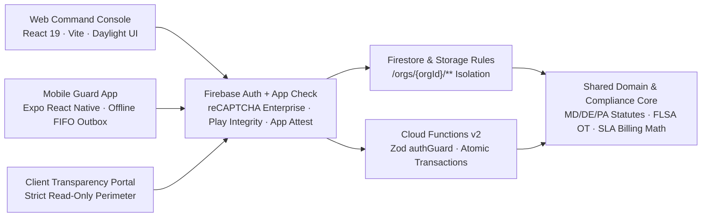

# Arclight Security ERP & Computer-Aided Dispatch

**Arclight Security** is a multi-tenant Security Guard Enterprise Resource Planning (ERP), Workforce Management, and Computer-Aided Dispatch (CAD) platform built for contract security agencies operating across **Maryland, Delaware, and Pennsylvania**.

Mid-market security contractors (`25–500` officers) typically pay **`$25–$55+` per guard per month** stitching together a brittle four-vendor "Frankenstack":
- **Guard Tour & DAR:** Silvertrac, OfficerReports, GuardsPro, or TrackTik with multi-module creep and annual lock-ins.
- **Scheduling & Workforce:** Legacy schedulers built atop janitorial UIs that lack statutory license gating.
- **Payroll & Earned Wage Access:** Manual CSV exports into generic payroll tools that routinely break FLSA multi-rate blended overtime rules.
- **Push-to-Talk Radio:** Separate Zello Work (`~$8/user/mo`) or Motorola WAVE / hardware radio leases (`$25–$35+/mo` over 30-month terms).

Because these four tools share zero state, expired state cards pass schedulers silently, uncertified officers sign out weapons from armories, and unstaffed "dark hours" trigger liquidated damages before operations notices. Arclight replaces all four silos with one deterministic TypeScript core backed by Cloud Firestore, Cloud Functions v2, a Daylight Enterprise command console, a scoped client transparency portal, and an offline-capable Expo React Native field app.

---

## High-Level Multi-Tenant Architecture



Every tenant organization lives strictly under `/orgs/{orgId}/**`, gated by JWT custom claims (`orgId`, `role`, `clientId`, `siteIds`) and server-side Zod validation (`AuthClaimsSchema`) across every callable Cloud Function.

---

## 1. Tri-State Statutory Compliance Enforcement

Regulatory oversight across Maryland, Delaware, and Pennsylvania spans three incompatible state police regimes. Arclight encodes all statutory gates inside a shared zero-dependency package (`@arclight/compliance-engine`) enforced at **three operational boundaries**: shift assignment (`assignOfficerToShift`), geofence clock-in (`clockInOutGeofence`), and armory checkout.

| Jurisdiction | Regulatory Authority | Enforced Statutes, Training & Watchdogs |
| :--- | :--- | :--- |
| **Maryland (MD)** | Maryland State Police (MSP) | Active MSP Guard Card, **MD SB 760** training certification (`12h` initial / `8h` renewal), **Wear & Carry Permit (`16h`)** on armed posts, plus an automated **48-hour MSP Use-of-Force reporting watchdog** (`forceReportDeadline: ISO`) with live countdown banner and printable courtroom addendum. |
| **Delaware (DE)** | Delaware State Police (DSP) | **Title 24 Ch. 13** bifurcation between **Yellow Card** (`16h` unarmed, 5-year cycle) and **Red Card** (`40h` armed firearm endorsement, strict annual Dec 31 expiration + 3-shoot qualification rule). Active Red Cards legally supersede Yellow Cards on unarmed posts. Enforces **19 Del. C. § 707** lone-worker fully paid 30-minute meal periods. |
| **Pennsylvania (PA)** | Pennsylvania State Police (PSP) | **Act 235 (`22 P.S. § 41`)** Lethal Weapons certification (`40h` training + physical/psychological clearance, strict 5-year hard expiration) gating armed shifts and armory issuance of **firearms, TASER CEWs, and expandable batons (`18 Pa. C.S. § 908`)**. |

*Deep dive:* [Statutory Compliance as Deterministic Code](../03_Architecture-Deep-Dives/Statutory-Compliance-As-Code.md)

---

## 2. Armory, Master Keys & Patrol Fleet Custody

High-liability sites track serialized custody across `FIREARM`, `TASER_CEW`, `BATON_ASP`, `BODY_CAMERA`, `RADIO`, `MASTER_KEY_RING`, and `PATROL_VEHICLE` assets (`IN_VAULT`, `CHECKED_OUT`, `MAINTENANCE`).

- **Lethal-Weapon & Driver Interlocks:** Checking out a firearm, TASER, or Pennsylvania baton verifies active, unexpired post-matched credentials (`MD_WEAR_CARRY`, `DE_RED_CARD`, `PA_ACT_235`). Patrol cruiser checkouts validate an active `DRIVERS_LICENSE`, while returns flag maintenance defects via `INSPECTION_FLAG` custody records.
- **`<35ms` USB & Bluetooth Scanner Wedge (`createScannerWedgeListener`):** Captures raw HID bursts from 1D/2D barcode scanners with zero driver installation, strips ISO/IEC 15424 AIM headers (`]C1`, `]e0`, `]Q1`, `]d2`) and control bytes, and completes badge + serial custody handoffs in under 2 seconds.
- **Procedural Web Audio Signal Synthesizer:** Generates zero-dependency `AudioContext` chimes instead of fragile `.mp3` fetches:

| Signal Kind | Waveform & Frequency Envelope | Operational Meaning |
| :--- | :--- | :--- |
| **`CAD_DISPATCH`** | Sine `587.33 Hz (D5) -> 880.0 Hz (A5)` | Incoming priority dispatch call |
| **`LONE_WORKER_WARNING`** | Triangle double pulse `523.25 Hz (C5)` | Officer check-in interval overdue |
| **`DURESS_EMERGENCY`** | Sawtooth triad `880.0 Hz / 1174.66 Hz (D6)` | Urgent `10-33` / duress alert |
| **`SCAN_SUCCESS`** | Crisp sine `1046.5 Hz (C6)` (`75ms`) | Armory custody checkout/return verified |
| **`SCAN_BLOCKED`** | Low sawtooth drop `220.0 Hz -> 165.0 Hz` | Statutory credential gate rejected checkout |

---

## 3. "Dark Hours" SLA Billing & FLSA Blended Payroll

- **Automated Dark-Hours SLA Reconciliation:** `calculateClientInvoiceFromShifts` compares contracted post hours against GPS-verified clock-ins. Whenever site coverage falls below **`98%`** due to unstaffed shifts, the engine flags the SLA breach, computes an automated **`10%` SLA penalty credit**, and formats formal `Newsreader` serif Client Invoices (`INV-YYYY-XXXX`).
- **FLSA `29 C.F.R. § 778.115` Blended Overtime & Tax Allocation:** Guards splitting workweeks across unarmed and armed pay rates trigger integer-cents weighted-average regular-rate math (`0.5x` overtime premium across all hours `>40`), proportional state-by-state overtime allocation, local tax bucketing (`PA Act 32` PSD, Philadelphia, Wilmington, MD county), and real-time bill-to-pay margin calculation (`marginPct`).

### Worked Integer-Cents Math Traces (Zero Floating-Point Drift)
All payroll and invoice routines convert dollar rates into integer cents (`Math.round(rate * 100)`) before computing averages or proportional splits:

| Worked Scenario | Concrete Inputs | Exact Integer-Cents Computation | Statutory Outcome |
| :--- | :--- | :--- | :--- |
| **Multi-Rate FLSA Workweek** | `32h` unarmed (`$18.00/h`) + `14h` armed (`$24.00/h`) = `46h` total (`6h` OT) | Straight earnings = `(32×1800) + (14×2400) = 91,200¢` (`$912.00`). Blended regular rate = `Math.round(91200 / 46) = 1,983¢/h` (`$19.83`). Half-time OT premium = `6 × Math.round(1983 * 0.5) = 5,952¢` (`$59.52`). | **Gross Pay: `$971.52`** (`PA`/`MD`/`DE` hours split proportionally) |
| **Dark-Hours Site SLA Breach** | `240h` contracted @ `$38.50/h`; `228h` staffed (`12h` dark = `95.0%` coverage) | Base staffed amount = `228 × 3850 = 877,800¢` (`$8,778.00`). Coverage `< 98.0%` triggers `10%` SLA credit = `87,780¢` (`$877.80`). | **Net Client Invoice: `$7,900.20`** with breach line audit |

### Unified Single-Core Stack vs. Four-Vendor "Frankenstack"

| Operational Capability | Legacy 4-Vendor Stack (`$25–$55+/guard/mo`) | Arclight Unified Monorepo |
| :--- | :--- | :--- |
| **Compliance-Gated Dispatch** | Disconnected PDF spreadsheets (`$0` gate protection) | Real-time `evaluateShiftEligibility` on assignment, clock-in & armory |
| **Tactical PTT Radio** | External `$8–$35+/mo` app/radio subscriptions | Integrated Half-Duplex LTE radio tied directly to site shifts & `10-33 SOS` |
| **Client Transparency Portal** | Manual emailed DAR zip files | Real-time `CLIENT_VIEWER` perimeter hiding payroll, PII & draft records |
| **FLSA Payroll & Dark-Hours SLA** | Brittle Monday morning CSV cleanup | Automatic integer-cents weighted OT, county tax & `<98%` SLA reconciliation |

---

## 4. Strict 13-Collection `CLIENT_VIEWER` Perimeter & Callable Guards

Client property directors expect live operational visibility without exposing internal guard wages, phone numbers, IdentoGO background clearances, or draft investigations. `firestore.rules` and `storage.rules` enforce strict separation across all paths under `/orgs/{orgId}/`:

| Collection / Storage Path | `CLIENT_VIEWER` Access | Technical Enforcement Rule |
| :--- | :--- | :--- |
| `/clients/{clientId}` & `/sites/{siteId}` | **Scoped Read Only** | Matches `request.auth.token.clientId` |
| `/shifts/{shiftId}` & `/dispatchCalls/{callId}` | **Scoped Read Only** | Matches `resource.data.clientId == token.clientId` |
| `/incidents/{incidentId}` & `/incidents/**` Storage | **Filtered Read Only** | Requires `clientVisible == true && status != 'DRAFT'` |
| `/dars/{darId}` & `/policyDocuments/{docId}` | **Filtered Read Only** | Requires `clientVisible == true` (approved/public SOPs only) |
| `/clientInvoices/{invoiceId}` | **Scoped Non-Draft Read** | Excludes `DRAFT` invoices; matches `clientId` |
| `/users/{userId}` & `/credentials/{id}` | **DENIED** | Protects PII, licenses, and private profiles |
| `/timecards/{id}` & `/payrollRuns/{id}` | **DENIED** | Protects internal bill-to-pay margin & guard wages |
| `/shiftBids/{id}`, `/courses`, `/policyAcknowledgments` | **DENIED** | Explicitly blocked via `!isClientViewer(orgId)` |
| `/officerConfidential/{userId}` (KMS PII Vault) | **100% Client-Blocked** | `allow read, write: if false` (Admin SDK / Cloud KMS only) |
| `/radioChannels` & `/radioTransmissions` | **DENIED** | Tactical PTT channels strictly excluded from client portals |

Every Cloud Function callable (`assignOfficerToShift`, `clockInOutGeofence`, `recordCheckpointScan`, `submitIncidentReport`, `previewPayrollRun`, `submitPayrollRun`, `exportTimeToGross`, `publishPolicyRevision`, `acknowledgePolicyDocument`, `getOfficerPolicyCompliance`, `checkoutArmoryAsset`, `returnArmoryAsset`, `generateClientSlaInvoice`) validates caller JWT custom claims via Zod `AuthClaimsSchema` (`assertTenantIsolation` + `assertOfficerSelfOrAdmin`) before touching Firestore:

```typescript
// Server-side callable authorization invariant: derive tenant identity strictly from verified JWT claims
export function assertTenantIsolation(authToken: unknown, requestedOrgId: string): AuthClaims {
  const claims = AuthClaimsSchema.parse(authToken);
  if (claims.orgId !== requestedOrgId) {
    throw new HttpsError("permission-denied", "Cross-tenant boundary violation blocked.");
  }
  if (claims.role === "CLIENT_VIEWER") {
    throw new HttpsError("permission-denied", "Client viewers hold strictly read-only perimeter access.");
  }
  return claims;
}
```

Even if a compromised client tampers with request JSON arguments, server handlers reject cross-tenant or escalated writes deterministically before initializing database transactions.

---

## 5. Anti-Spoof Field Controls, HR Lifecycle & Zero-OT Automation

- **Anti-Spoof Geofence & Privacy-Safe Location:** Validates Android mock-location flags (`isMockedLocation === false`), enforces `horizontalAccuracyMeters <= 75`, captures optional `accelerometerVariance3s` motion signatures and App Attest / Play Integrity tokens, and strictly never polls GPS off-duty (`shift.status !== 'IN_PROGRESS'`).
- **IdentoGO Onboarding & Dirty CSV Importers:** Tracks recruits across `APPLIED -> INTERVIEW -> IDENTOGO_FINGERPRINTS -> STATE_LICENSE_PENDING -> OFFER_I9 -> HIRED` (`UNARMED` / `ARMED` tracks) alongside RFC-4180 heuristic CSV importers that normalize E.164 phone numbers and preview validation issues before batch commits.
- **Site BOLOs & SBI 70/20/10 Coaching:** Tracks `CRITICAL`, `HIGH`, and `ADVISORY` site alerts with verifiable officer acknowledgment trails (`acknowledgedByOfficerIds`), paired with structured Situation-Behavior-Impact coaching and progressive discipline logs.
- **`T+5m` No-Show Watchdog & Zero-OT Backfill Design:** Automated watchdog progression nudges overdue officers at `T+5m`, chimes dispatch at `T+10m`, and ranks eligible replacement pools at `T+15m` via `evaluateShiftEligibility(...)` sorted **strictly by `(projectedWeeklyHours + shiftDuration <= 40)` first** to prevent unbilled overtime:

```typescript
export function rankBackfillCandidates(
  candidates: CandidateCompliance[],
  shiftHours: number,
): CandidateCompliance[] {
  return candidates
    .filter((c) => c.eligibility.eligible)
    .sort((a, b) => {
      const aNoOt = a.projectedWeeklyHours + shiftHours <= 40 ? 0 : 1;
      const bNoOt = b.projectedWeeklyHours + shiftHours <= 40 ? 0 : 1;
      if (aNoOt !== bNoOt) return aNoOt - bNoOt; // Straight-time candidates ALWAYS rank first
      return a.projectedWeeklyHours - b.projectedWeeklyHours;
    });
}
```

- **Half-Duplex PTT Tactical Radio:** Lease-backed floor locks, `10-33 SOS` hot-mic preemption, Motorola-style chirps, `<35ms` scanner hotkey isolation, and dead-zone store-and-forward audio queuing ([Half-Duplex PTT Over LTE](../03_Architecture-Deep-Dives/Half-Duplex-PTT-Over-LTE.md)).

### Live Daylight Command Surfaces Implemented
The command-center web application avoids dark generic dashboards in favor of six dense Daylight Operations views paired with a three-page scoped Client Transparency Portal (`/client` overview, `/client/reports` filtered DARs & non-draft incidents, `/client/invoices` formal print-ready sheets):
- **Live Operations & Telemetry Grid:** Active post coverage, checkpoint tour completeness, no-show alerts, and 48h MSP SB 760 countdown banners.
- **Compliance & Armory Vaults:** Expiration radar (`30/14/7` day tiers), serial barcode checkout/return logs, and vehicle inspection flags.
- **Payroll Margin & Policy Read-Receipt Matrices:** Live gross/overtime/local-tax previews and timestamped SOP acknowledgement audits.

### Planned Production Financial & Field Expansions
Arclight's unified domain core is architected cleanly around upcoming v1.0 enterprise integrations without rewriting schema boundaries:
- **Earned Wage Access (EWA) & QuickBooks Online OAuth 2.0 + PKCE:** Zero-cost instant payout caps synced directly from verified clocked geofence shifts alongside one-click encrypted chart-of-accounts invoice/journal synchronization.
- **Bluetooth Low Energy (BLE) & NFC Checkpoints + Accelerometer Man-Down:** Hardware beacon proof-of-presence alongside `>2.8 G` spike + `<0.15 G` 90-second stillness detection escalating into automatic `10-33` distress dispatch after a 30-second audible cancellation window.

---

## Verified v0.3 Engineering Benchmarks

- **Monorepo Type Safety:** `5/5` workspace packages passing strict TypeScript (`0` errors).
- **Automated Test Coverage:** `25/25` test suites (**`205/205` unit and integration tests passing**) across `@arclight/domain` (`38`), `@arclight/compliance-engine` (`27`), `@arclight/functions` (`57`), `@arclight/mobile-guard` (`38`), and `@arclight/web-command` (`45`).
- **Daylight Enterprise Visual Gate & Build:** Built in `2.39s` with all Vite chunks `<500 KB` (`11 KB – 378 KB`), `0` blocking and `0` advisory layout/WCAG defects across `1440×900` and `375×812`.
- **Cross-Cutting Deep Dives:** [Statutory Compliance as Code](../03_Architecture-Deep-Dives/Statutory-Compliance-As-Code.md) · [Half-Duplex PTT Over LTE](../03_Architecture-Deep-Dives/Half-Duplex-PTT-Over-LTE.md) · [Anti-Slop UI Engineering](../03_Architecture-Deep-Dives/Anti-Slop-UI-Engineering.md)
