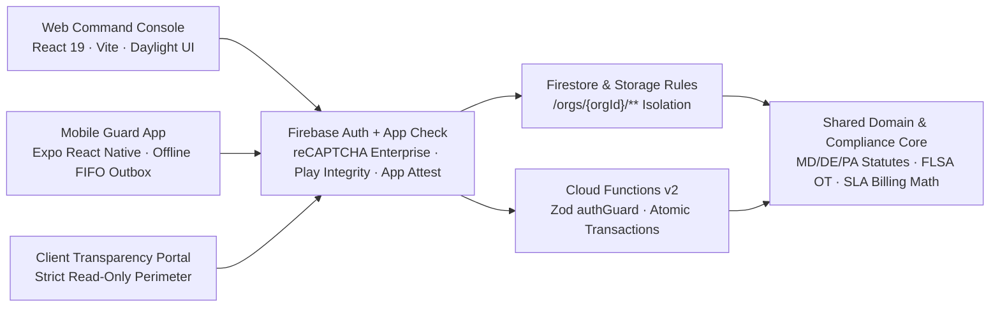

# Arclight Security ERP & Computer-Aided Dispatch

**Arclight Security (`v0.7.1`)** is a multi-tenant Security Guard Enterprise Resource Planning (ERP), Workforce Management, and Computer-Aided Dispatch (CAD) platform built for contract security agencies operating across **Maryland, Delaware, and Pennsylvania**.

Mid-market security contractors (`25–500` officers) typically pay **`$25–$55+` per guard per month** stitching together a brittle four-vendor "Frankenstack":
- **Guard Tour & DAR:** Silvertrac, OfficerReports, GuardsPro, or TrackTik with multi-module creep and annual lock-ins.
- **Scheduling & Workforce:** Legacy schedulers built atop janitorial UIs that lack statutory license gating.
- **Payroll & Earned Wage Access:** Manual CSV exports into generic payroll tools that routinely break FLSA multi-rate blended overtime rules.
- **Push-to-Talk Radio:** Separate Zello Work (`~$8/user/mo`) or Motorola WAVE / hardware radio leases (`$25–$35+/mo` over 30-month terms).

Because these four tools share zero state, expired state cards pass schedulers silently, uncertified officers sign out weapons from armories, and unstaffed "dark hours" trigger liquidated damages before operations notices. Arclight replaces all four silos with one deterministic TypeScript core backed by Cloud Firestore, Cloud Functions v2, a Daylight Enterprise command console, a scoped client transparency portal, and an offline-capable Expo React Native field app.

---

## High-Level Multi-Tenant Architecture



Every tenant organization lives strictly under `/orgs/{orgId}/**`, gated by JWT custom claims (`orgId`, `role`, `clientId`, `siteIds`) and server-side Zod validation (`AuthClaimsSchema`) across every callable Cloud Function.

---

## 1. Tri-State Statutory Compliance Enforcement

Regulatory oversight across Maryland, Delaware, and Pennsylvania spans three incompatible state police regimes. Arclight encodes all statutory gates inside a shared zero-dependency package (`@arclight/compliance-engine`) audited independently under **Read-Only Primary-Statute Veto Power** and enforced at **three operational boundaries**: shift assignment (`assignOfficerToShift`), geofence clock-in (`clockInOutGeofence`), and armory checkout.

### Zero State-Portal Scrapers: Cryptographic Document Verification
Headless scraping against state licensing portals invites IP bans, brittle CAPTCHA breakage, and stale compliance state. Instead, Arclight verifies officer credentials deterministically via **cryptographic `SHA-256` document hashing** of uploaded state cards and training certificates paired with **hard automatic midnight expiration lockouts**, advisory expiration warnings, and **two-person HR sign-off** before armed credentials transition to `VERIFIED`.

| Jurisdiction | Regulatory Authority | Enforced Statutes, Training & Watchdogs |
| :--- | :--- | :--- |
| **Maryland (MD)** | Maryland State Police (MSP) | Active MSP Guard Card, **MD SB 760** training certification (`12h` initial / `8h` renewal), **Wear & Carry Permit (`16h`)** on armed posts, an automated **48-hour MSP Use-of-Force reporting watchdog** (`forceReportDeadline: ISO`), and **"AI-Assisted" PDF evidentiary disclosure** whenever `polishedNarrative` accompanies immutable `rawOfficerTranscript`. |
| **Delaware (DE)** | Delaware State Police (DSP) | **Title 24 Ch. 13** bifurcation between **Yellow Card** (`16h` unarmed, 5-year cycle) and **Red Card** (`40h` armed firearm endorsement, strict annual Dec 31 expiration + 3-shoot qualification rule). Active Red Cards legally supersede Yellow Cards on unarmed posts. Enforces **19 Del. C. § 707** lone-worker fully paid 30-minute meal periods. |
| **Pennsylvania (PA)** | Pennsylvania State Police (PSP) | **Act 235 (`22 P.S. § 41`)** Lethal Weapons certification (`40h` training + physical/psychological clearance, strict 5-year hard expiration) gating armed shifts and armory issuance of **firearms, TASER CEWs, and expandable batons (`18 Pa. C.S. § 908`)**, alongside **`34 Pa. Code § 231.43(d)(2)`** multi-rate weighted-average overtime (*Chevalier* `0.5x` FWW banned). |

*Deep dive:* [Statutory Compliance as Deterministic Code](../03_Architecture-Deep-Dives/Statutory-Compliance-As-Code.md)

---

## 2. Armory, Master Keys & Patrol Fleet Custody

High-liability sites track serialized custody across `FIREARM`, `TASER_CEW`, `BATON_ASP`, `BODY_CAMERA`, `RADIO`, `MASTER_KEY_RING`, and `PATROL_VEHICLE` assets (`IN_VAULT`, `CHECKED_OUT`, `MAINTENANCE`).

- **Lethal-Weapon & Driver Interlocks:** Checking out a firearm, TASER, or Pennsylvania baton verifies active, unexpired post-matched credentials (`MD_WEAR_CARRY`, `DE_RED_CARD`, `PA_ACT_235`). Patrol cruiser checkouts validate an active `DRIVERS_LICENSE`, while returns flag maintenance defects via `INSPECTION_FLAG` custody records.
- **`<35ms` USB & Bluetooth Scanner Wedge (`createScannerWedgeListener`):** Captures raw HID bursts from 1D/2D barcode scanners with zero driver installation, strips ISO/IEC 15424 AIM headers (`]C1`, `]e0`, `]Q1`, `]d2`) and control bytes, and completes badge + serial custody handoffs in under 2 seconds.
- **Procedural Web Audio Signal Synthesizer:** Generates zero-dependency `AudioContext` chimes instead of fragile `.mp3` fetches:

| Signal Kind | Waveform & Frequency Envelope | Operational Meaning |
| :--- | :--- | :--- |
| **`CAD_DISPATCH`** | Sine `587.33 Hz (D5) -> 880.0 Hz (A5)` | Incoming priority dispatch call |
| **`LONE_WORKER_WARNING`** | Triangle double pulse `523.25 Hz (C5)` | Officer check-in interval overdue |
| **`DURESS_EMERGENCY`** | Sawtooth triad `880.0 Hz / 1174.66 Hz (D6)` | Urgent `10-33` / duress alert |
| **`SCAN_SUCCESS`** | Crisp sine `1046.5 Hz (C6)` (`75ms`) | Armory custody checkout/return verified |
| **`SCAN_BLOCKED`** | Low sawtooth drop `220.0 Hz -> 165.0 Hz` | Statutory credential gate rejected checkout |

---

## 3. "Dark Hours" SLA Billing & FLSA Blended Payroll

- **Automated Dark-Hours SLA Reconciliation:** `calculateClientInvoiceFromShifts` compares contracted post hours against GPS-verified clock-ins. Whenever site coverage falls below **`98%`** due to unstaffed shifts, the engine flags the SLA breach, computes an automated **`10%` SLA penalty credit**, and formats formal `Newsreader` serif Client Invoices (`INV-YYYY-XXXX`).
- **FLSA `29 C.F.R. § 778.115` Blended Overtime & Tax Allocation:** Guards splitting workweeks across unarmed and armed pay rates trigger integer-cents weighted-average regular-rate math (`0.5x` overtime premium across all hours `>40`), proportional state-by-state overtime allocation, local tax bucketing (`PA Act 32` PSD, Philadelphia, Wilmington, MD county), and real-time bill-to-pay margin calculation (`marginPct`).

### Worked Integer-Cents Math Traces (Zero Floating-Point Drift)
All payroll and invoice routines convert dollar rates into integer cents (`Math.round(rate * 100)`) before computing averages or proportional splits:

| Worked Scenario | Concrete Inputs | Exact Integer-Cents Computation | Statutory Outcome |
| :--- | :--- | :--- | :--- |
| **Multi-Rate FLSA Workweek** | `32h` unarmed (`$18.00/h`) + `14h` armed (`$24.00/h`) = `46h` total (`6h` OT) | Straight earnings = `(32×1800) + (14×2400) = 91,200¢` (`$912.00`). Blended regular rate = `Math.round(91200 / 46) = 1,983¢/h` (`$19.83`). Half-time OT premium = `6 × Math.round(1983 * 0.5) = 5,952¢` (`$59.52`). | **Gross Pay: `$971.52`** (`PA`/`MD`/`DE` hours split proportionally) |
| **Dark-Hours Site SLA Breach** | `240h` contracted @ `$38.50/h`; `228h` staffed (`12h` dark = `95.0%` coverage) | Base staffed amount = `228 × 3850 = 877,800¢` (`$8,778.00`). Coverage `< 98.0%` triggers `10%` SLA credit = `87,780¢` (`$877.80`). | **Net Client Invoice: `$7,900.20`** with breach line audit |

### Unified Single-Core Stack vs. Four-Vendor "Frankenstack"

| Operational Capability | Legacy 4-Vendor Stack (`$25–$55+/guard/mo`) | Arclight Unified Monorepo |
| :--- | :--- | :--- |
| **Compliance-Gated Dispatch** | Disconnected PDF spreadsheets (`$0` gate protection) | Real-time `evaluateShiftEligibility` on assignment, clock-in & armory |
| **Tactical PTT Radio** | External `$8–$35+/mo` app/radio subscriptions | Integrated Half-Duplex LTE radio tied directly to site shifts & `10-33 SOS` |
| **Client Transparency Portal** | Manual emailed DAR zip files | Real-time `CLIENT_VIEWER` perimeter hiding payroll, PII & draft records |
| **FLSA Payroll & Dark-Hours SLA** | Brittle Monday morning CSV cleanup | Automatic integer-cents weighted OT, county tax & `<98%` SLA reconciliation |

---

## 4. Strict 13-Collection `CLIENT_VIEWER` Perimeter & Callable Guards

Client property directors expect live operational visibility without exposing internal guard wages, phone numbers, IdentoGO background clearances, or draft investigations. `firestore.rules` and `storage.rules` enforce strict separation across all paths under `/orgs/{orgId}/`:

| Collection / Storage Path | `CLIENT_VIEWER` Access | Technical Enforcement Rule |
| :--- | :--- | :--- |
| `/clients/{clientId}` & `/sites/{siteId}` | **Scoped Read Only** | Matches `request.auth.token.clientId` |
| `/shifts/{shiftId}` & `/dispatchCalls/{callId}` | **Scoped Read Only** | Matches `resource.data.clientId == token.clientId` |
| `/incidents/{incidentId}` & `/incidents/**` Storage | **Filtered Read Only** | Requires `clientVisible == true && status != 'DRAFT'` |
| `/dars/{darId}` & `/policyDocuments/{docId}` | **Filtered Read Only** | Requires `clientVisible == true` (approved/public SOPs only) |
| `/clientInvoices/{invoiceId}` | **Scoped Non-Draft Read** | Excludes `DRAFT` invoices; matches `clientId` |
| `/users/{userId}` & `/credentials/{id}` | **DENIED** | Protects PII, licenses, and private profiles |
| `/timecards/{id}` & `/payrollRuns/{id}` | **DENIED** | Protects internal bill-to-pay margin & guard wages |
| `/shiftBids/{id}`, `/courses`, `/policyAcknowledgments` | **DENIED** | Explicitly blocked via `!isClientViewer(orgId)` |
| `/officerConfidential/{userId}` (KMS PII Vault) | **100% Client-Blocked** | `allow read, write: if false` (Admin SDK / Cloud KMS only) |
| `/radioChannels` & `/radioTransmissions` | **DENIED** | Tactical PTT channels strictly excluded from client portals |

Every Cloud Function callable (`assignOfficerToShift`, `clockInOutGeofence`, `recordCheckpointScan`, `submitIncidentReport`, `previewPayrollRun`, `submitPayrollRun`, `exportTimeToGross`, `publishPolicyRevision`, `acknowledgePolicyDocument`, `getOfficerPolicyCompliance`, `checkoutArmoryAsset`, `returnArmoryAsset`, `generateClientSlaInvoice`) validates caller JWT custom claims via Zod `AuthClaimsSchema` (`assertTenantIsolation` + `assertOfficerSelfOrAdmin`) before touching Firestore:

```typescript
// Server-side callable authorization invariant: derive tenant identity strictly from verified JWT claims
export function assertTenantIsolation(authToken: unknown, requestedOrgId: string): AuthClaims {
  const claims = AuthClaimsSchema.parse(authToken);
  if (claims.orgId !== requestedOrgId) {
    throw new HttpsError("permission-denied", "Cross-tenant boundary violation blocked.");
  }
  if (claims.role === "CLIENT_VIEWER") {
    throw new HttpsError("permission-denied", "Client viewers hold strictly read-only perimeter access.");
  }
  return claims;
}
```

Even if a compromised client tampers with request JSON arguments, server handlers reject cross-tenant or escalated writes deterministically before initializing database transactions.

---

## 5. Anti-Spoof Field Controls, Scheduling Automation & Client Reporting (`v0.6.0` Sprint 2)

Sprint 2 (`v0.6.0`) moved scheduling continuity, field anti-spoofing, and automated client reporting from design contracts into verified production execution across **`42` Gen-2 Cloud Functions (`enforceAppCheck: true`)**:

- **`T+5m` No-Show Watchdog & Zero-OT (`<=40h`) Ranked Backfill Cascade:** Automated watchdog schedules nudge overdue officers at `T+5m`, alert dispatch at `T+10m`, and compute compliance-filtered backfill cascades at `T+15m` via `evaluateShiftEligibility(...)` sorted **strictly by `(projectedWeeklyHours + shiftDuration <= 40)` first** to eliminate unbilled overtime. Outbound SMS dispatch runs fail-closed through **`DryRunSmsTransport`** until production carrier credentials are explicitly enabled:

```typescript
export function rankBackfillCandidates(
  candidates: CandidateCompliance[],
  shiftHours: number,
): CandidateCompliance[] {
  return candidates
    .filter((c) => c.eligibility.eligible)
    .sort((a, b) => {
      const aNoOt = a.projectedWeeklyHours + shiftHours <= 40 ? 0 : 1;
      const bNoOt = b.projectedWeeklyHours + shiftHours <= 40 ? 0 : 1;
      if (aNoOt !== bNoOt) return aNoOt - bNoOt; // Straight-time candidates ALWAYS rank first
      return a.projectedWeeklyHours - b.projectedWeeklyHours;
    });
}
```

- **Master Recurring Shift Templates & Compliance-Gated Bid/Swap:** Generates recurring rosters cleanly across **`2-2-3`**, **`4-on-4-off`**, and **weekly** rotation patterns, paired with self-service officer shift bidding and peer swap workflows that re-run the full tri-state `@arclight/compliance-engine` interlocks before any reassignment commits.
- **GPS Anti-Spoofing, Toggleable Liveness Selfie & Hard Off-Duty Teardown:** Clock-ins verify Android mock-location rejection (`isFromMockProvider === false`), enforce `horizontalAccuracyMeters <= 75`, evaluate `3s` accelerometer motion variance (`accelerometerVariance3s`), and support a **toggleable per-site / per-org liveness selfie punch** for high-liability posts. Whenever **`shift.status !== 'IN_PROGRESS'`**, the mobile runtime executes a hard off-duty sensor teardown—releasing GPS, motion, and audio handles completely so officers are never tracked off the clock.
- **Automated Client Daily Digest & Executive QBR Scorecard (`%PDF-`):** Scheduled client digests compile verified shift coverage, patrol tour completeness, and approved incidents—failing closed via **`DryRunEmailTransport`** in sandbox/dry-run modes—while the Executive QBR Scorecard exports print-ready **`%PDF-`** deliverables carrying mandatory **`"AI-Assisted"` evidentiary disclosure** whenever polished narratives accompany immutable `rawOfficerTranscript` records.
- **IdentoGO Onboarding, Site BOLOs & Half-Duplex PTT Tactical Radio:** Tracks recruits across `APPLIED -> INTERVIEW -> IDENTOGO_FINGERPRINTS -> STATE_LICENSE_PENDING -> OFFER_I9 -> HIRED` (`UNARMED` / `ARMED` tracks), enforces verifiable Site BOLO acknowledgments (`CRITICAL`, `HIGH`, `ADVISORY`) and structured coaching logs, and integrates live half-duplex tactical PTT (`GlobalRadioDock.tsx` Spacebar PTT + `HoldToTalkBar.tsx` `76pt` mobile bar + Bluetooth RSM hooks) with HS256 LiveKit token minting, atomic floor leases, MD/PA two-party wiretap consent with explicit **`10-33 SOS` life-safety `recordAudio: false` carve-out**, and dead-zone `STORE_AND_FORWARD` replay ([Half-Duplex PTT Over LTE](../03_Architecture-Deep-Dives/Half-Duplex-PTT-Over-LTE.md)).

---

## 6. Modular State Decomposition (`v0.6.1` Wave 0) & Production Onboarding (`v0.7.1` Sprint 2.5)

### Wave 0 (`v0.6.1`) — Zero-Regression State Architecture Decomposition
Before expanding multi-tenant onboarding and client provisioning surfaces, both frontend state monoliths were decomposed cleanly into domain-scoped slices while preserving **100% public API backwards compatibility** (`0` caller regressions):

| Surface | Monolithic Baseline | Decomposed Core + Slices | Backwards Compatibility |
| :--- | :---: | :---: | :---: |
| **Web Command Context** (`apps/web-command`) | `10,895` LOC | **`421` LOC** orchestrator + **`12` domain slices** | `100%` public hook/context API preserved |
| **Mobile Field Store** (`apps/mobile-guard`) | `5,583` LOC | **`384` LOC** orchestrator + **`7` domain slices** | `100%` public store & offline FIFO API preserved |

### Sprint 2.5 (`v0.7.1`) — Clean Production Provisioning, Onboarding & Contextual Guidance
Sprint 2.5 hardened the complete day-one agency and client activation path without contaminating live production tenants with demo data:

- **Hard Sandbox-vs-Production Isolation & `orgMode` Immutability Lock:** Production tenant provisioning runs through an explicit clean-org bootstrap path with zero demo fixtures. Firestore Security Rules lock `orgMode` (`SANDBOX` vs. `PRODUCTION`) as immutable after organization creation so a misconfigured client or elevated API call can never flip a live agency into sandbox mode or back-port demo records.
- **5-Step Agency Onboarding Wizard & Atomic CSV Bulk Roster Importer:** Walks new agencies sequentially through organization profile, jurisdictional compliance defaults, initial client/site setup, officer roster import, and go-live verification. The embedded RFC-4180 CSV Bulk Roster Importer previews row-level errors live and executes **`<= 400`-row single-transaction atomic imports** while deterministically **rejecting privileged role escalation** (`OWNER`, `ADMIN`, `SUPER_ADMIN`) from uploaded CSV rows.
- **3-Step Downstream Client Account & 1-Click `CLIENT_VIEWER` Portal Provisioning Wizard:** Lets operations managers create scoped client organizations, bind authorized site IDs, and mint least-privilege `CLIENT_VIEWER` portal credentials in one guided workflow locked to the 13-collection perimeter above.
- **17-Topic Contextual `?` `HelpPopover` & Lazy-Split `QuickStartDrawer`:** Embeds **17 role-gated contextual `?` help popovers** (viewport-clamped against desktop/mobile edges with capture-phase `Escape` dismissal) alongside a **lazy-split, role-aware `QuickStartDrawer`** keeping the maximum Vite JavaScript chunk at **`474.9 KB`** (strictly under the `< 500 KB` budget).

### Live Daylight Command Surfaces Implemented
The command-center web application avoids dark generic dashboards in favor of dense Daylight Operations views paired with the scoped Client Transparency Portal (`/client` overview, `/client/reports` filtered DARs & non-draft incidents, `/client/invoices` formal print-ready sheets):
- **Live Operations & Telemetry Grid:** Active post coverage, checkpoint tour completeness, `T+5m` no-show watchdog & zero-OT backfill cascades, and 48h MSP SB 760 countdown banners.
- **Compliance, Armory & Onboarding Wizards:** Expiration radar (`30/14/7` day tiers), serial barcode checkout/return logs, 5-step Agency Onboarding + atomic `<=400`-row CSV importer, and 3-step Client Portal provisioning.
- **Payroll Margin, QBR Scorecards & Policy Read-Receipt Matrices:** Live gross/overtime/local-tax previews, Executive QBR `%PDF-` exports, and timestamped SOP acknowledgement audits.

### Planned Production Financial & Field Expansions
Arclight's unified domain core is architected cleanly around upcoming enterprise integrations without rewriting schema boundaries:
- **Earned Wage Access (EWA) & QuickBooks Online OAuth 2.0 + PKCE:** Zero-cost instant payout caps synced directly from verified clocked geofence shifts alongside balanced (`debits === credits`) chart-of-accounts invoice/payroll journal synchronization.
- **Bluetooth Low Energy (`-78 dBm`) Checkpoints & Accelerometer Man-Down:** Hardware beacon proof-of-presence alongside `>2.8 G` spike + `<0.15 G` 90-second stillness detection escalating into automatic `10-33` distress dispatch after a 30-second audible cancellation window.

---

## Verified `v0.7.1` Production Quality & Security Benchmarks

| Verification Pillar | Verified `v0.7.1` Metric | Enforcement Scope |
| :--- | :--- | :--- |
| **Automated Test Suite** | **`1,098/1,098` passing** (`670` unit · `394` Vitest E2E · `34` Playwright browser E2E) | Desktop `1440px` & Mobile `375px` viewports, compliance, payroll, PTT, onboarding & isolation |
| **Serverless API Perimeter** | **`42` Gen-2 Cloud Functions (`enforceAppCheck: true`)** | Zod `AuthClaimsSchema` tenant isolation, `orgMode` immutability, fail-closed `DryRun*` transports |
| **Static Lint & Type Safety** | **`0` `oxlint` warnings/errors across `360` files** | Strict workspace `tsc --noEmit` across all monorepo packages |
| **Bundle Performance Budget** | **`474.9 KB` max Vite JS chunk (`< 500 KB`)** | Lazy-split role-aware `QuickStartDrawer` & manual Rollup chunking |
| **Adversarial Break-It Audits** | **`3` independent security & edge-case rounds → `0 CRITICAL / 0 HIGH`** | Independent `Sentinel` + `Aegis` loop validating rules, role escalation, `<dialog>` StrictMode races & edge cases |

- **Cross-Cutting Deep Dives:** [Statutory Compliance as Code](../03_Architecture-Deep-Dives/Statutory-Compliance-As-Code.md) · [Half-Duplex PTT Over LTE](../03_Architecture-Deep-Dives/Half-Duplex-PTT-Over-LTE.md) · [Anti-Slop UI Engineering](../03_Architecture-Deep-Dives/Anti-Slop-UI-Engineering.md)
