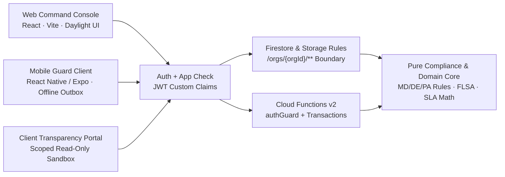

# Arclight Security ERP & Computer-Aided Dispatch

**Arclight Security** is a multi-tenant Security Guard Enterprise Resource Planning (ERP) and Computer-Aided Dispatch (CAD) platform built for contract guard operations across Maryland, Delaware, and Pennsylvania.

Contract security agencies operate under strict state police oversight, tight hourly margins, and unforgiving client Service Level Agreements (SLAs). Legacy guard software treats licensing, shift scheduling, armory checkout, and overtime payroll as disconnected spreadsheets. Arclight binds them to a single deterministic core so non-compliant dispatches and uncertified weapon checkouts are blocked before an officer ever steps onto a post.

> [!IMPORTANT]
> **Tenant Isolation First:** Every organization record lives under `/orgs/{orgId}/**`, gated by JWT custom claims (`orgId`, `role`, `clientId`, `siteIds`), Firestore/Storage security rules, and Zod-validated callable wrappers in Cloud Functions v2.

---

## System Architecture

---

## Core Operational Modules

### 1. Mid-Atlantic Tri-State Compliance Engine
Instead of passive expiration reminders, Arclight enforces hard programmatic blocks across three distinct state police regimes inside a shared TypeScript package (`@arclight/compliance-engine`):

| Jurisdiction | Regulatory Authority | Enforced Statutes & Hard Gates |
| :--- | :--- | :--- |
| **Maryland (MD)** | Maryland State Police (MSP) | Active MSP Guard Card, **MD SB 760** training certification (12h initial / 8h renewal), **Wear & Carry Permit** (16h armed post gate), plus automated **48-hour MSP Use-of-Force reporting watchdog** with live ISO countdown and courtroom-ready printable addendum. |
| **Delaware (DE)** | Delaware State Police (DSP) | **Yellow Card** (16h unarmed, 5-year cycle) vs. **Red Card** (40h armed firearm endorsement, annual Dec 31 expiration and 3-shoot qualification rule). Red Card validly supersedes Yellow Card on unarmed posts. |
| **Pennsylvania (PA)** | Pennsylvania State Police (PSP) | **Act 235 (`22 P.S. § 41`)** Lethal Weapons certification (40h training, physical/psychological screening, 5-year hard expiration) gating armed shifts and **expandable baton / TASER CEW armory checkouts** under `18 Pa. C.S. § 908`. |

Any missing, unverified, or expired credential—alongside incomplete site LMS training, unsigned post orders, or unacknowledged SOP revisions—returns structured `BLOCKING` violations that prevent scheduling or dispatch assignment.

*Deep dive:* [Statutory Compliance as Deterministic Code](../03_Architecture-Deep-Dives/Statutory-Compliance-As-Code.md)

### 2. Armory, Master Keys & Patrol Fleet Custody
Arclight tracks serialized custody across firearms, TASER CEWs, expandable batons, body-worn cameras, tactical radios, master key rings, and patrol vehicles (`IN_VAULT`, `CHECKED_OUT`, `MAINTENANCE`).

- **Lethal-Weapon Hardware Gating:** Checking out a firearm, baton, or TASER triggers real-time verification of the officer's jurisdiction-specific armed credential (`MD_WEAR_CARRY`, `DE_RED_CARD`, or `PA_ACT_235`). Patrol cruiser checkouts validate an active `DRIVERS_LICENSE`.
- **`<35ms` USB & Bluetooth Scanner Wedge:** Captures rapid HID keystroke bursts from commercial 1D/2D barcode scanners, strips ISO/IEC 15424 AIM symbology prefixes (`]C1`, `]e0`, `]Q1`, `]d2`), and isolates human typing/IME input unless explicitly targeted.
- **Procedural Web Audio Signals:** Synthesizes crisp confirmation tones (`1046.5 Hz`) and compliance-rejection buzzes (`220 Hz -> 165 Hz`) directly via `AudioContext`, eliminating fragile audio asset fetches.

### 3. "Dark Hours" SLA Billing & FLSA Blended Payroll
Security agencies lose margin in two places: unbilled liquidated damages from missed shifts and miscalculated multi-rate overtime.

- **Dark-Hours SLA Reconciliation:** Compares contracted post hours against GPS-verified clock-in durations (`calculateClientInvoiceFromShifts`). When coverage drops below `98%` due to unstaffed dark hours, the billing engine automatically applies a `10%` SLA penalty credit and renders a formal `Newsreader` serif Client Invoice (`INV-YYYY-XXXX`).
- **FLSA `29 C.F.R. § 778.115` Blended Overtime:** Guards frequently split a week between unarmed gatehouse shifts and higher-paid armed patrol posts. The payroll calculator computes weekly earnings in integer cents using weighted-average regular rates, applies the `0.5x` overtime premium across proportional state hours, tracks bill-to-pay gross margin, and exports payroll-ready summaries.

### 4. Strict `CLIENT_VIEWER` Portal Isolation
Client property managers and corporate security directors need visibility into site coverage without ever seeing confidential agency internals. Multi-layer `firestore.rules` and `storage.rules` allow `CLIENT_VIEWER` tokens to read only `clientVisible == true` non-draft incidents, daily activity reports (DARs), public SOPs, site shifts, and issued client invoices for their assigned `clientId`—while explicitly blocking internal employee rosters, guard wages, timecards, payroll runs, IdentoGO background records, and tactical radio channels.

### 5. HR Lifecycle, Site BOLOs & SBI Coaching
- **IdentoGO Onboarding Pipeline:** Moves recruits cleanly across `APPLIED -> INTERVIEW -> IDENTOGO_FINGERPRINTS -> STATE_LICENSE_PENDING -> OFFER_I9 -> HIRED` with one-click active roster promotion.
- **Fault-Tolerant CSV Importers:** Heuristic header mapping, E.164 phone standardization, and pre-flight validation preview tables for migrating dirty schedules and rosters from legacy tools.
- **Site BOLOs & Shift Pass-Downs:** Replaces paper clipboards with `CRITICAL`, `HIGH`, and `ADVISORY` site notices requiring verifiable officer acknowledgments at clock-in or first checkpoint scan.
- **SBI & 70/20/10 Coaching:** Structures commendations, coaching plans, and progressive discipline with Situation-Behavior-Impact clarity and officer e-signature records.

### 6. Half-Duplex Push-to-Talk (PTT) Tactical Radio
Designed to replace expensive hardware radio fleets over LTE/Wi-Fi, Arclight's PTT layer enforces real radio discipline: single-speaker floor locks with automatic lease expiration, dispatcher override, `10-33 SOS` hot-mic preemption, synthesized talk-permit and roger chirps, Spacebar hotkey collision protection against barcode scanner bursts, and offline dead-zone store-and-forward voice queuing.

*Deep dive:* [Half-Duplex Push-to-Talk Over LTE](../03_Architecture-Deep-Dives/Half-Duplex-PTT-Over-LTE.md)
