# Deterministic Programmatic Video Production Engine (`v0.1.0`)

Short-form vertical engineering videos routinely fail in two predictable ways: manual timeline editing turns repeatable technical storytelling into brittle clickwork, while naive AI video generators produce uncanny pacing, blown `-6 LUFS` distortion, desynchronized subtitles, and unreadable robotic scripts stuffed with spoken flags (*"dash dash release"* or *"one twenty-seven dot zero"*).

Hathcock Labs engineered a standalone **`pnpm` TypeScript monorepo (`v0.1.0`)** combining **programmatic `1080×1920` `60fps` React/Remotion composition**, **ITU-R BS.1770 `-14 LUFS` FFmpeg loudness mastering**, **content-addressed neural TTS alignment caching**, a **9-rule spoken-voice anti-slop gate (`Grade 6.6–9.0`)**, human preview gates, compact `<35 KB` companion bio-funnel bundles, and idempotent multi-platform dispatch.

---

## Multi-Channel Architecture (Zero Cross-Vertical Coupling)

The engine serves **three isolated vertical tracks**—**(A) Edge Infrastructure & Homelab Ops**, **(B) Quantitative Collectibles & Market Math**, and **(C) Systems Telemetry & Silicon Benchmarks**—sharing one hardened pipeline while keeping typography, voice profiles, companion static microsites, and SQLite episode catalogs isolated per track across four workspace packages:

| Monorepo Package | Core Technical Responsibility | Key Guardrails Enforced |
| :--- | :--- | :--- |
| **`shared`** | Zod episode/timeline schemas, SQLite WAL state ledger & vertical voice/theme presets | Strict schema validation & per-channel topic isolation |
| **`pipeline`** | 9-rule anti-slop linter, SHA-256 TTS cache, `-14 LUFS` mastering, preview gate & publishers | `Grade <= 10.0` readability, `adelay` sync & `dry-run` lock |
| **`video-studio`** | React/Remotion `1080×1920` `60fps` composition engine (`ShortMaster.tsx`) | Deterministic frame timing & inline `data:` asset URIs |
| **`bio-funnel`** | Self-contained dark-mode companion landing sites & downloadable checklist bundles | Strict `< 35 KB` page footprint per vertical track |

```mermaid
flowchart LR
    Seed["Ground-Truth Episode Specs\nSQLite Ledger + Zod Schemas (shared)"] --> Gate1["9-Rule Anti-Slop & Readability Gate\nGrade 6.6-9.0 · Zero Spoken CLI Syntax"]
    Gate1 --> Voice["Voice & Pronunciation Foundry\nSHA-256 Cache · Character -> Word Timings"]
    Voice --> Audio["2-Pass Audio Mastering (ffmpeg)\n-14 LUFS · -5dB @ 2.4kHz SFX Duck · adelay Pin"]
    Audio --> Video["Remotion 1080x1920 60fps Composition\nReact ShortMaster + Inline Data URIs -> ffprobe"]
    Video --> Human["Human Inline Approval Gate\nPreview Clip + Diagnostic Telemetry Sign-Off"]
    Human -->|"Worktree: PUBLISHER_PROVIDER=dry-run"| Pub["Idempotent Multi-Platform Publisher\nChunked Video · Companion <35 KB Bio Hubs"]
```



---

## 1. Spoken-Voice Readability & 9-Rule Anti-Slop Firewall (`slop-check.ts`)

Technical explanations fail fast on vertical video when narration reads like terminal documentation out loud. Every generated or authored episode script passes a deterministic **9-rule lint engine** built around one editorial rule: **"Speak Human in the Ear · Show Exact Receipts on Screen."**

```typescript
// Enforce spoken natural English while isolating terminal commands/paths strictly to screen visuals
export const MAX_READING_GRADE_LEVEL = 10.0;

export const UNEXPANDED_TTS_PATTERNS = [
  { label: "raw dollar sign ($)", regex: /\$/ },
  { label: "raw percent sign (%)", regex: /%/ },
  { label: "raw comparison operator (>=, <=, ==, !=, ->)", regex: /(>=|<=|==|!=|->)/ },
  { label: "raw filesystem path", regex: /\/(etc|var|usr|opt|mnt|home)\b/i },
  { label: "raw snake_case identifier (_)", regex: /[a-z0-9]_[a-z0-9]/i },
];

export const SPOKEN_CLI_SYNTAX_REGEX =
  /\b(dash\s+dash|slash\s+e\s*t\s*c|dot\s+conf|dot\s+yaml|dot\s+json|colon\s+latest|one\s+twenty-seven\s+dot\s+zero)\b/i;
```

- **Grade `6.6–9.0` Human Voiceover Validation:** Computes automated readability across narration segments, failing scripts above **`10.0`** (`reading_grade_too_high`) alongside explicit checks catching spoken terminal syntax (`spoken_cli_syntax`), unexpanded symbols (`$`, `%`, `->`), robotic initialisms, stale cross-episode repetition (`getPrecedingChannelEpisodes`), and generic promotional phrasing.
- **Display Override Alignment (`display-overrides.ts`):** Separates **spoken text** sent to speech synthesis (`apply_text_normalization: "off"`) from crisp **visual captions** overlaid on screen—preserving technical accuracy on screen without forcing viewers to listen to clunky literal punctuation.

---

## 2. SHA-256 Voice Synthesis Cache & `-14 LUFS` Broadcast Mastering

Regenerating identical neural voice takes across minor visual tweaks wastes voice synthesis quotas and shifts timing unpredictably. Instead, `elevenlabs-tts.ts` hashes canonical payload inputs (`text`, `model_id`, `voice_settings`, speed, pronunciation locator) via `SHA-256` before calling the API, decoding character-level alignment arrays (`character_start_times_seconds` / `character_end_times_seconds`) straight into deterministic word and segment timings for `60fps` subtitle rendering:

```typescript
// Deterministic content-addressed cache key: unchanged voice prose/settings hit disk in <1ms
export function computeTtsCacheHash(input: {
  text: string;
  voiceId: string;
  modelId: "eleven_multilingual_v2";
  voiceSettings: TtsVoiceSettings;
}): string {
  return createHash("sha256").update(JSON.stringify(input)).digest("hex").slice(0, 24);
}
```

Separating `apply_text_normalization: "off"` with explicit pronunciation dictionary locators ensures numbers, decibels, and measurements pronounce naturally while character indices align 1:1 to on-screen frame ticks.

### Zero-Drift Timeline Pinning & Automated SFX EQ Ducking (`audio-mastering.ts`)
Any leading audio silence trim desynchronizes Remotion captions by hundreds of milliseconds. `masterEpisodeAudio()` pins audio duration cleanly without shifting `t = 0`:

```typescript
// Pin audio strictly to t=0 without leading trims so rendered subtitles never drift
const dur = timelineDurationSec.toFixed(4);
const voiceFilter = `[0:a]aformat=sample_rates=48000:channel_layouts=stereo,atrim=0:${dur},apad=whole_dur=${dur}[voice]`;

// Position each transition sound effect via exact millisecond adelay and notch 2.4 kHz presence for vocal clarity
const sfxFilter = `[${idx}:a]aformat=sample_rates=48000:channel_layouts=stereo,equalizer=f=2400:t=q:w=1.2:g=-5,volume=0.26,adelay=${delayMs}|${delayMs}[sfx${idx}]`;
```

1. **Surgical SFX Ducking:** Transition sound effects mix with unity-gain voice (`amix normalize=0`) attenuated smoothly (`volume=0.26`) with a **`-5 dB` dip at `2,400 Hz`** (`Q = 1.2`) carving intelligible headroom specifically around spoken consonants.
2. **Two-Pass ITU-R BS.1770 Loudness Normalization:** Pass 1 measures integrated LUFS, true peak (`dBTP`), and loudness range via `ffmpeg -af loudnorm=...:print_format=json`; Pass 2 normalizes deterministically to **`-14 LUFS`** (`TP = -1.5 dBTP`, `LRA = 11 LU`) at `48 kHz` stereo AAC (`192 kbps`).

---

## 3. Programmatic 60fps Composition, Bio Funnels & Safe Dispatch

- **Inlined Asset Rendering (`renderer-bridge.ts`):** Resolves React/Remotion studio bundles (`ShortMaster.tsx`), encodes static capture overlays deterministically into `data:` URIs (`image/png`, `image/webp`, `image/svg+xml`) so Chromium never drops relative file URLs mid-frame, outputs **`1080×1920` `60fps` `H.264 High` + `48 kHz` AAC** MP4s, and validates stream tracks programmatically via `ffprobe`.
- **Companion `<35 KB` Dark-Mode Bio Hubs (`bio-funnel`):** Generates ultra-lightweight static landing hubs pairing each published vertical track with downloadable verification checklists and starter assets under strict `35 KB` payload caps.
- **Human Inline Approval & Worktree `dry-run` Guardrails (`telegram-gate.ts` / `dispatcher.ts`):** Before any clip touches external platform APIs, operators inspect rendered previews alongside readability diagnostics and tap explicit inline approval buttons.

### Multi-Platform Idempotent Publish Matrix

| Target Platform Surface | Payload & Transport Guard | Failure Mode Prevented |
| :--- | :--- | :--- |
| **Video Platform A (Short API)** | Explicit approval status check + idempotent SQLite publish key per `episodeSlug` | Prevents duplicate uploads if worker restarts mid-callback |
| **Video Platform B (Chunked Media)** | Deterministic fixed-size byte chunk planner (`computeChunkPlan`) + resume validation | Stops mobile/cellular cuts from corrupting tall vertical MP4 uploads |
| **Vertical Hub & Feed Cross-Post** | Unified normalized metadata wrapper + public media URL resolution | Keeps visual descriptions consistent across destinations |
| **Isolated Feature Worktrees** | Unconditional `PUBLISHER_PROVIDER=dry-run` (`system:publisher:dry-run` log only) | Guarantees dev tests & AI sprints never emit accidental live social posts |

---

## Verified v0.1.0 Engineering Benchmarks

- **Monorepo Type Safety & Unit Verification:** `4/4` workspace packages (`shared`, `pipeline`, `video-studio`, `bio-funnel`) clean under TypeScript (`0` errors) with **`33/33` pipeline unit tests passing** across audio mastering normalization parsing, slop/readability scoring, and chunked uploader logic.
- **Anti-Slop & Media Proof:** **`17/17` seeded episodes** across all three vertical tracks passing the 9-rule plain-English anti-slop gate (Flesch-Kincaid Grades **`6.6–9.0`**), verified **`1080×1920` `60fps` `H.264 High` + `-14 LUFS` `48 kHz` AAC** renders via `ffprobe`, `<35 KB` bio hubs, and `0` tracked large binary blobs (strict `.mp4`/`.sqlite` commit blocking in `squad-pre-commit`).

### Cross-References
- [Cognitive Architecture Overview](../02_AI-Systems-Architecture/00-Cognitive-Architecture-Overview.md) — `Tier C` automated audits & `4-Wave` hardware isolation.
- [Autonomous DevOps & Zero-Trust Gates](../02_AI-Systems-Architecture/05-Autonomous-DevOps-and-Zero-Trust-Gates.md) — `>2 MB` / `.mp4` / `.sqlite` binary commit quarantine & worktree `dry-run` locks.
