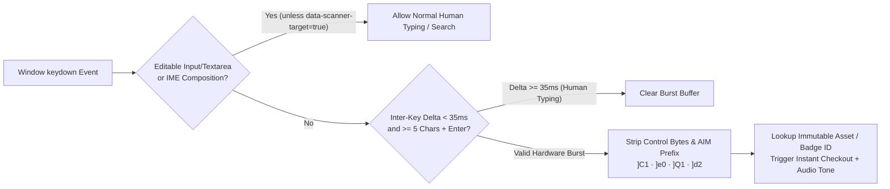
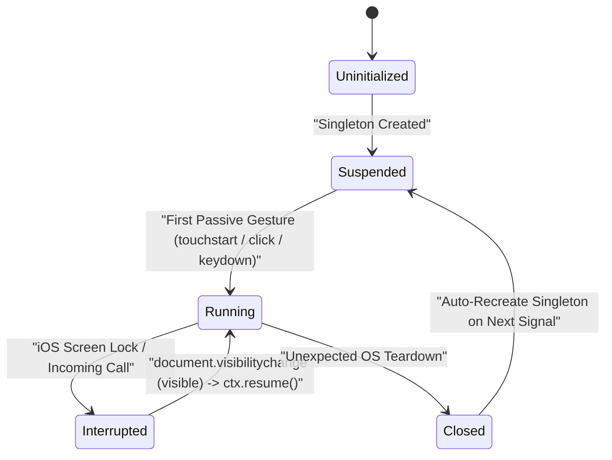

# High-Velocity Retail Floor & Asset Operations PWAs

High-volume retail sales floors and stockrooms punish desktop-shaped enterprise software immediately. Supervisors walk busy aisles one-handed; ruggedized enterprise barcode terminals and shared lockup key rings circulate rapidly across dozens of associates during peak shifts; concrete backrooms drop Wi-Fi intermittently; and multiple devices update state within milliseconds of each other via cold-start NFC or QR sticker taps.

We engineered two complementary Progressive Web Apps (PWAs) specifically for **sub-second floor hardware workflows** and **conflict-free multi-device coordination**:

1. **Phone-First Hardware Custody & Asset Manager PWA:** Tracks shared ruggedized handheld terminals, charging cradles, lockup key rings, and floor devices using strict single-handed thumb-zone ergonomics.
2. **Multi-Device Floor Execution & Coaching Planner PWA:** Synchronizes multi-week shift schedules, dirty spreadsheet KPI imports, daily zone lineups, and structured 70/20/10 coaching workflows across manager laptops, tablets, and smartphones.

---

## 1. Strict Phone-First Thumb-Zone Ergonomics

The Hardware Custody PWA treats smartphone geometry as a hard constraint rather than an afterthought:
- **Dynamic Viewport Physics (`100dvh`):** Layouts bind to dynamic viewport height with `viewport-fit=cover` safe-area padding so iOS Safari address bars and Home Indicator zones never clip bottom scan/checkout buttons.
- **Gloved Hit Geometry (`>= 44×44px`):** Every primary custody button, bay slot tile, and quick-checkout tap target meets or exceeds `44×44px` minimum touch dimensions with zero horizontal overflow at `320px` and `375px` widths.
- **Container-Query Charging Racks (`@container`):** Equipment charging cradle views adapt card layout density strictly to their parent container width rather than brittle global viewport breakpoints.
- **Immutable Physical Tag Decoupling:** NFC stickers and RFID fobs mounted on cages and equipment docks encode only an immutable hardware identifier (`/?tap=<barcode>`), completely decoupled from mutable UI display labels (`assetNumber`, `model`, `locationSlot`). Supervisors rename or reassign gear in the UI freely without ever re-flashing physical tags.

---

## 2. `<35ms` Hardware Barcode & RFID Wedge Integration

Enterprise handheld computers and USB/Bluetooth HID scanners emulate rapid keyboard keystrokes ("keyboard wedges") rather than exposing clean serial ports to web apps. Naive React `onChange` handlers or global `keydown` listeners routinely chop scanned tags, collide with search fields, or break on scanner preambles.



### Wedge State-Machine Defenses
1. **High-Precision Burst Timing (`<35ms`):** Tracks inter-keystroke intervals via `performance.now()`. Laser/CCD wedges emit printable characters under `35ms` apart terminated by `Enter` or `NumpadEnter` (`>= 5` chars); any slower human keystroke resets the buffer harmlessly.
2. **Modifier & Non-Printable Handling:** Modifier keys (`Shift`, `Control`, `Alt`, `Meta`, `CapsLock`) pass through without breaking uppercase burst continuity, while non-printable interrupts (`Escape`, `Tab`, `Backspace`) flush the buffer immediately.
3. **IME & Input Focus Isolation:** Explicitly ignores `event.isComposing`, `keyCode === 229`, `<input>`, `<textarea>`, `<select>`, and `contenteditable` targets unless explicitly opted in via `data-scanner-target="true"`.
4. **ISO/IEC 15424 AIM Symbology Stripping:** Removes ASCII control bytes (`0x00–0x1F`, `0x7F–0x9F`), enclosing preamble characters (`~`, backticks, quotes), and 3-character AIM symbology headers (`]C1` Code 128, `]e0` GS1 DataBar, `]Q1` QR, `]d2` Data Matrix) before normalizing IDs to uppercase.

```typescript
const AIM_PREFIX_RE = /^(?:\][A-Za-z][0-9A-Za-z])+/;

export function sanitizeScannedCode(raw: string): string {
  const withoutControls = raw.replace(/[\x00-\x1F\x7F-\x9F]/g, "").trim();
  const strippedWrapping = withoutControls.replace(/^[~`'"]+|[~`'"]+$/g, "");
  return strippedWrapping.replace(AIM_PREFIX_RE, "").trim().toUpperCase();
}
```

5. **Multi-Modal Hardware Fallback:** Supports native Web NFC (`NDEFReader` managed by `AbortController`) and live camera barcode scanning—strictly stopping every `MediaStream` track and clearing `video.srcObject` on teardown so mobile camera hardware never stays active after scanning finishes.

---

## 3. Singleton Web Audio with iOS WebKit Recovery

Operators clearing charging racks quickly rely on acoustic confirmation rather than reading screen toasts. External `.mp3` fetches stall on weak stockroom Wi-Fi and fail autoplay policies.



Our zero-dependency `SoundService` synthesizes crisp confirmation and rejection chimes via `AudioContext` while handling four real mobile browser failure modes:
- **Singleton Context Discipline:** Prevents hitting strict per-tab browser `AudioContext` allocation caps while recreating gracefully if closed externally.
- **First-Gesture Passive Unlock:** Registers one-time capture listeners (`touchstart`, `touchend`, `click`, `keydown`) that unlock suspended contexts on the operator's very first tap and automatically detach once `'running'`.
- **iOS `'interrupted'` & Lock-Screen Wake Recovery:** Subscribes to `document.visibilitychange`; waking an iPhone from lock screen or returning from a call immediately invokes `ctx.resume()` so audio cues never go dead mid-shift.
- **Zero-Leak Graph Cleanup:** Every scheduled oscillator and gain node calls `.disconnect()` inside its `onended` callback.

---

## 4. Dirty Spreadsheet ETL, PWA Caching & Zero-Clobber Sync

Shift rosters and operational scorecards arrive as messy multi-tab ODS/CSV exports containing inconsistent `"Last, First"` vs. `"First Last"` name formats, missing or reordered headers, BOM markers, and mixed time strings (`"9:00A-5:30P"` vs. `"0900–1730"`). Rather than mutating database state blindly on file drop, the ingestion pipeline runs a deterministic 3-stage reconciliation gate:

| Stage | Transformation & Heuristic Safeguard | Failure Prevented |
| :--- | :--- | :--- |
| **1. Header & Name Normalization** | Fuzzy alias mapping (`Associate` / `Emp Name` / `Staff`) + `"Last, First"` token flip matching normalized lowercase lookup keys | Duplicate employee records created from reversed spreadsheet columns |
| **2. Shift Grid & E.164 Parsing** | Extracts multi-day date headers into deterministic per-day start/end slices while scrubbing domestic phones cleanly to `+1XXXXXXXXXX` | Broken shift boundaries across midnight crossovers or invalid phone formats |
| **3. Interactive Pre-Flight Diff** | Renders matched updates, unmatched rows, and suspicious blanks inside an explicit staging review modal prior to batch Firestore write | Silent overwriting of manual shift trades or coach rosters |

### Cold-Start Mobile Transaction & PWA Service Worker Strategy
- **Cold-Start Deep Link (`/?tap=<barcode>`):** On waking from a lock screen NFC scan, mobile clients execute an atomic Firestore `runTransaction` read-merge-write (`mergeStoreState`)—resolving per-asset custody checkouts, check-ins, and custom supervisor labels strictly via independent timestamps while pruning log tails at a **`750 KB` safety watermark** well beneath Firestore's `1 MiB` document limit.
- **Service Worker Caching Discipline:** Separates static Precached UI shell bundles (`CacheFirst`, strict `<500 KB` Rollup chunks) from real-time operational endpoints (`NetworkFirst` with bounded timeout), preventing stale cached schedules from masquerading as live truth.

### Production Hardware Burst Debouncing Loop (`createScannerWedgeListener`)
```typescript
const BURST_THRESHOLD_MS = 35;

export function createScannerWedgeListener(onScan: (code: string) => void) {
  let buffer = "";
  let lastKeyTs = 0;

  const onKeyDown = (e: KeyboardEvent) => {
    if (e.isComposing || e.keyCode === 229) return;
    const el = e.target as HTMLElement | null;
    if (el && (["INPUT", "TEXTAREA", "SELECT"].includes(el.tagName) || el.isContentEditable)) {
      if (el.getAttribute("data-scanner-target") !== "true") return;
    }
    if (["Shift", "Control", "Alt", "Meta", "CapsLock"].includes(e.key)) return;

    const now = performance.now();
    if (e.key === "Enter" || e.key === "NumpadEnter") {
      if (buffer.length >= 5) {
        e.preventDefault();
        const clean = sanitizeScannedCode(buffer);
        if (clean.length >= 4) onScan(clean);
      }
      buffer = "";
      return;
    }

    if (e.key.length === 1) {
      buffer = now - lastKeyTs <= BURST_THRESHOLD_MS ? buffer + e.key : e.key;
      lastKeyTs = now;
    } else {
      buffer = "";
    }
  };

  window.addEventListener("keydown", onKeyDown, true);
  return () => window.removeEventListener("keydown", onKeyDown, true);
}
```

### Operational Floor Reliability Checklist
Before any build updates live floor terminals, the PWA passes four mechanical checks modeled on physical backroom workflows:
- **Zero-Driver Hardware Swap:** Connecting a USB-C scanner cradle or Bluetooth ring scanner works immediately via pure standard HID events without proprietary browser extensions.
- **Unambiguous Acoustic Feedback:** Successful checkouts, repeat badge taps, and blocked/missing gear alerts play crisp synthesized tones reliably even after iOS screen locks trigger Safari `'interrupted'` audio states.
- **Thumb-Only Portrait Reach:** Every checkout confirmation, return button, and bay assignment fits strictly inside bottom/middle portrait thumb reach at `320px` and `375px` widths with `>= 44×44px` hit areas.
- **Cold-Start Partition Immunity:** Tapping an NFC tag directly from an idle phone lock screen waits for atomic `runTransaction` state resolution rather than clobbering peer checkouts written moments earlier.

*Architecture Deep Dives:* [Zero-Clobber Real-Time Synchronization](../03_Architecture-Deep-Dives/Zero-Clobber-Realtime-Sync.md) · [Anti-Slop UI Engineering (Thumb-Zone PWAs)](../03_Architecture-Deep-Dives/Anti-Slop-UI-Engineering.md)
