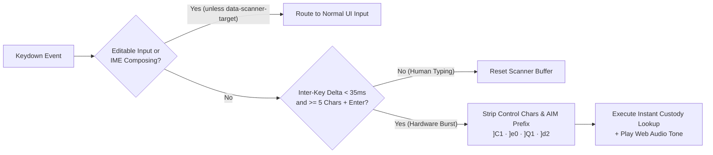

# High-Velocity Retail Floor & Asset Operations PWAs

High-volume retail floors break desktop-shaped software immediately. Supervisors carry phones while walking busy aisles; handheld ruggedized barcode terminals get grabbed during rush shifts and dropped onto charging cradles at close; Wi-Fi drops in concrete stockrooms.

We engineered two complementary Progressive Web Apps (PWAs) designed specifically for **sub-second physical workflows** and **zero-clobber multi-device state**:

1. **Phone-First Hardware Custody & Asset Manager PWA:** Tracks shared enterprise handheld scanners, charging cradles, lockup key rings, and mobile floor hardware with single-handed checkout/audit flows.
2. **Multi-Device Floor Execution & Coaching Planner PWA:** Synchronizes multi-week shift schedules, dirty spreadsheet KPI imports, and structured 70/20/10 coaching cards across phones, tablets, and manager workstations.

---

## Core Engineering Patterns

### 1. Single-Handed Thumb-Zone Phone Ergonomics
The Asset Manager PWA is strictly constrained to mobile phone viewport physics rather than stretched desktop grids:
- **Dynamic Viewport & Safe-Area Geometry:** Anchored to `100dvh` so iOS Safari address bars never trap primary scan buttons off-screen, with `>= 44×44px` touch targets sized for fast walking taps or warehouse gloves.
- **Container-Query Charging Racks (`@container`):** Equipment charging cradle displays adapt cleanly to card container width rather than brittle screen breakpoints.
- **Cold-Start URL Taps:** NFC tags or QR stickers positioned on lockup cages open directly into pre-focused checkout/return routes without forcing multi-screen navigation.

### 2. `<35ms` Hardware Barcode & RFID Wedge Capture
Enterprise handhelds and USB/Bluetooth scanners emulate rapid keyboard input ("keyboard wedges"). Naive `onChange` or global `keydown` handlers collide constantly with search inputs, shortcuts, and IME composition.

Our wedge engine separates hardware bursts from human typing cleanly:
- **Burst Timing Filter:** Buffers printable keystrokes only when inter-key intervals stay under `35ms` and terminate with `Enter` (`>= 5` characters). Human typing resets the buffer harmlessly.
- **ISO/IEC 15424 AIM Prefix Normalization:** Strips STX/ETX control bytes, enclosing delimiters, and scanner symbology headers (`]C1`, `]e0`, `]Q1`, `]d2`) before normalizing asset IDs.
- **Multi-Modal Fallback:** Pairs hardware wedge input with Web NFC (`NDEFReader`) tag scanning and live camera stream barcode capture with guaranteed `MediaStream` track cleanup on teardown.

### 3. Zero-Dependency Web Audio with iOS WebKit Recovery
Busy floors rarely look at a screen during rapid batch scans—operators rely on instant distinct audio confirmation and error tones. Fetching `.mp3` files fails in flaky stockroom Wi-Fi and triggers CORS/cache headaches.

Instead, a singleton `AudioContext` synthesizer generates crisp tonal envelopes on demand while defending against real mobile browser traps:
- **First-Gesture Auto-Unlock:** Attaches passive capture listeners (`touchstart`, `touchend`, `click`, `keydown`) to resume suspended contexts the moment a user interacts with the app.
- **iOS WebKit `'interrupted'` State & Lock-Screen Wake Recovery:** Listens to `document.visibilitychange` so returning from a locked phone or phone call immediately resumes `'interrupted'` audio pipelines instead of going silent mid-shift.
- **Leak-Free Graph Cleanup:** Every oscillator and gain node disconnects deterministically inside `onended`.

### 4. Fault-Tolerant Spreadsheet ETL & Zero-Clobber Sync
Floor planners and rosters routinely arrive as inconsistent multi-week CSV/ODS exports. Our ingestion layer normalizes ambiguous name formats (`"Last, First"` vs. `"First Last"`), cleans timestamps, and validates rows in preview before writing to Cloud Firestore.

On shared state documents, every write executes inside an atomic `runTransaction` read-merge-write routine that unions rosters/devices and resolves per-asset checkout/check-in conflicts by comparing item-level timestamps—while keeping document payloads safely under Firestore's `1 MiB` ceiling via a `750 KB` automated log-pruning guard.

*Deep dive:* [Zero-Clobber Real-Time Synchronization](../03_Architecture-Deep-Dives/Zero-Clobber-Realtime-Sync.md)
