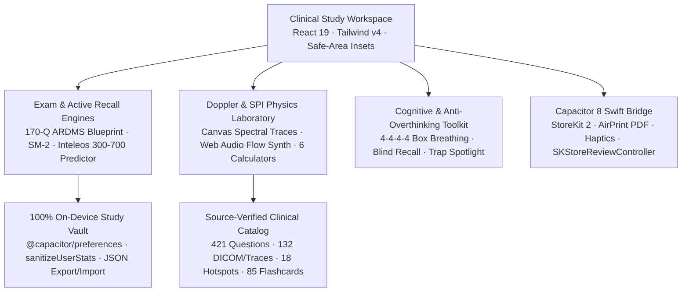

# SonoPrep Pro (iOS) — Vascular Sonography Exam Prep

**SonoPrep Pro** is a standalone commercial iOS application (`com.hathcocklabs.sonoprep`) engineered for vascular sonographers and diagnostic ultrasound candidates preparing for the **ARDMS Registered Vascular Technologist (RVT / VT)** and **Sonography Principles & Instrumentation (SPI)** board examinations.

Medical exam prep software breaks trust when it treats clinical hemodynamics as generic trivia—or worse, lets runtime generative AI invent stenosis thresholds or invert Doppler physics equations. SonoPrep anchors every interaction on **zero-hallucination clinical verification**, **100% local privacy**, **real-time hemodynamic simulation**, and **native iOS StoreKit/AirPrint ergonomics**.

> [!NOTE]
> **100% On-Device Study Vault:** SonoPrep requires zero forced cloud accounts, zero logins, and zero remote tracking databases. Spaced-repetition intervals, mock exam telemetry, and custom flashcards stay strictly on-device with sanitized JSON backup portability.

---

## System Architecture



---

## 1. Audited Clinical Catalog & ARDMS Blueprint Accuracy

Every question, anatomical hotspot, and diagnostic velocity matrix undergoes offline `Echo` clinical verification (`pro [MANDATORY]` lock) against primary peer-reviewed standards prior to entering release builds:

### Primary Clinical Authorities
- **SRU Carotid Consensus** (*Radiology* 2003; 229:340–346)
- **IAC Vascular Testing Standards** (2024 Accreditation Criteria)
- **SVU Lower Extremity Venous Guidelines**
- **Kremkau Sonography Principles & Instrumentation** (10th Ed.)

### Catalog Partition & Unbiased Exam Blueprint
| Exam Domain | Audited Pool (`421` Total) | `170`-Question Mock Blueprint Draw | Core Diagnostic Scope |
| :--- | :---: | :---: | :--- |
| **Cerebrovascular** | `100` | `48` | ICA/CCA ratios, SRU stenosis grading, subclavian steal, TCD Circle of Willis |
| **Peripheral Arterial** | `98` | `44` | ABI/TBI ratios, segmental pressures, bypass graft surveillance, pseudoaneurysms |
| **Peripheral Venous** | `83` | `42` | DVT compressibility, augmentation, valvular reflux cutoffs (`>0.5s`/`>1.0s`/`>0.35s`) |
| **Abdominal & Visceral** | `70` | `24` | Celiac/SMA mesenteric ischemia, renal artery stenosis (`RAR`), TIPS, portal hypertension |
| **Physics & QA Statistics** | `70` | `12` | Doppler shift equation, `13 µs/cm` range equation, aliasing, axial resolution, 2×2 QA |

Every full 3-hour timed mock draws **170 strictly unique questions** via unbiased Fisher-Yates shuffling (`0` repeat IDs per sitting) and projects scores onto the **Inteleos `300–700` psychometric scale** anchored on the **`555` passing threshold**. Visual study assets add **`132` DICOM ultrasound & spectral Doppler SVGs**, **`18` anatomical hotspot drills**, **`85` SuperMemo SM-2 flashcards**, and **`8` high-yield cheat sheets**.

---

## 2. Real-Time Doppler Hemodynamics & Physics Laboratory

Sonographers diagnose vascular disease by pairing spectral waveform morphology with Doppler audio pitch. Rather than displaying static textbook charts, SonoPrep renders and synthesizes live physics:

### Canvas Spectral Animator & Web Audio Flow Synthesizer
- **Interactive Waveform Renderer:** Animates real-time velocity envelopes on HTML5 Canvas for triphasic high-resistance peripheral arteries, low-resistance monophasic internal carotid/renal beds, *tardus-parvus* post-stenotic waveforms, high-velocity turbulent aliasing jets, subclavian pre-steal ("bunny-ear" mid-systolic cleft), pseudoaneurysm "to-and-fro" neck flow, and phasic venous flow.
- **Doppler Ear-Training Synthesizer:** Produces authentic Web Audio acoustic whooshes, harsh systolic bruits, and snapping triphasic pulses to power *"Listen & Look — Name the Vessel and Pathology"* drills.

### Six Live Diagnostic & SPI Equations Implemented

| Tool / Calculator | Governing Equations & Thresholds Verified | Interactive Teaching Outcome |
| :--- | :--- | :--- |
| **1. SRU Carotid Stager** | Dynamic ICA PSV, CCA PSV & EDV sliders (`<125`, `125–230`, `>230 cm/s`, `ICA/CCA` `<2.0` / `2.0–4.0` / `>4.0`) | Visualizes exact diagnostic jumps between `<50%`, `50–69%`, `>=70%`, near-occlusion, and total occlusion. |
| **2. ABI Staging & Calcification** | $\text{ABI} = \frac{\text{Highest Ankle SBP}}{\text{Highest Brachial SBP}}$ | Flags normal (`0.91–1.30`), PAD (`<=0.90`), rest pain/ulcer (`<0.50`), and non-compressible vessels (`>1.30–1.40`). |
| **3. Venous Reflux Matrix** | Superficial `>0.5s`, Deep `>1.0s`, Perforator `>0.35s` | Eliminates reversed/misremembered valve closure cutoffs across extremity veins. |
| **4. Visceral & Renal Matrix** | Fasting Celiac PSV `>=200 cm/s`, SMA PSV `>=275 cm/s`, Renal RAR `>3.5` | Clarifies fasting vs. postprandial mesenteric velocity changes and renal hypertension cutoffs. |
| **5. Doppler & Nyquist Physics** | $\Delta f = \frac{2 f_0 v \cos\theta}{c}$, $13\,\mu\text{s/cm}$, $\text{PRF} = \frac{c}{2d}$, $\text{Nyquist} = \frac{\text{PRF}}{2}$ | Demonstrates catastrophic velocity error above `60°` (`90°` blind angle) plus a 5-step aliasing remedy checklist. |
| **6. 2×2 Contingency QA** | Sensitivity, Specificity, PPV, NPV, Accuracy from `TP/FP/FN/TN` | Turns abstract SPI quality-assurance formulas into live interactive sensitivity checks. |

---

## 3. Cognitive Ergonomics & Anti-Anxiety Tooling

Technical mastery often collapses during 3-hour board sittings due to panic, anchor bias on wrong choices, and compulsive second-guessing:
- **2-Minute Physiological Box Breathing:** Integrated `4s` inhale / `4s` hold / `4s` exhale / `4s` rest pacer directly accessible during exams to blunt sympathetic adrenaline spikes.
- **Blind Recall & Trap-Word Spotlight:** Conceals multiple-choice options until the student recalls the rule independently, and highlights negative/absolute board traps (`NOT`, `EXCEPT`, `LEAST`, `ALWAYS`, `NEVER`, `FALSE`).
- **Zen Mode Clock & Second-Guessing Audit:** Lets anxious test-takers hide ticking timers while still tracking time, and records changed answers empirically to prove when first instincts outperform overthinking.
- **SuperMemo SM-2 & Weakness Rehab:** Schedules reviews (`Again`, `Hard`, `Good`, `Easy`) with non-finite interval guards and routes every missed question into an auto-draining Weakness Rehab queue:

```typescript
export function scheduleNextSm2(card: Sm2State, quality: 0 | 1 | 2 | 3): Sm2State {
  const safeEase = Number.isFinite(card.easeFactor) ? Math.max(1.3, card.easeFactor) : 2.5;
  if (quality === 0) {
    return { intervalDays: 1, repetitions: 0, easeFactor: Math.max(1.3, safeEase - 0.2) };
  }
  const reps = card.repetitions + 1;
  const intervalDays =
    reps === 1 ? 1 : reps === 2 ? 6 : Math.min(365, Math.round(card.intervalDays * safeEase));
  const delta = quality === 3 ? 0.15 : quality === 2 ? 0.0 : -0.14;
  return {
    intervalDays,
    repetitions: reps,
    easeFactor: Math.min(3.2, Math.max(1.3, Number((safeEase + delta).toFixed(2)))),
  };
}
```

### Inteleos Psychometric Calibration & Unbiased Exam Draw
- **Zero Duplicate Items per Mock Sitting:** Draws exactly `170` unique IDs scaled proportionally to live ARDMS RVT blueprint weights (`48` Cerebrovascular, `44` Arterial, `42` Venous, `24` Abdominal/Visceral, `12` Physics/QA) via Fisher-Yates shuffling so long study streaks never suffer skewed domain coverage.
- **Scale Score Projection (`300–700`):** Maps raw blueprint-weighted domain mastery continuously onto Inteleos's scaled passing curve (`555` cutoff), giving candidates honest readiness visibility weeks ahead of test day rather than naive percent-correct illusions.

---

## 4. Native iOS Capacitor Bridge, Privacy & Bundle Discipline

Built with React 19, TypeScript, Vite 8, Tailwind CSS v4, and Capacitor 8 inside a native Swift Package Manager Xcode workspace (`ios/App/App.xcodeproj`):

- **Custom Swift StoreKit 2 & AirPrint Plugin:** Bridges `Product.products`, `product.purchase`, `Transaction.currentEntitlements`, `Transaction.updates`, `AppStore.sync` (Restore Purchases), `SKStoreReviewController`, and **`UIPrintInteractionController`** (allowing students to AirPrint or export PDF clinical cheat sheets directly to iOS Files).
- **Schema-Sanitized On-Device Vault:** Persists study progress exclusively via `@capacitor/preferences` and local storage with portable JSON export/import protected against corrupted, `NaN`, or oversized imported payloads by `sanitizeUserStats`:

```typescript
export function sanitizeUserStats(raw: unknown): UserStats {
  const input = (typeof raw === "object" && raw !== null ? raw : {}) as Record<string, unknown>;
  const clampFinite = (val: unknown, min: number, max: number, fallback: number): number => {
    const n = Number(val);
    return Number.isFinite(n) ? Math.min(max, Math.max(min, n)) : fallback;
  };

  return {
    totalAnswered: clampFinite(input.totalAnswered, 0, 500_000, 0),
    correctCount: clampFinite(input.correctCount, 0, 500_000, 0),
    studyStreakDays: clampFinite(input.studyStreakDays, 0, 10_000, 0),
    sm2Intervals: sanitizeSm2Record(input.sm2Intervals),      // Rejects NaN / <=0 ease factors
    missedQuestionIds: sanitizeBoundedStringSet(input.missedQuestionIds, 2_000),
    examHistory: sanitizeBoundedHistory(input.examHistory, 250),
  };
}
```

- **Rollup `manualChunks` Discipline (`<500 KB` Enforced):** Isolates multi-hundred-line question catalogs, SVG anatomical atlases, Capacitor plugins, icon libraries, and confetti modules cleanly inside `vite.config.ts` so every iOS WKWebView chunk loads rapidly off local flash storage:

```typescript
build: {
  rollupOptions: {
    output: {
      manualChunks: {
        "vendor-react": ["react", "react-dom"],
        "vendor-capacitor": ["@capacitor/core", "@capacitor/preferences", "@capacitor/haptics"],
        "vendor-icons": ["lucide-react"],
        "data-questions": ["./src/data/questions.ts"],
        "data-clinical": ["./src/data/clinicalAssets.ts", "./src/data/cheatSheets.ts"],
      },
    },
  },
}
```

### App Store Review & Clinical Engineering Verification
- **Strict Isolation Boundary:** Zero analytics SDKs, zero cloud authentication logins, `PrivacyInfo.xcprivacy` declared accurately (`CA92.1` UserDefaults API reasoning), explicit **FDA `21 CFR 801` educational-only disclaimers**, and primary vascular citation drawers accessible from every study sheet.
- **Clinical & UI Test Gates:** **`34/34` passing unit & App Store compliance specs** (covering Fisher-Yates unbiased 170-Q blueprint uniqueness, Inteleos `300–700` curve calibration, SM-2 ease bounds, and `sanitizeUserStats` corruption immunity), **`15/15` headless Playwright E2E workflows** (`Free` and `Pro` states, `0` console errors), `0` `oxlint` warnings across `74` source files, and clean native Release archive builds (`xcodebuild`).
- **Clinical Ergonomics & Cross-References:** [Adversarial Verification & Offline Clinical Guarantees](../02_AI-Systems-Architecture/04-Adversarial-Verification-and-Fact-Locked-AI.md) · [Anti-Slop UI Engineering (Clinical Calm Palette)](../03_Architecture-Deep-Dives/Anti-Slop-UI-Engineering.md)

### Spectral Canvas Physics & Offline Diagnostic Continuity
Inside interactive Doppler drills, spectral envelope generators modulate peak systolic velocity, end-diastolic persistence, spectral window broadening, and retrograde diastolic notches cleanly at `60 fps` on Canvas—paired directly with formant-filtered Web Audio noise bursts so medical students connect **both** visual aliasing wraps and audible systolic bruits without streaming large remote media files over hospital Wi-Fi dead zones.

- **Real-Time Acoustic & Waveform Drills:** Switches instantaneously between normal high-resistance triphasic limb arteries, low-resistance internal carotid traces, blunted *tardus-parvus* distal stenoses, and classic "to-and-fro" pseudoaneurysm necks using zero network fetches.
- **Strict Read-Only Clinical Verification:** Every stenosis cutoff and Doppler question passes independent `Echo` checks directly against published **SRU Carotid Consensus**, **IAC Vascular Standards**, **SVU Venous Guidelines**, and **Kremkau Physics** before entering release builds.
