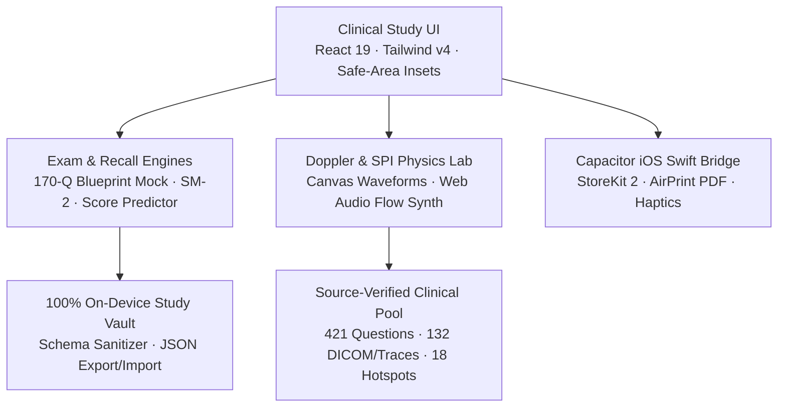

# SonoPrep Pro (iOS) — Vascular Sonography Exam Prep

**SonoPrep Pro** is a commercial iOS examination preparation platform engineered for vascular sonographers preparing for the **ARDMS Registered Vascular Technologist (RVT)** and **Sonography Principles & Instrumentation (SPI)** board examinations.

Medical study tools cannot afford "close enough" answers. A single hallucinated velocity threshold or inverted Doppler angle equation teaches a clinician the wrong diagnostic standard. SonoPrep combines a zero-cloud local storage architecture with source-verified clinical content, interactive acoustic simulations, and evidence-backed test-anxiety tooling.

---

## Architecture Highlights

---

## Core Engineering & Clinical Capabilities

### 1. 100% Local On-Device Study Vault
SonoPrep is architected so every candidate's study history, missed-question rehab queue, SuperMemo SM-2 review intervals, and custom flashcards stay **100% on-device** with zero forced account sign-ups or external database dependencies:
- **Schema-Sanitized Portability:** Students can export and restore complete study progress via JSON snapshots guarded by a deep payload sanitizer (`sanitizeUserStats`) that rejects malformed types or non-finite timestamps.
- **Privacy by Architecture:** Includes an explicit privacy manifest (`PrivacyInfo.xcprivacy`), clear FDA `21 CFR 801` educational study-aid disclaimers, and zero cross-user data leakage.

### 2. Source-Verified Clinical & Physics Content
Every question, diagnostic matrix, and rationale is audited against primary clinical and physics authorities—never generated blindly at runtime:
- **Clinical Pool Integrity:** `421` verified questions (`301` RVT + `120` SPI) partitioned across Cerebrovascular (`100`), Peripheral Arterial (`98`), Peripheral Venous (`83`), Abdominal & Visceral (`70`), and Physics & QA (`70`), backed by `132` DICOM ultrasound scans and spectral Doppler trace SVGs, `18` interactive anatomical hotspots, `85` SM-2 flashcards, and `8` high-yield velocity cheat sheets.
- **Authoritative Citations:** Cross-verified against the **SRU Carotid Consensus** (*Radiology* 2003), **IAC Vascular Testing Standards**, **SVU Lower Extremity Venous Guidelines**, and **Kremkau Sonography Physics**.
- **Unbiased Mock Simulation:** Uses Fisher-Yates randomization weighted strictly to the ARDMS 170-question blueprint with zero duplicate questions per sitting, paired with a `300–700` scaled score predictor anchored on the `555` passing threshold.

### 3. Real-Time Doppler Hemodynamics & SPI Physics Lab
Rather than static textbook diagrams, SonoPrep renders hemodynamic signatures visually and acoustically in real time:
- **Canvas Spectral Envelope Animator & Web Audio Flow Synthesizer:** Demonstrates triphasic high-resistance peripheral arterial flow, monophasic *tardus-parvus* post-stenotic waveforms, high-velocity stenotic jet turbulence, subclavian pre-steal ("bunny-ear") patterns, pseudoaneurysm to-and-fro neck jets, and respiratory venous phasicity.
- **Interactive Diagnostic Calculators:**
  - **SRU Carotid Stenosis Stager:** Live ICA PSV, CCA PSV, and EDV sliders mapping to stenosis grading.
  - **ABI & Venous Reflux Matrices:** Ankle-Brachial Index staging (with medial calcification alerts) and superficial/deep/perforator reflux cutoffs (`>0.5s`, `>1.0s`, `>0.35s`).
  - **Visceral Criteria & 2×2 QA Contingency:** Fasting Celiac (`>= 200 cm/s`), SMA (`>= 275 cm/s`), Renal RAR (`> 3.5`), plus Sensitivity, Specificity, PPV, NPV, and Accuracy calculators.
  - **Doppler & Aliasing Simulators:** Interactive Doppler equation (`cos θ` error explosion past `60°`) and `13 µs/cm` range-ambiguity / Nyquist aliasing controls.

### 4. Test-Taking Anxiety & Cognitive Retention Tooling
Board exams fail prepared candidates through panic, rushed reading, and second-guessing:
- **2-Minute Physiological Box Breathing:** Guided `4s` inhale / `4s` hold / `4s` exhale / `4s` rest visualizer built directly into the exam bar.
- **Blind Recall & Trap-Word Spotlight:** Conceals answer choices until the student formulates the diagnosis mentally, and highlights board trap qualifiers (`NOT`, `EXCEPT`, `LEAST`, `ALWAYS`, `NEVER`, `FALSE`).
- **Second-Guessing Audit:** Tracks answer revisions so candidates see empirical proof of whether changing initial instincts helps or hurts their score.

### 5. Native iOS Capacitor Packaging
Built with React 19, TypeScript, Vite 8, Tailwind CSS v4, and Capacitor 8 inside a native Xcode workspace:
- **Native StoreKit 2 & AirPrint Swift Bridge:** Custom Swift plugin bridging `Product.products`, `Transaction.currentEntitlements`, `Transaction.updates`, `AppStore.sync` (Restore Purchases), `SKStoreReviewController`, and `UIPrintInteractionController` so cheat sheets print cleanly or export straight to iOS Files as PDFs.
- **Viewport & Bundle Discipline:** Enforces `viewport-fit=cover` Dynamic Island / Home Indicator safe-area insets and deterministic Rollup `manualChunks` keeping all bundles well below the `500 KB` threshold with zero build warnings.
