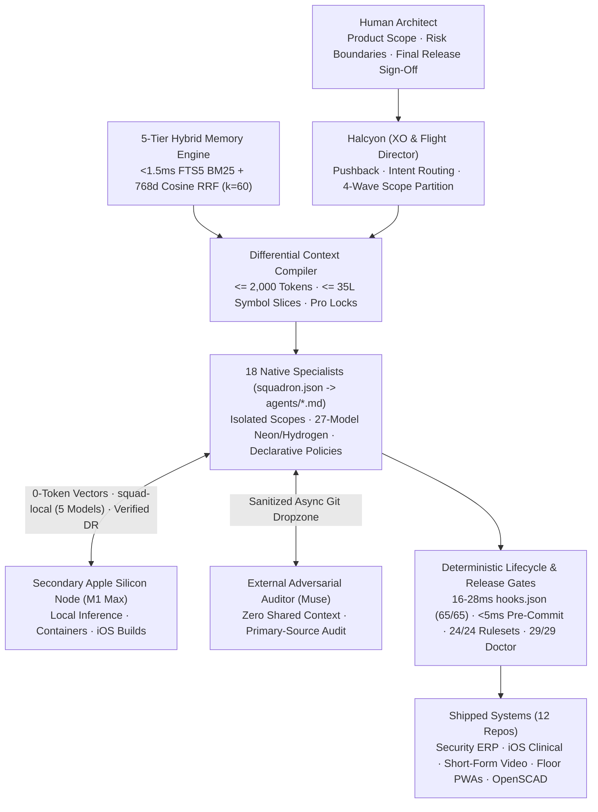
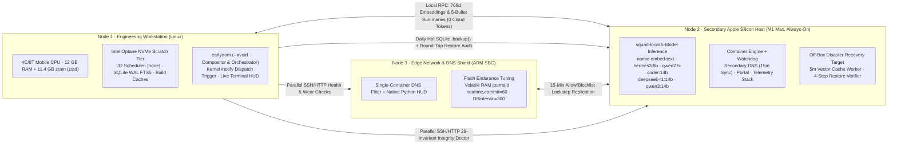
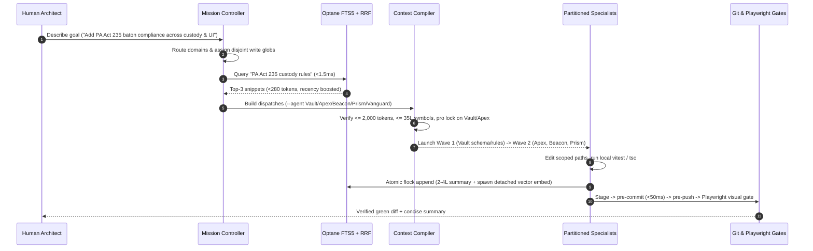

# 00 · Cognitive Architecture Overview

Software engineered for regulated security operations, clinical board examinations, programmatic media rendering, and physical floor hardware collapses quickly under naive AI-assisted workflows. When a developer opens a single generalist chat session and asks a large language model to architect, implement, style, test, and deploy a multi-package product inside one continuously growing conversation window, four failure modes reliably emerge:

1. **Context Pollution & Lost-in-the-Middle Decay:** Stuffing entire source files, compiler traces, and exploratory searches into one `100k+`-token thread dilutes attention over early architectural invariants. By turn 15, the model forgets tenant isolation rules it helped establish at turn 3 and introduces permissive database fallbacks just to silence an error.
2. **Domain Unawareness & Subtle Hallucinations:** A generalist prompt juggling CSS grid spacing, Firebase SDK initialization, and React hooks will casually guess domain truths when pressed—misquoting a 48-hour police use-of-force reporting deadline, inverting a Doppler ultrasound angle equation above `60°`, or inventing a nonexistent Safari dialog attribute.
3. **Homogenized "AI-Slop" Visual Clones:** Left unguided, frontier models converge on the exact same visual template regardless of industry: dark `#07090e` backgrounds, neon cyan borders, four identical-height KPI stat boxes bolted across the top of every screen, decorative placeholder badges, and custom `<div class="modal-overlay">` popups that shatter keyboard focus traps and iOS viewport scrolling.
4. **Contextual Monoculture & Confirmation Bias:** Asking the same conversation context that generated an architectural claim or library choice to "audit itself" produces polite rationalization rather than genuine falsification. Without an isolated external verifier, stale library assumptions and vendor marketing fluff propagate straight into production code.

At **Hathcock Labs**, we treat AI-assisted software engineering as a **governed distributed systems discipline**, not conversational prompting. At the orchestration apex sits **`Halcyon` (Executive Officer / XO & Flight Director)**—never a yes-man, allergic to empty praise, and engineered to push back directly on flawed trade-offs—coordinating **18 narrow domain specialists** alongside independent external auditor **`Muse`**. Work executes across a **3-node heterogeneous compute topology** backed by a **5-tier sub-millisecond memory engine**, strict **`<= 2,000`-token** differential dispatches, a **4-Wave Hardware-Aware OOM-Safe Execution Doctrine**, zero-bypass GitHub Pro Rulesets, and deterministic browser/typecheck gates.

---

## System Architecture at a Glance



---

## Monolithic Chat vs. Governed 18-Specialist Stack

| Dimension | Naive Monolithic AI Coding | Hathcock Labs Governed Cognitive Stack |
| :--- | :--- | :--- |
| **Orchestration & Registry** | Unstructured single-chat prompt + duplicated ad-hoc agent definitions | **`Halcyon` (XO)** + single-source **`squadron.json`** (`fleet sync-roster` → `18` native `agents/*.md` with declarative `commandExecutionPolicy: off` & `skills: []`, zero 4-way drift) |
| **Context Window & Rule Diet** | Full raw files + bloated `>40 KB` global rules truncating on boot | Global rules deduplicated **`40.7 KB` → `20.4 KB`** (`<24 KB` cap; `<22 KB` doctor guard) + **`<= 2,000`-token** differential prompt with `<1.5 KB` `REPO_MAP.md` & `<= 35`-line slices |
| **Institutional Memory** | Re-reads giant Markdown logs every session or forgets past bugs | Sub-`1.5 ms` SQLite **FTS5 BM25 + 14-day recency** fused via **RRF (`k = 60`)** with local `768d` vectors (**`1,015/1,015` embedded sections**) |
| **Safety-Critical Reasoning** | Same model/tier used for CSS tweaks and clinical/security checks | Runtime tier locks (`inherit` → **Gemini 4 Neon High**; `pro` → **Hydrogen `tiered-xhigh`**) enforced by `PreToolUse` `hooks.json` tier floors + `/swarm` pinning (`gemini-4-neon-xhigh` & Pool 2 gates) |
| **Verification Discipline** | Agent inspects its own reasoning inside the same biased context | **`16–28 ms` `hooks.json`** (`65/65` tests: project isolation, write-time Air-Gap, anti-dump) + **`Scout` ↔ `Muse`** auditor + **`24/24` Pro Rulesets** + Playwright gate |
| **Concurrency & Collisions** | Multiple edits overwrite shared files or thrash 12 GB laptop RAM | Auto-hydrated Optane `fleet wt` worktrees (`functions/node_modules`, `packages/*/dist`) + **4-Wave** `PreToolUse`/`PostToolUse` `fcntl.flock` heavy-build lock (`15m` TTL) + `8`-slot blackboard |
| **Token & Hardware Cost** | Burns frontier quota on summarization, linting, and blind searches | **27-model** Pool 1/Pool 2 routing (`Gemini 4 Neon` + `Orchestrator Neon` + `Hydrogen`, `0.35x` `Gemini 4 Low`, `0.20x` `3.8-flash`) + calibrated `32.5M`/`325M` live `/usage` lock (`Cld:XX%/XdXXh`) |

---

## Real Failure Postmortems That Shaped This Architecture

Every structural constraint in our AI stack exists because an earlier shortcut broke under real engineering pressure:

### Postmortem 1 · The Dark-Slate 4-KPI-Box Clone Regression
- **What Broke:** Early security command-center iterations defaulted to dark `#07090e` backgrounds topped by four uniform KPI stat boxes—fatiguing dispatchers reading dense staffing tables under office lighting and cloning generic AI templates.
- **Root Cause:** No domain-specific visual archetype or automated DOM layout verification existed.
- **Permanent Fix:** Standardized the **Daylight Enterprise Operations** visual system (`#F6F6F3` warm-stone canvas, `248px` left rail, `Newsreader` serif legal/invoice sheets), deleted the generic `StatCard` wrapper component completely, and wired `squad-visual-gate` into headless Playwright to verify DOM overflow and WCAG luminance across `1440×900` and `375×812`.

### Postmortem 2 · `pnpm` v11 Build-Script Halts Under Multi-Agent Fan-Out
- **What Broke:** Dispatching multiple specialists concurrently into a fresh workspace monorepo triggered `ERR_PNPM_IGNORED_BUILDS` on transitive post-install hooks (`@firebase/util`, `protobufjs`), stalling concurrent waves mid-sprint.
- **Root Cause:** Agents attempted independent installs concurrently without pre-approving workspace build scripts.
- **Permanent Fix:** Pre-populated `allowBuilds` explicitly in `pnpm-workspace.yaml` and standardized centralized dependency setup from Optane package caches *before* parallel specialist fan-out.

### Postmortem 3 · Cloud Firestore Provisioning Propagation Race
- **What Broke:** Creating a fresh Firebase project and immediately provisioning the regional `(default)` database hit HTTP `403` errors because `firestore.googleapis.com` had not finished propagating.
- **Permanent Fix:** Captured the deterministic two-step bootstrap sequence inside deployment runbooks and Tier 4 institutional memory: deploy Firestore rules first to trigger automatic API enablement, wait ~20 seconds for propagation, then initialize the `(default)` database and composite indexes.

### Postmortem 4 · Cold-Start Mobile NFC Tap Overwriting Peer Edits
- **What Broke:** Waking an idle phone straight into an NFC tag checkout route (`/?tap=<barcode>`) submitted partial local state before hydrating full cloud truth, silently reverting checkouts saved seconds earlier on a peer device.
- **Permanent Fix:** Standardized atomic Firestore `runTransaction` read-merge-write handlers (`mergeStoreState` / `mergeCollectionById`) resolving per-item conflicts by independent checkout, check-in, and rename timestamps—locked behind mandatory `pro` model guardrails on `Nexus` and `Vault`.

---

## Five Foundational Engineering Pillars

1. **Explicit Role Boundaries & Inter-Agent Seams:** Specialists never blur conflicting responsibilities. On mobile PWAs, **`Prism`** owns visual palettes (`OKLCH`), typography, and layout hierarchy, while **`Forge`** owns `100dvh` viewport physics, iOS safe-area insets, PWA precaching, and Rollup `manualChunks` (`<500 KB`). Likewise, **`Echo`** holds read-only permissions strictly to verify clinical accuracy, while **`Aegis`** refactors application code.
2. **Sub-Millisecond Local Memory Over Raw Stuffing:** Compact structural `REPO_MAP.md` files (`<1.5 KB`) pair with Optane-backed SQLite FTS5 + `768d` hybrid RRF search, delivering `<300` grounded tokens in `<1.5 ms` instead of dumping 50,000-token log archives.
3. **Mechanical Guardrails Over Polite Prompt Reminders:** Token limits (`<=2,000`), raw code dump bans (`>80` lines), secret regex sweeps, `tsc --noEmit`, `vitest`, and Playwright DOM/WCAG verification execute deterministically in Python/Bash/Node outside the model's discretion.
4. **Adversarial Verification & Fact-Locked Runtime AI:** Research claims cross an asynchronous Git dropzone to an external compute node (`Muse`) sharing zero prompt history; runtime AI inside regulated apps runs at `temperature: 0.0` with strict `responseSchema` validation and immutable raw human testimony (`rawOfficerTranscript`).
5. **Right-Sized Heterogeneous Silicon:** Workstations optimize for fast local editing and I/O; an always-on Apple Silicon node absorbs `768d` embeddings, local summarization, and DR verification at zero cloud token cost; an ARM edge node shields network DNS sustainably.

---

## Three-Node Heterogeneous Compute & Cognitive Topology



### Node 1 · Primary Engineering Workstation (Linux)
Running concurrent multi-package TypeScript builds, headless Chromium tests, and subagent orchestration on a `12 GB` RAM mobile laptop requires deliberate kernel and storage tuning:

```ini
# /etc/sysctl.d/99-workstation-tuning.conf — Keep directory trees & inodes hot in RAM
vm.vfs_cache_pressure=50
```

```udev
# /etc/udev/rules.d/60-io-scheduler.rules — Direct multi-queue NVMe/Optane dispatch
ACTION=="add|change", KERNEL=="nvme[0-9]*n[0-9]*", ATTR{queue/scheduler}="none"
```

- **Dedicated Intel Optane NVMe Scratch Tier:** Houses SQLite WAL knowledge (`memory.db`), C/C++ `ccache`, Rust `CARGO_TARGET_DIR`, and `pnpm`/`npm`/`uv` package stores—delivering sub-millisecond random I/O while protecting primary SSD write endurance.
- **`11.4 GB` `zstd`-Compressed `zram` + `earlyoom` Guard:** Absorbs parallel build spikes while `earlyoom` runs continuously with `--avoid` protection on the Wayland compositor and active AI orchestrator—killing runaway build subprocesses before desktop freezes occur. Background bloat daemons (`cups`, `ModemManager`, `avahi-daemon`) remain pruned, while systemd `inotify` path triggers idle at `0 MB` RAM until mobile captures arrive.

### Node 2 · Always-On Apple Silicon Inference & Replication Node
A unified-memory Apple Silicon **M1 Max (`32 GB`)** host handles 24/7 continuous services without draining laptop battery or cloud quotas:
- **Zero-Cloud-Token 5-Model Inference (`squad-local`):** Serves `nomic-embed-text` (`768d` vectors), `hermes3:8b` (`01_Dispatch/` JSON triage + `5-bullet` digests), `qwen2.5-coder:14b` (code/regex/SQL reviews), `deepseek-r1:14b` (step-by-step reasoning checks), and `qwen3:14b` (general local Q&A) over LAN HTTP RPC at zero cloud API cost.
- **Autonomous Container & Vector Daemons:** Runs secondary DNS failover synchronized every `15 minutes` (`nebula-sync`), vehicle telemetry bridges, and a LAN research review portal, watched by a `launchd` container watchdog alongside a `300s` background vector cache worker.
- **Verified Off-Box Disaster Recovery:** Receives daily hot snapshots and passes a **4-step round-trip SQLite restore proof** before stamping `VERIFIED_OK`.

### Node 3 · Dedicated Edge Network & DNS Shield (ARM SBC)
An `8 GB` ARM single-board computer enforces network-wide DNS filtering sustainably on flash media:
- **Strict Single-Container Isolation:** Runs only the core DNS container (`pihole` v6) plus a native systemd Python telemetry HUD translating tracker domains (`crashlytics`, `app-measurement`) into plain English while filtering RFC 9462 DDR chatter (`_dns.resolver.arpa`).
- **Flash-Wear Mitigation:** Configures volatile RAM logging (`Storage=volatile`, `RuntimeMaxUse=32M`), mounts `/` with `noatime,commit=60`, and batches FTL SQLite disk flushes (`DBinterval = 300s`).

```ini
# /etc/systemd/journald.conf.d/volatile.conf — Zero SD/eMMC journal writes
[Journal]
Storage=volatile
RuntimeMaxUse=32M
```

```ini
# /etc/default/earlyoom (Node 1) — Protect interactive compositor & AI orchestrator
EARLYOOM_ARGS="-r 60 -m 5 -s 10 --avoid '(^|/)(cosmic-comp|waybar|zellij|node|python3)$'"
```

Together, the three nodes obey a strict **compute placement invariant**: latency-sensitive file indexing and interactive UI builds stay directly on Workstation NVMe/Optane; heavy batch embeddings, container workloads, and disaster recovery verification run unattended on the always-on Apple Silicon node; and perimeter DNS filtering runs isolated on low-wattage ARM hardware so workstation reboots never drop household/lab name resolution.

---

## Architectural Trade-offs & Rejected Alternatives

Every piece of custom infrastructure in this stack exists because an off-the-shelf alternative introduced unacceptable latency, nondeterminism, or failure modes under daily workload pressure:

### 1. Why Deterministic CLI Tools Instead of Graph Agent Frameworks (LangGraph / CrewAI / AutoGen)?
Heavy Python orchestration frameworks serialize agent prompts, intermediate reflection loops, and graph state inside opaque framework abstractions. On latency-sensitive engineering tasks:
- **Graph framework overhead:** Every node transition adds Python serialization overhead and nudges teams toward passing growing state dictionaries from node to node.
- **Our choice:** Native Python CLIs (`squad-memory`, `squad-context`, `squad-doctor`) paired with OS-level primitives (`fcntl.flock`, SQLite WAL, `systemd` path units, and `git` hooks). Every state transition produces human-readable plain files or SQLite rows that can be inspected, `grep`'d, benchmarked, and debugged with standard Linux tools (`sqlite3`, `flock`, `journalctl`).

### 2. Why Hybrid BM25 + RRF Over Pure Vector Embeddings?
Semantic vector search alone is notoriously weak on **exact code identifiers**. Searching `"MD SB 760"`, `"ERR_PNPM_IGNORED_BUILDS"`, `"calculateClientInvoiceFromShifts"`, or `"< 0.15G"` in a pure vector index often ranks topically related paragraphs ahead of the exact rule or symbol definition. Conversely, pure lexical BM25 misses conceptual queries (`"prevent cold mobile startup overwriting peer edits"`).
- **Our choice:** Fusing SQLite FTS5 BM25 lexical ranking (`5:2:1` weighted across title, tags, and body) with local `768d` cosine similarity via **Reciprocal Rank Fusion (`k = 60`)**. Exact error codes snap immediately to rank #1 via BM25, while conceptual design questions surface cleanly via vectors—without sending a single private code chunk to a cloud embedding endpoint.

### 3. Why Single-Repo Micro-Slicing (`REPO_MAP.md`) Instead of Persistent IDE Vector Indexes?
Background IDE vector crawlers burn CPU indexing `node_modules/`, stale test snapshots, and transient branches. Worse, they return arbitrary `80`-line slices out of context without conveying architectural boundaries.
- **Our choice:** A fast `<1.5 KB` AST/export structural map regenerated automatically inside `squad-pre-commit` on every commit. Any subagent orienting in a `50,000`-line monorepo reads `~40` lines once, identifies the exact file and line bounds, and slices only what it needs.

### 4. Why Isolated Subagent Contexts With Shared File-System Blackboard Over Shared Chat Threads?
Long-lived multi-agent group chats accumulate irrelevant dialogue and encourage agents to defer to earlier messages rather than primary source code.
- **Our choice:** Every subagent starts completely stateless with `<= 2,000` differential tokens, reads target files directly on disk, verifies its own work via `tsc` / `vitest`, appends a compact `2–4` line structured handoff via `fcntl.flock` to a `8`-entry rolling blackboard, and terminates cleanly.

---

## End-to-End Mission Execution Trace



### Concrete Token & Latency Budget for a 5-Specialist Feature Wave

| Lifecycle Stage | Executor / Mechanism | Payload Size | Elapsed Latency | Billing Tier |
| :--- | :--- | :--- | :--- | :--- |
| **1. Orientation** | `<1.5 KB` `REPO_MAP.md` + `squad-memory query` | `~620` tokens | `< 4 ms` | `0` LLM tokens |
| **2. Dispatch Compilation** | `squad-context build` across 5 specialists | `~1,480` avg tokens / agent | `~35 ms` | `0` LLM tokens |
| **3. Wave 1 Schema & Rules** | `Vault` (`pro [MANDATORY]`) | `~1,850` input / `~640` output | `~18 s` | `1.0x` Frontier |
| **4. Wave 2 Implementation** | `Apex` (`pro`), `Beacon` (`flash`), `Prism` (`flash`) parallel | `~4,600` total input | `~16 s` parallel | Mixed `1.0x` / `0.20x` |
| **5. Verification Proof** | `Vanguard` (`flash`) unit + Playwright behavioral specs | `~1,720` input / `~890` output | `~22 s` | `0.20x` Fast |
| **6. Pre-Commit & Handoff** | `oxlint` + secret regex + `REPO_MAP` refresh + `flock` append | `~180` tokens logged | `< 65 ms` | `0` LLM tokens |
| **7. Background Vector Sync** | Apple Silicon `nomic-embed-text` (`768d`) async batch | `~4` changed sections | Non-blocking | `0` Cloud tokens |

Notice the allocation discipline: **frontier `1.0x` reasoning runs exclusively on security rules, backend authorization, and statutory invariants**, while deterministic tooling handles discovery, linting, and symbol slicing in milliseconds with zero token spend.

---

## Quantified Token & Hardware Economics

| Optimization Mechanism | Unoptimized Baseline | Governed System | Measured Improvement |
| :--- | :--- | :--- | :--- |
| **Blackboard Startup Read** | Unbounded log (`~112,000` tokens) | Rolling 8-entry log (`~7,800` tokens) | **`93%` initialization token reduction** |
| **Memory Query Payload** | Full file reads (`~50,000+` tokens) | Optane FTS5 top-K snippets (`<300` tokens) | **`~99%` context drop in `<1.5 ms`** |
| **Subagent Dispatch Size** | Raw dumps + chat logs (`10k–40k` tokens) | Differential Compiler cap (`<= 2,000` tokens) | **Hard `exit 1` enforcement on bloat** |
| **Routine Tooling Quota Cost** | `1.0x` frontier weight on all tasks | `0.20x` fast tier (`~85–90%` of daily ops) | **`~4x` effective sprint runway** |
| **Embeddings & Summaries** | Cloud API per chunk / digest | Local Apple Silicon (`nomic-embed-text` / `hermes3:8b`) | **`0` cloud tokens spent** |

---

## End-to-End Mission Walkthrough & Failure Recovery

### Case Trace · Adding Pennsylvania Baton Compliance (`18 Pa. C.S. § 908`)
1. **Intent Routing & Scope Partition:** The Mission Controller splits non-overlapping paths across `Vault` (domain types & Firestore rules), `Apex` (Cloud Function custody gate), `Beacon` (`<35ms` scanner wedge + Web Audio buzz), `Prism` (Daylight badge UI), and `Vanguard` (Vitest proofs).
2. **Zero-Search Orientation:** Specialists inspect `<1.5 KB` `REPO_MAP.md` and run `squad-memory query "PA Act 235 baton"`, retrieving exact statutory context in `<1.5 ms`.
3. **Differential Context Compilation:** `squad-context build` outputs `<= 2,000`-token dispatches with `<= 35`-line symbol slices, enforcing **`pro [MANDATORY]`** on `Vault` and `Apex` while routing mechanical edits via `flash` (`0.20x`).
4. **Hard Gates:** `squad-pre-commit` validates zero secrets and zero `oxlint` warnings in `<50 ms` and refreshes `REPO_MAP.md`; `squad-pre-push` chains workspace `tsc` + `vitest`; `squad-visual-gate` confirms zero DOM/WCAG defects.
5. **Atomic Handoff:** Each specialist logs completion via `squad-memory append` under `fcntl.flock`, rolling compaction cleanly and spawning a detached vector delta worker.

### Graceful Degradation Under Infrastructure Faults

| Fault Scenario | Automated System Response | Recovery Verification |
| :--- | :--- | :--- |
| **Secondary Apple Silicon Node Offline** | `squad-memory query` times out cleanly after `1.5s` and falls back seamlessly to local Optane FTS5 BM25 (`<1.5 ms`) without blocking subagents. | Stale `section_embeddings` rows stay NULL in SQLite; `squad_vector_worker` drains backlog automatically once Node 2 returns. |
| **Subagent Prompt Exceeds `2,000` Tokens** | `squad-context build` steps down 8 deterministic trim profiles; manual prompts `>2,000` tokens or `>80` code lines fail `squad-context validate` with `exit 1`. | Every dispatch attempt (pass/warn/fail, profile applied, model tier) writes atomically to `dispatch_audit.jsonl`. |
| **7-Day Heuristic Quota High (`325M` est)** | Live HUD flags elevated rolling velocity while suppressing false `[CRIT]` alarms whenever Pool 1 remains unthrottled; summarization and triage stay pinned to local Apple Silicon inference. | `squad-live-telemetry` locks to live `/usage` headers (`XX% LIVE`), tracks actual child-transcript model IDs, and isolates Pool 2 (`Cld:XX%/XdXXh`) from Pool 1 Gemini buckets. |
| **Memory Spike During Concurrent Builds** | `PreToolUse` `hooks.json` acquires a kernel `fcntl.flock` lock (`15m` auto-TTL, released on `PostToolUse`) to serialize heavy builds (`vite`, Chromium/Playwright, Metro) before launch; `11.4 GB` `zstd` `zram` + `earlyoom` buffer residual spikes. | Mechanical 4-Wave OOM enforcement (`65/65` hook tests, `16–28 ms`) eliminates concurrent bundler/Chromium swaps on 12 GB workstation RAM. |
| **Local Container, Config, or Node Drift** | `launchd` watchdog on Node 2 restarts crashed containers cleanly; 15-minute `nebula-sync` heals DNS list drift; `fleet sync-roster` regenerates `agents/*.md` from `squadron.json`. | `squad-doctor` verifies **`29/29`** invariants across all `3` hosts (adding UTF-8/`<22 KB` rule cap, symlink parity, archive secret hygiene, `<24h` worktree TTL, canonical-repo hook guard & SSOT roster parity). |

---

## Observability, Telemetry & Continuous Self-Healing

Reliability in a multi-agent system requires closing the loop between runtime behavior and architectural invariants so silent degradation cannot linger undetected:

1. **Dispatch Audit Trail (`dispatch_audit.jsonl`):** Every invocation compiled or validated by `squad-context` appends an `fcntl.flock`-guarded JSON line containing timestamp, specialist codename, selected model tier (`pro` vs. `flash`), mandatory-guardrail enforcement status, estimated token count, symbol slice count, and validation exit status. Regressions in prompt hygiene show up as measurable token inflation rather than vague "the AI feels sluggish" complaints.
2. **27-Model Dual-Pool Routing & Calibrated Fixed-Bucket Telemetry:** Rather than discovering quota exhaustion mid-sprint, a sideband multiplexer pane continuously tail-parses actual executed model IDs across parent and child subagent transcripts—measuring fixed `5-hour` Pool 1 buckets (`32,500,000` empirical weighted tokens anchored live to `/usage` headers as `XX% LIVE`) alongside a `325,000,000`-token `7-day` rolling heuristic (`~7d est`, suppressing false `[CRIT]` alerts while Pool 1 remains unthrottled) and an isolated multi-day Pool 2 countdown (`Cld:XX%/XdXXh`). Weights separate **`Gemini 4 Low` (`0.35x`)** cleanly from `1.0x` pro/high/xhigh, `0.55x` medium, `0.20x` `3.8-flash`, and `0.08x` `flash-lite` (`4.0x` output, `0.025x` cache-read) with syntax-validated (`compile()`) zero-flicker `os.execv()` live reloads. Routing spans **27 live models** (`20` Pool 1 Gemini models including **Gemini 4 Neon** & **Orchestrator Neon** alongside Hydrogen, Carbon, Argon, and 3.8 Flash; `7` Pool 2 Claude 5.5 + sunsetting GPT-OSS 120B excluded from routing): keeping `>95%` of volume in Pool 1 via runtime delegation (`inherit` → Neon High; `pro`/`flash` → Hydrogen `tiered-xhigh`/`tiered-high`) plus explicit `/swarm` pinning (`gemini-4-neon-xhigh` and selective Pool 2 cross-vendor release verification).
3. **29-Invariant Cross-Node & Governance Integrity Doctor (`squad-doctor`):** Expanded from `23` to **`29/29`** automated parallel probes across all three nodes—verifying hardware/OS state (Optane `[none]` scheduler, `vfs_cache_pressure=50`, `earlyoom`, 24/7 no-sleep & Wi-Fi lock, SQLite WAL/FTS5, `0600` credentials, Git hook symlinks across `12` repos, 5-model Apple Silicon availability, verified off-box backups, and Node 3 flash-wear settings) plus six cognitive-governance invariants: **UTF-8 / `<22 KB` global rule ceiling**, **cross-tool symlink parity**, **cold-archive secret hygiene**, **`<24h` Optane worktree TTL**, **worktree hook canonical-repo resolution**, and **single-source `squadron.json` ↔ `agents/*.md` roster parity**.
4. **Hot SQLite Backups With Proof-of-Restore:** Instead of blind `rsync` copies that risk torn WAL frames, daily DR snapshots execute SQLite's online `.backup()` API over SSH to Apple Silicon and immediately unpack, query FTS5 row counts, and assert parity on a temporary copy before marking the backup `VERIFIED_OK`.

> [!IMPORTANT]
> The unifying rule across all four mechanisms is **closed-loop mechanical truth**: no subsystem trusts "fire-and-forget" logs, self-reported agent claims, or unverified backups. Every guarantee—from CSS luminance to zero-bypass GitHub Pro rulesets and SQLite durability—has a deterministic verifier attached to it.

---

## Hard System Constants & Structural Map Contract

Before any specialist reads source code or opens an architectural search, it reads the target repository's auto-generated `REPO_MAP.md`—strictly bounded under `1.5 KB` (`~38` compact lines) and automatically refreshed inside `pre-commit` whenever source files change:

```markdown
# REPO_MAP (<project-name>)
Generated: 2026-11-18T08:00:00Z | Guarded Cap: 1536 bytes
## Entrypoints
- apps/web-command/src/main.tsx        # Dispatch command SPA bootstrap
- apps/mobile-guard/src/main.tsx       # Field officer PWA bootstrap
- packages/compliance-engine/index.ts  # Deterministic Tri-State evaluator
- functions/src/index.ts               # Trigger & callable API surface
## Core Services & Symbol Anchors
- packages/domain/src/payroll.ts       # FLSA blended overtime + shift invoice math
- apps/mobile-guard/src/store/fieldStore.ts # Offline FIFO outbox + anti-spoof telemetry
```

Rather than relying on vague guidelines, the entire stack enforces hard numerical bounds directly in tool code:

| Constant / Guardrail | Enforced Value | Owning Subsystem | Failure Prevented |
| :--- | :--- | :--- | :--- |
| **Global Rule Injection Budget** | `20.4 KB` (`< 24 KB` cap; `< 22 KB` doctor alarm) | Constitutional Rules + `SessionStart` / `squad-doctor` | Silent session-boot guardrail truncation |
| **Deterministic Lifecycle Hooks** | `16–28 ms` latency · `65/65` subprocess tests | `hooks.json` (`SessionStart` / `PreToolUse` / `PostToolUse`) | Project bleed, force-push, 12 GB OOM, Air-Gap & dump leaks |
| **Single-Source Agent Registry** | `squadron.json` → `18` native `agents/*.md` | `fleet sync-roster` + `squad-doctor` (`29/29`) | 4-way config drift & per-session agent re-definition |
| **Max Dispatch Payload** | `2,000` tokens (`~7,600` chars @ `3.8` c/t) | Context Compiler + `invoke_subagent` hook | Lost-in-the-middle prompt bloat |
| **Max Symbol Slice Length** | `35` lines/symbol (`80` contiguous max) | Symbol Extractor / Validator | Raw full-file transcript dumping |
| **Active Blackboard Window** | `8` recent missions (FIFO archive older) | Memory Engine (`flock`) | Unbounded startup read growth |
| **Hybrid RRF Constant & Weights** | `k = 60`, `BM25(5.0, 2.0, 1.0)` + `14d` decay | Memory Query Engine (`1,015` chunks) | Keyword misses & semantic drift |
| **Calibrated Dual-Pool Quotas** | `32.5M` (5h fixed) / `325M` (`~7d est`) + `Cld:XX%/XdXXh` | Live Telemetry HUD (27 models) | Bucket drift, false `[CRIT]` & pool bleed |
| **Repository & Ruleset Parity** | `12` repos · `24/24` zero-bypass Pro rulesets | `Chronos` / `Sentinel` Gate | Accidental force-push / tag clobber |
| **Vector RPC Grace Timeout** | `1.5 s` failover to FTS5 BM25 | Hybrid Query Pipeline | LAN outages blocking dev velocity |
| **Hardware Scanner Burst Cut** | `< 35 ms` keystroke cadence threshold | Retail & Armory Wedges | Focus hijacking & partial barcode reads |
| **Runtime AI Determinism** | `temperature = 0.0` + Zod `responseSchema` | Product AI Endpoints | Invented statutory citations or JSON drift |

---

## Chapter Map: Deep Technical Breakdown

- **Chapter 1 — [The 18-Specialist Squadron](01-The-18-Specialist-Squadron.md):** Single-source `squadron.json` registry (`fleet sync-roster` → `18` native `agents/*.md` specs with declarative `commandExecutionPolicy: off` & `skills: []`), inter-agent boundary seams, zero-mention routing, 4-wave sequencing, and risk-tiered audits.
- **Chapter 2 — [Five-Tier Memory & Hybrid RRF Retrieval](02-Five-Tier-Memory-and-Hybrid-RRF.md):** SQLite WAL DDL, FTS5 triggers, re-entrant `fcntl.flock` locking, CTE BM25 + 14-day recency math, `768d` BLOB packing, and worked Reciprocal Rank Fusion (`k = 60`).
- **Chapter 3 — [Differential Context & Quota Governance](03-Differential-Context-and-Quota-Governance.md):** The `<= 2,000`-token compiler, `hooks.json` deterministic lifecycle gates (`65/65` tests, `16–28 ms`), `<24 KB` rule-file hygiene (`40.7 KB → 20.4 KB`), 8-step trim ladder, 27-model `Gemini 4 Neon` + `Hydrogen` + `/swarm` routing, calibrated `32.5M`/`325M` telemetry math, and the Unicode-safe live HUD.
- **Chapter 4 — [Adversarial Verification & Fact-Locked AI](04-Adversarial-Verification-and-Fact-Locked-AI.md):** Breaking confirmation bias via the two-node `Scout` ↔ `Muse` Git dropzone and locking regulated runtime AI with `temperature: 0`, Zod `responseSchema` contracts, and immutable raw testimony.
- **Chapter 5 — [Autonomous DevOps & Zero-Trust Gates](05-Autonomous-DevOps-and-Zero-Trust-Gates.md):** Sub-`5ms` secret/blob/media pre-commit hooks, auto-hydrated Optane worktrees (`fleet wt`), **`24/24` zero-bypass GitHub Pro Rulesets** across `12` repos, Playwright WCAG gating, **29-invariant** integrity doctor (`squad-doctor`), and round-trip verified DR restores.
- **Chapter 6 — [Ambient Mobile Dispatch & Local Inference](06-Ambient-Mobile-Dispatch-and-Local-Inference.md):** Kernel `inotify` wakeups, automatic `hermes3:8b` JSON dispatch triage, crash-safe atomic writes, and the 5-model `squad-local` M1 Max zero-token CLI.
