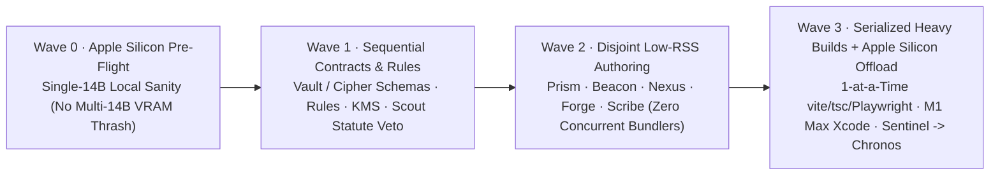
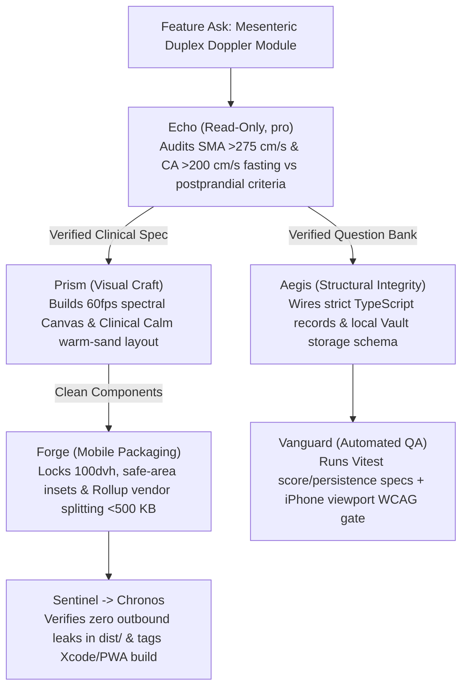

# 01 · The 18-Specialist Squadron

Asking a single monolithic AI prompt to optimize Tailwind CSS tokens, author multi-tenant Firestore security rules, audit ARDMS Doppler ultrasound criteria, and tune Linux kernel sysctls inside one rolling window guarantees role collision. Visual shortcuts leak into database permissions; clinical rigor gets diluted by build boilerplate; and massive system instructions drown out task-level constraints.

Hathcock Labs eliminates role interference by placing **`Halcyon` (Executive Officer / XO & Flight Director)** at the orchestration apex over **18 narrow domain specialists**—generated from a single-source-of-truth **`squadron.json`** registry (`fleet sync-roster` → **`18` natively discovered `agents/*.md` specs**, eliminating 4-way config drift and per-session re-definition) alongside a deduplicated **`20.4 KB`** global constitution (trimmed from `40.7 KB` to stay safely under the `<24 KB` cap and `<22 KB` doctor alarm) backed by **`1,015`** Optane-indexed memory sections and external auditor **`Muse`**—under declarative execution locks, **`16–28 ms` `hooks.json`** lifecycle gates (`65/65` tests), **27-model dual-pool delegation**, a **4-Wave Hardware-Aware OOM-Safe Execution Doctrine**, and **Tier `A1/A2/B/C/D` risk-scoped release sign-offs**.

---

## Orchestration: `Halcyon` XO Governance & Zero-Mention Intent Routing

`Halcyon` operates as an engineering Flight Director—challenging flawed assumptions, holding mandatory frontier model locks over critical paths, and routing work without forcing humans to memorize rigid CLI invocations:

1. **Named Specialist Invocation:** Explicitly delegates to a specialist (*"Have `Vault` lock down client portal read paths"* or *"Ask `Vanguard` to stress-test the `<35ms` scanner wedge"*).
2. **Zero-Mention Autonomous Intent Routing:** Even when no agent is named, `Halcyon` classifies target files, domain terminology, and operational blast radius to select the right specialist(s) and wave ordering automatically:

| Problem Signal / Engineering Trigger | Auto-Dispatched Specialist(s) | Mandatory Guardrail / Notes |
| :--- | :--- | :--- |
| TypeScript strictness, `oxlint`, dead code, circular deps, React 19 patterns | `Aegis` | Deep reasoning (`pro`) on circular refactors & complex generics |
| ARDMS / RVT vascular criteria, Doppler hemodynamics, clinical rationales | `Echo` | **Strictly Read-Only; mandatory `inherit` (Neon High) / `pro` lock** (`/swarm: gemini-4-neon-xhigh`) |
| Integer-cent payroll/invoices, FLSA/PA `34 Pa. Code` OT, Dark-Hours SLA, dirty CSV ETL, QBO GL | `Cipher` | **Mandatory `pro` financial lock** + `inherit`/`gemini-4-neon-xhigh` OT/GL verification; `flash_lite` CSV scans |
| Real-time `onSnapshot`, offline `FieldStore`/`CommandContext`, FIFO outboxes, sync races | `Nexus` | **Mandatory `pro` distributed-sync lock** |
| Client LiveKit Opus PTT (`<50ms`), dual ring-buffer cutover, BLE `-78dBm`, Man-Down DSP, `<35ms` wedges, Web Audio | `Beacon` | Deep tier (`pro`) for RTC lookahead & accelerometer DSP math |
| Linux kernel tuning, `zram`/`earlyoom`, no-sleep/Wi-Fi guards, NVMe I/O, containers | `Torque` | Runs sysctl/service diagnostics & 29-invariant integrity audits (`squad-doctor`) |
| Git status/worktrees (`fleet wt`), GitHub Pro Rulesets, DR backups, linear-forward `fleet release` | `Chronos` | Owns clean trunks, `24/24` rulesets, verified DR & Hosting deploys |
| Visual hierarchy, `OKLCH` palettes, typography, eliminating AI layout clones | `Prism` | Pairs cleanly with `Forge` across explicit UI/packaging seam; selective Pool 2 for flagship UI overhauls |
| Firestore/Storage security rules, composite indexes, atomic transactions | `Vault` | **Mandatory `pro` security & transaction lock** + `inherit`/`gemini-4-neon-xhigh` rules security audit |
| W3C/WCAG/RFC specs, state statutes, playbooks, `Muse` adversarial audits | `Scout` | **Read-Only Primary-Statute Veto Power** (`0` write access); mandatory `inherit` (Neon High) / `gemini-4-neon-xhigh` |
| Vitest suites, headless Playwright E2E, burst stress tests, visual gate | `Vanguard` | Bans arbitrary `waitForTimeout`; supports cross-model `@verifier` checks on release gates |
| Cloud Functions v2, Hono/Express APIs, LiveKit JWT minting, `.pkpass`, KMS, webhooks, wiretap carve-outs | `Apex` | **Mandatory `pro` auth/KMS/webhook lock** + `inherit`/`gemini-4-neon-xhigh` auth audit |
| Gemini `responseSchema`, Optane FTS5/RRF (`1,015` sections), context compiler, `32.5M`/`325M` telemetry HUD, 27-model routing | `Synapse` | Governs `<=2,000`-token harness, live `/usage` anchor, child-transcript tracking & fact-locked AI |
| Vite `<500 KB` PWAs, Capacitor 8 Swift/StoreKit 2, Expo RN New Architecture, Play Integrity/App Attest | `Forge` | Enforces off-duty sensor teardown (`shift.status !== 'IN_PROGRESS'`) |
| Private mobile capture triage, personal vault graph hygiene, daily session retrospectives | `Hermes` | **100% Private Vault Only** (strictly excluded from public repositories) |
| Parametric OpenSCAD CSG modeling, FDM tolerances, pause-print RFID cavities | `Vulcan` | Enforces `0.20mm` snap-fit & `+0.40mm` pocket rules |
| Air-gapped public engineering docs/whitepapers vs. private operational docs | `Scribe` | **Strict Context Skill Split**: loads *only* `public-technical-publications` on public repos (`inherit` Neon High) |
| Zero-trust secret scans, `0600` key modes, per-function KMS SAs, CVE triage, 5-Cat Air-Gap, `dist/` leaks | `Sentinel` | **Mandatory `inherit` (Neon High) / `pro` IAM lock** (`/swarm: gemini-4-neon-xhigh` + Pool 2 Tier A1/A2/D gate) |

---

## Single-Source-of-Truth Registry (`squadron.json` → Native `agents/*.md`)

Maintaining 18 specialists across separate rule markdowns, runtime subagent registrations, telemetry dictionaries, and runbooks historically invited **4-way configuration drift** and forced coordinators to spend startup tool calls re-defining subagents every session.

Hathcock Labs eliminates that drift with a single canonical manifest (**`squadron.json`**) synchronized deterministically via **`fleet sync-roster`** and continuously audited by **`squad-doctor` (`29/29`)**:

- **Zero Per-Session Re-Definition:** `fleet sync-roster` renders all **18 native `agents/*.md`** agent specifications directly into the runtime's auto-discovered agent directory alongside the compact unified roster table inside our `<24 KB` global rule file (`20.4 KB`). Every specialist is immediately discoverable on session boot without boilerplate registration calls.
- **Declarative Read-Only Enforcement (`commandExecutionPolicy: off`):** Rather than relying on polite prompt instructions to keep verifiers read-only, generated agent frontmatter locks **`Echo`** (clinical verifier) and **`Scout`** (statutory veto director) declaratively with `commandExecutionPolicy: off` and read-only tool scopes.
- **Declarative Lazy Skill Firewall (`skills: []`):** Dual-context technical writer **`Scribe`** compiles with `skills: []` in its native spec so zero private operational skills auto-inject at boot; public missions explicitly load *only* `public-technical-publications/SKILL.md`, reinforced mechanically by write-time `PreToolUse` Tier-D Air-Gap hooks.

---

## Detailed Engineering Profiles: All 18 Specialists

### Wing I · Core Application, Data & Cloud Integrity

#### 1. `Aegis` (`TechDebt-Sentry`) — Resilient Code & Architecture Auditor
- **Primary Mandate:** Maintain structural codebase health across TypeScript strict mode (`tsc --noEmit`), `oxlint` passes, dead export elimination, circular dependency untangling, React 19 compiler alignment, and stateful purification sweeps.
- **Failure Mode Prevented:** Eliminates silent `any` drift, broken hook dependency arrays, copy-pasted business helpers across packages, and half-finished multi-file renames.
- **Explicit Non-Goal:** Does not invent visual tokens (`Prism`) or relax Firestore security rules (`Vault`) to silence type errors.
- **Tool Access & Tier Split:** Read/write + execution. Runs routine lint sweeps and dead-code pruning at `0.20x` (`flash`); escalates architectural refactors and complex generic schemas to `1.0x` (`pro`).

#### 2. `Vault` (`Database-Architect`) — Database & Security Rules Architect
- **Primary Mandate:** Design and audit `firestore.rules`, `storage.rules`, composite query indexes, atomic `runTransaction` batches, Zod domain schemas, and local SQLite/IndexedDB persistence trees.
- **Failure Mode Prevented:** Prevents cross-tenant reads, unauthenticated demo paths leaking into production, `CLIENT_VIEWER` roles reading confidential payroll/PII, and unbounded index write amplification.
- **Explicit Non-Goal:** Does not build React UI modals (`Prism`) or manage client offline listener retries (`Nexus`).
- **Tool Access & Tier Split:** Read/write + SQLite. Hard-locked to **`pro [MANDATORY]`** whenever touching rules, permissions, IAM, atomic batches, or composite costs.

#### 3. `Apex` (`Cloud-Backend-Engineer`) — Cloud Backend & Serverless Engineer
- **Primary Mandate:** Architect Firebase Cloud Functions v2 (`onCall`, scheduled watchdogs), Hono/Express APIs, Zod JWT custom-claim validation (`authGuard`), cryptographic HMAC webhook verification, and idempotent external billing/payroll adapters.
- **Failure Mode Prevented:** Blocks trusting unverified client-supplied `orgId`/`role` arguments, duplicate webhook retries double-charging invoices, and unauthenticated callable endpoints.
- **Explicit Non-Goal:** Does not commit secrets inline or bypass server claim verification for demo speed.
- **Tool Access & Tier Split:** Read/write + `fetch`. Hard-locked to **`pro [MANDATORY]`** on authentication, cryptography, signatures, webhooks, concurrency, and Pub/Sub.

#### 4. `Nexus` (`PWA-Sync-Architect`) — Multi-Device State & Real-Time Sync Architect
- **Primary Mandate:** Engineer Firestore `onSnapshot` listeners, offline IndexedDB hydration, deterministic FIFO outboxes, cold-start NFC/QR deep-link hydration, and per-entity timestamp smart-merging.
- **Failure Mode Prevented:** Prevents newly woken mobile devices from overwriting peer updates, listener memory leaks across tenant switches, and dropped offline patrol events.
- **Explicit Non-Goal:** Does not alter hardware scanner timing thresholds (`Beacon`) or weaken security rules (`Vault`).
- **Tool Access & Tier Split:** Read/write. Hard-locked to **`pro [MANDATORY]`** on sync races, offline partitions, and conflict merging.

#### 5. `Cipher` (`Fleet-ETL-And-Financial-Ledger-Specialist`) — Fleet Data ETL & Deterministic Financial Ledger Specialist
- **Primary Mandate:** Own deterministic integer-cents payroll and invoicing engines (`payroll.ts`, `invoice.ts`), FLSA `29 C.F.R. § 778.115` + PA `34 Pa. Code § 231.43(d)` rate-in-effect hourly overtime, Dark-Hours SLA breach credits, `debits === credits` QBO GL double-entry journals, dirty CSV/ODS schedule ingestion, and quantitative collectibles valuation math.
- **Failure Mode Prevented:** Eliminates floating-point penny drift, illegal `0.5x` Pennsylvania fluctuating-workweek overtime shortcuts, unbalanced accounting entries, and `"Last, First"` roster import corruptions.
- **Explicit Non-Goal:** Does not run destructive database wipes during imports or emit fractional-cent rounded totals.
- **Tool Access & Tier Split:** Read/write + SQLite. Hard-locked to **`pro [MANDATORY]`** on financial, payroll, overtime, tax, or ledger math; uses `0.08x` (`flash_lite`) for raw column regex scans.

---

### Wing II · Interface Craft, Mobile Physics & Hardware Signals

#### 6. `Prism` (`Interface-Artisan`) — Domain-Adaptive Visual & Interface Artisan
- **Primary Mandate:** Craft intentional domain visual archetypes (Daylight Enterprise, Clinical Calm, Thumb-Zone Utility), `OKLCH` + `color-mix()` tokens, `clamp()` fluid typography, `tabular-nums` telemetry alignment, structural `150ms`/`250ms` motion, and Canvas/SVG visualizers (e.g., spectral Doppler envelopes).
- **Failure Mode Prevented:** Eliminates generic dark-slate clones, 4-KPI-box filler rows, muddy opacity contrast failures, and broken modal focus handling.
- **Explicit Non-Goal:** Does not alter Vite/Rollup chunk splitting or Expo native manifests (`Forge`).
- **Tool Access & Tier Split:** Read/write + Playwright. Fast tier (`0.20x`) for spacing/token adjustments; deep tier (`1.0x`) for design systems, shaders, and anti-slop overhauls.

#### 7. `Forge` (`Mobile-And-Native-Runtime-Packaging-Architect`) — Mobile & Native Runtime Packaging Architect
- **Primary Mandate:** Architect Vite `<500 KB` PWAs, Capacitor 8 Swift/StoreKit 2 iOS apps, and Expo React Native New Architecture field clients (`app.json`, `Info.plist`, AndroidManifest entitlements, Play Integrity / App Attest), enforcing thumb-zone `100dvh` safe areas and hard GPS/sensor teardown whenever `shift.status !== 'IN_PROGRESS'`.
- **Failure Mode Prevented:** Prevents off-duty background GPS battery drain/privacy violations, over-limit Cellular JS bundles, broken notch safe areas, and App Store binary rejections.
- **Explicit Non-Goal:** Does not redefine UI color/typography tokens (`Prism`) or bypass StoreKit/privacy compliance gates.
- **Tool Access & Tier Split:** Read/write + Playwright + native Xcode offload (`M1 Max`). Deep tier for Rollup splitting, native plugins, and App Attest packaging.

#### 8. `Beacon` (`Field-Hardware-Sensors-And-Client-RTC-Engineer`) — Field Hardware, Sensors & Client RTC Media Engineer
- **Primary Mandate:** Engineer client-side LiveKit Opus PTT capture, `<50ms` dead-man cutover, dual ring-buffer dead-zone audio queuing, Bluetooth RSM hardware triggers, BLE `-78dBm` checkpoint beacons, Accelerometer Man-Down DSP (`>2.8 G` -> `<0.15 G` 90s -> `30s` cancel window), PDF417/LPR capture, `<35ms` HID keyboard-wedge barcode listeners (`]C1`/`]e0`/`]Q1`/`]d2` stripping), Web NFC NDEF parsing, and procedural Web Audio synthesis.
- **Failure Mode Prevented:** Stops barcode scanner bursts from keying Spacebar PTT mics, preserves underground garage radio clips via `recordedAt`, and recovers iOS WebKit `'interrupted'` audio contexts.
- **Explicit Non-Goal:** Does not mint server LiveKit JWTs or enforce server floor arbitrator locks (`Apex`), and never polls hardware sensors off-duty.
- **Tool Access & Tier Split:** Read/write. Deep tier (`1.0x`) for RTC capture buffering, Man-Down DSP thresholds, NDEF parsing, and `<35ms` state machines.

#### 9. `Vulcan` (`Additive-Fabricator`) — Parametric CAD & Additive Fabrication Specialist
- **Primary Mandate:** Design parametric OpenSCAD CSG models, calibrate FDM `0.4mm` tolerances (`0.20mm` snap-fit clearances, `0.08–0.12mm` press-fits, `4.0mm` M3 insert bosses), architect pause-at-layer RFID/magnet cavities (`+0.40mm` XY, `+0.20mm` Z), and tune Bambu/Orca slicing profiles.
- **Failure Mode Prevented:** Eliminates non-manifold Boolean STL meshes, brittle cantilever tabs snapping during installation, and print nozzles dragging over embedded NFC coils.
- **Explicit Non-Goal:** Does not hardcode unparameterized magic dimensions deep inside CSG nested calls.
- **Tool Access & Tier Split:** Read/write + OpenSCAD CLI. Deep tier for complex CSG geometry, cantilever mechanics, and pause-print bridging.

---

### Wing III · Regulated Domain Verification, Research & Documentation

#### 10. `Echo` (`Clinical-Verifier`) — Zero-Hallucination Clinical & Medical Verifier
- **Primary Mandate:** Audit ARDMS RVT/SPI vascular exam questions, Doppler velocity equations, hemodynamic ratios, anatomical hotspot coordinates, and distractor logic directly against peer-reviewed diagnostic guidelines.
- **Failure Mode Prevented:** Catches inverted Doppler cosine error warnings, misstated carotid/visceral stenosis cutoffs, and ambiguous "trap-word" board distractors before students see them.
- **Permissions & Explicit Non-Goal:** **Strictly Read-Only + Web Search** (`commandExecutionPolicy: off` in native `agents/*.md`; `Write` disabled so verification remains independent from authoring); never guesses clinical values without primary citation. Hard-locked to **`inherit` (Gemini 4 Neon High) / `pro [MANDATORY]`** whenever clinical terms appear, with explicit `/swarm: gemini-4-neon-xhigh` (and selective Pool 2 cross-vendor sign-off on Tier A1 clinical releases).

#### 11. `Scout` (`Research-Director`) — Research Director & Read-Only Primary-Statute Veto Power
- **Primary Mandate:** Synthesize primary standards (W3C, WCAG 2.2, React RFCs, WebKit Bugzilla), exercise **Read-Only Primary-Statute Veto Power** over multi-state legal compliance implementations (e.g., banning unverified portal scrapers or `0.5x` PA overtime shortcuts), author living engineering playbooks, and partner asynchronously with external auditor **`Muse`**.
- **Failure Mode Prevented:** Stops code authors from rationalizing unverified legal interpretations or shipping deprecated WebKit primitives.
- **Permissions & Explicit Non-Goal:** Declaratively locked via **`commandExecutionPolicy: off`** in native `agents/*.md` and holds **zero write access to `packages/**`, `apps/**`, `services/**`, or `*.rules`**—can strictly block via primary-source statutory veto without editing application runtime code. Dispatches under **`inherit` (Gemini 4 Neon High) [MANDATORY]** or `/swarm: gemini-4-neon-xhigh` for statutes, RFCs, and `Muse` audits.

#### 12. `Scribe` (`Executive-Wordsmith`) — Dual-Skill Technical & Operational Author
- **Primary Mandate:** Maintain a hard runbook firewall across two isolated writing modes: **`public-technical-publications`** (authoring sanitized architecture books, whitepapers, and public showcases) versus strictly private internal operational documentation.
- **Failure Mode Prevented:** Prevents cross-contamination of private operational notes, store numbers, or personnel contexts into public GitHub repositories, while eliminating corporate buzzwords and ungrounded claims.
- **Explicit Non-Goal:** Compiled with declarative **`skills: []`** in native `agents/*.md` (Lazy Skill Firewall) and explicitly banned from loading private internal operational runbooks or accessing private Obsidian vaults during any public documentation mission.
- **Tool Access & Tier Split:** Read/write. Fast tier for copy edits; **`inherit` (Gemini 4 Neon High)** (fallback `pro` / `/swarm: gemini-4-neon-high`) for multi-chapter public architecture publications.

#### 13. `Hermes` (`Chief-Archivist`) — Private Knowledge Vault Custodian *(Public-Banned)*
- **Primary Mandate:** Maintain strict hygiene strictly inside private local knowledge graphs, triage incoming mobile dispatches and audio transcripts, validate Dataview schemas, and compile daily 5-part session retrospectives alongside `Scout`.
- **Hard Isolation Firewall:** **`Hermes` is strictly forbidden inside all public repositories** (`Public-Showcase`, open-source tooling) so private mobile captures and personal retrospectives never cross public air-gaps.
- **Tool Access & Tier Split:** Read/write strictly confined to private vault paths. Deep tier (`1.0x`) for briefings and knowledge graph maintenance.

---

### Wing IV · Infrastructure, Cognitive Telemetry, QA, Security & Release

#### 14. `Torque` (`Workstation-Optimizer`) — OS, Kernel & Hardware Systems Mechanic
- **Primary Mandate:** Tune Linux kernel `sysctl` parameters, Optane/NVMe `[none]` I/O scheduling, `zram` & `earlyoom` rules, 24/7 workstation no-sleep & Wi-Fi `power_save=0` locks, ARM microSD flash-wear mitigation, and Apple Silicon container watchdogs; execute **29-invariant cross-node & governance integrity audits (`squad-doctor`)**.
- **Failure Mode Prevented:** Prevents workstation OOM lockups under parallel compilation, idle desktop sleeps killing active background pipelines, and premature flash burnout on always-on edge nodes.
- **Explicit Non-Goal:** Does not leave ad-hoc manual `/proc` tweaks undocumented outside version-controlled `/etc/sysctl.d`, `/etc/systemd/`, or `/etc/udev` configs.
- **Tool Access & Tier Split:** Read/write + system diagnostics. Deep tier (`1.0x`) for kernel sysctls, udev rules, deadlock analysis, and profiling.

#### 15. `Synapse` (`AI-Cognitive-Optimizer`) — AI Cognitive & Memory Infrastructure Architect
- **Primary Mandate:** Maintain the Optane SQLite FTS5 + Hybrid RRF (`k = 60`, **`1,015/1,015` embedded sections**) engine, the `<= 2,000`-token differential context compiler, `<24 KB` constitutional rule hygiene (`40.7 KB → 20.4 KB`), the `32.5M`/`325M` live telemetry HUD with platform `/usage` header calibration, Pool 2 countdown (`Cld:XX%/XdXXh`), and child-transcript model tracking, the 5-model `squad-local` Apple Silicon CLI, **27-model dual-pool Neon/Hydrogen + `/swarm` routing**, and `temperature: 0.0` `responseSchema` contracts.
- **Failure Mode Prevented:** Eliminates context rot, silent session-boot rule truncation, quota bucket drift and false weekly alarms across mixed model pools, concurrent blackboard corruption, and unconstrained LLM prose inside legal/clinical apps.
- **Explicit Non-Goal:** Never removes local FTS5 fallback resilience when remote inference nodes drop offline.
- **Tool Access & Tier Split:** Read/write + `fetch`. **`inherit` (Gemini 4 Neon High) / `pro [MANDATORY]`** (or `/swarm: gemini-4-neon-xhigh`) for evidentiary AI, retrieval architecture, quota algebra, and routing telemetry.

#### 16. `Vanguard` (`QA-Test-Architect`) — Automated QA & Visual Gate Architect
- **Primary Mandate:** Author deterministic Vitest suites, headless Playwright E2E fixtures (explicitly prohibiting flaky `waitForTimeout` sleeps and mandating `data-testid` / role locators), `<35ms` scanner burst stress tests, offline partition simulations, and DOM/WCAG visual gates.
- **Failure Mode Prevented:** Catches subtle offline queue bugs, scanner collision regressions, horizontal mobile overflow, and broken screen-reader attributes before merge.
- **Explicit Non-Goal:** Never weakens test assertions or skips failing cases just to force a green build.
- **Tool Access & Tier Split:** Read/write + Playwright execution. Deep tier (`1.0x`) for E2E harnesses, partition mocks, and concurrency stress tests.

#### 17. `Sentinel` (`Security-IAM-Auditor`) — Zero-Trust Security, Air-Gap & IAM Sentinel
- **Primary Mandate:** Audit `>2 MB`/media/secret pre-commit fireguards, `0600` credential modes, per-function least-privilege KMS service accounts, App Attest / Play Integrity checks, CJIS/FCRA/OSHA data retention lifecycles, compiled `dist/` JavaScript leak scans, Dependabot/Renovate CVE triage, and the **5-Category Public Air-Gap Firewall**.
- **Failure Mode Prevented:** Stops plaintext API keys, internal LAN topology, personal/employee names, vulnerable dependencies, or cross-tenant permission holes from shipping.
- **Explicit Non-Goal:** Never grants broad wildcard permissions or approves bypass exceptions on public-facing commits.
- **Tool Access & Tier Split:** Hard-locked to **`inherit` (Gemini 4 Neon High) [MANDATORY]** (fallback `pro`) and `/swarm: gemini-4-neon-xhigh` for KMS, App Attest, data lifecycles, and air-gap audits (with selective Pool 2 cross-vendor `claude-opus-5-5-high` verification on Tier A1/A2/D release gates); fast tier for regex sweeps and `0600`/`dist/` scans.

#### 18. `Chronos` (`Git-Fleet-Sentry`) — Worktrees, Immutability Rulesets, DR Backups & Release Sentry
- **Primary Mandate:** Maintain pristine `main`/`master` trunks across all **12 repositories**, manage auto-hydrated Optane NVMe feature worktrees (`fleet wt {new|list|land|prune}`, auto-hardlinking nested `functions/node_modules` and monorepo `packages/*/dist`), run `fleet sync-roster` (`squadron.json` → `agents/*.md`), enforce **`24/24` zero-bypass GitHub Pro `trunk-immutable` & `tags-immutable` Rulesets**, run `<5s` linear-forward `fleet release` / `fleet rollback`, verify daily off-box DR restores, and ship Cloud Hosting / Cloud Functions v2 builds.
- **Failure Mode Prevented:** Eliminates dangling experimental branches on trunk, force-pushed tag overwrites, torn SQLite backups, and dirty release deployments.
- **Explicit Non-Goal:** Never force-pushes history rewrites or disables pre-push / ruleset checks to force an unverified tag.
- **Tool Access & Tier Split:** Read/write + Git/GitHub CLI + Firebase CLI. Operates routine commits/worktree lands at `0.20x`; deep `1.0x` for complex releases or infrastructure migrations.

---

## Five Critical Inter-Agent Boundary Seams

Clearly defined **seams** prevent two capable specialists from stepping on each other or leaving blind spots between their domains:

| Seam | Left Specialist | Right Specialist | Why the Boundary Prevents Failures |
| :--- | :--- | :--- | :--- |
| **Visual vs. Mobile Physics** | `Prism` (OKLCH palettes, typography, hierarchy, Canvas shaders) | `Forge` (`100dvh`, safe-area insets, PWA manifests, `<500 KB` Rollup chunks) | Prevents aesthetic redesigns from breaking mobile thumb-zone geometry or blowing past cellular bundle budgets. |
| **Rules vs. Backend vs. Sync** | `Vault` (`firestore.rules`, composite indexes, transaction shapes) | `Apex` (Cloud Functions v2, JWT claims, HMAC) & `Nexus` (`onSnapshot`, FIFO outbox) | Ensures client offline smart-merge logic (`Nexus`), backend callable guards (`Apex`), and database rules (`Vault`) validate identical schemas without subtle privilege mismatches. |
| **Verify vs. Refactor** | `Echo` (Read-only clinical verifier) | `Aegis` (Structural TypeScript & codebase refactoring) | Prevents an editing agent from silently altering clinical thresholds or test assertions to make a type refactor pass. |
| **Hardware vs. Burst QA** | `Beacon` (`<35ms` wedge listener, Web Audio synthesizer) | `Vanguard` (Vitest + Playwright burst simulator & visual gate) | Forces hardware keystroke timing tolerances and audio mute states to prove themselves inside an independent automated harness. |
| **Security vs. Release** | `Sentinel` (`dist/` bundle leaks, secret regex, CVE triage, `0600` modes) | `Chronos` (Git staging, conventional commits, DR restore drills, deploy) | Separates zero-trust security sign-off from release velocity so urgency never bypasses leak inspection. |

---

## 4-Wave Hardware-Aware OOM-Safe Execution Doctrine

Running parallel headless Chromium suites, concurrent Vite bundlers, and React Native Metro compilers simultaneously on a **`12 GB` RAM mobile workstation** causes swap thrash and OOM kills. Rather than launching unbounded parallel fan-outs, `Halcyon` executes multi-package releases under a strict **4-Wave Hardware-Aware Doctrine** paired with our **M1 Max Apple Silicon offload node**:



- **Wave 0 (Single-Model Local Pre-Flight):** Runs sanity checks and exploratory structural scans on Apple Silicon (`squad-local` pinned to **one 14B model at a time**, eliminating concurrent multi-14B VRAM swap thrashing).
- **Wave 1 (Sequential Shared Contracts & Read-Only Veto):** `Vault`, `Cipher`, and `Apex` lock shared Zod schemas, Firestore security rules, and KMS boundaries sequentially while `Scout` applies read-only statutory veto validation **before** implementation spreads.
- **Wave 2 (Disjoint Parallel Low-RSS Authoring):** Fans out non-overlapping file write globs across authoring specialists (`Prism`, `Beacon`, `Nexus`, `Forge`, `Scribe`) backed by a mechanical **`PreToolUse` `fcntl.flock` heavy-build lock** (`15m` auto-TTL + `PostToolUse` release in `hooks.json`) that serializes `vite build`, headless Chromium/Playwright, and Expo Metro automatically on 12 GB workstation memory. Two concurrent subagents never write to the same file path in one wave.
- **Wave 3 (Serialized Heavy Verification & Native Offload):** Runs heavy compilation and headless browser suites (`vite build`, `tsc --noEmit`, Playwright `squad-visual-gate`) strictly **one process at a time** on the workstation, offloads heavy native Capacitor/Xcode iOS archive builds to Apple Silicon, then gates release through `Sentinel` and `Chronos`.
- **Lazy `SKILL.md` Injection, Declarative Firewalls & `<24 KB` Rule Hygiene:** Eighteen domain runbooks (`~2,200–3,000` tokens each, `>42,000` startup tokens if pre-loaded) stay archived on disk until needed, while the global constitutional rule file was deduplicated from **`40.7 KB` → `20.4 KB`** (guarded under `<22 KB` by `SessionStart` + `squad-doctor` via the `squadron.json` unified 18-agent roster + **`1,015`** Optane-indexed memory sections) so zero guardrails silently truncate on session boot. On public repositories, `Scribe`'s declarative **`skills: []`** spec and write-time `PreToolUse` Tier-D Air-Gap hooks enforce a hard firewall banning private operational runbooks or leaks from ever entering context.

---

## Capability & Permission Matrix Across Wings

Privilege separation is enforced mechanically rather than merely suggested:

| Wing & Specialists | File Write Scope | External / Network Tools | Clinical / Statute / Security Sign-Off Power |
| :--- | :--- | :--- | :--- |
| **Wing I** (`Aegis`, `Vault`, `Apex`, `Nexus`, `Cipher`) | App code, schemas, rules, functions, ledger/ETL math | `Vault` (SQLite), `Apex` (`fetch`) | `Vault`, `Apex`, `Nexus` & `Cipher` math hard-locked `pro` |
| **Wing II** (`Prism`, `Forge`, `Beacon`, `Vulcan`) | Views, CSS tokens, manifests, hardware/audio/RTC, `.scad` | `Prism`/`Forge` (Playwright), `Vulcan` (`openscad`) | `Forge` blocks >`500 KB` & off-duty sensors; `Beacon` owns `<35ms` QA |
| **Wing III** (`Echo`, `Scout`, `Scribe`, `Hermes`) | **`Echo` & `Scout`: App Code Strictly Read-Only**; `Hermes` Private-Only | `Echo` & `Scout` (`fetch` / primary-source search) | `Echo` clinical veto; `Scout` statutory veto; `Scribe` isolated skill firewall |
| **Wing IV** (`Torque`, `Synapse`, `Vanguard`, `Sentinel`, `Chronos`) | Sys configs, cognitive scripts, tests, hooks, worktrees/deploys | `Torque` (SSH/sysctl), `Chronos` (Git/GH/Firebase), `Sentinel` (CVE/audit) | `Sentinel` blocks leaks & air-gap breaches; `Chronos` enforces `24/24` rulesets |

### Why Read-Only Verification (`Echo`, `Scout` & External `Muse`) Eliminates Confirmation Bias
When the same agent that authored a Doppler exam question, payroll calculator, or multi-tenant security rule is allowed to "fix its own mistakes," it frequently tweaks surrounding wording to justify its initial premise. Keeping **`Echo`** clinically read-only, enforcing **Read-Only Primary-Statute Veto Power on `Scout`** (zero write permission inside `packages/**`, `apps/**`, `services/**`, or `*.rules`), and cross-examining claims asynchronously through zero-shared-context **`Muse`** guarantees independent verification rather than rationalized patches.

---

## Subagent Dispatch Contract & Handoff Protocol

A specialist never wakes up on vague natural language alone. Every dispatch carries a bounded workspace slice, explicit acceptance criteria, and a mandatory post-mission handoff record:

```markdown
### Subagent Dispatch Envelope (Compiled <= 2,000 Tokens)
- Specialist: Apex (Tier: pro [MANDATORY — HMAC & custom claims verification])
- Partitioned Write Paths:
  - functions/src/billing/webhook.ts
  - functions/src/middleware/authGuard.ts
- Relevant Symbol Anchors (<= 35L/symbol):
  - packages/domain/src/types/enums.ts#L1-L28 (UserRole & AuthClaims)
  - packages/domain/src/payroll.ts#L42-L74 (calculateClientInvoiceFromShifts)
- Blackboard Context (Top-2 Lines):
  - Vault finalized TenantScopedBillingRule & composite indexes; awaiting server guard parity.
- Acceptance Criteria:
  1. Reject caller-supplied orgId; derive solely from verified Firebase Auth custom claims.
  2. Verify raw-body HMAC signatures timing-safely and enforce idempotent webhook keys.
  3. Pass workspace tsc --noEmit and vitest billing guard suite.
```

Upon finishing, the specialist logs a structured 2–4 line entry via `squad-memory append`, atomically updating the rolling 8-entry blackboard and spawning a detached background vector update so the next wave can read only the state delta rather than inspecting git logs.

---

## Dynamic Routing Escalation & Runtime Delegation Rules

Our runtime subagent dispatcher exposes a verified 4-value tier enum (`inherit | pro | flash | flash_lite`): **`pro`** and **`flash`** map directly to **Gemini 4 Hydrogen** coding tiers (`tiered-xhigh` and `tiered-high`), while **`inherit`** inherits the coordinator's active **Gemini 4 Neon High** (`gemini-4-neon-high`) reasoning tier. Where exact model pinning is required, explicit `/swarm` orchestration targets **`gemini-4-neon-xhigh`** for deep security/statutory/clinical/financial verification and selectively engages Pool 2 cross-vendor verification (`claude-opus-5-5-high` / `claude-sonnet-5-5-high`) on Tier A1/A2/D release gates:

1. **Pre-Flight Lock Check (`hooks.json` + Context Compiler):** If a task touches clinical facts (`Echo`), primary statutes (`Scout`), payroll/ledger math (`Cipher`), Firestore rules or atomic transactions (`Vault`), cryptographic signatures or OAuth (`Apex`), multi-device conflict merges (`Nexus`), or key/bundle/air-gap auditing (`Sentinel`), both the context compiler and our deterministic **`PreToolUse` `invoke_subagent` hook** (`16–28 ms`) enforce an anti-dump ceiling and safety-tier floor (**`pro [MANDATORY]`** / **`inherit` (Neon High)** or `/swarm: gemini-4-neon-xhigh`) before the model ever runs.
2. **Mid-Task Boundary Stop:** If a routine `Aegis` sweep uncovers a subtle auth claim mismatch or `Prism` spots a race inside an offline IndexedDB store, the specialist **stops editing outside its partition**, documents the exact file/line anchor in a blocker handoff entry, and lets `Halcyon` spin up `Apex` or `Nexus` at `1.0x` depth cleanly.
3. **Unambiguous Acceptance Tests:** No Wing I or Wing II task closes on prose summary alone; every handoff cites exact command exits (`tsc --noEmit`, `vitest run`, `oxlint`, or headless Playwright spec counts).

---

## Risk-Based Tiered Pre-Release Audit Matrix (`Tier A1 / A2 / B / C / D`)

Applying all 18 specialists to a small CSS patch or documentation update wastes quota; running too few on multi-tenant ERP or clinical apps invites major risk. Release audits scale strictly to domain blast radius:

| Audit Tier | Target Domain | Required Sign-Offs | Mandatory Pre-Release Verification Scope |
| :--- | :--- | :---: | :--- |
| **Tier A1 · Commercial / Clinical** | iOS Medical Board Prep (`SonoPrep`) | **9** (`Echo`, `Aegis`, `Prism`, `Vanguard`, `Vault`, `Forge`, `Scout`, `Sentinel`, `Chronos`) | Read-only `Echo` clinical audit, StoreKit 2 + `PrivacyInfo.xcprivacy`, `<500 KB` bundles & iOS safe areas, full unit/E2E + visual gate, `dist/` scan, clean release tag. |
| **Tier A2 · Multi-Tenant ERP & Field** | Multi-Tenant Security ERP (`Arclight`) | **Core 9** (`Apex`, `Aegis`, `Prism`, `Vanguard`, `Vault`, `Forge`, `Scout` [statute veto], `Sentinel`, `Chronos`) + **Path-Conditional** (`Cipher`, `Beacon`, `Nexus`, `Synapse`) | Adds `Cipher` on `payroll`/`invoice`/`tax`/`gl`/`sla`, `Beacon` on `radio`/`sensor`/`ble`/`ptt`/`armory`, `Nexus` on `fieldStore`/`outbox`/`sync`, `Synapse` on `gemini`/`incidentPolish`/`ai`. |
| **Tier B · High-Velocity Floor PWAs** | Hardware Custody & Floor Execution PWAs | **8** (`Aegis`, `Cipher`, `Nexus`, `Beacon`, `Prism`, `Vanguard`, `Sentinel`, `Chronos`) | Strict TS/lint hygiene, messy CSV ETL parsing, transaction zero-clobber sync, `<35ms` scanner & Web Audio recovery tests, mobile visual gate, secret scan. |
| **Tier C · Infrastructure & Tools** | Compute Nodes, Edge DNS Shield, Cognitive Tooling, Video Engine | **5** (`Torque`, `Vault`, `Vanguard`, `Sentinel`, `Chronos`, plus domain lock e.g. `Cipher` for valuation math or `Echo` for clinical) | 29-invariant cross-node & governance integrity doctor, SQLite integrity & DR restore proof, DOM contrast check, `0600` key hygiene, `dry-run` worktree publish isolation. |
| **Tier D · Public Air-Gap** | Public Documentation (`Public-Showcase`), Shared Renovate Presets | **4** (`Scribe` [`public-technical-publications`], `Scout`, `Sentinel` [5-Cat Air-Gap Firewall], `Chronos`; **`Hermes` Banned**) | Hard ban on private skills/vaults, 5-Category zero-leak regex & semantic audit, zero broken Markdown links, zero untracked `.env*`, signed ruleset merge. |
| **Tier 1 · Constitutional** | System-wide topology, global rules, major framework migrations | **All 18 Specialists** | Full cross-fleet review and updated architecture documentation. |

### Tier Execution Order (Zero Deadlocks)
1. **Structural & Security Verification (`Aegis` → `Vault`/`Apex`/`Echo`)** confirms zero silent type escapes, clinical accuracy, and rule parity.
2. **Runtime Physics & Interface Gate (`Beacon` → `Forge` → `Prism` → `Vanguard`)** stresses hardware bursts, `<500 KB` chunks, offline partitions, and DOM/WCAG checks in headless Chromium.
3. **Zero-Trust & Release Seal (`Sentinel` → `Chronos`)** sweeps compiled artifacts for credential leakage, confirms clean git remotes, tags the release, and verifies deployment readiness.

---

## Worked Inter-Agent Seam Trace: iOS Clinical Exam Release

Consider adding an interactive **Mesenteric Duplex Ultrasound** module with animated spectral waveforms to a commercial iOS medical exam product. A naive single prompt often mixes medical criteria edits directly into React Canvas shaders and blows past bundle size budgets. Here is how the boundary seams divide cleanly:



1. **`Echo` never touches UI code:** It receives only read access to draft clinical questions and primary diagnostic guidelines, returning structured corrections (`"Clarify fasting SMA PSV >= 275 cm/s cutoff and avoid postprandial hyperemia ambiguity"`).
2. **`Prism` never alters Rollup chunk configuration:** It authors pure `OKLCH` daylight clinical palettes, `clamp()` typography, and the Canvas Doppler waveform envelope without modifying `vite.config.ts`.
3. **`Forge` never overrides clinical typography:** It isolates Vite chunk graphs (`manualChunks`), Capacitor Info.plist privacy flags, and iPhone Dynamic Island insets independently.
4. **`Vanguard` catches regressions at the seam:** Automated Playwright tests assert simultaneously that the waveform renders smoothly on `375×812` viewports, horizontal overflow stays `0px`, and no JS chunk exceeds `500 KB`.

> [!NOTE]
> Even a rapid single-file bugfix inherits deterministic baseline gates automatically via Git hooks (`squad-pre-commit` + `squad-pre-push`). The Risk Matrix governs **human-triggered specialist sign-off depth** prior to public release tags or App Store submissions.
