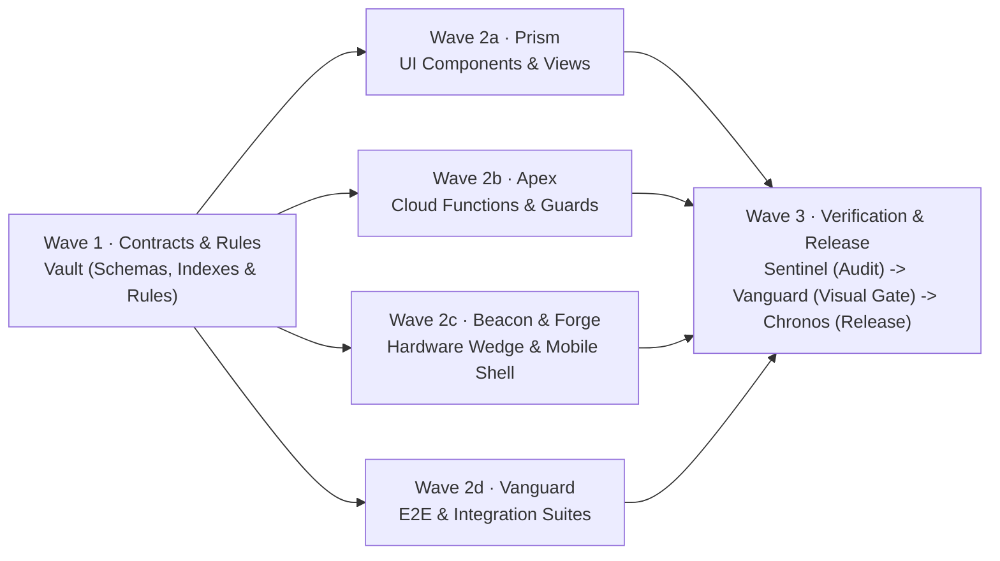
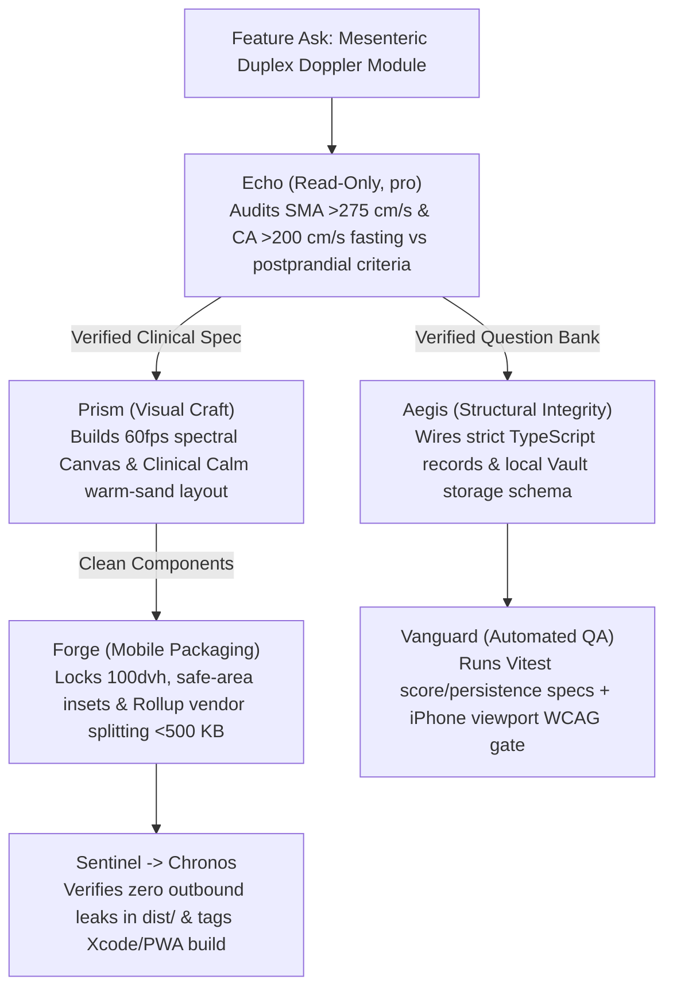

# 01 · The 18-Specialist Squadron

Asking a single monolithic AI prompt to optimize Tailwind CSS tokens, author multi-tenant Firestore security rules, audit ARDMS Doppler ultrasound criteria, and tune Linux kernel sysctls inside one rolling window guarantees role collision. Visual shortcuts leak into database permissions; clinical rigor gets diluted by build boilerplate; and massive system instructions drown out task-level constraints.

Hathcock Labs eliminates role interference by partitioning engineering labor across **18 narrow domain specialists**, coordinated by a central **Mission Controller** under strict file-write isolation, lazy procedural runbooks, and risk-scoped release sign-offs.

---

## Orchestration: Explicit Invocation vs. Zero-Mention Intent Routing

The Mission Controller routes work without forcing the human architect to memorize rigid CLI wrappers:

1. **Named Specialist Invocation:** Explicitly delegates to a specialist (*"Have `Vault` lock down client portal read paths"* or *"Ask `Vanguard` to stress-test the `<35ms` scanner wedge"*).
2. **Zero-Mention Autonomous Intent Routing:** Even when no agent is named, the Mission Controller classifies target files, domain terminology, and operational blast radius to select the right specialist(s) automatically:

| Problem Signal / Engineering Trigger | Auto-Dispatched Specialist(s) | Mandatory Guardrail / Notes |
| :--- | :--- | :--- |
| TypeScript strictness, `oxlint`, dead code, circular deps, React 19 patterns | `Aegis` | Deep reasoning on circular refactors & complex generics |
| ARDMS / RVT vascular criteria, Doppler hemodynamics, clinical rationales | `Echo` | **Read-only access; mandatory `pro` clinical lock** |
| Dirty CSV/ODS schedules, E.164 phone formats, roster ETL normalization | `Cipher` | `flash_lite` for row/header scans; `flash` for transforms |
| Real-time `onSnapshot`, offline IndexedDB, multi-device sync races | `Nexus` | **Mandatory `pro` distributed-sync lock** |
| Barcode scanners (`<35ms`), Web NFC NDEF tags, procedural Web Audio | `Beacon` | Deep tier for NDEF payloads & audio lookahead math |
| Linux kernel tuning, `zram`/`earlyoom`, NVMe I/O, containers, ARM edge wear | `Torque` | Runs sysctl/service diagnostics & 3-node drift checks |
| Git status/commits, merge conflicts, Renovate hygiene, DR backups, deploys | `Chronos` | Owns clean-tree staging & production Hosting deploys |
| Visual hierarchy, `OKLCH` palettes, typography, eliminating AI layout clones | `Prism` | Pairs with `Forge` across explicit UI/packaging seam |
| Firestore/Storage security rules, composite indexes, atomic transactions | `Vault` | **Mandatory `pro` security & transaction lock** |
| W3C/WCAG/RFC specs, breaking changes, playbooks, `Muse` dropzone audits | `Scout` | Pairs externally with independent adversarial node |
| Vitest suites, headless Playwright E2E, burst stress tests, visual gate | `Vanguard` | Bans arbitrary `waitForTimeout` in E2E specifications |
| Cloud Functions v2, Hono/Express APIs, JWT/HMAC auth, webhooks | `Apex` | **Mandatory `pro` auth & webhook idempotency lock** |
| Gemini `responseSchema`, Optane FTS5/RRF memory, context compiler, HUD | `Synapse` | Governs `<=2,000`-token harness & fact-locked AI |
| Mobile `100dvh`/safe-area physics, PWA manifests, Rollup `manualChunks` | `Forge` | Enforces `<500 KB` chunks & thumb-zone ergonomics |
| Mobile dispatch inbox triage, knowledge graph hygiene, session learnings | `Hermes` | Compiles daily 5-part retrospectives alongside `Scout` |
| Parametric OpenSCAD CSG modeling, FDM tolerances, pause-print RFID cavities | `Vulcan` | Enforces `0.20mm` snap-fit & `+0.40mm` pocket rules |
| Executive documentation, 70/20/10 plans, SBI/GROW coaching, whitepapers | `Scribe` | Enforces grounded metrics & zero corporate buzzwords |
| Zero-trust secret scans, `0600` file modes, CVE triage, `dist/` bundle leaks | `Sentinel` | **Mandatory `pro` IAM/OAuth boundary lock** |

---

## Detailed Engineering Profiles: All 18 Specialists

### Wing I · Core Application, Data & Cloud Integrity

#### 1. `Aegis` (`TechDebt-Sentry`) — Resilient Code & Architecture Auditor
- **Primary Mandate:** Maintain structural codebase health across TypeScript strict mode (`tsc --noEmit`), `oxlint` passes, dead export elimination, circular dependency untangling, React 19 compiler alignment, and stateful purification sweeps.
- **Failure Mode Prevented:** Eliminates silent `any` drift, broken hook dependency arrays, copy-pasted business helpers across packages, and half-finished multi-file renames.
- **Explicit Non-Goal:** Does not invent visual tokens (`Prism`) or relax Firestore security rules (`Vault`) to silence type errors.
- **Tool Access & Tier Split:** Read/write + execution. Runs routine lint sweeps and dead-code pruning at `0.20x` (`flash`); escalates architectural refactors and complex generic schemas to `1.0x` (`pro`).

#### 2. `Vault` (`Database-Architect`) — Database & Security Rules Architect
- **Primary Mandate:** Design and audit `firestore.rules`, `storage.rules`, composite query indexes, atomic `runTransaction` batches, Zod domain schemas, and local SQLite/IndexedDB persistence trees.
- **Failure Mode Prevented:** Prevents cross-tenant reads, unauthenticated demo paths leaking into production, `CLIENT_VIEWER` roles reading confidential payroll/PII, and unbounded index write amplification.
- **Explicit Non-Goal:** Does not build React UI modals (`Prism`) or manage client offline listener retries (`Nexus`).
- **Tool Access & Tier Split:** Read/write + SQLite. Hard-locked to **`pro [MANDATORY]`** whenever touching rules, permissions, IAM, atomic batches, or composite costs.

#### 3. `Apex` (`Cloud-Backend-Engineer`) — Cloud Backend & Serverless Engineer
- **Primary Mandate:** Architect Firebase Cloud Functions v2 (`onCall`, scheduled watchdogs), Hono/Express APIs, Zod JWT custom-claim validation (`authGuard`), cryptographic HMAC webhook verification, and idempotent external billing/payroll adapters.
- **Failure Mode Prevented:** Blocks trusting unverified client-supplied `orgId`/`role` arguments, duplicate webhook retries double-charging invoices, and unauthenticated callable endpoints.
- **Explicit Non-Goal:** Does not commit secrets inline or bypass server claim verification for demo speed.
- **Tool Access & Tier Split:** Read/write + `fetch`. Hard-locked to **`pro [MANDATORY]`** on authentication, cryptography, signatures, webhooks, concurrency, and Pub/Sub.

#### 4. `Nexus` (`PWA-Sync-Architect`) — Multi-Device State & Real-Time Sync Architect
- **Primary Mandate:** Engineer Firestore `onSnapshot` listeners, offline IndexedDB hydration, deterministic FIFO outboxes, cold-start NFC/QR deep-link hydration, and per-entity timestamp smart-merging.
- **Failure Mode Prevented:** Prevents newly woken mobile devices from overwriting peer updates, listener memory leaks across tenant switches, and dropped offline patrol events.
- **Explicit Non-Goal:** Does not alter hardware scanner timing thresholds (`Beacon`) or weaken security rules (`Vault`).
- **Tool Access & Tier Split:** Read/write. Hard-locked to **`pro [MANDATORY]`** on sync races, offline partitions, and conflict merging.

#### 5. `Cipher` (`Retail-Data-Wrangler`) — ETL & Dirty Data Wrangling Specialist
- **Primary Mandate:** Build fault-tolerant ingestion pipelines for messy multi-sheet CSV/ODS schedules and HR exports, heuristic header aliases, E.164 phone standardization, badge ID canonicalization, and interactive import preview validators.
- **Failure Mode Prevented:** Stops ambiguous `"Last, First"` vs. `"First Last"` name formats or quoted RFC-4180 cells from corrupting employee rosters or silently dropping shifts.
- **Explicit Non-Goal:** Does not run destructive production database wipes during imports; enforces idempotent pre-flight diffs.
- **Tool Access & Tier Split:** Read/write + SQLite. Uses **`0.08x` (`flash_lite`)** for column regex scans and row counts; `0.20x` (`flash`) for batch parsers.

---

### Wing II · Interface Craft, Mobile Physics & Hardware Signals

#### 6. `Prism` (`Interface-Artisan`) — Domain-Adaptive Visual & Interface Artisan
- **Primary Mandate:** Craft intentional domain visual archetypes (Daylight Enterprise, Clinical Calm, Thumb-Zone Utility), `OKLCH` + `color-mix()` tokens, `clamp()` fluid typography, `tabular-nums` telemetry alignment, structural `150ms`/`250ms` motion, and Canvas/SVG visualizers (e.g., spectral Doppler envelopes).
- **Failure Mode Prevented:** Eliminates generic dark-slate clones, 4-KPI-box filler rows, muddy opacity contrast failures, and broken modal focus handling.
- **Explicit Non-Goal:** Does not touch Rollup bundle splitting (`Forge`) or write E2E browser assertions (`Vanguard`).
- **Tool Access & Tier Split:** Read/write + Playwright. Fast tier (`0.20x`) for spacing/token adjustments; deep tier (`1.0x`) for complete design systems, shaders, and anti-slop overhauls.

#### 7. `Forge` (`Phone-Packaging-Architect`) — Mobile Viewport & PWA Packaging Architect
- **Primary Mandate:** Enforce phone-only thumb-zone ergonomics (`100dvh`, `viewport-fit=cover`, Dynamic Island/Home Indicator safe-area insets), `>=44×44px` touch targets, PWA manifests/precaching, Capacitor iOS Xcode bridging, and Rollup `manualChunks` keeping every JS bundle `<500 KB`.
- **Failure Mode Prevented:** Prevents iOS Safari toolbars from burying primary checkout actions, multi-megabyte bundles from stalling on cellular links, and App Store binary rejections.
- **Explicit Non-Goal:** Does not redefine visual brand aesthetics (`Prism`) or bypass iOS StoreKit/privacy compliance checks.
- **Tool Access & Tier Split:** Read/write + Playwright. Deep tier for Rollup splitting, service worker precache lifecycles, and Safari viewport geometry.

#### 8. `Beacon` (`Retail-Hardware-Integrator`) — Hardware Sensors, Scanners & Web Audio Engineer
- **Primary Mandate:** Implement `<35ms` HID keyboard-wedge barcode/RFID listeners, ISO/IEC 15424 AIM symbology stripping, Web NFC (`NDEFReader`) payload parsing, procedural Web Audio synthesis (CAD chimes, scan beeps, Motorola-style PTT chirps, Doppler acoustic flow), and rugged `KEYCODE_PTT` / Bluetooth headset hooks.
- **Failure Mode Prevented:** Stops human search typing from firing asset checkouts, stops barcode bursts from triggering Spacebar PTT hotkeys, and recovers iOS WebKit `'interrupted'` audio contexts.
- **Explicit Non-Goal:** Does not rely on brittle remote `.mp3` CDN fetches for critical operational audio feedback.
- **Tool Access & Tier Split:** Read/write. Deep tier (`1.0x`) for NDEF parsing, lookahead audio buffer scheduling, and wedge state machines; `0.20x` for frequency/debounce tuning.

#### 9. `Vulcan` (`Additive-Fabricator`) — Parametric CAD & Additive Fabrication Specialist
- **Primary Mandate:** Design parametric OpenSCAD CSG models, calibrate FDM `0.4mm` tolerances (`0.20mm` snap-fit clearances, `0.08–0.12mm` press-fits, `4.0mm` M3 insert bosses), architect pause-at-layer RFID/magnet cavities (`+0.40mm` XY, `+0.20mm` Z), and tune Bambu/Orca slicing profiles.
- **Failure Mode Prevented:** Eliminates non-manifold Boolean STL meshes, brittle cantilever tabs snapping during installation, and print nozzles dragging over embedded NFC coils.
- **Explicit Non-Goal:** Does not hardcode unparameterized magic dimensions deep inside CSG nested calls.
- **Tool Access & Tier Split:** Read/write + OpenSCAD CLI. Deep tier for complex CSG geometry, cantilever mechanics, and pause-print bridging.

---

### Wing III · Regulated Domain Verification, Research & Documentation

#### 10. `Echo` (`Clinical-Verifier`) — Zero-Hallucination Clinical & Medical Verifier
- **Primary Mandate:** Audit ARDMS RVT/SPI vascular exam questions, Doppler velocity equations, hemodynamic ratios, anatomical hotspot coordinates, and distractor logic directly against peer-reviewed diagnostic guidelines.
- **Failure Mode Prevented:** Catches inverted Doppler cosine error warnings, misstated carotid/visceral stenosis cutoffs, and ambiguous "trap-word" board distractors before students see them.
- **Permissions & Explicit Non-Goal:** **Strictly Read-Only + Web Search** (`Write` disabled so verification remains independent from authoring); never guesses clinical values without primary citation. Hard-locked to **`pro [MANDATORY]`** whenever clinical terms appear.

#### 11. `Scout` (`Research-Director`) — Research Director & Adversarial Co-Investigator
- **Primary Mandate:** Synthesize primary technical standards (W3C, WCAG 2.2, React RFCs, WebKit Bugzilla), evaluate breaking dependency shifts, research state statutes, author living engineering playbooks, and partner asynchronously with external auditor `Muse`.
- **Failure Mode Prevented:** Stops teams from shipping deprecated HTML/CSS primitives, trusting vendor marketing hype, or overlooking regional statutory traps.
- **Explicit Non-Goal:** Does not treat summary blog posts as authoritative when official RFCs, statutes, or browser bug trackers exist.
- **Tool Access & Tier Split:** Read + targeted playbook/dropzone write + web search. Deep tier (`1.0x`) for RFC evaluation and adversarial verification.

#### 12. `Scribe` (`Executive-Wordsmith`) — Technical & Operational Author
- **Primary Mandate:** Author grounded engineering documentation, product whitepapers, SBI/GROW performance feedback records, 70/20/10 development plans, and executive briefings in a direct, human operational voice.
- **Failure Mode Prevented:** Eliminates generic AI buzzword slop, fabricated baseline metrics, and vague coaching feedback that fails HR or operational scrutiny.
- **Explicit Non-Goal:** Never invents unverified metrics, fake case numbers, or boilerplate corporate filler.
- **Tool Access & Tier Split:** Read/write. Fast tier (`0.20x`) for polishing bullets; deep tier (`1.0x`) for full whitepapers and formal coaching plans.

#### 13. `Hermes` (`Chief-Archivist`) — Knowledge Archivist & Mobile Dispatch Custodian
- **Primary Mandate:** Triage mobile markdown notes and transcribed voice memos, enforce Obsidian YAML frontmatter and wikilink hygiene, synthesize briefings, and compile mandatory 5-part session retrospectives alongside `Scout`.
- **Failure Mode Prevented:** Stops field-captured ideas from disappearing into unindexed folders and prevents operational lessons from being forgotten between sprints.
- **Explicit Non-Goal:** Never discards un-transcribed mobile audio captures when offline; always preserves raw recordings cleanly.
- **Tool Access & Tier Split:** Read/write. Deep tier (`1.0x`) for executive briefings, voice memo routing, and knowledge graph audits.

---

### Wing IV · Infrastructure, Cognitive Telemetry, QA, Security & Release

#### 14. `Torque` (`Workstation-Optimizer`) — OS, Kernel & Hardware Systems Mechanic
- **Primary Mandate:** Tune Linux kernel `sysctl` parameters, Optane/NVMe `[none]` I/O scheduling, `zram` & `earlyoom` rules, ARM microSD flash-wear mitigation, and Apple Silicon container watchdogs; execute 22-invariant 3-node drift audits.
- **Failure Mode Prevented:** Prevents workstation OOM lockups under parallel compilation, network mount boot stalls, and premature flash burnout on always-on edge nodes.
- **Explicit Non-Goal:** Does not leave ad-hoc manual `/proc` tweaks undocumented outside version-controlled `/etc/sysctl.d` or `/etc/udev` configs.
- **Tool Access & Tier Split:** Read/write + system diagnostics. Deep tier (`1.0x`) for kernel sysctls, udev rules, deadlock analysis, and profiling.

#### 15. `Synapse` (`AI-Cognitive-Optimizer`) — AI Cognitive & Memory Infrastructure Architect
- **Primary Mandate:** Maintain the Optane SQLite FTS5 + Hybrid RRF (`k = 60`) engine, the `<= 2,000`-token differential context compiler, the dual-window rolling quota HUD, the 5-model `squad-local` M1 Max zero-token CLI, and `temperature: 0.0` `responseSchema` hardening in production apps.
- **Failure Mode Prevented:** Eliminates context rot, token runaway, concurrent blackboard corruption, and unconstrained LLM outputs inside regulated applications.
- **Explicit Non-Goal:** Never drops fallback resilience when local vector endpoints go offline.
- **Tool Access & Tier Split:** Read/write + `fetch`. Deep tier (`1.0x`) for retrieval architecture, vector fusion, and anti-hallucination schemas.

#### 16. `Vanguard` (`QA-Test-Architect`) — Automated QA & Visual Gate Architect
- **Primary Mandate:** Author deterministic Vitest suites, headless Playwright E2E fixtures (explicitly prohibiting flaky `waitForTimeout` sleeps and mandating `data-testid` / role locators), `<35ms` scanner burst stress tests, offline partition simulations, and DOM/WCAG visual gates.
- **Failure Mode Prevented:** Catches subtle offline queue bugs, scanner collision regressions, horizontal mobile overflow, and broken screen-reader attributes before merge.
- **Explicit Non-Goal:** Never weakens test assertions or skips failing cases just to force a green build.
- **Tool Access & Tier Split:** Read/write + Playwright execution. Deep tier (`1.0x`) for E2E harnesses, partition mocks, and concurrency stress tests.

#### 17. `Sentinel` (`Security-IAM-Auditor`) — Zero-Trust Security & IAM Sentinel
- **Primary Mandate:** Own staged diff secret scanning, `0600` credential permissions, compiled `dist/` JavaScript bundle audits, Dependabot/Renovate CVE triage, public documentation air-gap firewalls, and IAM/OAuth/PKCE boundaries.
- **Failure Mode Prevented:** Stops plaintext API keys, private certs, internal hostnames, or vulnerable packages from reaching public repositories or production CDNs.
- **Explicit Non-Goal:** Never grants broad wildcard permissions or permits `.env` files in version control.
- **Tool Access & Tier Split:** Hard-locked to **`pro [MANDATORY]`** for IAM, auth boundaries, PKCE, and rotation design; `0.20x` for regex sweeps and mechanical patch CVE PRs.

#### 18. `Chronos` (`Git-Fleet-Sentry`) — Version Control, DR Backups & Release Sentry
- **Primary Mandate:** Enforce clean Git working trees, atomic conventional commits across 11 repositories, lockfile integrity, daily off-box verified DR backups, and Firebase Hosting/Rules/Functions production releases.
- **Failure Mode Prevented:** Eliminates unpushed work, dirty release builds, broken merge resolutions, and untested backups that silently fail during recovery.
- **Explicit Non-Goal:** Never force-pushes history rewrites or bypasses pre-push type/test verification without explicit human override.
- **Tool Access & Tier Split:** Read/write + Git/GitHub + Firebase CLI. Runs ~90% of daily commits/hosting deploys at `0.20x`; escalates complex rebases or production rule migrations to `1.0x`.

---

## Five Critical Inter-Agent Boundary Seams

Clearly defined **seams** prevent two capable specialists from stepping on each other or leaving blind spots between their domains:

| Seam | Left Specialist | Right Specialist | Why the Boundary Prevents Failures |
| :--- | :--- | :--- | :--- |
| **Visual vs. Mobile Physics** | `Prism` (OKLCH palettes, typography, hierarchy, Canvas shaders) | `Forge` (`100dvh`, safe-area insets, PWA manifests, `<500 KB` Rollup chunks) | Prevents aesthetic redesigns from breaking mobile thumb-zone geometry or blowing past cellular bundle budgets. |
| **Rules vs. Backend vs. Sync** | `Vault` (`firestore.rules`, composite indexes, transaction shapes) | `Apex` (Cloud Functions v2, JWT claims, HMAC) & `Nexus` (`onSnapshot`, FIFO outbox) | Ensures client offline smart-merge logic (`Nexus`), backend callable guards (`Apex`), and database rules (`Vault`) validate identical schemas without subtle privilege mismatches. |
| **Verify vs. Refactor** | `Echo` (Read-only clinical verifier) | `Aegis` (Structural TypeScript & codebase refactoring) | Prevents an editing agent from silently altering clinical thresholds or test assertions to make a type refactor pass. |
| **Hardware vs. Burst QA** | `Beacon` (`<35ms` wedge listener, Web Audio synthesizer) | `Vanguard` (Vitest + Playwright burst simulator & visual gate) | Forces hardware keystroke timing tolerances and audio mute states to prove themselves inside an independent automated harness. |
| **Security vs. Release** | `Sentinel` (`dist/` bundle leaks, secret regex, CVE triage, `0600` modes) | `Chronos` (Git staging, conventional commits, DR restore drills, deploy) | Separates zero-trust security sign-off from release velocity so urgency never bypasses leak inspection. |

---

## Wave Sequencing, Parallel Isolation & Lazy Runbooks

Complex multi-surface releases execute in **ordered waves** where Wave 1 locks shared contracts before Wave 2 fans out concurrently across isolated file paths:



- **Zero Shared Write Targets:** Two concurrent subagents never receive write permission to the same file path in one wave. If Wave 2 discovers an unexpected shared contract type gap, the discovering specialist halts cleanly rather than editing Wave 1 contracts out of band; Wave 1 (`Vault` / `Aegis`) merges the type atomically before Wave 2 resumes.
- **Lazy `SKILL.md` Injection:** Rather than injecting 18 lengthy manuals (`~2,200–3,000` tokens each, or `>42,000` startup tokens combined) into every base prompt, domain runbooks (`clinical-verification-rvt`, `openscad-additive-cad`, `scanner-burst-qa`, `firestore-zero-clobber-sync`, `phone-pwa-packaging`, `cloud-backend`, `premium-component-scaffold`, `playwright-authoring`) stay archived on disk until the specialist explicitly engages that workflow.

---

## Capability & Permission Matrix Across Wings

Privilege separation is enforced mechanically rather than merely suggested:

| Wing & Specialists | File Write Scope | External / Network Tools | Clinical / Security Sign-Off Power |
| :--- | :--- | :--- | :--- |
| **Wing I** (`Aegis`, `Vault`, `Apex`, `Nexus`, `Cipher`) | App code, schemas, rules, functions, ETL scripts | `Vault` (SQLite), `Apex` (`fetch`) | `Vault` + `Apex` mandatory `pro` on IAM/auth/rules |
| **Wing II** (`Prism`, `Forge`, `Beacon`, `Vulcan`) | Views, CSS tokens, manifests, hardware/audio hooks, `.scad` | `Prism`/`Forge` (Playwright), `Vulcan` (`openscad`) | `Forge` blocks >`500 KB` bundles; `Beacon` owns `<35ms` QA |
| **Wing III** (`Echo`, `Scout`, `Scribe`, `Hermes`) | **Echo: Strictly Read-Only**; others scoped docs/vault | `Echo` & `Scout` (`fetch` / primary-source web search) | `Echo` can veto any medical item independently of authors |
| **Wing IV** (`Torque`, `Synapse`, `Vanguard`, `Sentinel`, `Chronos`) | Sys configs, cognitive scripts, tests, hooks, deploys | `Torque` (SSH/sysctl), `Chronos` (Git/Firebase), `Sentinel` (CVE/audit) | `Sentinel` blocks release on leaks; `Chronos` owns DR proof |

### Why Read-Only Verification (`Echo` & External `Muse`) Eliminates Confirmation Bias
When the same agent that authored a Doppler exam question or drafted a multi-tenant rule is allowed to "fix its own mistakes," it almost always edits surrounding wording to justify its initial premise. By keeping `Echo` **strictly read-only** (unable to silently rewrite the question file it audits) and pairing `Scout` with a zero-shared-history external node (`Muse`), verification remains genuinely adversarial: falsified claims return structured citations and pass/fail verdicts rather than rationalized patches.

---

## Subagent Dispatch Contract & Handoff Protocol

A specialist never wakes up on vague natural language alone. Every dispatch carries a bounded workspace slice, explicit acceptance criteria, and a mandatory post-mission handoff record:

```markdown
### Subagent Dispatch Envelope (Compiled <= 2,000 Tokens)
- Specialist: Apex (Tier: pro [MANDATORY — HMAC & custom claims verification])
- Partitioned Write Paths:
  - functions/src/billing/webhook.ts
  - functions/src/middleware/authGuard.ts
- Relevant Symbol Anchors (<= 35L/symbol):
  - packages/domain/src/types/enums.ts#L1-L28 (UserRole & AuthClaims)
  - packages/domain/src/payroll.ts#L42-L74 (calculateClientInvoiceFromShifts)
- Blackboard Context (Top-2 Lines):
  - Vault finalized TenantScopedBillingRule & composite indexes; awaiting server guard parity.
- Acceptance Criteria:
  1. Reject caller-supplied orgId; derive solely from verified Firebase Auth custom claims.
  2. Verify raw-body HMAC signatures timing-safely and enforce idempotent webhook keys.
  3. Pass workspace tsc --noEmit and vitest billing guard suite.
```

Upon finishing, the specialist logs a structured 2–4 line entry via `squad-memory append`, atomically updating the rolling 8-entry blackboard and spawning a detached background vector update so the next wave can read only the state delta rather than inspecting git logs.

---

## Dynamic Routing Escalation & Graceful Handoff Rules

Routing `~85–90%` of mechanical tasks onto `0.20x` fast-tier execution (`flash`) only works safely if specialists know precisely when **not** to guess:

1. **Pre-Flight Lock Check:** If the task touches clinical facts (`Echo`), Firestore rules or atomic transactions (`Vault`), cryptographic signatures or OAuth (`Apex`), multi-device conflict merges (`Nexus`), or key/bundle auditing (`Sentinel`), the context compiler promotes the invocation unconditionally to `pro [MANDATORY]` before the model ever runs.
2. **Mid-Task Boundary Stop:** If a fast-tier `Aegis` sweep uncovers a subtle auth claim mismatch or `Prism` spots a race inside an offline IndexedDB store, the specialist **stops editing outside its partition**, documents the exact file/line anchor in a blocker handoff entry, and lets the Mission Controller spin up `Apex` or `Nexus` at `1.0x` depth cleanly.
3. **Unambiguous Acceptance Tests:** No Wing I or Wing II task closes on prose summary alone; every handoff cites exact command exits (`tsc --noEmit`, `vitest run`, `oxlint`, or headless Playwright spec counts).

---

## Risk-Based Tiered Pre-Release Audit Matrix

Applying all 18 specialists to a small CSS patch wastes quota and delays iteration; running too few on clinical or multi-tenant apps invites major risk. Release audits scale strictly to domain consequence:

| Audit Tier | Target Domain | Required Sign-Offs | Mandatory Pre-Release Verification Scope |
| :--- | :--- | :---: | :--- |
| **Tier A · Regulated & Commercial** | Medical Board Prep (`SonoPrep`), Multi-Tenant Security ERP (`Arclight`) | **9** (`Echo` or `Apex`, `Aegis`, `Prism`, `Vanguard`, `Vault`, `Forge`, `Scout`, `Sentinel`, `Chronos`) | Clinical criteria or backend auth guards, zero-leak rules, `<500 KB` bundles & iOS safe areas, full E2E + visual gate, `dist/` secret scan, clean release tag. |
| **Tier B · High-Velocity Floor PWAs** | Hardware Custody & Retail Floor Operations PWAs | **8** (`Aegis`, `Cipher`, `Nexus`, `Beacon`, `Prism`, `Vanguard`, `Sentinel`, `Chronos`) | Strict TS/lint hygiene, messy CSV ETL parsing, transaction zero-clobber sync, `<35ms` scanner & Web Audio recovery tests, mobile visual gate, secret scan. |
| **Tier C · Infrastructure & Daemons** | Compute Nodes, Edge DNS Shield, Cognitive Tooling | **5** (`Torque`, `Vault`, `Vanguard`, `Sentinel`, `Chronos`) | 22-invariant 3-node drift doctor, SQLite integrity & DR restore verification, LAN DOM contrast check, `0600` credential hygiene, clean sync. |
| **Tier 1 · Constitutional** | System-wide topology, global rules, major framework migrations | **All 18 Specialists** | Full cross-fleet review and updated architecture documentation. |

### Tier Execution Order (Zero Deadlocks)
1. **Structural & Security Verification (`Aegis` → `Vault`/`Apex`/`Echo`)** confirms zero silent type escapes, clinical accuracy, and rule parity.
2. **Runtime Physics & Interface Gate (`Beacon` → `Forge` → `Prism` → `Vanguard`)** stresses hardware bursts, `<500 KB` chunks, offline partitions, and DOM/WCAG checks in headless Chromium.
3. **Zero-Trust & Release Seal (`Sentinel` → `Chronos`)** sweeps compiled artifacts for credential leakage, confirms clean git remotes, tags the release, and verifies deployment readiness.

---

## Worked Inter-Agent Seam Trace: iOS Clinical Exam Release

Consider adding an interactive **Mesenteric Duplex Ultrasound** module with animated spectral waveforms to a commercial iOS medical exam product. A naive single prompt often mixes medical criteria edits directly into React Canvas shaders and blows past bundle size budgets. Here is how the boundary seams divide cleanly:



1. **`Echo` never touches UI code:** It receives only read access to draft clinical questions and primary diagnostic guidelines, returning structured corrections (`"Clarify fasting SMA PSV >= 275 cm/s cutoff and avoid postprandial hyperemia ambiguity"`).
2. **`Prism` never alters Rollup chunk configuration:** It authors pure `OKLCH` daylight clinical palettes, `clamp()` typography, and the Canvas Doppler waveform envelope without modifying `vite.config.ts`.
3. **`Forge` never overrides clinical typography:** It isolates Vite chunk graphs (`manualChunks`), Capacitor Info.plist privacy flags, and iPhone Dynamic Island insets independently.
4. **`Vanguard` catches regressions at the seam:** Automated Playwright tests assert simultaneously that the waveform renders smoothly on `375×812` viewports, horizontal overflow stays `0px`, and no JS chunk exceeds `500 KB`.

> [!NOTE]
> Even a rapid single-file bugfix inherits deterministic baseline gates automatically via Git hooks (`squad-pre-commit` + `squad-pre-push`). The Risk Matrix governs **human-triggered specialist sign-off depth** prior to public release tags or App Store submissions.
