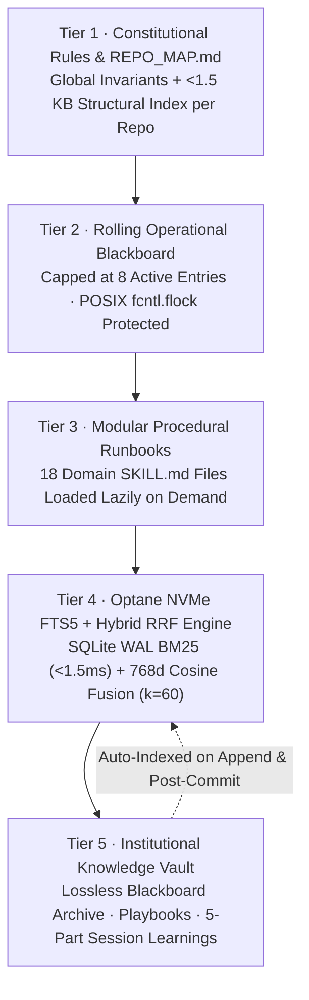
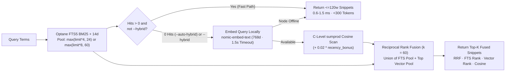

# 02 · Five-Tier Memory & Hybrid RRF Retrieval

Long-running engineering ecosystems accumulate huge volumes of operational memory: hardware scanner timing quirks, state statutory exceptions, Safari WebKit defects, and daily mission handoffs. Naive AI workflows hit a costly dilemma between two bad options:
- **Stuff Everything Into Context:** Reading flat 50,000-token archives on every turn exhausts context capacity, triggers lost-in-the-middle degradation, and burns rolling quota windows rapidly.
- **Start Every Session Cold:** Dropping institutional history forces engineers to re-explain solved failure modes week after week.

Hathcock Labs solves this via a **5-Tier Hierarchical Memory & Hybrid Retrieval Engine (`squad-memory`)** anchored on dedicated **Intel Optane NVMe scratch storage** and coupled asynchronously to **local `768`-dimensional semantic vectors** on our Apple Silicon node. Typical lexical searches resolve in **`0.6 ms – 1.5 ms`** and return **`<300` tokens** of grounded architectural snippets—over a **99% context reduction** compared to reading raw flat files.

---

## Five-Tier Memory Hierarchy



### Tier 1: Constitutional Ground Truth & Zero-Search `REPO_MAP.md`
At startup, the Mission Controller loads strictly compact constitutional bounds: physical node profiles, strict isolation walls (preventing commercial medical apps from coupling to unrelated study backends), and specialist delegation contracts.

Every repository maintains an auto-generated **`REPO_MAP.md`** capped under **`1.5 KB` (`~100–350` tokens)**. Inside monorepos, it parses `apps/`, `packages/`, and `services/` workspaces alongside pages, state slices, core services, and exact verification commands:

```markdown
# REPO MAP // sample-monorepo
> Role: Regulated Multi-Tenant Operations Platform
> Stack: pnpm Monorepo + React 19 + Expo React Native + Cloud Functions v2

### Workspace Packages & Apps
- `packages/domain`: Core Zod schemas, payroll math & shared enums
- `packages/compliance-engine`: Deterministic shift & armory eligibility evaluators
- `apps/web-command`: Daylight Operations Console & Client Portal
- `apps/mobile-guard`: Offline-first field client with FIFO outbox
- `services/functions`: Cloud Functions v2 callable guards & watchdogs

### Verification Commands
- Typecheck: `pnpm run typecheck` | Test: `pnpm run test` | Build: `pnpm run build`
```

Reading `REPO_MAP.md` replaces 5–8 blind `fd`/`rg` directory scans with direct symbol navigation—and pre-commit hooks refresh it automatically inside the same commit whenever tracked source files change.

### Tier 2: Rolling 8-Entry Blackboard & Re-Entrant `fcntl.flock` Locking
Live cross-agent mission handoffs sit in a compact operational blackboard strictly capped at the **8 most recent missions** (`<200` lines / `~30 KB`). Enforcing rolling compaction slashed subagent initialization reads from **~112,000 tokens down to ~7,800 tokens (~93% savings)**.

When four parallel specialists finish within milliseconds of each other, naive file appends interleave markdown blocks or lose updates. Every handoff invokes `squad-memory append`, protected at the OS kernel boundary by a **re-entrant POSIX advisory file lock (`fcntl.flock`)**:

```python
@contextmanager
def atomic_lock(lock_path=LOCK_PATH, timeout=10.0):
    global _LOCK_DEPTH, _LOCK_FILE
    if lock_path == LOCK_PATH and _LOCK_DEPTH > 0:
        _LOCK_DEPTH += 1  # Prevents self-deadlock during nested sync -> compact calls
        try:
            yield _LOCK_FILE
        finally:
            _LOCK_DEPTH -= 1
        return

    lf = open(lock_path, "a+")
    t0 = time.time()
    while True:
        try:
            fcntl.flock(lf.fileno(), fcntl.LOCK_EX | fcntl.LOCK_NB)
            break
        except (IOError, BlockingIOError):
            if time.time() - t0 > timeout:
                lf.close()
                raise TimeoutError(f"Lock timeout on {lock_path}")
            time.sleep(0.01)
    ...
```

Inside that exclusive lock, `append_mission()` completes four steps atomically:
1. Creates a `.bak` backup, prepends the new timestamped block (`### [YYYY-MM-DD HH:MM] — Agent: <Name>`), keeps only the newest `8` active entries, and moves overflow entries (deduplicated by exact header line) losslessly into cold archives.
2. Computes `SHA-256(header + body)` and executes `INSERT OR IGNORE` directly into SQLite FTS5 in **`<5 ms`**, making the new handoff immediately searchable.
3. Spawns a detached background embedding subprocess (`start_new_session=True`, `/dev/null` stdio) so foreground agents finish in ~5–16 ms with zero LAN HTTP blocking.

### Tier 3: Modular `SKILL.md` Procedural Runbooks
Eighteen specialist manuals—covering clinical ARDMS validation, OpenSCAD snap-fit tolerances, iOS Safari `<dialog>` rules, and scanner burst testing—stay out of default prompts and load lazily only when a specialist executes inside that domain.

---

## Tier 4: Optane NVMe SQLite FTS5 + Hybrid Reciprocal Rank Fusion (`k = 60`)

All Markdown knowledge—living engineering playbooks, domain skills, archived blackboards, adversarial dropzone reports, and daily session retrospectives—is chunked by `##` / `###` headings (extracting YAML frontmatter `title`, `date`, `tags`, and inline `#tags`) into a single SQLite database residing on Optane NVMe scratch storage.

### SQLite WAL Schema, Triggers & Memory-Mapped Tuning
```sql
PRAGMA journal_mode = WAL;
PRAGMA synchronous = NORMAL;
PRAGMA busy_timeout = 5000;
PRAGMA mmap_size = 268435456; -- 256 MB memory-mapped I/O window
PRAGMA temp_store = MEMORY;

CREATE TABLE sections (
    id INTEGER PRIMARY KEY AUTOINCREMENT,
    source_path TEXT NOT NULL,
    title TEXT NOT NULL,
    date TEXT,
    tags TEXT,
    content TEXT NOT NULL,
    content_hash TEXT UNIQUE NOT NULL,
    created_at TIMESTAMP DEFAULT CURRENT_TIMESTAMP
);

CREATE VIRTUAL TABLE sections_fts USING fts5(
    title, tags, content,
    content='sections',
    content_rowid='id',
    tokenize='porter unicode61'
);

CREATE TABLE section_embeddings (
    content_hash TEXT PRIMARY KEY,
    model TEXT NOT NULL,
    dims INTEGER NOT NULL,
    norm REAL NOT NULL,
    vector BLOB NOT NULL, -- Little-endian IEEE-754 float32 (<768f)
    updated_at TIMESTAMP DEFAULT CURRENT_TIMESTAMP
);

CREATE TRIGGER sections_ai AFTER INSERT ON sections BEGIN
    INSERT INTO sections_fts(rowid, title, tags, content)
    VALUES (new.id, new.title, new.tags, new.content);
END;

CREATE TRIGGER sections_ad AFTER DELETE ON sections BEGIN
    INSERT INTO sections_fts(sections_fts, rowid, title, tags, content)
    VALUES ('delete', old.id, old.title, old.tags, old.content);
END;

CREATE TRIGGER sections_au AFTER UPDATE ON sections BEGIN
    INSERT INTO sections_fts(sections_fts, rowid, title, tags, content)
    VALUES ('delete', old.id, old.title, old.tags, old.content);
    INSERT INTO sections_fts(rowid, title, tags, content)
    VALUES (new.id, new.title, new.tags, new.content);
END;
```

### Why Embedded SQLite BLOBs Beat Running a Separate Vector Daemon?
Running Qdrant, Chroma, or Pinecone on a `12 GB` RAM workstation adds constant background RAM overhead, socket serialization latency, and split backup states. Storing `768d` vectors as packed little-endian `float32` BLOBs (`3,072` bytes per chunk) keyed by **`SHA-256(title + content)` (`content_hash`)** yields three decisive engineering advantages:
1. **Hash-Keyed Cache Survival Across Rebuilds:** Because embeddings join on `content_hash` rather than ephemeral integer `rowid`s, full `sync` runs can clear and rebuild `sections` cleanly while unchanged chunks retain 100% of their pre-computed vectors—and orphaned vectors prune in one `DELETE WHERE content_hash NOT IN (...)` statement.
2. **Zero-Copy Single-File Disaster Recovery:** One online `sqlite3.Connection.backup()` snapshot captures both full-text indexes and semantic embeddings atomically.
3. **C-Accelerated Exact Cosine Scans:** Over ~750–1,500 structured knowledge chunks (~2.5–4.5 MB total vector data), Python's C-level `math.sumprod` computes **exact** cosine similarity across every row with zero approximate-nearest-neighbor recall loss.

### Markdown Parsing, Query Sanitization & Exact C-Level Cosine Kernels

Indexing raw `.md` files carelessly corrupts search signals—frontmatter keys pollute body text, inline `#comments` inside shell scripts look like hashtags, and FTS5 treats punctuation like `-`, `.`, or `/` in code identifiers (`ERR-403` or `firestore.rules`) as boolean syntax errors.

1. **Heading-Scoped Markdown Chunker:** Scans top-level YAML frontmatter once (`title`, `date`, `tags`), then splits prose cleanly at `##` / `###` section boundaries—tracking fenced code blocks (` ``` `) so `#` comments inside Python or Bash never become phantom tags, while hashing `(normalized_title + "\n" + body)` with SHA-256 (`content_hash`).
2. **FTS5 Punctuation Firewall (`sanitize_query`):** Unquoted hyphens (`auto-hybrid`) or colons (`title:foo`) crash SQLite `MATCH` queries with `fts5: syntax error`. The sanitizer strips FTS boolean operators unless explicitly quoted, preserves alphanumeric tokens cleanly (`r"[A-Za-z0-9_]+"`), wraps dashed tokens safely (`"auto-hybrid"`), and rejects blank queries before touching disk.
3. **Zero-Dependency C-Level Vector Scan:** Instead of shipping NumPy or native vector extensions inside hot CLI queries, `vector_search()` unpacks `<768f` binary BLOBs directly into Python tuples and runs C-level `math.sumprod` dot products:

```python
import math, struct

def cosine_scan(rows, q_vec, q_norm, recency_fn):
    scored = []
    for content_hash, dims, norm, blob, sec_date in rows:
        if norm <= 0.0 or dims != len(q_vec):
            continue
        v = struct.unpack(f"<{dims}f", blob)
        cos = math.sumprod(q_vec, v) / (q_norm * norm)
        # Subtle +0.02 tie-breaker for trailing 14-day entries without distorting semantics
        score = cos + 0.02 * recency_fn(sec_date)
        scored.append((score, cos, content_hash))
    scored.sort(reverse=True)
    return scored
```

Over `~1,000` archived sections (`~3.1 MB` of contiguous vector BLOBs inside Optane-backed page cache), this scan evaluates **100% exact cosine similarity** across the entire corpus in a few milliseconds without approximate index rebuilds.

### Two-Stage CTE Lexical Query + 14-Day Recency Scoring (`<1.5 ms`)
Read queries open SQLite via read-only URI (`?mode=ro`), sanitize punctuation safely (`sanitize_query`), and evaluate weighted BM25 inside a top-K Common Table Expression so SQLite touches full `sections` rows **strictly** for top hits:

```sql
WITH fts_hits AS (
    SELECT rowid, bm25(sections_fts, 5.0, 2.0, 1.0) AS rank
    FROM sections_fts
    WHERE sections_fts MATCH ?
    ORDER BY rank ASC
    LIMIT ?
)
SELECT s.id, s.title, s.source_path, s.date, s.tags, s.content, fts_hits.rank
FROM fts_hits
JOIN sections s ON s.id = fts_hits.rowid;
```

- **Weighted BM25 Field Priority:** Titles weigh **`5.0x`**, tags **`2.0x`**, and body prose **`1.0x`**.
- **Gentle 14-Day Recency Tie-Breaker:** Sections dated within the trailing `14` days earn a bounded boost (`0.20 * ((14.0 - days_old) / 14.0)`) subtracted from negative BM25 rank (`adj = raw_bm25 - bonus`), gently prioritizing fresh bugfixes over stale notes during ties without overriding strong lexical matches.
- **Hard Output Cap:** Formatted snippets cap at **`<= 120` words** (`<300` tokens across results).

### Hybrid Reciprocal Rank Fusion (`k = 60`) & `--auto-hybrid` Rescue

Exact keyword search struggles when terminology diverges (e.g., querying `"underground parking garage voice queue"` when the note reads `"dead-zone store-and-forward Opus capture"`).



#### Worked Numerical Example (`k = 60`)
Suppose Candidate **A** explains dead-zone store-and-forward queuing (`FTS rank #3`, `Vector rank #2`), whereas Candidate **B** merely repeats a superficial phrase (`FTS rank #1`, absent from top semantic results):

$$\text{RRF}(A) = \frac{1}{60 + 3} + \frac{1}{60 + 2} = 0.01587 + 0.01613 = \mathbf{0.03200}$$

$$\text{RRF}(B) = \frac{1}{60 + 1} + 0 = \mathbf{0.01639}$$

Candidate **A** scores nearly double **B**, with deterministic tie-breaking on raw cosine similarity. By default (`--auto-hybrid`), zero-hit lexical queries fall back automatically to Hybrid RRF without adding network latency to normal lexical hits—and if the Apple Silicon inference endpoint is unreachable past `1.5s`, execution falls back cleanly to pure Optane FTS5.

```python
def reciprocal_rank_fusion(fts_hits, vec_hits, k=60, limit=5):
    rrf_scores, fts_rank_map, vec_rank_map, cos_map = {}, {}, {}, {}
    for rank, row in enumerate(fts_hits, start=1):
        ch = row["content_hash"]
        fts_rank_map[ch] = rank
        rrf_scores[ch] = rrf_scores.get(ch, 0.0) + 1.0 / (k + rank)

    for rank, (score, cos, ch) in enumerate(vec_hits, start=1):
        vec_rank_map[ch] = rank
        cos_map[ch] = cos
        rrf_scores[ch] = rrf_scores.get(ch, 0.0) + 1.0 / (k + rank)

    # Deterministic tie-breaking: highest RRF -> highest cosine -> alphabetical hash
    ranked = sorted(
        rrf_scores.keys(),
        key=lambda ch: (rrf_scores[ch], cos_map.get(ch, -1.0), ch),
        reverse=True,
    )
    return [
        {
            "content_hash": ch,
            "rrf": rrf_scores[ch],
            "fts_rank": fts_rank_map.get(ch),
            "vec_rank": vec_rank_map.get(ch),
            "cosine": cos_map.get(ch),
        }
        for ch in ranked[:limit]
    ]
```

Two practical engineering properties make `k = 60` durable in daily use:
1. **Normalized Pool Sizing:** Rather than fusing only top-`5` from each branch, retrieval expands candidate pools to `max(limit * 4, 24)` (or `max(limit * 8, 60)` under explicit `--hybrid`) so domain hits ranking #12 lexically and #7 semantically still combine into the final top 3.
2. **Transparent Provenance Per Result:** Every returned card echoes exact diagnostics (`rrf=0.03200 · fts=#3 · vec=#2 · cos=0.78`), allowing engineers and specialists to tell immediately whether a match arrived from exact symbol syntax or conceptual resonance.

---

## Compaction Safety, Crash Resilience & Cold-Archive Deduplication

Rolling blackboards only inspire trust if archival never loses a handoff during a crash or duplicate write:

1. **Pre-Mutation Snapshot (`.bak`):** Before trimming any active entry, `compact_blackboard()` writes an atomic sibling backup so aborted writes leave complete pre-compaction state intact.
2. **Header-Keyed Archive Deduplication:** Overflow entries move out of the rolling `8`-slot active buffer and append strictly once to the monthly/yearly archive Markdown ledger, checking exact `### [YYYY-MM-DD HH:MM] — Agent: ...` header strings so repeated compaction sweeps stay idempotent.
3. **Orphan & Unembedded Repair Loop:** Full `sync` scans compute symmetric diffs against tracked Markdown paths—deleting sections whose source files were removed, inserting updated `content_hash` rows, and leaving historical `section_embeddings` cached untouched until `DELETE FROM section_embeddings WHERE content_hash NOT IN (SELECT content_hash FROM sections)` cleans stale rows in milliseconds.

---

## Measured Operational Performance & Benchmarks

| Operation | Execution Path | Measured Wall-Clock Latency | Output / Token Impact |
| :--- | :--- | :---: | :--- |
| **`squad-memory query` (Lexical)** | Optane SQLite WAL FTS5 CTE | **`0.63 ms – 1.50 ms`** | `<300` tokens (~99% reduction) |
| **`squad-memory query --hybrid`** | Optane FTS5 + LAN `768d` Cosine RRF | **`~229 ms – 406 ms`** | Zero cloud API tokens spent |
| **`squad-memory append`** | `fcntl.flock` + compaction + FTS5 insert | **`5.85 ms – 16.16 ms`** | Keeps blackboard at `8` entries |
| **Background Vector Spawn** | Detached `start_new_session` subprocess | **`4.75 ms` non-blocking** | `0 ms` UI/agent stall |
| **`squad-memory map`** | Structural `<1.5 KB` `REPO_MAP.md` gen | **`<50 ms` across all repos** | `~100–350` tokens per repo |

---

## Tier 5: Institutional Vault & Mandatory 5-Part Session Retrospectives

At the close of every major milestone, `Scout` and `Hermes` compile a structured retrospective (`YYYY-MM-DD_Session_Learnings.md`) enforcing five concrete sections:
1. **What Broke & Permanent Fixes:** Exact root causes and durable code/config resolutions (including exact error codes and schema migrations).
2. **Architectural Standards Established:** Conventions, security rules, and domain schemas ratified across teams.
3. **Silicon & Build Optimizations:** Measured kernel, bundler, and Optane/flash caching deltas verified empirically.
4. **Git Commits & Verification Status:** Exact commit hashes, remote sync state, and passing test/benchmark counts.
5. **Actionable Next-Session Handoffs:** Concrete open work and non-obvious edge cases ready for subsequent sprints.

Post-commit hooks and background sync immediately feed every section back into Tier 4's FTS5 + `768d` index, converting transient session debugging into permanent sub-millisecond recall.

> [!TIP]
> The payoff compounds week over week: fixing a subtle Safari WebKit modal bug or `pnpm` native-build quirk once makes the lesson retrievable across every future repository in under `1.5 ms` for the life of the platform.
