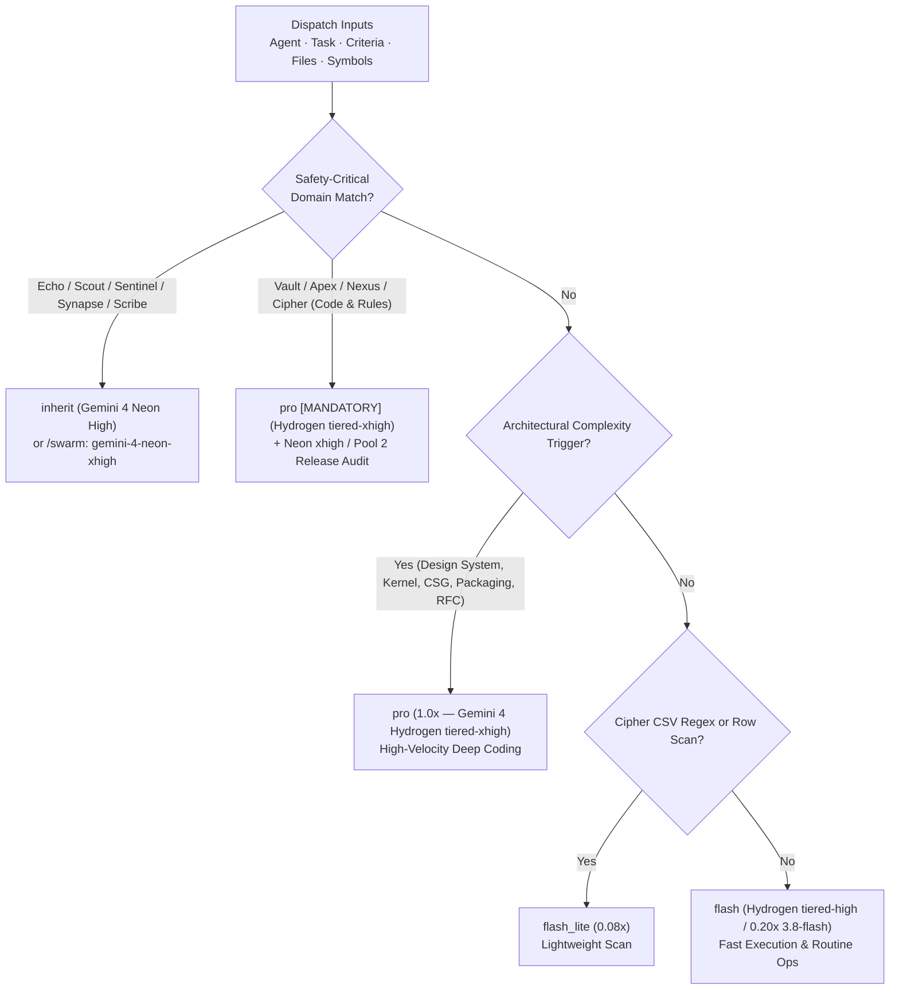

# 03 · Differential Context & Quota Governance

Even with sub-millisecond memory retrieval, multi-agent pipelines waste huge token budgets and suffer accuracy regressions if the Mission Controller pastes raw 600-line source files and multi-turn conversation logs into every subagent call. Bloated prompts push parallel waves against provider rate ceilings prematurely while burying the exact 20 lines of code that actually need work.

Hathcock Labs enforces lean dispatches, safety-locked model routing, and real-time quota visibility mechanically via two tools: our **Differential Context Compiler (`squad-context`)** and our **Dual-Window Telemetry HUD (`squad-live-telemetry`)**.

---

## 1. The `<= 2,000`-Token Differential Context Compiler

Every subagent invocation compiles deterministically under a strict **`MAX_TOKENS = 2000`** budget (conservatively estimated via `math.ceil(len(text) / 3.8)`).

### Five-Part Structure of a Compiled Subagent Dispatch
```markdown
### Subagent Mission Dispatch — `Vault`
- **Recommended Model:** `pro [MANDATORY]` — *Vault security rules / atomic transaction guardrail*
- **Workspace:** `<repo_root>`

#### 1. Task Brief & Acceptance Criteria
Enforce CLIENT_VIEWER exclusion on radio channels and prevent draft invoice reads.

**Acceptance Criteria:**
- Reject CLIENT_VIEWER in RadioChannelSchema.superRefine and firestore.rules
- Preserve existing tenant isolation tests and log completion via squad-memory append

**Scoped Targets:**
- firestore.rules (612 lines)
- packages/domain/src/schemas/radio.ts (248 lines)

#### 2. Structural Repo Map
- `packages/domain` (`@arclight/domain`): Zod schemas & shared enums ...

#### 3. Squadron Memory & Blackboard State Diff
- Latest Handoff: [2026-11-15 18:50] — Agent: Chronos ...
- **[Client Viewer Isolation Verification]** (2026-11-15): Multi-layer filter blocks...

#### 4. Targeted Symbol Slices (`<=35` lines/symbol)
#### [radio.ts#L36-L70] — `RadioChannelSchema`
```ts
export const RadioChannelSchema = z.object({ ... })
```
<!-- squad-context: 642/2000 est. tokens | model=pro [MANDATORY] -->
```

Notice what is **missing**: zero 600-line raw files, zero multi-turn conversational history, and zero unrelated workspace listings—yet `Vault` receives exact routing rationale, line-counted targets, repo structure, latest blackboard diff, memory context, and exact symbol lines in **`642` tokens**.

### AST-Heuristic Symbol Slicing (`<= 35` Lines)
Instead of reading whole source files into prompts, `extract_symbol_snippet` resolves explicit `file:symbol` paths, candidate target files, or scoped `ripgrep` fallbacks (excluding `node_modules`, `.git`, `dist`, `build`, and lockfiles). Once it matches a declaration line:

```python
def_pat = re.compile(
    rf"^\s*(?:export\s+)?(?:default\s+)?(?:async\s+)?"
    rf"(?:def|class|function|const|let|var|interface|type|enum|fn|pub\s+fn|struct)\s+{esc}\b"
)
top_decl = re.compile(r"^(?:def |class |export (?:default )?(?:async )?(?:function|class|interface|type) )")
```

It captures up to **`35` lines**, stops early the moment an unrelated top-level declaration begins, trims blank tail lines, and formats an exact line-ranged slice (`file#Lstart-Lend`).

### Eight-Step Progressive Trimming Ladder
When complex dispatches combine multiple symbol slices, memory snippets, repo maps, and git diffs exceeding `2,000` tokens, `build_context()` never arbitrarily chops off acceptance criteria. Instead, it iterates cleanly through **8 deterministic trim profiles**, shedding lower-priority context while protecting the core mission brief:

| Trim Step | Repo Map | Memory Snippets | Max Symbols | Lines / Symbol | Git Diff Hunks |
| :---: | :---: | :---: | :---: | :---: | :---: |
| **0 (Full)** | `16` lines | Top `2` + Diff | `6` | `35` | `36` hunk lines |
| **1** | `16` lines | Top `2` + Diff | `5` | `28` | `16` hunk lines |
| **2** | `7` lines | Top `2` + Diff | `4` | `22` | `0` (`--stat` only) |
| **3** | `7` lines | Top `1` + Diff | `3` | `16` | Disabled |
| **4** | `7` lines | Top `1` + Diff | `2` | `12` | Disabled |
| **5** | `7` lines | Diff Only | `1` | `10` | Disabled |
| **6** | Disabled | Diff Only | `0` | `0` | Disabled |
| **7** | Disabled | Disabled | `0` | `0` | Disabled |

### Anti-Dump Static Validation & JSONL Audit Trail
Running `squad-context validate` acts as an automated pre-dispatch firewall exiting `1` on four explicit violations:
1. **`EMPTY_PROMPT`:** Empty payload.
2. **`TOKEN_BUDGET_EXCEEDED`:** Estimated tokens strictly `> 2,000`.
3. **`RAW_FILE_DUMP_DETECTED`:** Detects **both** fenced code blocks AND unfenced raw code blocks exceeding **`80` contiguous code lines** (scanned via line-start heuristics matching `import`, `export`, `const`, `def`, `class`, control flow, and block braces).
4. **`UNPRUNED_CHAT_LOG_DETECTED`:** Rejects raw multi-turn transcript markers (`User:` / `Assistant:` `>= 4`, `[Message] timestamp=` `>= 3`, or `"role":` JSON turns `>= 4`) instead of concise 2-line state diffs.

Every validation appends an atomic `fcntl.flock`-guarded record into `dispatch_audit.jsonl`:

```json
{"timestamp": "2026-11-17T08:05:12Z", "agent": "Vault", "recommended_model": "pro [MANDATORY]", "chars": 2438, "est_tokens": 642, "max_code_lines": 34, "chat_markers": 0, "passed": true, "violations": []}
```

Engineers inspect fleet compliance rates, max/average prompt tokens, and blocked violations directly via `squad-context stats`.

### Catching Unfenced Code Dumps & Raw Transcript Loops
Polite instructions telling an orchestrator *"never paste whole files"* break silently whenever an agent pastes raw code *without* Markdown triple-backtick fences, or embeds serialized JSON chat transcripts inside prose. The validator closes both loopholes heuristically:

```python
_CODE_LINE_RE = re.compile(
    r"^\s*(?:import |from |export |const |let |var |function |async |def |class |"
    r"return |if\s*\(|for\s*\(|while\s*\(|try\s*\{|catch\s*\(|switch\s*\(|"
    r"interface |type |enum |public |private |protected |fn |pub fn |struct |"
    r"//|/\*|\*/|@[A-Za-z_]|[\}\]]+;?\s*$)"
)

def detect_code_dumps(prompt_text: str) -> tuple[int, list[str]]:
    in_fence, fence_len, unfenced_run, max_block = False, 0, 0, 0
    for line in prompt_text.splitlines():
        if line.strip().startswith("```"):
            if in_fence:
                max_block = max(max_block, fence_len)
                in_fence, fence_len = False, 0
            else:
                in_fence, fence_len, unfenced_run = True, 0, 0
        elif in_fence:
            fence_len += 1
        elif _CODE_LINE_RE.match(line):
            unfenced_run += 1
            max_block = max(max_block, unfenced_run)
        elif not line.strip() and unfenced_run > 0:
            unfenced_run += 1  # Keep contiguous across single blank formatting lines
        else:
            unfenced_run = 0
    return max_block, (["RAW_FILE_DUMP_DETECTED"] if max_block > 80 else [])
```

### Worked Progressive Trim Convergence (`3,410 -> 1,690` Tokens)
Consider dispatching `Apex` to lock down a Cloud Function billing webhook using `6` symbol slices, top `2` memory snippets, a `16`-line repo map, and an active `36`-line `git diff` hunk:

| Attempt | Active Trim Profile | Est. Payload | Decision | What Got Shed First |
| :---: | :--- | :---: | :---: | :--- |
| **1** | **Step 0** (`6` syms × `35L`, `36L` diff, `16L` map) | `3,410` tokens | Too heavy | Nothing dropped yet; `3,410 > 2,000` triggers Step 1 |
| **2** | **Step 1** (`5` syms × `28L`, `16L` diff, `16L` map) | `2,645` tokens | Too heavy | Lowest-priority `6th` symbol & trailing diff context |
| **3** | **Step 2** (`4` syms × `22L`, `--stat` diff, `7L` map) | `2,085` tokens | Near cap | Full hunk replaced with file line-change `--stat` |
| **4** | **Step 3** (`3` syms × `16L`, Top `1` memory, `7L` map) | **`1,690` tokens** | **`PASS`** | **Task brief, criteria, targets & top 3 symbols 100% intact** |

Even on a tight multi-file patch, critical acceptance criteria (`Section 1`) and targeted line ranges (`file#Lstart-Lend`) are **never truncated**—only secondary surrounding context steps back cleanly.

### Constitutional Rule-File Hygiene (`<24 KB` Per-File Injection Cap)
Subagent dispatch budgets mean nothing if the host runtime silently truncates the global system constitution on session boot. Many agentic IDE runtimes enforce a hard per-file rule injection cap of **`24,000` bytes (`<24 KB`)**: once a global rules file drifts past that ceiling, trailing guardrails—such as release immutability rules, model routing locks, or air-gap firewalls—quietly vanish from active context without raising an error.

To eliminate silent boot truncation permanently, Hathcock Labs refactored its global rules from **`40.7 KB` → `20.4 KB`** (`-49.9%` footprint, guarded below **`<22 KB`** by both `SessionStart` hooks and `squad-doctor` `29/29` for `~3.6 KB` headroom below the `24 KB` cap):
- **Single-Source Unified Roster (`squadron.json` → `agents/*.md`):** `fleet sync-roster` generates the compact 18-agent routing table and all 18 natively discovered `agents/*.md` specs from one canonical manifest, eliminating 4-way configuration drift.
- **Optane FTS5/Vector Offload (`1,015/1,015` Embedded Sections):** Moved deep procedural playbooks, historical failure traces, and extended specialist dossiers out of always-injected boot rules and into Optane SQLite WAL FTS5 + `768d` vector memory, retrieving them on demand in `<1.5 ms` with **zero boot truncation**.

### Deterministic Lifecycle Hooks (`hooks.json` · `65/65` Tests · `16–28 ms`)
Advisory prompt rules fail under fatigue or concurrent fan-out. Every critical runtime boundary now executes deterministically via native lifecycle hooks (**`hooks.json`**), verified by **`65/65` automated subprocess tests** at **`16–28 ms`** end-to-end latency:

| Lifecycle Hook Event | Enforced Runtime Invariant | Failure Mode Eliminated |
| :--- | :--- | :--- |
| **`SessionStart`** | Checks global rule file byte size (`<22 KB` alarm / `<24 KB` cap) and flags stale Optane worktrees exceeding `<24h` TTL. | Silent boot truncation & forgotten orphaned worktrees. |
| **`PreToolUse` (Shell & Write)** | Enforces strict project isolation boundaries (blocking cross-repo contamination between commercial clinical and unrelated study repos), blocks destructive shell commands & force-pushes, and runs write-time Tier-D Air-Gap leak scans on public repositories. | Cross-project contamination, destructive trunk resets & public leaks prior to disk write. |
| **`PreToolUse` + `PostToolUse` (12 GB OOM Lock)** | Acquires a kernel **`fcntl.flock`** lock (with **`15m` auto-TTL** safety expiry, released cleanly on `PostToolUse`) before launching heavy builds (`vite build`, headless Chromium/Playwright, Metro). | Concurrent bundler/browser swap thrash and OOM kills on `12 GB` workstation RAM. |
| **`PreToolUse` (`invoke_subagent`)** | Enforces the `<= 2,000`-token / `<= 80`-line anti-dump ceiling and mandatory safety-tier floors (`pro` / `inherit` Neon High) on safety-critical specialists. | Prompt bloat and accidental downgrade of security, clinical, or statutory checks. |

---

## 2. Dynamic Task-Tier Routing, 27-Model Catalog & Mandatory Safety Locks

Throwing deep frontier reasoning at `git status` or spacing adjustments wastes quota; routing database rules, statutory vetoes, or clinical fact-checking through lightweight models invites dangerous regressions. `recommend_model()` and explicit `/swarm` orchestration resolve routing deterministically across our **27-model dual-pool catalog**:



### Programmatic Routing Triggers Across All Specialists

| Specialist / Rule | Mandatory / Deep-Tier (`1.0x`) Triggers | Fast / Lightweight Bypass |
| :--- | :--- | :--- |
| **`Echo`** *(Mandatory)* | **`inherit` (Neon High) / `pro [MANDATORY]`** + `/swarm: gemini-4-neon-xhigh` (selective Pool 2 on Tier A1 clinical gates) unless pure JSON formatting | Syntax-only JSON prettification |
| **`Cipher`** *(Mandatory)* | **`pro [MANDATORY]`** on `payroll`, `invoice`, `overtime`, `flsa`, `pa act`, `tax`, `qbo`, `gl`, `journal`, `sla`, `arbitrage` + `inherit`/`gemini-4-neon-xhigh` verification | Dirty CSV header regex & row scans (`flash_lite`, `0.08x`) |
| **`Vault`** *(Mandatory)* | **`pro [MANDATORY]`** on `firestore.rules`, `security`, `permission`, `auth`, `iam`, `transaction`, `atomic`, `rollback`, `batch`, `composite cost` + `gemini-4-neon-xhigh` audit | Mock seed JSON or routine field stubs |
| **`Apex`** *(Mandatory)* | **`pro [MANDATORY]`** on `auth`, `crypto`, `hmac`, `signature`, `webhook`, `idempoten`, `jwt`, `oauth`, `kms`, `wiretap` + `gemini-4-neon-xhigh` auth audit | Routine status/env endpoint boilerplate |
| **`Nexus`** *(Mandatory)* | **`pro [MANDATORY]`** on `race`, `sync`, `clobber`, `merge`, `hydration`, `indexeddb`, `offline`, `conflict`, `multi-device`, `onsnapshot`, `outbox` | Basic listener shape audit |
| **`Scout`** *(Mandatory)* | **`inherit` (Neon High) [MANDATORY]** + `/swarm: gemini-4-neon-xhigh` for primary statutes, RFCs, and `Muse` adversarial audits | Quick version or syntax lookup |
| **`Sentinel`** *(Mandatory)* | **`inherit` (Neon High) [MANDATORY]** + `/swarm: gemini-4-neon-xhigh` on IAM, KMS, App Attest, data lifecycles, and air-gap boundaries (selective Pool 2 `claude-opus-5-5-high` on Tier A1/A2/D gates) | Regex secret sweeps, `0600` & `dist/` scans |
| **Architectural & Publication Triggers** | `Aegis` (`circular`, `refactor`, `react 19 compiler`), `Prism` (`design system`, `shader`; selective Pool 2 `claude-sonnet-5-5-high` for flagship UI overhauls), `Forge` (`manualchunks`, `rollup`, `100dvh`, `expo`, `capacitor`), `Beacon` (`ndef`, `lookahead`, `man-down`, `ptt`, `wedge`), `Torque` (`kernel`, `sysctl`, `udev`, `deadlock`), `Vanguard` (`scanner burst`, `partition`; cross-model `@verifier`), `Synapse` (`inherit` Neon High for evidentiary AI/telemetry), `Scribe` (`inherit` Neon High for public architecture docs), `Vulcan` (`csg`, `cantilever`, `pause-at-layer`) | Standard component edits, lint fixes, tests, commits |

### 27-Model Dual-Pool Catalog & Verified Runtime Delegation Architecture
Auditing live subscription rosters and actual child-subagent transcripts established both our **27-model dual-pool inventory** and the exact runtime mapping between abstract subagent tier enums and concrete executed models:

| Pool / Delegation Layer | Live Model Inventory (`27` Models) | Verified Runtime Role & Governance Policy |
| :--- | :--- | :--- |
| **Pool 1 · Gemini Family (`20` Models, Fixed 5h Bucket)** | **`Gemini 4 Neon`** (`low`, `medium`, `high`, `xhigh`), **`Orchestrator`** (`neon`, `argon`, default), **`Gemini 4 Hydrogen`**, **`Carbon`**, **`Argon`**, **`Gemini 3.8 Flash`** (`flash`, `flash-lite`) | Carries **`>95%`** of daily engineering load. `Halcyon` coordinates on `gemini-4-neon-high` and runs solo coding on `gemini-pro-orchestrator-neon`. |
| **Pool 2 · Cross-Vendor (`7` Models, Multi-Day Reset)** | **`Claude 5.5`** (`opus` / `sonnet` × `low`, `medium`, `high`) + sunsetting **`GPT-OSS 120B`** (`gpt-oss-120b-medium`, sunsets `2026-11-30` — **excluded from routing**) | Tracked via isolated **`Cld:XX%/XdXXh`** anchor. Reserved strictly for cross-vendor Tier A1/A2/D release gates, flagship `Prism` UI overhauls, cross-model `@verifier` checks, stalled refactors, or Pool 1 exhaustion. |
| **Subagent Tier Enum (`inherit \| pro \| flash \| flash_lite`)** | `pro` → **`Gemini 4 Hydrogen` (`tiered-xhigh`)** · `flash` → **`Gemini 4 Hydrogen` (`tiered-high`)** · `inherit` → **Coordinator's `Gemini 4 Neon High`** | Verified directly from child execution transcripts: coding subagents inherit Hydrogen's high-velocity code execution while `inherit` passes the coordinator's Neon High reasoning tier straight to clinical, statutory, security, and publication specialists. |
| **Explicit `/swarm` Model Pinning** | **`gemini-4-neon-xhigh`** (Pool 1 deep verification) · **`claude-opus-5-5-high`** / **`claude-sonnet-5-5-high`** (selective Pool 2 cross-checks) | Used whenever exact model IDs are mandatory—pinning `gemini-4-neon-xhigh` for high-consequence security, statutory, clinical, and financial verification or engaging cross-vendor review on release gates. |
| **Child-Transcript Classifier (`_classify_model_tier`)** | Normalizes concrete executed model IDs (`neon-*`, `hydrogen-*`, `argon-*`, `carbon-*`, `low`, `medium`, `3.8-flash`, `flash-lite`) directly from child transcripts | Eliminates alias distortion when `flash` or `inherit` resolves to different backend models across tiers, ensuring every token bills into its exact weight bucket. |

---

## 3. Fixed-Bucket Dual-Pool Telemetry Calibration & Live HUD

Earlier telemetry assumed a simple sliding 5-hour window (`oldest + 5h`) and inferred model weights from parent dispatch labels. Analyzing wake-window boundary traces (`15:15:13 -> 20:15:13`) and inspecting actual child subagent transcripts proved two structural truths: Pool 1 enforces a **fixed 5-hour bucket** initiated by the first request after the previous bucket expires (`bucket_end = bucket_start + 5h`), while Pool 2 runs on a completely separate **multi-day rolling reset** (`Cld:XX%/XdXXh`) that must never dilute Pool 1 totals.

### Unified Weighted Token Formula & Calibrated Pool Constants
`squad-live-telemetry` parses **actual executed model IDs from both parent and child subagent transcripts**, isolates Pool 1 Gemini turns from Pool 2 cross-vendor sessions, reads uncached `input_tokens`, `output_tokens`, and `cache_read_tokens` directly (using `0.15 / 0.85` fallback splitting strictly on legacy rows), and applies empirically calibrated tier weights:

$$\text{Weighted Tokens} = \sum_{\text{tier}} w_{\text{tier}} \times \Big(\text{Input}_{\text{uncached}} + (4.0 \times \text{Output}) + (0.025 \times \text{Cache}_{\text{read}})\Big)$$

where $w_{\text{tier}} \in \{1.0_{\text{pro/high/xhigh}},\, 0.55_{\text{medium}},\, 0.35_{\text{gemini4-low}},\, 0.20_{\text{3.8-flash}},\, 0.08_{\text{flash-lite}}\}$.

- **Separate `Gemini 4 Low` (`0.35x`) Tier:** Distinct from `0.55x` medium and `0.20x` `Gemini 3.8 Flash`, preventing Gemini 4 low-tier bursts from skewing empirical 5-hour burn curves.
- **Fixed 5-Hour Pool 1 Bucket (`SQUAD_5H_QUOTA = 32,500,000`):** Calibrated empirically against live platform remaining-percentage headers (`27.36M / 0.84 = 32.57M`). A bucket initiates cleanly on the first post-expiry request and resets deterministically at `bucket_start + 5h` (`Rst: XhXXm` or `Ready`).
- **7-Day Rolling Heuristic (`SQUAD_WEEKLY_QUOTA = 325,000,000`, `~7d est`):** Recalibrated from earlier `195M` estimates to reflect observed multi-day throughput across the 27-model catalog. Crucially, the HUD implements **false-alarm suppression**: whenever live server headers confirm Pool 1 is unthrottled, spurious `[CRIT]` red banners are suppressed so operators see real status (`~7d est`) instead of alert fatigue.
- **Automatic `/usage` Ground-Truth Lock (`XX% LIVE` + `Cld:XX%/XdXXh`):** Invoking zero-worker model roster introspection at session start and sprint milestones writes exact server-side `quota_remaining` and `quota_resets` headers directly into transcripts—anchoring both Pool 1 (`84% LIVE`) and the Pool 2 multi-day countdown (`Cld:100%/4d18h`) across the entire `0%–100%` range.

### Terminal Systems Engineering Inside the HUD
Rendering dense multi-column ANSI dashboards inside split terminal multiplexers (Zellij / COSMIC Terminal) hits subtle rendering traps that shatter naive Python `len()` alignment:

```python
def _grapheme_width(s, idx):
    """Account for zero-width ANSI sequences, combining marks, variation selectors & 2-col emoji."""
    ch = s[idx]
    nxt = idx + 1
    has_vs16 = False
    while nxt < len(s):
        c2 = s[nxt]
        if c2 == '\ufe0f':
            has_vs16 = True
            nxt += 1
        elif unicodedata.category(c2) in ('Mn', 'Me', 'Cf') and c2 != '\u200d':
            nxt += 1
        else:
            break
    cp = ord(ch)
    if cp < 32 or cp == 0x7F:
        return 0, nxt
    if has_vs16 or (0x1F300 <= cp <= 0x1FAFF) or unicodedata.east_asian_width(ch) in ('W', 'F'):
        return 2, nxt
    if unicodedata.category(ch) in ('Mn', 'Me', 'Cf'):
        return 0, nxt
    return 1, nxt
```

1. **Zero Color Bleed (`fit_line`):** Tracks whether ANSI escapes were opened on a truncated line and emits `\033[0m` cleanly before `\033[K\r\n`, preventing runaway background colors from spilling across adjacent multiplexer panes.
2. **Responsive Multi-Breakpoint Grid:** Reads live `shutil.get_terminal_size()` on every 2-second frame, adapting the 18-specialist grid dynamically across `3` columns (`>= 88` cols), `2` columns (`>= 58` cols), or `1` column vertically—computing `text_budget = max(8, cell_w - 4 - badge_w)` and selecting full, short, or compact role descriptors alongside live `<45s` subagent tool summaries and fleet Git clean/dirty badges.
3. **Syntax-Guarded `os.execv()` Hot-Reload:** Monitors its own script `mtime`; when modified, validates syntax in memory via `compile(source, script_path, 'exec')` *before* calling `os.execv()`, guaranteeing an in-progress edit never kills the live monitoring pane.

```python
_ANSI_RE = re.compile(r"\x1b\[[0-9;?]*[ -/]*[@-~]")

def fit_line(s: str, max_w: int) -> str:
    """Truncate ANSI-styled text strictly by rendered display columns without slicing escape bytes."""
    out, col, idx, has_ansi = [], 0, 0, False
    n = len(s)
    while idx < n:
        if s[idx] == "\x1b":
            m = _ANSI_RE.match(s, idx)
            if m:
                out.append(m.group(0))
                has_ansi = True
                idx = m.end()
                continue
        w, nxt = _grapheme_width(s, idx)
        if col + w > max_w:
            break
        out.append(s[idx:nxt])
        col += w
        idx = nxt
    rendered = "".join(out)
    if has_ansi:
        rendered += "\033[0m"
    return rendered + ("\033[0K" if max_w > 0 else "")
```

### Live Telemetry HUD Operator View
In production inside a side-by-side terminal workspace split, the HUD distills system telemetry into a single non-scrolling dashboard frame every 2 seconds:

```text
 SQUADRON LIVE TELEMETRY · 5h: 84% LIVE (27.3M / 32.5M) · Cld:100%/4d18h · Rst: 3h11m · [~7d est: 28% OK] · Cache: 88.4%
───────────────────────────────────────────────────────────────────────────────────────────────────────────────────────
 ◈ Aegis     [IDLE] Clean TS/Lint       ◈ Vault     [PRO]  Rules & Schema    ◈ Apex     [PRO]  Guards & HMAC
 ◈ Nexus     [PRO]  Sync & IndexedDB    ◈ Cipher    [PRO]  Ledger & ETL      ◈ Prism    [ACTV] Tokens OKLCH
 ◈ Forge     [IDLE] 100dvh & Native     ◈ Beacon    [IDLE] <35ms & RTC       ◈ Vulcan   [IDLE] CSG Fixtures
 ◈ Echo      [NEON] Clinical Read-Only  ◈ Scout     [NEON] Veto & Dropzone   ◈ Scribe   [ACTV] Air-Gap Docs
 ◈ Hermes    [IDLE] Private Vault Only  ◈ Torque    [IDLE] 29/29 & Kernel    ◈ Synapse  [IDLE] RRF & Compiler
 ◈ Vanguard  [ACTV] E2E Visual Gate     ◈ Sentinel  [NEON] IAM & Air-Gap     ◈ Chronos  [IDLE] 24/24 Rulesets
───────────────────────────────────────────────────────────────────────────────────────────────────────────────────────
 WORKSPACE FLEET (12): arclight [clean] · sonoprep [clean] · video-engine [clean] · docs [worktree]
```

### Automated Action Thresholds on Dual-Pool Quota Gauges

| Gauge Threshold | Operational State Transition |
| :--- | :--- |
| **`5h > 25% remaining` and `~7d est < 70%`** | Standard Pool 1 routing (`>95%` volume): `Halcyon` on `gemini-4-neon-high`, solo coding on `gemini-pro-orchestrator-neon`, `inherit` → Neon High for verification specialists, `pro`/`flash` → Hydrogen coding tiers, and `0.35x` / `0.20x` / `0.08x` for routine sweeps. |
| **`5h <= 25% remaining`** *(Fixed `Rst:` < 90m)* | Pause non-critical documentation sweeps; prioritize only open verification gates (`Vanguard`, `Sentinel`, `Chronos`) or spill overflow selectively onto Pool 2 Claude 5.5 (`Cld:XX%/XdXXh`, excluding sunsetting GPT-OSS 120B). |
| **`~7d est >= 70%`** *(Elevated Heuristic)* | Disable optional deep formatting sweeps; offload triage, digests, code review, and sanity checks strictly to Node 2 via `squad-local` (`hermes3:8b`, `qwen2.5-coder:14b`, `deepseek-r1:14b`, `qwen3:14b`). |
| **Live Pool 1 Throttled or `~7d est >= 90%` Confirmed** | **Emergency Freeze on Exploratory Sweeps** *(false `[CRIT]` alarms suppressed while Pool 1 remains unthrottled on live `/usage` headers)*: Allow strictly mandatory verification gates (`Echo`, `Scout`, `Cipher`, `Vault`, `Apex`, `Nexus`, `Sentinel`) and final `Chronos` releases. |

By surfacing both rolling counters before exhaustion hits, teams preserve deep reasoning headroom specifically for high-consequence security, synchronization, and clinical verification passes.
