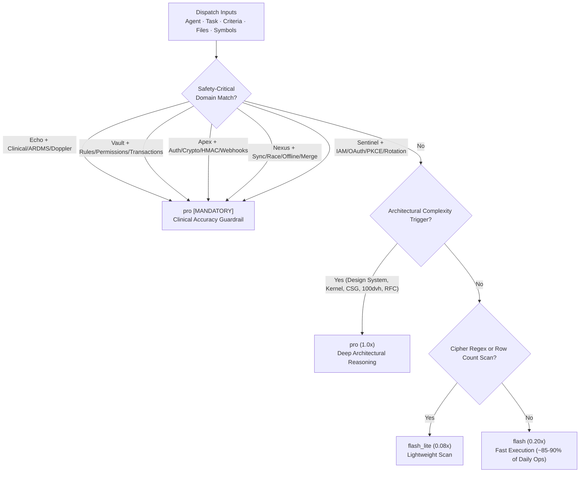

# 03 · Differential Context & Quota Governance

Even with sub-millisecond memory retrieval, multi-agent pipelines waste huge token budgets and suffer accuracy regressions if the Mission Controller pastes raw 600-line source files and multi-turn conversation logs into every subagent call. Bloated prompts push parallel waves against provider rate ceilings prematurely while burying the exact 20 lines of code that actually need work.

Hathcock Labs enforces lean dispatches, safety-locked model routing, and real-time quota visibility mechanically via two tools: our **Differential Context Compiler (`squad-context`)** and our **Dual-Window Telemetry HUD (`squad-live-telemetry`)**.

---

## 1. The `<= 2,000`-Token Differential Context Compiler

Every subagent invocation compiles deterministically under a strict **`MAX_TOKENS = 2000`** budget (conservatively estimated via `math.ceil(len(text) / 3.8)`).

### Five-Part Structure of a Compiled Subagent Dispatch
```markdown
### Subagent Mission Dispatch — `Vault`
- **Recommended Model:** `pro [MANDATORY]` — *Vault security rules / atomic transaction guardrail*
- **Workspace:** `<repo_root>`

#### 1. Task Brief & Acceptance Criteria
Enforce CLIENT_VIEWER exclusion on radio channels and prevent draft invoice reads.

**Acceptance Criteria:**
- Reject CLIENT_VIEWER in RadioChannelSchema.superRefine and firestore.rules
- Preserve existing tenant isolation tests and log completion via squad-memory append

**Scoped Targets:**
- firestore.rules (612 lines)
- packages/domain/src/schemas/radio.ts (248 lines)

#### 2. Structural Repo Map
- `packages/domain` (`@arclight/domain`): Zod schemas & shared enums ...

#### 3. Squadron Memory & Blackboard State Diff
- Latest Handoff: [2026-11-15 18:50] — Agent: Chronos ...
- **[Client Viewer Isolation Verification]** (2026-11-15): Multi-layer filter blocks...

#### 4. Targeted Symbol Slices (`<=35` lines/symbol)
#### [radio.ts#L36-L70] — `RadioChannelSchema`
```ts
export const RadioChannelSchema = z.object({ ... })
```
<!-- squad-context: 642/2000 est. tokens | model=pro [MANDATORY] -->
```

Notice what is **missing**: zero 600-line raw files, zero multi-turn conversational history, and zero unrelated workspace listings—yet `Vault` receives exact routing rationale, line-counted targets, repo structure, latest blackboard diff, memory context, and exact symbol lines in **`642` tokens**.

### AST-Heuristic Symbol Slicing (`<= 35` Lines)
Instead of reading whole source files into prompts, `extract_symbol_snippet` resolves explicit `file:symbol` paths, candidate target files, or scoped `ripgrep` fallbacks (excluding `node_modules`, `.git`, `dist`, `build`, and lockfiles). Once it matches a declaration line:

```python
def_pat = re.compile(
    rf"^\s*(?:export\s+)?(?:default\s+)?(?:async\s+)?"
    rf"(?:def|class|function|const|let|var|interface|type|enum|fn|pub\s+fn|struct)\s+{esc}\b"
)
top_decl = re.compile(r"^(?:def |class |export (?:default )?(?:async )?(?:function|class|interface|type) )")
```

It captures up to **`35` lines**, stops early the moment an unrelated top-level declaration begins, trims blank tail lines, and formats an exact line-ranged slice (`file#Lstart-Lend`).

### Eight-Step Progressive Trimming Ladder
When complex dispatches combine multiple symbol slices, memory snippets, repo maps, and git diffs exceeding `2,000` tokens, `build_context()` never arbitrarily chops off acceptance criteria. Instead, it iterates cleanly through **8 deterministic trim profiles**, shedding lower-priority context while protecting the core mission brief:

| Trim Step | Repo Map | Memory Snippets | Max Symbols | Lines / Symbol | Git Diff Hunks |
| :---: | :---: | :---: | :---: | :---: | :---: |
| **0 (Full)** | `16` lines | Top `2` + Diff | `6` | `35` | `36` hunk lines |
| **1** | `16` lines | Top `2` + Diff | `5` | `28` | `16` hunk lines |
| **2** | `7` lines | Top `2` + Diff | `4` | `22` | `0` (`--stat` only) |
| **3** | `7` lines | Top `1` + Diff | `3` | `16` | Disabled |
| **4** | `7` lines | Top `1` + Diff | `2` | `12` | Disabled |
| **5** | `7` lines | Diff Only | `1` | `10` | Disabled |
| **6** | Disabled | Diff Only | `0` | `0` | Disabled |
| **7** | Disabled | Disabled | `0` | `0` | Disabled |

### Anti-Dump Static Validation & JSONL Audit Trail
Running `squad-context validate` acts as an automated pre-dispatch firewall exiting `1` on four explicit violations:
1. **`EMPTY_PROMPT`:** Empty payload.
2. **`TOKEN_BUDGET_EXCEEDED`:** Estimated tokens strictly `> 2,000`.
3. **`RAW_FILE_DUMP_DETECTED`:** Detects **both** fenced code blocks AND unfenced raw code blocks exceeding **`80` contiguous code lines** (scanned via line-start heuristics matching `import`, `export`, `const`, `def`, `class`, control flow, and block braces).
4. **`UNPRUNED_CHAT_LOG_DETECTED`:** Rejects raw multi-turn transcript markers (`User:` / `Assistant:` `>= 4`, `[Message] timestamp=` `>= 3`, or `"role":` JSON turns `>= 4`) instead of concise 2-line state diffs.

Every validation appends an atomic `fcntl.flock`-guarded record into `dispatch_audit.jsonl`:

```json
{"timestamp": "2026-11-17T08:05:12Z", "agent": "Vault", "recommended_model": "pro [MANDATORY]", "chars": 2438, "est_tokens": 642, "max_code_lines": 34, "chat_markers": 0, "passed": true, "violations": []}
```

Engineers inspect fleet compliance rates, max/average prompt tokens, and blocked violations directly via `squad-context stats`.

### Catching Unfenced Code Dumps & Raw Transcript Loops
Polite instructions telling an orchestrator *"never paste whole files"* break silently whenever an agent pastes raw code *without* Markdown triple-backtick fences, or embeds serialized JSON chat transcripts inside prose. The validator closes both loopholes heuristically:

```python
_CODE_LINE_RE = re.compile(
    r"^\s*(?:import |from |export |const |let |var |function |async |def |class |"
    r"return |if\s*\(|for\s*\(|while\s*\(|try\s*\{|catch\s*\(|switch\s*\(|"
    r"interface |type |enum |public |private |protected |fn |pub fn |struct |"
    r"//|/\*|\*/|@[A-Za-z_]|[\}\]]+;?\s*$)"
)

def detect_code_dumps(prompt_text: str) -> tuple[int, list[str]]:
    in_fence, fence_len, unfenced_run, max_block = False, 0, 0, 0
    for line in prompt_text.splitlines():
        if line.strip().startswith("```"):
            if in_fence:
                max_block = max(max_block, fence_len)
                in_fence, fence_len = False, 0
            else:
                in_fence, fence_len, unfenced_run = True, 0, 0
        elif in_fence:
            fence_len += 1
        elif _CODE_LINE_RE.match(line):
            unfenced_run += 1
            max_block = max(max_block, unfenced_run)
        elif not line.strip() and unfenced_run > 0:
            unfenced_run += 1  # Keep contiguous across single blank formatting lines
        else:
            unfenced_run = 0
    return max_block, (["RAW_FILE_DUMP_DETECTED"] if max_block > 80 else [])
```

### Worked Progressive Trim Convergence (`3,410 -> 1,690` Tokens)
Consider dispatching `Apex` to lock down a Cloud Function billing webhook using `6` symbol slices, top `2` memory snippets, a `16`-line repo map, and an active `36`-line `git diff` hunk:

| Attempt | Active Trim Profile | Est. Payload | Decision | What Got Shed First |
| :---: | :--- | :---: | :---: | :--- |
| **1** | **Step 0** (`6` syms × `35L`, `36L` diff, `16L` map) | `3,410` tokens | Too heavy | Nothing dropped yet; `3,410 > 2,000` triggers Step 1 |
| **2** | **Step 1** (`5` syms × `28L`, `16L` diff, `16L` map) | `2,645` tokens | Too heavy | Lowest-priority `6th` symbol & trailing diff context |
| **3** | **Step 2** (`4` syms × `22L`, `--stat` diff, `7L` map) | `2,085` tokens | Near cap | Full hunk replaced with file line-change `--stat` |
| **4** | **Step 3** (`3` syms × `16L`, Top `1` memory, `7L` map) | **`1,690` tokens** | **`PASS`** | **Task brief, criteria, targets & top 3 symbols 100% intact** |

Even on a tight multi-file patch, critical acceptance criteria (`Section 1`) and targeted line ranges (`file#Lstart-Lend`) are **never truncated**—only secondary surrounding context steps back cleanly.

---

## 2. Dynamic Task-Tier Routing & Mandatory Safety Locks

Throwing deep frontier reasoning at `git status` or spacing adjustments wastes quota; routing database rules or clinical fact-checking through fast lightweight models invites dangerous regressions. `recommend_model()` resolves routing deterministically:



### Programmatic Routing Triggers Across All Specialists

| Specialist / Rule | Mandatory / Deep-Tier (`1.0x`) Triggers | Fast / Lightweight Bypass (`0.20x` / `0.08x`) |
| :--- | :--- | :--- |
| **`Echo`** *(Mandatory)* | Unconditional unless pure formatting (`json format`, `syntax check`, `indent`) with **zero** clinical/ultrasound/doppler terms | Syntax-only JSON prettification (`0.20x`) |
| **`Vault`** *(Mandatory)* | `firestore.rules`, `security`, `permission`, `auth`, `iam`, `transaction`, `atomic`, `rollback`, `batch`, `dexie`, `composite cost` | Mock seed JSON or routine field stubs (`0.20x`) |
| **`Apex`** *(Mandatory)* | `auth`, `crypto`, `hmac`, `signature`, `webhook`, `idempoten`, `jwt`, `oauth`, `concurrency`, `pubsub`, `middleware` | Routine endpoint boilerplate (`0.20x`) |
| **`Nexus`** *(Mandatory)* | `race`, `sync`, `clobber`, `merge`, `hydration`, `indexeddb`, `offline`, `conflict`, `multi-device`, `onsnapshot`, `atomic` | Basic state-shape audit (`0.20x`) |
| **`Sentinel`** *(Mandatory)* | `iam`, `oauth`, `pkce`, `jwt`, `privilege`, `escalation`, `rotation architecture`, `auth boundary`, `supply-chain compromise` | Regex secret sweeps & patch CVEs (`0.20x`) |
| **Architectural Triggers (`pro`)** | `Aegis` (`circular`, `refactor`, `react 19 compiler`), `Prism` (`design system`, `shader`, `anti-slop overhaul`), `Forge` (`manualchunks`, `rollup`, `100dvh`, `safari`), `Beacon` (`ndef`, `lookahead`, `wedge protocol`), `Torque` (`kernel`, `sysctl`, `udev`, `deadlock`), `Vanguard` (`scanner burst`, `partition`, `stress`), `Vulcan` (`csg`, `cantilever`, `pause-at-layer`) | Standard component edits, lint fixes, tests, commits (`0.20x`; `0.55x` medium); `Cipher` `regex` / `row count` scans (`0.08x`) |

---

## 3. Dual-Window Rolling Quota & Live HUD Telemetry

AI provider plans frequently enforce **overlapping rolling limits**: a fast 5-hour burst window alongside a 7-day weekly ceiling. Reaching the weekly cap unexpectedly mid-sprint stalls shipping even when the 5-hour meter looks empty. Our live terminal HUD (`squad-live-telemetry.py`) reads real transcript logs every 2 seconds to monitor both windows simultaneously.

### Unified Weighted Token Formula
Transcript log parsing reads native uncached `input_tokens`, `output_tokens`, and `cache_read_tokens` directly (applying a `0.15 / 0.85` split fallback only on legacy multi-turn rows missing explicit cache counts) and weights usage by **model tier** (`1.0x` pro/high, `0.55x` medium, `0.20x` flash, `0.08x` flash-lite), `4.0x` output cost, and **`0.025x` prompt-cache read weight**:

$$\text{Weighted Tokens} = \sum_{\text{tier}} w_{\text{tier}} \times \Big(\text{Input}_{\text{uncached}} + (4.0 \times \text{Output}) + (0.025 \times \text{Cache}_{\text{read}})\Big)$$

where $w_{\text{tier}} \in \{1.0_{\text{pro}},\, 0.55_{\text{medium}},\, 0.20_{\text{flash}},\, 0.08_{\text{lite}}\}$.

- **5-Hour Estimated Rolling Envelope (`~100,000,000` weighted tokens, no turn-count cap):** Tracks trailing `18,000`-second burn and computes a **25%-load rolloff countdown (`Rst: XhXXm`)**—scanning active steps chronologically until `25%` of current weighted load crosses the oldest aging boundary (`rolloff_ep + 18000 - now`), showing exactly when meaningful capacity frees up rather than waiting on a single small initial turn.
- **7-Day Estimated Rolling Weekly Cap (`~500,000,000` weighted tokens, `~5.0x` full burst windows):** Displays green `[~7d: X% OK]` below `70%`, yellow `[WARN: ~7d CAP X%]` from `70%–89%`, and red `[CRIT: ~7d CAP X%]` at `>= 90%`, alongside live prompt cache hit percentage (`Cache: X%`). Exhausting the weekly ceiling supersedes the 5-hour reset countdown.

### Terminal Systems Engineering Inside the HUD
Rendering dense multi-column ANSI dashboards inside split terminal multiplexers (Zellij / COSMIC Terminal) hits subtle rendering traps that shatter naive Python `len()` alignment:

```python
def _grapheme_width(s, idx):
    """Account for zero-width ANSI sequences, combining marks, variation selectors & 2-col emoji."""
    ch = s[idx]
    nxt = idx + 1
    has_vs16 = False
    while nxt < len(s):
        c2 = s[nxt]
        if c2 == '\ufe0f':
            has_vs16 = True
            nxt += 1
        elif unicodedata.category(c2) in ('Mn', 'Me', 'Cf') and c2 != '\u200d':
            nxt += 1
        else:
            break
    cp = ord(ch)
    if cp < 32 or cp == 0x7F:
        return 0, nxt
    if has_vs16 or (0x1F300 <= cp <= 0x1FAFF) or unicodedata.east_asian_width(ch) in ('W', 'F'):
        return 2, nxt
    if unicodedata.category(ch) in ('Mn', 'Me', 'Cf'):
        return 0, nxt
    return 1, nxt
```

1. **Zero Color Bleed (`fit_line`):** Tracks whether ANSI escapes were opened on a truncated line and emits `\033[0m` cleanly before `\033[K\r\n`, preventing runaway background colors from spilling across adjacent multiplexer panes.
2. **Responsive Multi-Breakpoint Grid:** Reads live `shutil.get_terminal_size()` on every 2-second frame, adapting the 18-specialist grid dynamically across `3` columns (`>= 88` cols), `2` columns (`>= 58` cols), or `1` column vertically—computing `text_budget = max(8, cell_w - 4 - badge_w)` and selecting full, short, or compact role descriptors alongside live `<45s` subagent tool summaries and fleet Git clean/dirty badges.
3. **Syntax-Guarded `os.execv()` Hot-Reload:** Monitors its own script `mtime`; when modified, validates syntax in memory via `compile(source, script_path, 'exec')` *before* calling `os.execv()`, guaranteeing an in-progress edit never kills the live monitoring pane.

```python
_ANSI_RE = re.compile(r"\x1b\[[0-9;?]*[ -/]*[@-~]")

def fit_line(s: str, max_w: int) -> str:
    """Truncate ANSI-styled text strictly by rendered display columns without slicing escape bytes."""
    out, col, idx, has_ansi = [], 0, 0, False
    n = len(s)
    while idx < n:
        if s[idx] == "\x1b":
            m = _ANSI_RE.match(s, idx)
            if m:
                out.append(m.group(0))
                has_ansi = True
                idx = m.end()
                continue
        w, nxt = _grapheme_width(s, idx)
        if col + w > max_w:
            break
        out.append(s[idx:nxt])
        col += w
        idx = nxt
    rendered = "".join(out)
    if has_ansi:
        rendered += "\033[0m"
    return rendered + ("\033[0K" if max_w > 0 else "")
```

### Live Telemetry HUD Operator View
In production inside a side-by-side terminal workspace split, the HUD distills system telemetry into a single non-scrolling dashboard frame every 2 seconds:

```text
 SQUADRON LIVE TELEMETRY · 5h: ~18% est (18.4M / 100M) · Rst: 3h14m · [~7d: 41% OK] · Cache: 88.4%
──────────────────────────────────────────────────────────────────────────────────────────────────
 ◈ Aegis     [IDLE] Clean TS/Lint       ◈ Vault     [PRO]  Rules & Schema    ◈ Apex     [PRO]  Guards & HMAC
 ◈ Nexus     [PRO]  Sync & IndexedDB    ◈ Cipher    [IDLE] ETL & Schedules   ◈ Prism    [ACTV] Tokens OKLCH
 ◈ Forge     [IDLE] 100dvh & Chunks     ◈ Beacon    [IDLE] <35ms & Audio     ◈ Vulcan   [IDLE] CSG Fixtures
 ◈ Echo      [PRO]  Clinical Read-Only  ◈ Scout     [IDLE] RFC & Dropzone    ◈ Scribe   [ACTV] Docs Authoring
 ◈ Hermes    [IDLE] Vault Triage        ◈ Torque    [IDLE] Kernel & Nodes    ◈ Synapse  [IDLE] RRF & Compiler
 ◈ Vanguard  [ACTV] E2E Visual Gate     ◈ Sentinel  [PRO]  IAM & Leaks       ◈ Chronos  [IDLE] Git & Releases
──────────────────────────────────────────────────────────────────────────────────────────────────
 WORKSPACE FLEET: arclight [clean] · sonoprep [clean] · retail-pwa [clean] · docs [2 modified]
```

### Automated Action Thresholds on Dual Quota Gauges

| Gauge Threshold | Operational State Transition |
| :--- | :--- |
| **`5h < 70%` and `7d < 70%`** | Standard dynamic routing: `~85–90%` tasks on `0.20x` fast tier (`0.55x` medium / `0.08x` lite); mandatory + architectural specialists at `1.0x`. |
| **`5h >= 75%`** *(25%-rolloff `Rst:` < 90m)* | Pause non-critical documentation sweeps; prioritize only open verification gates (`Vanguard`, `Sentinel`, `Chronos`). |
| **`7d >= 70%`** *(Yellow Alert)* | Disable optional deep formatting sweeps; offload triage, digests, code review, and sanity checks strictly to Node 2 via `squad-local` (`hermes3:8b`, `qwen2.5-coder:14b`, `deepseek-r1:14b`, `qwen3:14b`). |
| **`7d >= 90%`** *(Red Critical)* | **Emergency Freeze on Exploratory Sweeps:** Allow strictly `pro [MANDATORY]` correctness gates (`Echo`, `Vault`, `Apex`, `Nexus`, `Sentinel`) and final `Chronos` releases. |

By surfacing both rolling counters before exhaustion hits, teams preserve deep reasoning headroom specifically for high-consequence security, synchronization, and clinical verification passes.
