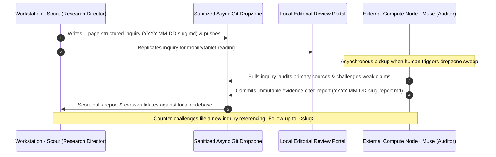
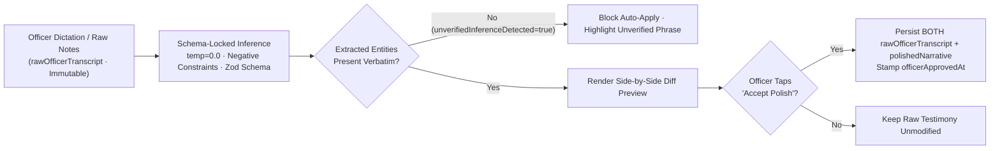

# 04 · Adversarial Verification & Fact-Locked AI

Even the sharpest specialist operating inside a clean `<2,000`-token context window faces a fundamental epistemological flaw when checking its own conclusions: **contextual monoculture**. If a single AI session drafts an architectural trade-off, selects a payroll library, or interprets a state labor exception, prompting that same session to *"verify everything carefully"* routinely yields confirmation bias—plausible defense of prior claims rather than genuine falsification.

Separately, shipping free-form generative AI inside regulated applications creates immediate legal and clinical liability. An unconstrained LLM rewriting a security officer's rough shift notes into polished prose or improvising a medical rationale can impeach testimony in court or teach clinicians inaccurate diagnostic thresholds.

Hathcock Labs defeats both failure modes through two complementary architectures: **Two-Node Adversarial Research (`Scout` ↔ `Muse`)** during technical discovery and **Fact-Locked Structured AI (`Synapse` & `Echo`)** inside runtime products.

---

## 1. Two-Node Adversarial Verification (`Scout` ↔ `Muse`)

Whenever our engineering team confronts unverified third-party claims, multi-state regulatory traps, browser engine quirks, or competitive feature matrices, **`Scout` (Workstation Research Director)** partners with **`Muse`**, an independent adversarial auditor running on a separate physical compute node with **zero shared memory or conversation history**.



### Standardized Dropzone Contracts

#### Request Contract (`requests/YYYY-MM-DD-<slug>.md`)
Every inquiry authored by `Scout` is constrained to one focused page so `Muse` evaluates falsifiable claims cleanly:

```markdown
# Research Inquiry: <Specific Engineering or Regulatory Claim>
- **Date Filed:** YYYY-MM-DD
- **Filing Specialist:** Scout (Workstation)
- **Follow-up to:** <optional prior request filename>
- **Hypothesis & Local Constraints:**
  <Concise architectural context, OS/browser target, or statutory scope>
- **Claims to Audit ("Bullshit Detection" Targets):**
  1. <Exact library/vendor/legal assertion to confirm or falsify>
  2. <Edge case or hidden trap to verify>
- **Required Evidence Standard:** Primary RFCs, official docs, statute citations, or bug tracker IDs with exact dates checked.
```

#### Immutable Report Contract (`reports/YYYY-MM-DD-<slug>-report.md`)
`Muse` answers strictly with dated citations, verified counterexamples, and explicit caveat flags (`CONFIRMED`, `PARTIALLY TRUE / CAVEAT`, or `REFUTED / VAPORWARE`).

Four governance rules preserve audit integrity:
1. **Zero Shared Prompt Context:** `Muse` never inspects working code diffs, prior turn reasoning, or sunk-cost engineering preferences—eliminating sycophantic bias.
2. **Asynchronous Decoupling:** The workstation never wastes execution cycles waiting in live polling loops; deep source verification runs asynchronously whenever requested.
3. **Immutable Reports & Linked Counter-Challenges:** Completed reports are **never edited in place**. Whenever local constraints clash with a recommendation or require deeper follow-up proof, `Scout` opens a brand-new linked request carrying `Follow-up to: <original-request>`, keeping an intact audit chain.
4. **Strict Sanitization Firewall:** Requests contain zero credentials, API keys, employee names, internal network topology, or raw operational database dumps.

### Concrete Verdict Rubric & Worked Dropzone Trace

Every claim audited by `Muse` resolves into one of three non-ambiguous verdicts backed by dated primary sources:

| Verdict Tag | Criteria | Downstream Action by `Scout` |
| :--- | :--- | :--- |
| **`CONFIRMED`** | Official RFC, state statute, browser bug tracker, or empirical test confirms behavior verbatim | Codify directly in living playbook & `SKILL.md`; reference report date |
| **`PARTIALLY TRUE / CAVEAT`** | Holds on Chromium/Node but breaks on WebKit, mobile viewports, or specific state thresholds | Codify with explicit platform/statute guardrails and cross-border exceptions |
| **`REFUTED / VAPORWARE`** | Vendor brochure claim or popular AI assumption contradicted by primary documentation or source | Block adoption permanently; record warning section inside Optane FTS5 memory |

Consider how this loop prevents subtle production defects with a worked example around native HTML `<dialog>` dismissal behavior across mobile WebKit:

```markdown
# Sample Filed Request: requests/2026-11-12-dialog-light-dismiss.md
- Filing Specialist: Scout (Workstation)
- Hypothesis: Native HTML `<dialog closedby="any">` + `@starting-style` CSS animations
  can replace custom backdrop listeners across both desktop Chrome and iOS Safari 26.
- Claims to Audit:
  1. Does Safari WebKit ship complete `closedby="any"` attribute support cleanly in production?
  2. Does transitioning `scrollbar-color` inside modal overlays trigger WebKit rendering defects?
- Required Evidence: W3C HTML spec status, WebKit Bugzilla IDs, MDN compat data with dates.
```

`Muse` evaluates primary browser engine commit logs independently and commits an immutable report:

```markdown
# Audit Report: reports/2026-11-12-dialog-light-dismiss-report.md
1. `closedby="any"` across mobile iOS Safari -> VERDICT: PARTIALLY TRUE / CAVEAT
   - Evidence: Supported on Chromium/Firefox baselines, but incomplete across legacy iOS Safari builds
     still active on rugged field handsets; requires explicit `pointerdown` target === dialog guard.
2. Animating `scrollbar-color` -> VERDICT: REFUTED FOR PRODUCTION
   - Evidence: Triggers WebKit Bugzilla #311752 causing scroll thumb flicker inside fixed modal layers.
```

That single asynchronous handoff eliminated fragile modal state before a line of application CSS shipped.

### Four Real "Bullshit-Detection" Catches Before Code Lock

#### Case 1 · FLSA Blended Overtime & State Labor Law Traps
- **Initial Assumption:** Standard `1.5x` hourly overtime or simplified salaried fluctuating-workweek calculations apply uniformly across regional security guards.
- **Primary-Source Audit (`Muse`):** Surfaced Pennsylvania Supreme Court precedent (*Chevalier v. GNC*) barring `0.5x` salaried fluctuating-workweek shortcuts under the Pennsylvania Minimum Wage Act, confirmed federal **FLSA `29 C.F.R. § 778.115`** mandatory weighted-average regular rates across multi-rate workweeks, and uncovered **Delaware `19 Del. C. § 707`**, which allows solitary security guards to skip off-post meal relief *strictly when all on-post meal time remains 100% paid*.
- **Codebase Impact:** Shaped `calculateBlendedOvertimeAndMargin` (integer-cents math) and timekeeping break rules before any live payroll shipped.

#### Case 2 · Tri-State Cross-Border Tax Asymmetry
- **Initial Assumption:** Mid-Atlantic states share symmetric wage-tax reciprocity for roaming guards.
- **Primary-Source Audit (`Muse`):** Verified that while `MD–PA` maintains wage-tax reciprocity, **Delaware enforces zero reciprocity** on cross-border wages, requiring split state withholding alongside local municipal traps (`PA Act 32` PSD higher-of-home/work rates, Philadelphia Wage Tax `3.75%`/`3.44%`, Wilmington `1.25%`).
- **Codebase Impact:** Modeled explicit `localTaxJurisdiction` buckets inside `@arclight/domain`.

#### Case 3 · Safari / WKWebView Standards Traps
- **Initial Assumption:** Baseline Chromium HTML/CSS modal patterns work equivalently inside iOS Safari and Capacitor WKWebView.
- **Primary-Source Audit (`Muse` + WebKit Check):** Caught that `<dialog closedby="any">` and CSS `overlay` exit transitions lack Safari support, that transitioning `scrollbar-color` triggers **WebKit Bug 311752** scrollbar flickering, and that `aria-describedby` targets announce in VoiceOver even when hidden via `display: none`.
- **Codebase Impact:** Standardized `pointerdown`/`pointerup` coordinate light-dismiss guards and `:user-invalid` + dynamic `aria-describedby` attachment across all apps.

#### Case 4 · Vendor Feature vs. Reality Audits
- **Initial Assumption:** Established security guard software vendors already ship integrated WebRTC radio and multi-rate blended overtime out of the box.
- **Primary-Source Audit (`Muse`):** Audited live vendor capabilities—exposing missing native half-duplex Push-to-Talk in incumbent guard tour software, broken multi-rate CSV exports, and unconstrained AI report rewrites creating courtroom liability.

---

## 2. Fact-Locked Runtime AI (`Synapse` & `Echo` Standard)

Allowing a production LLM to rewrite human field records freely creates active legal liability. Suppose an officer dictates a terse 02:30 AM patrol note: *"Saw white van speed out west gate."* An unconstrained LLM instructed *"make this sound professional"* frequently hallucinates: *"At approximately 02:30 hours, an unauthorized white cargo van exited the West Gate at high velocity following an apparent trespass attempt."*

In a civil trial or **Maryland SB 760** police use-of-force inquiry, inventing `cargo`, `unauthorized`, or `trespass` impeaches the officer's entire credibility.

### Canonical Schema-Locked Narrative Contract
Inside [Arclight Security](../01_Products/Arclight-Security-ERP.md), any AI voice-to-DAR or grammar-polish feature obeys an ironclad **Anti-Pattern vs. Fact-Locked Schema** boundary:

```typescript
// ❌ ANTI-PATTERN (Silent Testimony Mutation / Impeachment Risk):
// Overwrites user-entered narrative in-place with unrestricted LLM prose.
incident.detailedNarrative = await llm.rewrite(`Make this professional: ${rawNotes}`);

// ✅ CANONICAL FACT-LOCKED STANDARD (Immutable Testimony + 1:1 Entity Trace):
export const AiNarrativePolishSchema = z.object({
  rawOfficerTranscript: z.string().min(1),       // Immutable original testimony (preserved forever)
  polishedNarrative: z.string().min(1),          // Punctuation & grammar clarity ONLY
  extractedEntities: z.object({
    timestampsCited: z.array(z.string()),        // Must trace 1:1 verbatim to rawOfficerTranscript
    plateNumbersCited: z.array(z.string()),
    actionsObserved: z.array(z.string()),
  }),
  unverifiedInferenceDetected: z.boolean(),      // Guard flag if source omits any detail
  modelRevisionId: z.string(),
  officerApprovedAt: z.string().datetime(),      // Requires explicit human review & acceptance tap
});
```

### Runtime Verification Flow



1. **Zero Sampling Temperature (`temperature: 0.0`):** Eliminates stochastic word invention.
2. **Strict `responseSchema` Enforcement:** Malformed or extra fields fail Zod validation before touching UI state.
3. **Explicit Negative Prompt Constraint:** Instructs the model strictly: *"Do NOT introduce any time, weapon, vehicle color, license plate, injury, or legal conclusion not verbatim present in `rawOfficerTranscript`."*
4. **Deterministic Post-Parse Grounding Guard:** Even at `temperature: 0.0`, backend handlers verify extracted facts programmatically before returning any diff preview to mobile handsets:

```typescript
export function assertVerbatimEntityGrounding(
  polish: AiNarrativePolish,
): AiNarrativePolish {
  const haystack = polish.rawOfficerTranscript.toLowerCase().replace(/\s+/g, " ");
  const cited = [
    ...polish.extractedEntities.timestampsCited,
    ...polish.extractedEntities.plateNumbersCited,
    ...polish.extractedEntities.actionsObserved,
  ];

  const ungrounded = cited.filter((token) => {
    const normalized = token.trim().toLowerCase().replace(/\s+/g, " ");
    return normalized.length > 0 && !haystack.includes(normalized);
  });

  if (ungrounded.length > 0) {
    return {
      ...polish,
      unverifiedInferenceDetected: true, // Blocks auto-apply & surfaces alert banner
    };
  }
  return polish;
}
```

5. **Human-in-the-Loop Opt-In (`officerApprovedAt`):** Polished output remains strictly an unapplied preview diff until the reporting officer reviews and explicitly confirms it.
6. **Dual-Persistence Forensic Exports:** Both fields live side-by-side in Firestore; official printed incident PDFs and Maryland State Police SB 760 reports always embed `rawOfficerTranscript` verbatim in the audit appendix.

---

## 3. Offline-First Clinical Verification (`SonoPrep Pro`)

In medical board preparation ([SonoPrep Pro](../01_Products/SonoPrep-iOS.md)), runtime LLM hallucinations carry patient-safety consequences rather than courtroom risk. Teaching a candidate an inverted Doppler angle correction or misstated carotid velocity threshold translates into clinical error.

SonoPrep eliminates runtime hallucination exposure structurally:
- **100% Pre-Audited Clinical Bank:** Every one of the **`421` ARDMS RVT/SPI questions**, **`132` DICOM/spectral SVGs**, **`18` interactive hotspots**, **`85` SM-2 flashcards**, and **`8` velocity criteria cheat sheets** passes independent `Echo` (`pro [MANDATORY]` lock) auditing directly against **SRU Carotid Consensus**, **IAC Vascular Testing Standards**, **SVU Venous Guidelines**, and **Kremkau Physics** prior to release.
- **Deterministic Offline Study Core:** The contextual clinical tutor matches questions against this pre-verified local index first—guaranteeing accurate, cited hemodynamic rationales offline in clinical spaces—while optional external query paths remain schema-constrained and isolated.

### Four-Gate Clinical Item Audit Rubric (`Echo`, Read-Only)

Before any vascular sonography item merges into the production offline bank, `Echo` enforces four clinical invariants inside a strictly read-only audit pass:

| Verification Gate | Exact Hemodynamic / Clinical Check | Example Error Caught Before Release |
| :--- | :--- | :--- |
| **1. Doppler Equation Sign Check** | Verifies $f_d = \frac{2 f_0 v \cos\theta}{c}$ directionality, Nyquist limit aliasing rules ($PRF/2$), and $>60^\circ$ cosine error direction | Catching distractor phrasing claiming $60^\circ \to 70^\circ$ *underestimates* rather than overestimates true velocity |
| **2. Consensus Ratio Concordance** | Cross-checks ICA PSV (`<125`, `125–230`, `>=230` cm/s), ICA/CCA ratios (`<2.0`, `2.0–4.0`, `>4.0`), and Renal RAR (`>= 3.5`) strictly against published guidelines | Flagging legacy `>140 cm/s` ICA PSV tables misattributed to SRU Carotid Consensus |
| **3. Trap-Word & Negation Hygiene** | Flags vague qualifiers (*"always"*, *"never"*, double negatives) when subtle pathophysiologic exceptions exist | Rewriting *"normal portal flow never reverses"* when hepatofugal flow occurs in portal hypertension |
| **4. Visual Coordinate & Waveform Parity** | Verifies interactive anatomy hotspot radii and SVG spectral traces (`parvus-tardus`, bidirectional triphasic) match question stems cleanly | Repairing mislabeled high-resistance external carotid vs. low-resistance internal carotid traces |

Because `Echo` holds zero write permissions on question banks during auditing, corrections flow transparently through human-reviewed diffs and TypeScript schema checks before packaging.

---

## 4. Untrusted Input Isolation & Graceful Circuit Breakers

Field inputs pasted from external shift logs or dictated over noisy cellular connections cannot be trusted blindly inside prompt templates. Any runtime endpoint enforces three structural safeguards:

1. **Structural Delimiter Isolation:** Untrusted user speech or dispatch text enters inside explicit data tags (`<raw_transcript>...</raw_transcript>`) accompanied by system instructions treating inner tags strictly as plain text payloads, neutralising embedded imperative text.
2. **Schema-Validated Failure Fallback:** If the inference endpoint returns invalid JSON, trips rate limits, or exceeds a `6,000 ms` mobile budget, UI callers degrade gracefully without breaking officer documentation: the unedited `rawOfficerTranscript` commits directly to Firestore or the offline Dexie queue with `aiPolishStatus: "skipped"`.
3. **Zero Silent Clinical Mutations:** Offline mobile clinical builds operate exclusively over bundled TypeScript record modules (`>= 99%` unit coverage), ensuring hospital basement exam rooms with zero cellular signal deliver identical accuracy and feedback velocity as online workstations.

> [!IMPORTANT]
> Reliability in regulated AI comes from **making the non-AI path complete and safe on its own**. Model polish accelerates clarity when available, never acting as a single point of failure or silent editor of record truth.

---

## 5. Zero-Bloat `modern-web-guidance` CLI Audits & Specialist Keep/Drop Filtering

Embedding encyclopedic browser-compatibility matrices directly inside global AI system prompts bloats every session's static token tax and rots the instant WebKit or Chromium ships a new release. Conversely, blindly auto-fixing raw output from static web-platform scanners introduces regressions wherever deployment targets or physical peripherals diverge from generic web defaults.

Hathcock Labs resolves both failure modes by wiring **`npx modern-web-guidance@latest search|retrieve|legacy-scan`** directly into specialist `SKILL.md` runbooks on demand—consuming **`0` static prompt tokens** during normal work—and gating every scanner finding behind a mandatory **Specialist Keep/Drop Verification Pass**:

### Verified 10-App Fleet Audit Result (`26/47` False Positives Filtered Out)
Across a 10-application fleet audit (`47` raw findings flagged by `legacy-scan`), independent specialist verification kept **`21` verified hardening wins** (detailed in [Anti-Slop UI Engineering & WebKit Resilience](../03_Architecture-Deep-Dives/Anti-Slop-UI-Engineering.md)) and explicitly **dropped `26/47` (`55.3%`) false positives** that would have damaged production reliability:

| Dropped Finding Class | Why Automated Scanners Flagged It | Real-World Production Hazard Prevented |
| :--- | :--- | :--- |
| **iOS 15.0 Deployment Crash Traps** | Nudged replacing defensive CSS/JS fallbacks with newer Baseline APIs (`1dvh` without `100vh` fallback, modern WebKit-absent primitives) | Prevented layout collapse and runtime exceptions inside iOS 15.0 WKWebView baselines |
| **`<35ms` HID Barcode Scanner Regressions** | Suggested naive form/focus or key-event refactors around global keyboard listeners | Protected high-velocity hardware barcode wedge burst capture (`<35ms` inter-keystroke cadence) from dropped characters |
| **API-Key Password Autofill Hazards** | Recommended generic `autocomplete` credential attributes on secret configuration inputs | Prevented browser password managers from silently overwriting operator API keys with saved login passwords |

---

## 6. Adversarial Specialist Evals & Standalone Wave 3 Break-It Gate (`squad-harness`)

Prompt-level instructions cannot guarantee that 18 specialists consistently refuse cross-boundary writes, detect subtle auth regressions, or resist prompt-injection leaks across model upgrades. Inside **`squad-harness`** (our code-enforced 4-Wave Mission Runner documented in [05 · Autonomous DevOps & Zero-Trust Gates](05-Autonomous-DevOps-and-Zero-Trust-Gates.md)), verification is separated from authoring through two mechanical controls:

1. **12-Case Adversarial Specialist Eval Suite:** An executable benchmark testing specialist routing, read-only boundary refusals, air-gap leakage traps, unverified statutory claims, and regression detection before harness or prompt revisions promote.
2. **Standalone Wave 3 Break-It Gate (`Sentinel` + `Aegis`):** Executed independently from Wave 2 implementation sessions with zero shared author-turn reasoning, looping strictly until **`0 CRITICAL / 0 HIGH`** findings remain across security rules, React/WebKit state races, and compiler/E2E gates.

---

## 7. Multi-Turn Evidence Chains & Audit Traceability

Adversarial research only works long-term if teams can audit **why** an architectural rule exists six months later without rummaging through forgotten chat threads:

1. **Append-Only Dropzone Ledger:** Every `requests/*.md` inquiry and `reports/*.md` verdict stays checked into version control permanently. When specifications shift (e.g., an iOS WebKit release resolves a modal backdrop bug), `Scout` opens a fresh inquiry carrying `Follow-up to: 2026-11-12-dialog-light-dismiss.md` rather than rewriting history.
2. **Verbatim Claim Linkage Inside Playbooks:** Living playbooks cite exact report filenames and primary RFC/statute sections (`29 C.F.R. § 778.115`, `24 Del. C. Ch. 13`, `WebKit Bug 311752`) so any new engineer or specialist questioning a rule retrieves its primary proof in `<1.5 ms` via local NVMe FTS5.
3. **Hard Parity Between Product & Runtime Audits:** The exact same statutory boundaries audited externally by `Muse` (`19 Del. C. § 707`, `18 Pa. C.S. § 908`) become mandatory unit-test assertions in `@arclight/compliance-engine` and Zod `responseSchema` negative constraints inside runtime AI prompts—bridging offline due diligence seamlessly into deterministic execution.
