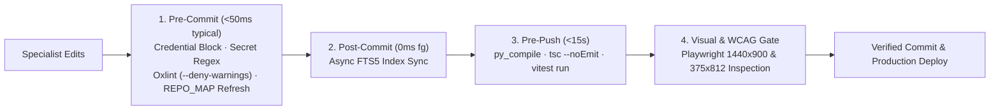
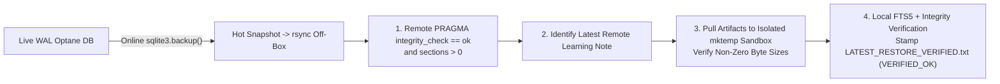

# 05 · Autonomous DevOps & Zero-Trust Gates

Telling an AI coding agent in prose *"remember to run TypeScript, keep bundles secret-free, and verify mobile viewports"* provides zero mechanical safety. Under sprint pressure or multi-file conflict resolution, unguarded agents skip manual checks unless **operating-system hooks, compilers, and headless browser suites enforce correctness automatically**.

Hathcock Labs locks code quality, secret hygiene, supply-chain governance, rendered DOM geometry, and backup recoverability behind four chained Git/browser gates, grouped Renovate controls, a parallel 22-invariant 3-node drift doctor, and automated round-trip restore proofs.

---

## The Four-Stage Chained Verification Pipeline



### Stage 1 · Universal Pre-Commit Sentinel (`<50 ms` Typical, `<400 ms` Target)
Installed identically across all `10` active engineering repositories via symlinked Git hooks, `squad-pre-commit` evaluates strictly staged changes (`git diff --cached --name-only --diff-filter=ACMR`) so commits stay sub-50ms while intercepting leaks before history records them:

```bash
# 1. Credential filename quarantine (exempting explicit .example/.template/.sample/.md files)
case "$FILE" in
    *.env.local|*.env.production|*.env.staging|*serviceaccount*|*credentials*.json|*.pem|*.key|*id_rsa*|*id_ed25519*)
        echo "BLOCKED: Sensitive credential artifact staged: $FILE"
        exit 1
        ;;
esac

# 2. Scan strictly ADDED staged lines (^+) to avoid flagging deleted or historical lines
ADDED_LINES="$(git diff --cached -U0 -- "$FILE" | grep '^+' | grep -v '^+++')"
```

1. **Sensitive Filename Quarantine:** Immediately halts commits if `.env.*`, private key files, SSH keys, or service account JSON files are staged outside documented templates.
2. **Staged Diff Secret Regex Sweep:** Filters strictly added (`^+`) diff lines—blocking high-confidence Google API keys, GitHub tokens, OpenAI/Anthropic keys, bearer tokens, inline hardcoded password literals (exempting `process.env`, `import.meta.env`, and `os.environ` references), and cryptographic `-----BEGIN ... PRIVATE KEY-----` headers.
3. **Sub-50ms Rust Linting (`oxlint --deny-warnings`):** Passes only staged `.ts`, `.tsx`, `.js`, and `.jsx` files to `oxlint`, treating warnings as hard failures with negligible latency.
4. **Zero-Dirty `REPO_MAP.md` Auto-Refresh:** Whenever tracked source files change inside a repository maintaining `REPO_MAP.md`, regenerates the compact `<1.5 KB` structural map and runs `git add` inside the exact same commit—preventing follow-up dirty-tree clutter.

### Stage 2 · Zero-Wait Post-Commit Indexing (`0 ms` Foreground)
Whenever `HEAD` updates structural repo maps, engineering playbooks, or adversarial dropzone reports, `squad-post-commit` compares `git diff-tree --no-commit-id --name-only -r HEAD` and triggers an Optane SQLite FTS5 sync silently via detached background execution (`0 ms` interactive stall, zero working-tree mutations).

### Stage 3 · Workspace-Aware Pre-Push Verification (`<15s`)
Before any branch pushes to remote origin, `squad-pre-push` enforces full compilation and automated test coverage:

```bash
# Drain stdin refs and skip validation on pure remote branch deletions (40-zero SHA)
while read -r local_ref local_sha remote_ref remote_sha; do
    [ "$local_sha" = "0000000000000000000000000000000000000000" ] && continue
    ACTIVE_PUSH=1
done
```

- **Python Bytecode Guard:** Compiles staged or tracked Python CLI tools and telemetry scripts via `python3 -m py_compile` while isolating temporary `.pyc` output cleanly outside repository trees (`PYTHONPYCACHEPREFIX=/tmp/pycache`).
- **Workspace Monorepo vs. Single-Package Detection:** Checks automatically for `pnpm-workspace.yaml` (running strict workspace `pnpm -r --if-present typecheck && pnpm -r --if-present test`) vs. single-package React/Vite apps (`npx tsc --noEmit && npx vitest run --passWithNoTests`), chaining strictly with `&&` so broken tests or type errors can never push silently.

### Stage 4 · Deterministic Visual & WCAG 2.2 Gate (`squad-visual-gate`)
Clean compilation and unit tests cannot catch an iOS action button sliced in half, horizontal overflow on narrow `320px` phones, or low-contrast text. Our standalone Node + Playwright gate evaluates live URLs or local HTML bundles across desktop (`1440×900`) and mobile (`375×812` / `320×568`) viewports using deterministic readiness (`domcontentloaded` + `document.fonts.ready`—banning arbitrary `sleep` timers):

| Audit Code | Class | Exact Automated Inspection Rule |
| :--- | :--- | :--- |
| **`HORIZONTAL_OVERFLOW`** | Blocking (`exit 1`) | `document.documentElement.scrollWidth > window.innerWidth + 1` |
| **`RUNTIME_ERROR`** | Blocking (`exit 1`) | Uncaught `pageerror` exceptions during page load or font settle |
| **`UNNAMED_CONTROL`** | Blocking (`exit 1`) | Interactive buttons/links lacking accessible labels (`aria-label` / text content) |
| **`CLIPPED_CONTROL`** | Blocking (`exit 1`) | Interactive elements truncated past viewport edges or clipped by `overflow: hidden` ancestors |
| **`UNDERSIZED_TARGET`** | Strict Gate (`--strict-targets`) | Interactive controls smaller than `24×24px` (WCAG 2.2 AA `2.5.8`) |
| **`LOW_CONTRAST`** | Strict Gate (`--strict-targets`) | Relative luminance WCAG contrast below `4.5:1` (`3.0:1` large text >= 18pt / 14pt bold) |

```javascript
// Deduplicate repeating list-row findings by normalizing DOM nth-child selectors
function normalizeSelectorKey(el) {
  return buildCssPath(el).replace(/:nth-of-type\(\d+\)/g, ":nth-of-type(*)");
}
```

Findings deduplicate cleanly by normalized selector pattern (*"count problems, not pixels"*) so a broken repeating table row emits one actionable defect rather than 40 identical alerts, accompanied by viewport pass/fail summaries in CI and terminal runs.

---

## Zero-Trust Secret, Bundle & Supply-Chain Controls

- **`0600` POSIX Credential Isolation:** All local `.env` files, service credentials, and native iOS/Android Firebase config artifacts enforce strict `0600` (`-rw-------`) permissions so unprivileged daemons cannot read them. `Sentinel` audits file modes directly across working repositories.
- **Compiled `dist/` Bundle Verification:** Before any Vite application reaches Hosting or App Store wrappers, release audits scan compiled JavaScript output (`dist/assets/*.js`) to verify zero server secrets, service account keys, internal project identifiers, or private tokens were accidentally bundled into `VITE_*` browser globals.
- **Grouped Renovate Supply-Chain Governance:** Automated dependency updates route through a shared preset eliminating PR flood fatigue while quarantining malicious upstream releases:

```json
{
  "schedule": ["before 5am on monday"],
  "minimumReleaseAge": "3 days",
  "prConcurrentLimit": 5,
  "packageRules": [
    { "matchPackageNames": ["vite", "rollup", "vitest", "esbuild"], "groupName": "build-and-test" },
    { "matchUpdateTypes": ["patch", "digest"], "automerge": true, "automergeType": "pr" },
    { "matchUpdateTypes": ["major", "minor"], "automerge": false }
  ]
}
```

- **Air-Gapped Public Showcase Pre-Commit Firewall:** Our public documentation showcase repository runs a dedicated standalone pre-commit hook inspecting added diff lines across five zero-leak categories before Git commits can complete:
  1. Cryptographic private key blocks and provider API key prefixes.
  2. Internal RFC-1918 private LAN subnets and local mDNS host suffixes.
  3. Workstation user home directories, scratch mount paths, and private project IDs.
  4. Employee/personal names and internal retail store identifiers.
  5. Generic AI cliché words and promotional marketing filler.

---

## Parallel 22-Invariant Drift Doctor & Verified Disaster Recovery

### 1. 3-Node Gold-Standard Readiness Doctor (`squad-doctor`, `<3.5s`)
System drifts—such as a Linux kernel update resetting an NVMe scheduler, an OS reboot dropping a `launchd` watchdog, or an `earlyoom` service silently halting—rarely announce themselves loudly until an outage hits. Executing `4` concurrent `ThreadPoolExecutor` probes (local Linux introspection, single-round-trip Python-over-SSH diagnostics on Nodes 2 & 3, and HTTP health verification), `squad-doctor` verifies **22 concrete invariants** in under `3.5 seconds`:

| Node | # | Verified Invariant | Pass Contract |
| :--- | :-: | :--- | :--- |
| **Node 1 (Workstation)** | 1 | Optane Scratch Mount & Sysctl | `/proc/mounts` lists Optane tier; `vm.vfs_cache_pressure == 50` |
| **Node 1 (Workstation)** | 2 | Direct Multi-Queue I/O | Active NVMe block device scheduler locked to `[none]` |
| **Node 1 (Workstation)** | 3 | Sub-10ms Lexical Query Speed | Timed `squad-memory` SQLite WAL FTS5 query completes `< 10 ms` |
| **Node 1 (Workstation)** | 4 | Vector Index Parity | Embedded `content_hash` count matches active section rows (`100%` parity) |
| **Node 1 (Workstation)** | 5 | Memory Pressure Guard (`earlyoom`) | `earlyoom` systemd active with `--avoid` compositor/orchestrator flags |
| **Node 1 (Workstation)** | 6 | Scheduled Off-Box DR Timer | Backup `systemd.timer` both enabled and active |
| **Node 1 (Workstation)** | 7 | Engineering Fleet Git Hooks | `30/30` `pre-commit`/`post-commit`/`pre-push` hooks `+x` across `10` active repos |
| **Node 1 (Workstation)** | 8 | Public Showcase Firewall | Standalone showcase `.git/hooks/pre-commit` (`1/1`) executable & origin verified |
| **Node 1 (Workstation)** | 9–11 | Context, Visual & Local Inference CLIs | `squad-context`, `squad-visual-gate`, and `squad-local` installed & `+x` |
| **Node 2 (Apple Silicon)** | 12–13 | Container Fleet & Watchdog | `0` unhealthy/restarting containers; `launchd` watchdog active |
| **Node 2 (Apple Silicon)** | 14 | Background Vector Worker | `300s` `launchd` vector pre-embedder active & clean lock state |
| **Node 2 (Apple Silicon)** | 15 | 5-Model Local Inference Readiness | Ollama API alive with `nomic-embed-text`, `hermes3:8b`, `qwen2.5-coder:14b`, `deepseek-r1:14b` & `qwen3:14b` |
| **Node 2 (Apple Silicon)** | 16–17 | DR Restore Proof & Repo Sync Dedup | `LATEST_RESTORE_VERIFIED.txt < 36h` (`VERIFIED_OK`); sync `2 MB` rotation intact |
| **Node 3 (ARM Edge)** | 18–19 | Primary DNS Container & Lockstep Control | DNS container `running:healthy`; unified control API returns `200 OK` lockstep |
| **Node 3 (ARM Edge)** | 20–22 | Edge Flash-Wear Protections | `Storage=volatile` `journald`, `noatime` root mount, DNS SQLite `DBinterval >= 300s` |

### 2. Online SQLite Snapshots & 4-Step Round-Trip DR Restore Proof
Standard filesystem `cp` or `rsync` copies risk capturing a split-brain SQLite database whose `-wal` shared frames have not flushed cleanly. Daily off-box backups (`squad-backup-memory.sh`) invoke SQLite's online C-level `.backup()` API to yield an internally consistent snapshot *without blocking concurrent queries*:

```python
import sqlite3

def create_consistent_snapshot(src_db: str, dst_snapshot: str) -> None:
    with sqlite3.connect(f"file:{src_db}?mode=ro", uri=True) as src:
        with sqlite3.connect(dst_snapshot) as dst:
            src.backup(dst)  # Safely copies committed pages + WAL frames atomically
```



Only after all four round-trip checks succeed locally inside the isolated temporary directory (confirming bytes can actually travel back across the wire, open cleanly under SQLite WAL, pass `PRAGMA integrity_check`, and answer `MATCH` full-text queries) does the backup node stamp `LATEST_RESTORE_VERIFIED.txt` with `STATUS=VERIFIED_OK`. If any step breaks or ages beyond `36 hours`, `squad-doctor` exits non-zero cleanly so silent backup rot cannot hide.

---

## Fail-Closed Security vs. Fail-Open Availability Matrix

Every automated check in our pipeline explicitly defines whether it **fails closed** (blocks commit, push, or release immediately) or **degrades cleanly** (warns and falls back safely during disconnected travel):

| Subsystem / Gate | Failure Condition | Gate Policy | Operational Consequence |
| :--- | :--- | :---: | :--- |
| **`squad-pre-commit` Secret Sweep** | Private key, token prefix, or staged `.env.local` | **Fail Closed (`exit 1`)** | Commit aborts immediately; leak never enters local Git history |
| **`squad-pre-commit` `oxlint`** | Any TypeScript/JS warning or error (`--deny-warnings`) | **Fail Closed (`exit 1`)** | Prevents warning rot from accumulating across multi-agent waves |
| **`squad-pre-push` Type & Unit Suite** | `tsc --noEmit` error or any failed `vitest` spec | **Fail Closed (`exit 1`)** | Broken branches cannot reach remote repositories or CI triggers |
| **`squad-visual-gate` Blocking Audits** | Horizontal overflow, runtime page errors, unnamed/clipped buttons | **Fail Closed (`exit 1`)** | Mobile clipping & contrast failures block release builds deterministically |
| **Public Air-Gap Firewall Hook** | Any LAN IP, local path, personal name, or internal store identifier | **Fail Closed (`exit 1`)** | Standalone public docs remain strictly sanitized before commit |
| **Secondary Node Vector Inference** | Workstation off-LAN (`1.5s` RPC timeout) | **Fail Open (Degraded)** | `squad-memory` serves `<1.5 ms` Optane FTS5 cleanly without blocking work |
| **Remote Off-Box DR Ping** | Secondary backup host asleep or unreachable on travel | **Warning Badge Only** | Local hot SQLite snapshots stay safe on Optane; syncs on next check |

```bash
# Exact pre-commit staged secret pattern checks (evaluating strictly ADDED '+' lines)
if echo "$ADDED_LINES" | grep -qE "(ghp_[A-Za-z0-9]{20,}|sk-[A-Za-z0-9]{20,}|AKIA[0-9A-Z]{16}|-----BEGIN (RSA |EC |OPENSSH )?PRIVATE KEY-----)"; then
    echo "BLOCKED: High-confidence secret pattern detected in staged diff."
    exit 1
fi
```

### Continuous Visual Gate Contrasting & Bounding-Rect Verification
Under `--strict-targets`, `squad-visual-gate` walks every visible interactive node inside Playwright's browser context to compute relative sRGB luminance contrast directly from computed foreground and opaque ancestor background colors:

```javascript
function relativeLuminance(rgb) {
  const [r, g, b] = rgb.map((c) => {
    const s = c / 255;
    return s <= 0.03928 ? s / 12.92 : Math.pow((s + 0.055) / 1.055, 2.4);
  });
  return 0.2126 * r + 0.7152 * g + 0.0722 * b;
}

function contrastRatio(fgRgb, bgRgb) {
  const l1 = relativeLuminance(fgRgb);
  const l2 = relativeLuminance(bgRgb);
  return (Math.max(l1, l2) + 0.05) / (Math.min(l1, l2) + 0.05);
}
```

Separating exact numeric assertions from screenshot-eyeballing catches subtle contrast slips (`4.1:1` slate-on-stone links) and `2px` mobile flex clipping automatically across every commit wave.

> [!IMPORTANT]
> Combining sub-50ms commit hooks, strict pre-push compilation chains, DOM geometry gates, 22-invariant infrastructure checks, and proof-of-restore DR scripts shifts verification from **human willpower** to **deterministic systems engineering**.

---

## Multi-Runtime `squad-pre-push` Dispatch Logic

Because our fleet mixes multi-package `pnpm` TypeScript monorepos, single-app React/Capacitor projects, Python cognitive utilities, and documentation vaults, the universal pre-push gate detects repository topology automatically rather than maintaining bespoke scripts per folder:

```bash
# Detect Python, single-package Vite/npm, or pnpm workspace monorepo cleanly
if [ -f "pnpm-workspace.yaml" ]; then
    pnpm -r --if-present typecheck && pnpm -r --if-present test
elif [ -f "package.json" ]; then
    [ -f "tsconfig.json" ] && npx tsc --noEmit || true
    if grep -q '"test"' package.json; then
        npx vitest run --passWithNoTests
    fi
fi

# Compile any tracked Python tooling into isolated /tmp bytecode
PY_FILES="$(git ls-files '*.py')"
if [ -n "$PY_FILES" ]; then
    PYTHONPYCACHEPREFIX=/tmp/squad-pycache python3 -m py_compile $PY_FILES
fi
```

This single `~80`-line hook removes configuration drift across all engineering repositories: whether a specialist pushes a minor compliance helper fix inside `@arclight/domain`, adjusts an SM-2 easing clamp in SonoPrep, or refines ANSI grapheme-width slicing inside `squad-live-telemetry.py`, identical typechecking and non-watch unit execution block broken remote pushes every single time.

### Centralized Symlink Governance Across 11 Repositories
Copying hook scripts across ten repositories invites silent version drift the first time a secret pattern improves. All engineering repositories link their `pre-commit`, `post-commit`, and `pre-push` entrypoints to one authoritative scripts hub (`chmod +x`), while the standalone public documentation repository mounts its dedicated air-gap leak firewall. A single run of `squad-doctor` flags any stale, missing, or unlinked repository hook (`30/30` engineering + `1/1` showcase) within milliseconds.

### Why Deterministic Mechanical Hooks Outperform Agent Prompt Rules
Asking specialists gently inside system instructions *"never stage `.env` files, check TypeScript, and remember mobile layout overflow"* breaks whenever parallel sprints touch shared schemas or tight time pressure hits. Placing those checks inside **sub-50ms pre-commit filters, `&&`-chained pre-push build commands, headless Playwright DOM inspections, and round-trip SQLite DR proofs** converts aspirational hygiene into unbypassable engineering physics: broken builds simply cannot cross repository boundaries.

1. **Zero Flag Creep:** Hooks require zero developer opt-in flags once initialized.
2. **Symmetric Local & Remote Execution:** Identical TypeScript, Vitest, Python, and DOM gates run before `git push` completes locally, keeping shared branches clean by construction.
3. **Verifiable Recovery Drills:** Daily off-box snapshots prove themselves by restoring readable full-text indexes inside temporary sandboxes automatically before stamping success.
