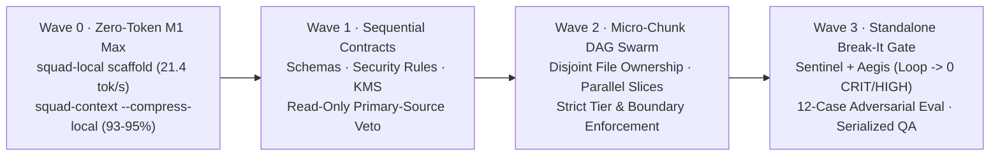
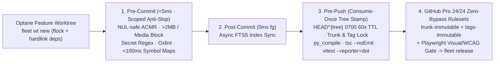
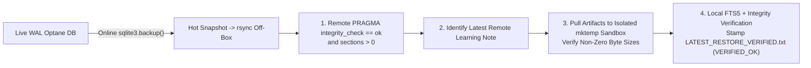

# 05 · Autonomous DevOps & Zero-Trust Gates

Telling an AI coding agent in prose *"remember to run TypeScript, avoid pushing multi-megabyte media blobs, and verify mobile viewports"* provides zero mechanical safety. Under sprint pressure or concurrent multi-agent execution, unguarded branches invite dangling half-done trees, binary repository bloat, accidental force-pushes, or overwritten release tags unless **OS hooks, remote GitHub Rulesets, compilers, and headless browser suites enforce correctness automatically**.

Hathcock Labs locks code quality, trunk immutability, secret/blob hygiene, rendered DOM geometry, and backup recoverability across **12 active repositories** behind **Squadron Harness v1 (`squad-harness`) + Micro-Chunk DAG Swarm execution**, **zero-bloat `modern-web-guidance` CLI fleet audits**, **local NVMe feature worktrees (`fleet wt`)**, `<5ms` pre-commit fireguards with **scoped Anti-Slop gates**, **consume-once verified tree stamps (`HEAD^{tree}`, `0700`, `60s` TTL)**, **`204` automated lifecycle hook tests**, **2-layer local + remote `24/24` zero-bypass GitHub Pro Rulesets**, linear-forward `fleet release` / `fleet rollback`, grouped Renovate controls, a **`30/30` cross-node diagnostic doctor**, and automated round-trip restore proofs.

---

## Squadron Harness v1 & Micro-Chunk DAG Swarm Engine (`squad-harness`)

Coordinating multi-specialist engineering sprints purely through free-form chat instructions invites skipped audit waves, overlapping file edits, and inconsistent tier enforcement. **Squadron Harness v1 (`squad-harness`)** replaces prose orchestration with a **code-enforced 4-Wave Mission Runner** backed by atomic local NVMe state and a micro-chunk Directed Acyclic Graph (DAG) scheduler:



### Mechanical Guarantees Enforced in Code
1. **Wave 0 Local Apple Silicon Offload (`0` Cloud Tokens):** Before cloud frontier specialists launch, Wave 0 invokes `squad-local scaffold` (`qwen2.5-coder:14b` @ `21.4 tok/s`) for Zod/Vitest boilerplate and `squad-context --compress-local` (`qwen3:8b` @ `36.9 tok/s`, **`93–95%` compression**) to shrink raw logs/diffs cleanly.
2. **Micro-Chunk DAG Disjoint Partitioning:** Wave 2 decomposes implementation into small, dependency-ordered DAG nodes with explicit disjoint file write scopes—preventing concurrent specialists from clobbering shared files while serializing heavy builds (`vite build`, Playwright, Metro) via kernel `fcntl.flock` to protect `12 GB` workstation RAM.
3. **Standalone Wave 3 Break-It Gate & 12-Case Adversarial Eval Suite:** Wave 3 runs **`Sentinel` + `Aegis`** as an isolated, repeatable gate looping until **`0 CRITICAL / 0 HIGH`** findings clear, reinforced by a **12-case adversarial specialist eval suite** that catches routing bypasses, boundary violations, and air-gap slips before harness changes ship.
4. **Atomic Local NVMe Mission State & Strict Tier Floors:** Every wave transition, node verdict, and retry watermark persists atomically (`tempfile + os.fsync() + os.replace()`) on local NVMe scratch—guaranteeing crash-resumable missions while blocking low-tier model downgrades on mandatory frontier domains (`Vault`, `Apex`, `Nexus`, `Sentinel`, `Echo`, `Scout`).
5. **Zero-Bloat `modern-web-guidance` CLI Fleet Audit Integration:** Specialist web-platform skills run **`npx modern-web-guidance@latest search|retrieve|legacy-scan`** on demand rather than bloating static prompts, pairing raw scanner output with mandatory specialist Keep/Drop review (filtering out **`26/47` false positives** across our 10-app fleet, including iOS 15.0 deployment crash traps, `<35ms` HID barcode scanner regressions, and API-key password autofill hazards; see [04 · Adversarial Verification](04-Adversarial-Verification-and-Fact-Locked-AI.md)).

---

## The Four-Stage Verification & Release Pipeline



### Stage 0 · Trunk-Based Development & Optane NVMe Worktrees (`fleet wt`)
Primary checkouts remain strictly clean and pinned directly to trunk (`main`/`master`). Experimental edits, multi-agent waves, and isolated documentation sprints never sit dangling on trunk—instead spawning cleanly into **`0700` isolated Optane NVMe worktrees** managed by `fleet wt {new|list|land|prune}`:

- **Race-Free Serialization & Hardlink Zero-Copy:** Worktree creation acquires a per-repository `fcntl.flock` mutex, seeds `node_modules` instantaneously via same-device POSIX hardlinks (`cp -al` or `pnpm --prefer-offline`) with isolated `.vite` and `.tmp` scratch directories, assigns deterministic non-colliding Vite ports (`5201..5250`), and automatically pins `PUBLISHER_PROVIDER=dry-run` on media automation tracks so dev sandboxes can never emit accidental live social posts.
- **24-Hour Worktree Age Hygiene & Clean Landing:** `fleet wt list` flags stale feature worktrees past a `24h` TTL; `fleet wt land <repo> <branch> [--squash]` cleanly rebases onto latest trunk, runs full `squad-pre-push` checks, fast-forwards/squash-merges into trunk, pushes to `origin`, and removes both worktree and ephemeral branch atomically.

### Stage 1 · Universal Pre-Commit Firewall (`<5 ms` Typical, `13/13` Unit Tests)
Installed identically across all **12 repositories** (`11` engineering repos via symlinked hooks + `1` dedicated public showcase air-gap guard), `squad-pre-commit` evaluates strictly staged changes (`git diff --cached --name-only -z --diff-filter=ACMR`) using `NUL`-safe path handling in `<5 ms`:

```bash
# 1. Credential artifact & binary blob/media firewall (runs in <5ms across staged paths)
case "$FILE" in
    *.env|*.env.*|*serviceaccount*|*credentials*.json|*.pem|*.key|*id_rsa*|*id_ed25519*)
        echo "BLOCKED: Sensitive credential artifact staged: $FILE" && exit 1 ;;
    *.mp4|*.mov|*.mkv|*.avi|*.sqlite|*.sqlite3|*.db|*.wav|*.flac|*.zip|*.tar.gz)
        echo "BLOCKED: Media/SQLite binary artifact forbidden in Git history: $FILE" && exit 1 ;;
esac

# 2. >2 MB staged blob ceiling + NUL-safe strictly added (^+) secret/air-gap diff scan
BLOB_BYTES=$(git cat-file -s ":$FILE" 2>/dev/null || echo 0)
[ "$BLOB_BYTES" -gt 2097152 ] && echo "BLOCKED: Staged blob > 2 MB ($BLOB_BYTES bytes)" && exit 1
```

1. **Binary, Media & Database Quarantine:** Immediately halts `.mp4`, `.mov`, `.wav`, `.sqlite`/`.db` files and any blob **`> 2 MB`** before large binaries ever enter `.git` pack history.
2. **Expanded Credential & Added-Line Secret Regex Sweep:** Filters strictly added (`^+`) diff lines—quarantining `.env.*` / keyfiles outside `.example`/`.template`/`.sample` docs, and blocking provider keys (`AIza*`, `gh*`, `sk-*`, `AKIA*`), inline secret literals, and `-----BEGIN ... PRIVATE KEY-----` blocks (`13/13` automated unit assertions).
3. **Built-In Public Air-Gap Guard:** Automatically enforces the **5-Category Public Air-Gap Firewall** inside public repositories (`0` credentials, `0` raw PII, `0` internal LAN subnets/mDNS suffixes/local workstation paths, `0` private store/project/channel identifiers, `0` internal vault/coaching artifacts).
4. **Scoped Anti-Slop Gate, Sub-50ms Rust Linting (`oxlint --deny-warnings`) & `<100 ms` Symbol Maps:** Evaluates strictly staged added diff lines against Anti-Slop placeholder patterns (`// TODO`, stub handlers, unguarded dead fallbacks), runs `oxlint --deny-warnings` with zero warnings tolerated, and refreshes `<1.5 KB` `REPO_MAP.md` alongside **`<100 ms` workspace-sharded `<= 4 KB` symbol maps** inside the exact same commit.

### Stage 2 · Zero-Wait Post-Commit Indexing (`0 ms` Foreground)
Whenever `HEAD` updates structural repo maps, engineering playbooks, or adversarial dropzone reports, `squad-post-commit` compares `git diff-tree --no-commit-id --name-only -r HEAD` and triggers an Optane SQLite FTS5 sync silently via detached background execution (`0 ms` interactive stall, zero working-tree mutations).

### Stage 3 · Two-Layer Trunk & Tag Immutability, Consume-Once Verified Tree Stamps & `24/24` GitHub Pro Rulesets
Protecting shared branches locally alone fails if an external CLI push bypasses hooks; enforcing remote rulesets alone wastes CI minutes when bad local pushes fail remotely. We combine **both**, while eliminating redundant double-test runs safely without spoofable environment variables:

```bash
# Layer 1 (Local Hook): Check immutable release tags BEFORE skipping branch deletions
while read -r local_ref local_sha remote_ref remote_sha; do
    case "$remote_ref" in
        refs/tags/v*)
            # Block deleting or overwriting existing semantic release tags (vX.Y.Z)
            if git rev-parse -q --verify "refs/tags/${remote_ref#refs/tags/}" >/dev/null 2>&1; then
                [ "$remote_sha" != "0000000000000000000000000000000000000000" ] && exit 1
            fi ;;
    esac
    [ "$remote_ref" = "refs/heads/main" ] || [ "$remote_ref" = "refs/heads/master" ] || continue
    # Reject branch deletion or non-fast-forward history rewrites on trunk
done
```

- **Consume-Once Verified Tree Stamps (`HEAD^{tree}`, `0700`, `60s` TTL):** Previously, passing `tsc && vitest` during worktree landing and immediately pushing to `origin` triggered a redundant second full suite run inside `squad-pre-push`—whereas trusting an env var (`SKIP_TESTS=1`) creates a trivial bypass loophole. Now, a verified verification harness writes a **`0700` mode stamp** bound to the exact Git tree hash (`git rev-parse HEAD^{tree}`) with a strict **`60s` TTL**. `squad-pre-push` verifies hash parity and freshness, then **consumes (unlinks) the stamp atomically on first use**—preventing duplicate test execution while guaranteeing any single-byte edit or stale tree forces a full re-run.
- **Local Pre-Push Layer & Normalized Reporters (`204` Total Lifecycle Hook Tests):** Verifies trunk non-FF protection, immutable `refs/tags/v*` rules ahead of delete-only early returns, repository privacy checks (`isPrivate`), Python `/tmp` bytecode compilation, and workspace `tsc --noEmit && vitest run --reporter=dot` (keeping passing output terse).
- **Remote Layer (`24/24` Zero-Bypass GitHub Pro Rulesets across `12/12` Repositories):** Every repository pairs an active **`trunk-immutable`** branch ruleset with an active **`tags-immutable`** tag ruleset (`allow_auto_merge=true`, `delete_branch_on_merge=true`, zero bypass actors)—rendering history rewrites, trunk deletions, and floating release tag mutations mathematically impossible even if someone runs `--no-verify`.
- **Linear-Forward `<5s` Releases & Rollbacks (`fleet release` / `fleet rollback`):** All `12/12` repositories tag clean releases cleanly as immutable annotated **`vX.Y.Z`** tags. Rollbacks never rewrite trunk history—instead applying `git revert` cleanly forward onto a fresh linear patch tag inside `<5 seconds`.

### Stage 4 · Deterministic Visual & WCAG 2.2 Gate (`squad-visual-gate`)
Clean compilation and unit tests cannot catch an iOS action button sliced in half, horizontal overflow on narrow `320px` phones, or low-contrast text. Our standalone Node + Playwright gate evaluates live URLs or local HTML bundles across desktop (`1440×900`) and mobile (`375×812` / `320×568`) viewports using deterministic readiness (`domcontentloaded` + `document.fonts.ready`—banning arbitrary `sleep` timers):

| Audit Code | Class | Exact Automated Inspection Rule |
| :--- | :--- | :--- |
| **`HORIZONTAL_OVERFLOW`** | Blocking (`exit 1`) | `document.documentElement.scrollWidth > window.innerWidth + 1` |
| **`RUNTIME_ERROR`** | Blocking (`exit 1`) | Uncaught `pageerror` exceptions during page load or font settle |
| **`UNNAMED_CONTROL`** | Blocking (`exit 1`) | Interactive buttons/links lacking accessible labels (`aria-label` / text content) |
| **`CLIPPED_CONTROL`** | Blocking (`exit 1`) | Interactive elements truncated past viewport edges or clipped by `overflow: hidden` ancestors |
| **`UNDERSIZED_TARGET`** | Strict Gate (`--strict-targets`) | Interactive controls smaller than `24×24px` (WCAG 2.2 AA `2.5.8`) |
| **`LOW_CONTRAST`** | Strict Gate (`--strict-targets`) | Relative luminance WCAG contrast below `4.5:1` (`3.0:1` large text >= 18pt / 14pt bold) |

```javascript
// Deduplicate repeating list-row findings by normalizing DOM nth-child selectors
function normalizeSelectorKey(el) {
  return buildCssPath(el).replace(/:nth-of-type\(\d+\)/g, ":nth-of-type(*)");
}
```

Findings deduplicate cleanly by normalized selector pattern (*"count problems, not pixels"*) so a broken repeating table row emits one actionable defect rather than 40 identical alerts, accompanied by viewport pass/fail summaries in CI and terminal runs.

---

## Zero-Trust Secret, Bundle & Supply-Chain Controls

- **`0600` POSIX Credential Isolation:** All local `.env` files, service credentials, and native iOS/Android Firebase config artifacts enforce strict `0600` (`-rw-------`) permissions so unprivileged daemons cannot read them. `Sentinel` audits file modes directly across working repositories.
- **Compiled `dist/` Bundle Verification:** Before any Vite application reaches Hosting or App Store wrappers, release audits scan compiled JavaScript output (`dist/assets/*.js`) to verify zero server secrets, service account keys, internal project identifiers, or private tokens were accidentally bundled into `VITE_*` browser globals.
- **Grouped Renovate Supply-Chain Governance:** Automated dependency updates route through a shared preset eliminating PR flood fatigue while quarantining malicious upstream releases:

```json
{
  "schedule": ["before 5am on monday"],
  "minimumReleaseAge": "3 days",
  "prConcurrentLimit": 5,
  "packageRules": [
    { "matchPackageNames": ["vite", "rollup", "vitest", "esbuild"], "groupName": "build-and-test" },
    { "matchUpdateTypes": ["patch", "digest"], "automerge": true, "automergeType": "pr" },
    { "matchUpdateTypes": ["major", "minor"], "automerge": false }
  ]
}
```

- **Air-Gapped Public Showcase Pre-Commit Firewall:** Our public documentation showcase repository runs a dedicated standalone pre-commit hook inspecting added diff lines across five zero-leak categories before Git commits can complete:
  1. Cryptographic private key blocks and provider API key prefixes.
  2. Internal RFC-1918 private LAN subnets and local mDNS host suffixes.
  3. Workstation user home directories, scratch mount paths, and private project IDs.
  4. Employee/personal names and internal retail store identifiers.
  5. Generic AI cliché words and promotional marketing filler.

---

## Parallel 30-Invariant Diagnostic Doctor & Verified Disaster Recovery

### 1. 3-Node Gold-Standard Diagnostic Doctor (`squad-doctor`, `30/30 PASS`)
System drifts—such as a Linux kernel update resetting an NVMe scheduler, workstation sleep or Wi-Fi power management throttling background workers, an OS reboot dropping a `launchd` watchdog, global rules creeping past byte ceilings, or stale deprecated model tags lingering in local configs—rarely announce themselves loudly until an outage hits. Executing `4` concurrent `ThreadPoolExecutor` probes (local Linux introspection, single-round-trip Python-over-SSH diagnostics on Nodes 2 & 3, and HTTP health verification), `squad-doctor` verifies **`30/30` concrete invariants** across all three hardware nodes:

| Node | # | Verified Invariant | Pass Contract |
| :--- | :-: | :--- | :--- |
| **Node 1 (Workstation)** | 1 | Optane Scratch Mount & Sysctl | `/proc/mounts` lists Optane tier; `vm.vfs_cache_pressure == 50` |
| **Node 1 (Workstation)** | 2 | Direct Multi-Queue I/O | Active NVMe block device scheduler locked to `[none]` |
| **Node 1 (Workstation)** | 3 | Sub-10ms Lexical Query Speed | Timed `squad-memory` SQLite WAL FTS5 query completes `< 10 ms` (`~1.29 ms` observed) |
| **Node 1 (Workstation)** | 4 | Vector Index Parity | Embedded `content_hash` count matches active section rows (`100%` parity) |
| **Node 1 (Workstation)** | 5 | Memory Pressure Guard (`earlyoom`) | `earlyoom` systemd active with `--avoid` compositor/orchestrator flags |
| **Node 1 (Workstation)** | 6 | Scheduled Off-Box DR Timer | Backup `systemd.timer` both enabled and active |
| **Node 1 (Workstation)** | 7 | Engineering Fleet Git Hooks | `33/33` `pre-commit`/`post-commit`/`pre-push` hooks `+x` across `11` code repos |
| **Node 1 (Workstation)** | 8 | Public Showcase Firewall | Standalone showcase hooks (`3/3`) executable & origin verified |
| **Node 1 (Workstation)** | 9–11 | Context, Visual & Local Inference CLIs | `squad-context`, `squad-visual-gate`, and `squad-local` installed & `+x` |
| **Node 1 (Workstation)** | 12 | **24/7 No-Sleep & Wi-Fi Always-On Guard** | `sleep`/`suspend`/`hibernate` masked, lid ignore active, NetworkManager & `iwlwifi` `power_save=0` |
| **Node 2 (Apple Silicon)** | 13–14 | Container Fleet & Watchdog | `0` unhealthy/restarting containers; `launchd` watchdog active |
| **Node 2 (Apple Silicon)** | 15 | Background Vector Worker | `300s` `launchd` vector pre-embedder active & clean lock state |
| **Node 2 (Apple Silicon)** | 16 | Local Inference & Co-Residency Readiness | Ollama API alive serving tuned `qwen3:8b` (`4.8 GB` / `37 tok/s`) + pinned `nomic-embed-text` (`0` evictions, `0 MB` swap) + `14B` tiers |
| **Node 2 (Apple Silicon)** | 17–18 | DR Restore Proof & Repo Sync Dedup | `LATEST_RESTORE_VERIFIED.txt < 36h` (`VERIFIED_OK`); sync `2 MB` rotation intact |
| **Node 3 (ARM Edge)** | 19–20 | Primary DNS Container & Lockstep Control | DNS container `running:healthy`; unified control API returns `200 OK` lockstep |
| **Node 3 (ARM Edge)** | 21–23 | Edge Flash-Wear Protections | `Storage=volatile` `journald`, `noatime` root mount, DNS SQLite `DBinterval >= 300s` |
| **Governance & Hygiene** | 24–29 | Cognitive Governance Invariants | UTF-8 & rule byte-cap guard (`11.5 KB` active), cross-tool symlink parity, cold-archive secret hygiene, `<24h` worktree TTL, canonical-repo worktree hook resolution, `squadron.json` ↔ `agents/*.md` roster parity |
| **Governance & Hygiene** | 30 | **Automated Stale-Model Hygiene** | Sweeps configs, rules, and agent specs to ensure zero deprecated or stale local/cloud model IDs linger |

### 2. Online SQLite Snapshots & 4-Step Round-Trip DR Restore Proof
Standard filesystem `cp` or `rsync` copies risk capturing a split-brain SQLite database whose `-wal` shared frames have not flushed cleanly. Daily off-box backups (`squad-backup-memory.sh`) invoke SQLite's online C-level `.backup()` API to yield an internally consistent snapshot *without blocking concurrent queries*:

```python
import sqlite3

def create_consistent_snapshot(src_db: str, dst_snapshot: str) -> None:
    with sqlite3.connect(f"file:{src_db}?mode=ro", uri=True) as src:
        with sqlite3.connect(dst_snapshot) as dst:
            src.backup(dst)  # Safely copies committed pages + WAL frames atomically
```



Only after all four round-trip checks succeed locally inside the isolated temporary directory (confirming bytes can actually travel back across the wire, open cleanly under SQLite WAL, pass `PRAGMA integrity_check`, and answer `MATCH` full-text queries) does the backup node stamp `LATEST_RESTORE_VERIFIED.txt` with `STATUS=VERIFIED_OK`. If any step breaks or ages beyond `36 hours`, `squad-doctor` exits non-zero cleanly so silent backup rot cannot hide.

---

## Fail-Closed Security vs. Fail-Open Availability Matrix

Every automated check in our pipeline explicitly defines whether it **fails closed** (blocks commit, push, or release immediately) or **degrades cleanly** (warns and falls back safely during disconnected travel):

| Subsystem / Gate | Failure Condition | Gate Policy | Operational Consequence |
| :--- | :--- | :---: | :--- |
| **`squad-pre-commit` Secret Sweep** | Private key, token prefix, or staged `.env.local` | **Fail Closed (`exit 1`)** | Commit aborts immediately; leak never enters local Git history |
| **`squad-pre-commit` `oxlint`** | Any TypeScript/JS warning or error (`--deny-warnings`) | **Fail Closed (`exit 1`)** | Prevents warning rot from accumulating across multi-agent waves |
| **`squad-pre-push` Type & Unit Suite** | `tsc --noEmit` error or any failed `vitest` spec | **Fail Closed (`exit 1`)** | Broken branches cannot reach remote repositories or CI triggers |
| **`squad-visual-gate` Blocking Audits** | Horizontal overflow, runtime page errors, unnamed/clipped buttons | **Fail Closed (`exit 1`)** | Mobile clipping & contrast failures block release builds deterministically |
| **Public Air-Gap Firewall Hook** | Any LAN IP, local path, personal name, or internal store identifier | **Fail Closed (`exit 1`)** | Standalone public docs remain strictly sanitized before commit |
| **Secondary Node Vector Inference** | Workstation off-LAN (`1.5s` RPC timeout) | **Fail Open (Degraded)** | `squad-memory` serves `<1.5 ms` Optane FTS5 cleanly without blocking work |
| **Remote Off-Box DR Ping** | Secondary backup host asleep or unreachable on travel | **Warning Badge Only** | Local hot SQLite snapshots stay safe on Optane; syncs on next check |

```bash
# Exact pre-commit staged secret pattern checks (evaluating strictly ADDED '+' lines)
if echo "$ADDED_LINES" | grep -qE "(ghp_[A-Za-z0-9]{20,}|sk-[A-Za-z0-9]{20,}|AKIA[0-9A-Z]{16}|-----BEGIN (RSA |EC |OPENSSH )?PRIVATE KEY-----)"; then
    echo "BLOCKED: High-confidence secret pattern detected in staged diff."
    exit 1
fi
```

### Continuous Visual Gate Contrasting & Bounding-Rect Verification
Under `--strict-targets`, `squad-visual-gate` walks every visible interactive node inside Playwright's browser context to compute relative sRGB luminance contrast directly from computed foreground and opaque ancestor background colors:

```javascript
function relativeLuminance(rgb) {
  const [r, g, b] = rgb.map((c) => {
    const s = c / 255;
    return s <= 0.03928 ? s / 12.92 : Math.pow((s + 0.055) / 1.055, 2.4);
  });
  return 0.2126 * r + 0.7152 * g + 0.0722 * b;
}

function contrastRatio(fgRgb, bgRgb) {
  const l1 = relativeLuminance(fgRgb);
  const l2 = relativeLuminance(bgRgb);
  return (Math.max(l1, l2) + 0.05) / (Math.min(l1, l2) + 0.05);
}
```

Separating exact numeric assertions from screenshot-eyeballing catches subtle contrast slips (`4.1:1` slate-on-stone links) and `2px` mobile flex clipping automatically across every commit wave.

> [!IMPORTANT]
> Combining sub-`5ms` commit & scoped Anti-Slop hooks, consume-once verified tree stamps (`HEAD^{tree}`, `0700`, `60s` TTL), `24/24` zero-bypass remote Rulesets, Optane worktrees, DOM geometry gates, **`30/30`** diagnostic doctor invariants, and proof-of-restore DR scripts shifts verification from **human willpower** to **deterministic systems engineering**.

---

## Multi-Runtime `squad-pre-push` Dispatch Logic

Because our fleet mixes multi-package `pnpm` TypeScript monorepos, single-app React/Capacitor projects, Python cognitive utilities, and documentation vaults, the universal pre-push gate detects repository topology automatically rather than maintaining bespoke scripts per folder:

```bash
# Detect Python, single-package Vite/npm, or pnpm workspace monorepo cleanly
if [ -f "pnpm-workspace.yaml" ]; then
    pnpm -r --if-present typecheck && pnpm -r --if-present test
elif [ -f "package.json" ]; then
    [ -f "tsconfig.json" ] && npx tsc --noEmit || true
    if grep -q '"test"' package.json; then
        npx vitest run --passWithNoTests
    fi
fi

# Compile any tracked Python tooling into isolated /tmp bytecode
PY_FILES="$(git ls-files '*.py')"
if [ -n "$PY_FILES" ]; then
    PYTHONPYCACHEPREFIX=/tmp/squad-pycache python3 -m py_compile $PY_FILES
fi
```

This single `~80`-line hook removes configuration drift across all **12 repositories**: whether a specialist pushes a minor compliance helper fix inside `@arclight/domain`, adjusts an SM-2 easing clamp in SonoPrep, or verifies `-14 LUFS` audio mastering inside the programmatic video engine, identical typechecking and non-watch unit execution block broken remote pushes every single time.

### Centralized Symlink Governance Across 12 Repositories
Copying hook scripts across eleven engineering repositories invites silent version drift the first time a secret or blob rule improves. All `11` code repositories link their `pre-commit`, `post-commit`, and `pre-push` entrypoints (`33/33`) to one authoritative scripts hub (`chmod +x`), while the standalone public documentation showcase mounts its dedicated air-gap leak firewall (`3/3`), backed remotely by **`24/24` zero-bypass GitHub Pro Rulesets**. A single `0.55s` run of `squad-doctor` flags any stale hook, missing ruleset, or OS sleep drift across all three nodes immediately.

### Why Deterministic Mechanical Hooks Outperform Agent Prompt Rules
Asking specialists gently inside system instructions *"never stage `.env` files, check TypeScript, and remember mobile layout overflow"* breaks whenever parallel sprints touch shared schemas or tight time pressure hits. Placing those checks inside **sub-50ms pre-commit filters, `&&`-chained pre-push build commands, headless Playwright DOM inspections, and round-trip SQLite DR proofs** converts aspirational hygiene into unbypassable engineering physics: broken builds simply cannot cross repository boundaries.

1. **Zero Flag Creep:** Hooks require zero developer opt-in flags once initialized.
2. **Symmetric Local & Remote Execution:** Identical TypeScript, Vitest, Python, and DOM gates run before `git push` completes locally, keeping shared branches clean by construction.
3. **Verifiable Recovery Drills:** Daily off-box snapshots prove themselves by restoring readable full-text indexes inside temporary sandboxes automatically before stamping success.
