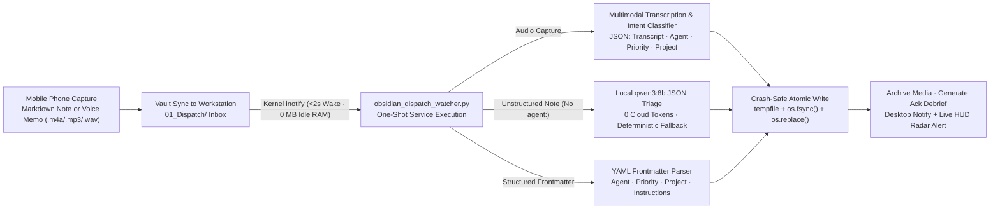

# 06 · Ambient Mobile Dispatch & Local Inference

High-signal ideas, mobile UI regressions, and architectural adjustments rarely wait politely until an engineer sits at a dual-monitor desk. They strike while walking a busy floor, testing an iOS build in bright sunlight, or auditing an operational site on foot. Yet polling directories continuously burns battery and resident laptop RAM, while routing routine note triage, voice digests, code sanity reviews, and bulk semantic indexing through cloud frontier models wastes rolling API capacity.

Hathcock Labs closes that loop with **zero idle workstation memory** and **zero cloud tokens** for unstructured note triage, local summarization, code review, chain-of-thought sanity checks, and vector indexing via **`squad-local`**.

---

## 1. Zero-RAM Kernel `inotify` Ingestion Pipeline

Polling a synced inbox folder every 5 seconds with a resident Python script wastes CPU wakeups and keeps memory occupied around the clock. Instead, mobile capture synchronization integrates directly with a Linux **systemd `.path` unit backed by kernel `inotify` watches**.



### Declarative Systemd `.path` + `oneshot` Wakeup Topology
Polling synced mobile folders in a `while True: sleep(5)` loop burns battery cycles and holds ~45–70 MB of resident interpreter memory continuously. Linux kernel `inotify` shifts file discovery entirely into kernel VFS space:

```ini
# dispatch-watcher.path — Idle footprint: 0 MB application RAM
[Unit]
Description=Watch synced mobile dispatch inbox via kernel inotify

[Path]
PathModified=/path/to/vault/01_Dispatch
DirectoryNotEmpty=/path/to/vault/01_Dispatch
MakeDirectory=true

[Install]
WantedBy=default.target
```

```ini
# dispatch-watcher.service — Wakes only while inbox contains unprocessed captures
[Unit]
Description=One-shot multimodal mobile note and voice-memo dispatcher

[Service]
Type=oneshot
ExecStart=/usr/bin/python3 /path/to/scripts/obsidian_dispatch_watcher.py
StandardOutput=journal
StandardError=journal
TimeoutStartSec=90
```

When a phone captures a field bug and Vault Sync writes the new file to disk, the kernel triggers the oneshot unit in `<2 seconds`, processes the queue cleanly, and exits straight back to `0 MB` resident memory.

### Engineering Guarantees of `obsidian_dispatch_watcher.py`
1. **Zero Idle Resident Footprint (`0 MB`):** When the dispatch inbox is empty, no watcher daemon lives in RAM. The moment vault synchronization drops a markdown note or audio recording, the kernel fires `inotify` and invokes the one-shot processor in under **2 seconds**.
2. **Broad Mobile Audio Codec Ingestion & Sync Settle Protection:** Supports `.m4a`, `.wav`, `.mp3`, `.ogg`, `.aac`, `.webm`, and `.flac` captures directly from phone voice recorders (`audio/mp4`, `audio/wav`, `audio/ogg`, `audio/aac`, `audio/webm`, `audio/flac`), ignoring transient `.tmp` or partial sync marker files cleanly until handles flush.
3. **Automatic `qwen3:8b` JSON Triage & Audio Intent Extraction:** When an unstructured quick-capture note drops into `01_Dispatch/` without explicit `agent:` YAML frontmatter (or marked `agent: auto`), `obsidian_dispatch_watcher.py` calls `triage_markdown_local()` against the local Apple Silicon `qwen3:8b` model (`temperature: 0`, `think: false`, `num_ctx: 4096`, strict `TRIAGE_SCHEMA` JSON mode) at **`0` cloud tokens**—classifying the note across all 18 specialists and target repositories while normalizing enums safely and falling back deterministically (`Hermes`, `MEDIUM`) if off-LAN. Multimodal audio processing likewise parses spoken notes into clean structured JSON:

```json
{
  "transcript": "Verbatim speech transcription of the field observation",
  "title": "3 to 6 word concise task title",
  "agent": "Beacon",
  "priority": "HIGH",
  "project": "target-repository-name",
  "triage_engine": "apple-silicon/qwen3:8b (0 cloud tokens)",
  "instructions": "Actionable Markdown checklist routed to the target specialist"
}
```

4. **Crash-Safe Atomic File Writes (`atomic_write`):** Cloud/LAN folder sync tools collide if partial markdown files appear mid-write. Every generated task dispatch, acknowledgment debrief, and telemetry radar JSON writes to a sibling temporary file, flushes userspace buffers, commits storage blocks via `os.fsync()`, and swaps directory entries atomically via `os.replace()`:

```python
def atomic_write(target_path: str, content: str) -> None:
    target_dir = os.path.dirname(target_path)
    os.makedirs(target_dir, exist_ok=True)
    with tempfile.NamedTemporaryFile("w", dir=target_dir, delete=False, suffix=".tmp") as tf:
        tf.write(content)
        tf.flush()
        os.fsync(tf.fileno())
        tmp_name = tf.name
    os.replace(tmp_name, target_path)
```

5. **Resilient Offline Audio Archival:** If network access is absent when an audio recording arrives, the watcher never drops data or spins in an infinite retry loop—it atomically moves the audio file into the processed audio archive and creates an `audio-untranscribed` structured stub linking directly to the archived media for delayed transcription once connectivity resumes.
6. **Live Operator Radar Feedback:** Emits an immediate native Linux desktop notification (`notify-send`) and updates a lightweight JSON radar state file rendered live at the bottom of the terminal telemetry HUD (`DISPATCH: 1 Note · 0 Audio pending`).

---

## 2. Zero-Cloud-Token 4-Model Inference (`squad-local` on M1 Max)

Our always-on Apple Silicon **M1 Max (`32 GB` unified memory)** node hosts a local `Ollama` runtime fronted by our **`squad-local` 4-model CLI**, absorbing embeddings, unstructured dispatch classification, technical digests, code sanity reviews, and reasoning checks at **zero cloud API cost**:

### Local Task-Tier Lineup & VRAM Co-Residency Tuning (`squad-local`)

| `squad-local` Tier / Command | Local M1 Max Model | Workload & Engineering Contract | Cloud Cost |
| :--- | :--- | :--- | :---: |
| **`embed`** *(pinned co-resident)* | **`nomic-embed-text`** (`768d`) | Batch `32`-chunk `float32` semantic indexing & `--auto-hybrid` RRF query vectors (`1.5s` RPC timeout, `keep_alive: -1`); stays permanently resident (`0` evictions) | **`0`** |
| **`squad-local triage`** *(+ `01_Dispatch/`)* | **`qwen3:8b`** *(Flash Attn · `q8_0` KV · `8K` ctx)* | Strict JSON-schema classification (`temperature: 0`, `think: false`) across 18 specialists & repositories + `5`-bullet digests (**`4.8 GB` VRAM / `37 tok/s`**) | **`0`** |
| **`squad-local code`** | **`qwen2.5-coder:14b`** | Local code reviews (`--file`, up to `48 KB`), regex/SQL drafting, and boilerplate verification (`temperature: 0.1`, clean upstream Modelfile) | **`0`** |
| **`squad-local ask` / `reason`** | **`qwen3:14b`** | General zero-token local engineering Q&A (`think: false` @ `22.2 tok/s`) and step-by-step edge-case sanity checks (`--think` optional) | **`0`** |

#### Eliminating `64K` Modelfile Eviction Thrash (Flash Attention + `q8_0` KV + `8K` Cap)
Default `64K`-context Ollama Modelfile allocations inflate KV-cache VRAM reservations dramatically—forcing the Apple Silicon runtime to evict `nomic-embed-text` whenever a chat/triage request arrives and causing cold model reload stalls and unified-memory swap pressure. Locking local inference behind three deterministic daemon knobs eliminated eviction thrash completely:

```env
# Apple Silicon Ollama Inference Tuning (Zero Eviction / Zero Swap Co-Residency)
OLLAMA_FLASH_ATTENTION=1
OLLAMA_KV_CACHE_TYPE=q8_0
# Explicit Modelfile / request context cap: num_ctx=8192 (eliminates 64K default KV bloat)
```

- **Measured Co-Residency Result:** **`qwen3:8b`** runs steadily at **`4.8 GB` VRAM** and **`37 tok/s`**, remaining continuously **co-resident with pinned `nomic-embed-text`** at **`0` model evictions** and **`0 MB` swap**—while `squad-doctor` (`30/30`) verifies stale-model hygiene automatically so retired/unreferenced model tags never linger across configs.

Running `squad-local status` probes `/api/tags` and `/api/ps` over the LAN, reporting round-trip latency, currently loaded VRAM footprints, quantization levels, and readiness across the local lineup—with `--json` machine output recording `"cloud_tokens": 0`, `elapsed_ms`, `load_ms`, and `tok_per_sec` on every call.

### Workload 1 · Synchronous-Free `768d` Vector Indexing (`nomic-embed-text`)
- **Primary Delta Worker:** Embeds uncached Markdown knowledge sections in batches of `32` via local HTTP RPC (`POST /api/embed`), packing `768`-dimensional little-endian `float32` blobs (`struct.pack("<768f", *vec)`) and precomputed L2 norms directly into SQLite (`section_embeddings`). Detached background spawns (`squad-memory embed`) keep foreground `append` and `sync` latencies under `16 ms` on the workstation.
- **Secondary Node Backup Pre-Embedder (`squad_vector_worker.py`):** Every `300 seconds`, a `launchd` background worker on the Apple Silicon node wakes under a non-blocking exclusive `fcntl.flock` lock (`LOCK_EX | LOCK_NB`) so overlapping runs skip cleanly without stacking. It opens the latest backed-up `memory.db` snapshot in immutable read-only mode (`?mode=ro&immutable=1`), copies precomputed embeddings safely, calls local `/api/embed` exclusively for missing `content_hash` keys, prunes deleted hashes, and persists an always-warm `embeddings_cache.db`:

```python
def run_vector_worker(snapshot_db: str, cache_db: str) -> dict:
    # 1. Non-blocking singleton lock prevents stacked 300s cron overlaps
    with open(WORKER_LOCK, "w") as lf:
        fcntl.flock(lf.fileno(), fcntl.LOCK_EX | fcntl.LOCK_NB)

        src = sqlite3.connect(f"file:{snapshot_db}?mode=ro&immutable=1", uri=True)
        cache = sqlite3.connect(cache_db)
        missing = find_uncached_sections(src, cache)  # LEFT JOIN by SHA-256 content_hash

        # 2. Embed strictly in 32-section chunks against local loopback Ollama
        for chunk in batched(missing, 32):
            vecs = post_ollama_embed(
                "http://127.0.0.1:11434/api/embed",
                model="nomic-embed-text",
                inputs=[f"{title}\n\n{body[:3500]}" for _, title, body in chunk],
            )
            for (ch_hash, _, _), vec in zip(chunk, vecs):
                norm = math.hypot(*vec)
                blob = struct.pack(f"<{len(vec)}f", *vec)
                upsert_embedding(cache, ch_hash, "nomic-embed-text", len(vec), norm, blob)

        prune_orphans(src, cache)
        return {"embedded_new": len(missing)}
```

Using `immutable=1` guarantees the worker never fails on read-only directory snapshots or stale `-shm`/`-wal` sidecars copied from another machine.

### Workload 2 · Zero-Token Technical Digests (`qwen3:8b`)
`squad-memory summarize <file>` (or piped `stdin` up to `15,000` characters) routes technical specs, reports, or release diffs locally to `qwen3:8b` via `/api/chat` over LAN HTTP at `think: false`, `temperature: 0.2`, `num_ctx: 4096`, and `num_predict: 400`:

```json
{
  "model": "qwen3:8b",
  "stream": false,
  "think": false,
  "options": { "temperature": 0.2, "num_ctx": 4096, "num_predict": 400 },
  "messages": [
    {
      "role": "user",
      "content": "Synthesize exactly 5 terse engineering bullets: (1) core architectural decision, (2) concrete files/components affected, (3) quantified limits or latency bounds, (4) failure mode prevented, (5) handoff/verification step. Zero fluff."
    }
  ]
}
```

Output surfaces local inference speed cleanly (`tokens/sec` measured from Ollama `eval_count / eval_duration`) alongside **`0 Cloud Tokens`** spent.

### Workload 3 · Semantic Sync Deduplication & Background Extraction
Automated hourly repository synchronization incorporates semantic diff deduplication (`SKIP_UNCHANGED`) and `2 MB` log rotation caps, keeping routine markdown extraction and commit-message drafting completely off paid frontier windows.

---

## 3. The Local-vs-Frontier Decision Boundary

Saving tokens by pushing judgment-critical code onto small local open-weight models introduces subtle defects; burning frontier quota on markdown extraction wastes rolling burst capacity. Every workflow obeys one explicit routing boundary:

| Workload Characteristic | Execution Tier | Verification & Safety Contract |
| :--- | :--- | :--- |
| Clinical medicine (`Echo`), security rules (`Vault`), auth/HMAC (`Apex`), sync races (`Nexus`), IAM (`Sentinel`), production code edits | **Cloud Frontier Tiers** (`pro` / `flash`) | Guarded by `pro [MANDATORY]` locks, `tsc`, `oxlint`, Vitest, Playwright DOM/WCAG gates, and `Muse`. |
| `768d` embeddings, `01_Dispatch/` `qwen3:8b` JSON triage, 5-bullet digests, `qwen2.5-coder:14b` code/regex checks, `qwen3:14b` reasoning & Q&A | **Local M1 Max (`squad-local` 4-Model Node)** | High-volume inference at **`0` cloud token burn** with deterministic FTS5 / enum fallbacks when off-LAN. |

### Disconnected Operation & Zero-Blocking Guarantees

| Field Condition | Mobile / Workstation Behavior |
| :--- | :--- |
| **Workstation Away From Home LAN** | `squad-memory query` detects unreachable Apple Silicon host in `<= 1.5s` and executes `<1.5 ms` Optane FTS5 lexical retrieval uninterrupted; unembedded rows stay safely queued. |
| **Phone Records Audio in Underground Garage** | Voice note syncs whenever signal returns; `obsidian_dispatch_watcher.py` wakes via `inotify` in `<2s`. If cloud transcription is offline, raw `.m4a` archives safely with an `audio-untranscribed` task stub rather than looping or dropping audio. |
| **Worker Overruns `300s` Scheduling Interval** | `LOCK_EX | LOCK_NB` causes the overlapping cron/launchd spawn to exit gracefully immediately instead of compounding Ollama memory pressure. |

This clear partition preserves rolling frontier burst capacity strictly for deep systems engineering, regulatory verification, and safety-critical reasoning while ambient notes, audio memos, and vector indexes stay resilient anywhere.

---

## 4. Supported Field Audio Formats & Multimodal Routing Contract

Mobile captures arrive from phone voice memo tools, smartwatches, and browser dictation widgets across incompatible container wrappers. `obsidian_dispatch_watcher.py` resolves MIME codecs explicitly before base64-encoding audio bytes cleanly into multimodal extraction requests:

```python
AUDIO_MIME_MAP = {
    ".m4a":  "audio/mp4",
    ".aac":  "audio/aac",
    ".mp3":  "audio/mpeg",
    ".wav":  "audio/wav",
    ".ogg":  "audio/ogg",
    ".opus": "audio/ogg",
    ".webm": "audio/webm",
    ".flac": "audio/flac",
}
```

### End-to-End Mobile Voice Capture Lifecycle
1. **Phone Dictation (`08:14` on site):** Engineer records a `24-second` `.m4a` clip noting that tablet charger dock spacing binds slightly when a protective sleeve stays installed (`0.20mm` interference fit issue).
2. **Sync & Kernel `inotify` Wake (`08:14:03`):** Folder synchronization writes the binary audio into `01_Dispatch/`; Linux kernel triggers the `oneshot` unit instantly from `0 MB` idle state.
3. **Multimodal Classification & Scoping (`08:14:08`):** Structured JSON routes strictly to **`Vulcan`** (`priority: HIGH`, `project: cad-fixtures`) with verbatim transcript preserved inside the generated Markdown card alongside a link to the archived original `.m4a`.
4. **Crash-Safe Atomic Debrief & Notification (`08:14:09`):** `atomic_write()` persists the task card via `os.fsync() + os.replace()`, moves the audio file to the archive folder, refreshes `pending_radar.json`, and fires a desktop toast (`notify-send`).
5. **HUD Telemetry Sync (`08:14:10`):** Within two seconds, the live terminal telemetry dashboard surfaces `[DISPATCH: 1 Active Note -> Vulcan]` cleanly without interrupting active compilation panes.

### Local vs. Cloud Economics Benchmark

| Telemetry Metric | Unoffloaded Baseline | Local Apple Silicon Tier | Monthly Engineering Gain |
| :--- | :--- | :--- | :--- |
| **`1,200` Section Vector Re-Index** | Cloud embedding API latency + quota | **`~1.8s` cached / `~14s` full cold**, `0` cloud tokens | Zero rate-limit jitter on large vault syncs |
| **Daily `5`-Bullet Architecture Digests & Triage** | `~2,500`–`4,000` frontier tokens per doc | **`qwen3:8b` (`4.8 GB` VRAM / `37 tok/s`, Flash Attn + `q8_0` KV + `8K` ctx)** co-resident w/ pinned `nomic-embed-text` (`0` evictions, `0 MB` swap) | Preserves rolling quota strictly for `Vault`/`Echo`/`Apex` |
| **Idle Folder Monitoring Cost** | Polling Python loop (`~55 MB` RAM, periodic CPU wakes) | **`0 MB` idle**, kernel `inotify` sub-2s dispatch wake | Longer mobile battery life & zero background bloat |
| **Partial Sync File Corruption** | Occasional truncated Markdown reads | **Tempfile + `os.fsync()` + `os.replace()`** (`0` torn reads) | Eliminates half-written cards across multi-device sync |

> [!TIP]
> The core principle behind ambient capture and local inference is **asymmetric latency hiding**: mobile captures wake the workstation only when work exists, while heavy embedding and digest math drain asynchronously onto unified-memory Apple Silicon with zero interruption to keyboard-to-merge engineering flow.

---

## 5. Failure Modes & Crash-Safe Reconciliation Matrix

Distributed file synchronization paired with local model execution introduces subtle concurrency edge cases if unguarded. Every boundary obeys deterministic recovery guarantees:

| Failure / Timing Hazard | Guardrail Enforced | Clean System Behavior |
| :--- | :--- | :--- |
| **Folder Sync Drops Half-Written File** | Minimum file-settle check + skip `.tmp`/conflict copies + `atomic_write` (`os.fsync` + `os.replace`) | Corrupted intermediate writes never parse; clean dispatches swap instantaneously |
| **Multimodal Transcription Fails Offline** | Move binary clip safely to processed archive + emit `audio-untranscribed` stub note | Zero audio data loss and zero infinite service restart loops |
| **Local Apple Silicon Ollama Unreachable** | `urllib` HTTP `1.5s` connect/read timeout on RPC; worker logs clean skip | FTS5 queries stay uninterrupted (`<1.5 ms`); `section_embeddings` catches up on reconnect |
| **Backup `memory.db` Held Open by Concurrent Writers** | Open secondary snapshots strictly with `?mode=ro&immutable=1` + non-blocking `LOCK_EX | LOCK_NB` | Worker embeds `content_hash` gaps cleanly without `SQLITE_BUSY` or stacked cron runs |
| **`64K` Modelfile KV-Cache Eviction Thrash** | `OLLAMA_FLASH_ATTENTION=1`, `OLLAMA_KV_CACHE_TYPE=q8_0`, `8K` context cap (`num_ctx=8192`) | `qwen3:8b` (`4.8 GB` VRAM / `37 tok/s`) stays co-resident with pinned `nomic-embed-text` at `0` evictions & `0 MB` swap |

Paired together, `systemd.path` `inotify` wakeups and headless Apple Silicon inference turn asynchronous field captures and nightly knowledge indexing into silent background utilities rather than battery drains or cloud quota liabilities.

### Why Local Open-Weight Models Stay Explicitly Scoped
- **Never Compromise Safety Surfaces:** While tuned `qwen3:8b` (`4.8 GB` / `37 tok/s`) excels at rapid 5-bullet technical synthesis and structured JSON extraction on unified Apple Silicon memory, it never audits clinical ultrasound guidelines (`Echo`), multi-tenant Firestore rules (`Vault`), or HMAC webhook guards (`Apex`). Those remain strictly locked to verified frontier reasoning plus deterministic compiler/test gates.
- **High-ROI Throughput Where Quality Is Verifiable:** `768d` embedding generation (`nomic-embed-text`) and structured digests produce directly inspectable retrieval hits and bulleted artifacts checked downstream by human engineers and lexical FTS5 fallbacks—recovering huge daily frontier quota headroom cleanly at zero marginal cost.

### Continuous Health Probes Over Local Daemons (`30/30` Doctor + Stale-Model Hygiene)
Rather than assuming background Apple Silicon inference workers stay silently alive across macOS updates or restarts, `squad-doctor` verifies local Ollama availability across the tuned lineup (`nomic-embed-text`, `qwen3:8b`, `qwen2.5-coder:14b`, `deepseek-r1:14b`, `qwen3:14b`), executes **automated stale-model hygiene checks** ensuring retired model IDs never linger in active configs, verifies `squad-local` CLI readiness on the workstation, confirms active `launchd` PID supervision on the container watchdog and `300s` vector pre-embedder, and checks workstation SQLite `section_embeddings` coverage (`embedded == total`) inside its **`30/30`-invariant** cross-node diagnostic sweep—turning local inference into an observable, self-verifying tier of production architecture.

### End-to-End Capture Safeguards Summary
- **Atomic File Swap (`os.replace`):** Partial phone sync drops never reach parsers half-written.
- **Zero Zombie Daemons:** Linux `systemd.path` triggers drop resident memory consumption completely to `0 MB` between field captures.
- **Lossless Offline Tolerance:** Unreachable transcription endpoints archive binary audio directly alongside stub notes rather than failing or looping.
- **Predictable Local Compute:** Batched `32`-chunk `768d` vectors (`norm` + `<768f` BLOB) pinned alongside `q8_0` Flash-Attention `qwen3:8b` (`4.8 GB` / `37 tok/s`, `0` evictions, `0 MB` swap) keep background knowledge continuous at zero cloud token burn.
