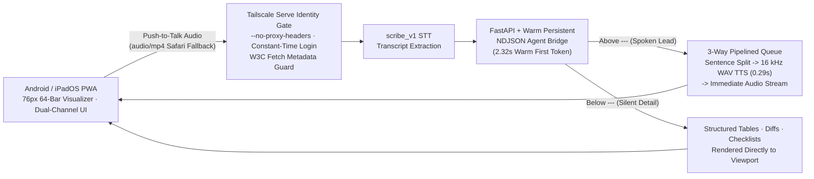
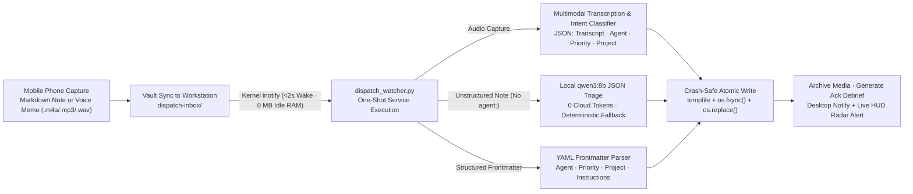

# 06 · Ambient Mobile Dispatch, HALCYON Flight Deck & Local Inference

High-signal ideas, mobile UI regressions, and architectural adjustments rarely wait politely until an engineer sits at a dual-monitor desk. They strike while walking a busy floor, testing an iOS build in bright sunlight, or auditing an operational site on foot. Yet polling directories continuously burns battery and resident laptop RAM, cold-spawning an agent per voice prompt stalls mobile conversations for `8–12` seconds, and routing routine note triage, log compression, boilerplate scaffolding, and bulk semantic indexing through cloud frontier models wastes rolling API capacity.

Hathcock Labs closes that loop with three complementary layers: **HALCYON Flight Deck** (an installable Android/iPadOS voice PWA backed by a warm persistent agent bridge and zero-token tailnet identity auth), **zero-RAM kernel `inotify` capture** for asynchronous field notes, and **Local Apple Silicon M1 Max Inference v1.2** (`squad-local`) running 3-model co-residency at **zero cloud tokens**.

---

## 1. HALCYON Flight Deck — Low-Latency Mobile & iPadOS Voice PWA

Asynchronous file sync works well for quick captures, but interactive architectural steering from a phone or iPad demands conversational latency, clean mobile ergonomics, and zero credential exposure on untrusted networks. **HALCYON Flight Deck** pairs a local **FastAPI** gateway and persistent warm **NDJSON agent bridge** with an installable Android/iPadOS Progressive Web App served strictly over a **private Tailscale tailnet**.



### ~4× End-to-End Voice Latency Reduction (`8.5–11.5s` → `2.32s`)
Spawning a fresh CLI process on every voice turn and waiting for the complete Markdown answer before synthesizing compressed MP3 audio previously introduced **`8.5–11.5s`** of dead air. Four concrete pipeline optimizations cut warm time-to-first-token by **~4×** down to **`2.32s`**:

1. **Persistent Warm NDJSON Agent Bridge:** FastAPI maintains a long-lived line-delimited JSON (`NDJSON`) worker session rather than cold-booting a subprocess per request, eliminating repeated binary startup, rule hydration, and tool-registry initialization.
2. **Uncompressed `16 kHz` WAV TTS (`0.29s`):** Replacing lossy encoder buffering with raw `16 kHz` PCM/WAV synthesis removes codec lookahead stalls and delivers playable speech chunks in **`0.29s`**.
3. **3-Way Pipelined Sentence-Streaming Queue:** Token generation, sentence-boundary segmentation, TTS synthesis, and client audio playback execute concurrently in a three-stage pipeline—sentence `N` plays on the handset while sentence `N+1` synthesizes and sentence `N+2` streams from the model.
4. **Dual-Channel `---` Conversational Voice Framing:** System framing separates every response cleanly across a `---` divider:
   - **Above `---` (Spoken Executive Lead):** Two to four natural spoken sentences routed straight into the TTS queue with zero code blocks, file paths, or Markdown syntax read aloud.
   - **Below `---` (Visual Reference Payload):** Structured Markdown tables, symbol slices, and verification checklists rendered silently to the mobile screen for visual inspection.

### Mobile Capture, Visualizer & In-House Zero-Token Knowledge Graph
- **`scribe_v1` Push-to-Talk with Safari/iPadOS Fallback:** Media capture negotiates `audio/webm` where supported and automatically falls back to **`audio/mp4`** on iOS/iPadOS Safari where WebM `MediaRecorder` encoding is absent, feeding directly into `scribe_v1` speech-to-text.
- **Full-Width `76px` 64-Bar Audio-Reactive Visualizer:** Built on Web Audio `AnalyserNode` frequency bins across a full-width `76px` strip, providing immediate physical confirmation of microphone gain and playback cadence without cluttering the viewport with telemetry chrome.
- **Zero-Token In-House Knowledge Graph (`62` Notes / `94` Nodes / `743` Edges):** Instead of bundling heavy third-party graph plugins or burning LLM tokens to browse interconnected documentation, Flight Deck computes and renders an interactive force-directed knowledge graph directly from local Markdown links and tag adjacency (**`62` notes**, **`94` nodes**, **`743` edges**) at **`0` cloud tokens**.

### Zero-Token Tailscale Serve Identity Auth & Security-First PWA
Exposing a live agent bridge with static bearer tokens stored in `localStorage` invites XSS token theft and CSRF cross-origin invocation. Flight Deck enforces network-layer identity and browser-enforced origin boundaries:

| Security Control | Implementation Invariant | Threat Neutralized |
| :--- | :--- | :--- |
| **Tailscale Serve Identity Header** | Local FastAPI binds loopback-only with **`--no-proxy-headers`** and validates `Tailscale-User-Login` via constant-time `hmac.compare_digest` | Prevents `X-Forwarded-*` header spoofing and eliminates static API tokens in browser storage |
| **W3C Fetch Metadata Middleware** | Permits top-level document loads (`Sec-Fetch-Mode: navigate`) while rejecting cross-site API mutations (`Sec-Fetch-Site: cross-site`) | Blocks cross-origin CSRF and drive-by local-network API probes |
| **Security-First `sw.js` Scope** | Service Worker caches strictly immutable `/assets/*` bundles; authenticated HTML, NDJSON streams, and API responses always bypass cache | Guarantees zero stale or leaked session payloads persist inside browser Cache Storage |

---

## 2. Zero-RAM Kernel `inotify` Ingestion Pipeline

Polling a synced inbox folder every 5 seconds with a resident Python script wastes CPU wakeups and keeps memory occupied around the clock. Instead, asynchronous mobile capture synchronization integrates directly with a Linux **systemd `.path` unit backed by kernel `inotify` watches**.



### Declarative Systemd `.path` + `oneshot` Wakeup Topology
Polling synced mobile folders in a `while True: sleep(5)` loop burns battery cycles and holds ~45–70 MB of resident interpreter memory continuously. Linux kernel `inotify` shifts file discovery entirely into kernel VFS space:

```ini
# dispatch-watcher.path — Idle footprint: 0 MB application RAM
[Unit]
Description=Watch synced mobile dispatch inbox via kernel inotify

[Path]
PathModified=/path/to/vault/dispatch-inbox
DirectoryNotEmpty=/path/to/vault/dispatch-inbox
MakeDirectory=true

[Install]
WantedBy=default.target
```

```ini
# dispatch-watcher.service — Wakes only while inbox contains unprocessed captures
[Unit]
Description=One-shot multimodal mobile note and voice-memo dispatcher

[Service]
Type=oneshot
ExecStart=/usr/bin/python3 /path/to/scripts/dispatch_watcher.py
StandardOutput=journal
StandardError=journal
TimeoutStartSec=90
```

When a phone captures a field bug and folder sync writes the new file to disk, the kernel triggers the oneshot unit in `<2 seconds`, processes the queue cleanly, and exits straight back to `0 MB` resident memory.

### Engineering Guarantees of the One-Shot Dispatch Watcher
1. **Zero Idle Resident Footprint (`0 MB`):** When the dispatch inbox is empty, no watcher daemon lives in RAM. The moment folder synchronization drops a markdown note or audio recording, the kernel fires `inotify` and invokes the one-shot processor in under **2 seconds**.
2. **Broad Mobile Audio Codec Ingestion & Sync Settle Protection:** Supports `.m4a`, `.wav`, `.mp3`, `.ogg`, `.aac`, `.webm`, and `.flac` captures directly from phone voice recorders (`audio/mp4`, `audio/wav`, `audio/ogg`, `audio/aac`, `audio/webm`, `audio/flac`), ignoring transient `.tmp` or partial sync marker files cleanly until handles flush.
3. **Automatic `qwen3:8b` JSON Triage & Audio Intent Extraction:** When an unstructured quick-capture note drops into `dispatch-inbox/` without explicit `agent:` YAML frontmatter (or marked `agent: auto`), the watcher calls `triage_markdown_local()` against the local Apple Silicon inference node (`qwen3:8b`, `temperature: 0`, `think: false`, `num_ctx: 4096`, strict `TRIAGE_SCHEMA` JSON mode) at **`0` cloud tokens**—classifying the note across all 18 specialists and target repositories while normalizing enums safely and falling back deterministically (`default triage queue`, `MEDIUM`) if off-network. Multimodal audio processing likewise parses spoken notes into clean structured JSON:

```json
{
  "transcript": "Verbatim speech transcription of the field observation",
  "title": "3 to 6 word concise task title",
  "agent": "Beacon",
  "priority": "HIGH",
  "project": "target-repository-name",
  "triage_engine": "apple-silicon/qwen3:8b (0 cloud tokens)",
  "instructions": "Actionable Markdown checklist routed to the target specialist"
}
```

4. **Crash-Safe Atomic File Writes (`atomic_write`):** Cloud/LAN folder sync tools collide if partial markdown files appear mid-write. Every generated task dispatch, acknowledgment debrief, and telemetry radar JSON writes to a sibling temporary file, flushes userspace buffers, commits storage blocks via `os.fsync()`, and swaps directory entries atomically via `os.replace()`:

```python
def atomic_write(target_path: str, content: str) -> None:
    target_dir = os.path.dirname(target_path)
    os.makedirs(target_dir, exist_ok=True)
    with tempfile.NamedTemporaryFile("w", dir=target_dir, delete=False, suffix=".tmp") as tf:
        tf.write(content)
        tf.flush()
        os.fsync(tf.fileno())
        tmp_name = tf.name
    os.replace(tmp_name, target_path)
```

5. **Resilient Offline Audio Archival:** If network access is absent when an audio recording arrives, the watcher never drops data or spins in an infinite retry loop—it atomically moves the audio file into the processed audio archive and creates an `audio-untranscribed` structured stub linking directly to the archived media for delayed transcription once connectivity resumes.
6. **Live Operator Radar Feedback:** Emits an immediate native Linux desktop notification (`notify-send`) and updates a lightweight JSON radar state file rendered live at the bottom of the terminal telemetry HUD (`DISPATCH: 1 Note · 0 Audio pending`).

---

## 3. Local Apple Silicon M1 Max Inference v1.2 (`squad-local` 3-Model Co-Residency)

Our always-on **local Apple Silicon inference node (`32 GiB` unified RAM)** hosts an `Ollama` runtime fronted by **`squad-local` v1.2**, absorbing embeddings, unstructured dispatch classification, log/diff compression (`squad-local summarize`), and Wave 0 Zod/Vitest scaffolding (`squad-local scaffold`) at **zero cloud API cost**:

### 3-Model Co-Residency Budget (`15.13 GB` / `32 GiB` Unified RAM)

| `squad-local` Tier / Command | Local M1 Max Model | Resident VRAM | Verified Workload & Throughput | Cloud Cost |
| :--- | :--- | :---: | :--- | :---: |
| **`embed`** *(pinned co-resident)* | **`nomic-embed-text`** (`768d`) | **`0.34 GB`** | Batch `32`-chunk `float32` semantic indexing & `--auto-hybrid` RRF query vectors (`1.5s` RPC timeout, `keep_alive: -1`) | **`0`** |
| **`squad-local summarize`** / **`triage`** *(+ `squad-context --compress-local`)* | **`qwen3:8b`** *(Flash Attn · `q8_0` KV · `8K` ctx)* | **`5.12 GB`** | Log/diff compression (**`36.9 tok/s`**, **`93–95%` payload compression**), `5`-bullet digests, and strict JSON-schema inbox classification (`temperature: 0`, `think: false`) | **`0`** |
| **`squad-local scaffold`** / **`code`** | **`qwen2.5-coder:14b`** *(Flash Attn · `q8_0` KV)* | **`9.67 GB`** | Wave 0 DAG swarm **Zod schema & Vitest test scaffolding** (**`21.4 tok/s`**), regex/SQL drafting, and local file sanity scans | **`0`** |
| **3-Model Co-Resident Total** | **All 3 Pinned Simultaneously** | **`15.13 GB`** | **`0` evictions · `0 MB` swap** inside `32 GiB` unified memory headroom (`~16.9 GiB` free for macOS/containers) | **`0`** |

#### Eliminating `64K` Modelfile Eviction Thrash (4 Daemon Knobs for Zero-Swap Co-Residency)
Default `64K`-context Ollama Modelfile allocations inflate KV-cache VRAM reservations dramatically—forcing the Apple Silicon runtime to evict `nomic-embed-text` or `qwen3:8b` whenever a `14B` coder request arrives and triggering cold model reload stalls. Locking local inference behind four deterministic daemon knobs keeps all three models resident simultaneously:

```env
# Local Apple Silicon Inference Node v1.2 — 3-Model Co-Residency (15.13 GB / 32 GiB)
OLLAMA_MAX_LOADED_MODELS=3
OLLAMA_FLASH_ATTENTION=1
OLLAMA_KV_CACHE_TYPE=q8_0
OLLAMA_KEEP_ALIVE=30m
# Explicit request context cap: num_ctx=8192 (eliminates 64K default KV bloat)
```

- **Measured v1.2 Co-Residency Result:** **`nomic-embed-text` (`0.34 GB`) + `qwen3:8b` (`5.12 GB`) + `qwen2.5-coder:14b` (`9.67 GB`) = `15.13 GB`** stay loaded in parallel at **`0` model evictions** and **`0 MB` swap**. Running `squad-local status` probes `/api/tags` and `/api/ps`, reporting round-trip latency, resident VRAM footprints, quantization levels, and readiness—with `--json` machine output recording `"cloud_tokens": 0`, `elapsed_ms`, `load_ms`, and `tok_per_sec` on every call.

### Workload 1 · Synchronous-Free `768d` Vector Indexing (`nomic-embed-text`)
- **Primary Delta Worker:** Embeds uncached Markdown knowledge sections in batches of `32` via local HTTP RPC (`POST /api/embed`), packing `768`-dimensional little-endian `float32` blobs (`struct.pack("<768f", *vec)`) and precomputed L2 norms directly into SQLite (`section_embeddings`). Detached background spawns (`squad-memory embed`) keep foreground `append` and `sync` latencies under `16 ms` on the workstation.
- **Secondary Node Backup Pre-Embedder (`squad_vector_worker.py`):** Every `300 seconds`, a `launchd` background worker on the local Apple Silicon inference node wakes under a non-blocking exclusive `fcntl.flock` lock (`LOCK_EX | LOCK_NB`) so overlapping runs skip cleanly without stacking. It opens the latest backed-up `memory.db` snapshot in immutable read-only mode (`?mode=ro&immutable=1`), copies precomputed embeddings safely, calls local `/api/embed` exclusively for missing `content_hash` keys, prunes deleted hashes, and persists an always-warm `embeddings_cache.db`:

```python
def run_vector_worker(snapshot_db: str, cache_db: str) -> dict:
    # 1. Non-blocking singleton lock prevents stacked 300s cron overlaps
    with open(WORKER_LOCK, "w") as lf:
        fcntl.flock(lf.fileno(), fcntl.LOCK_EX | fcntl.LOCK_NB)

        src = sqlite3.connect(f"file:{snapshot_db}?mode=ro&immutable=1", uri=True)
        cache = sqlite3.connect(cache_db)
        missing = find_uncached_sections(src, cache)  # LEFT JOIN by SHA-256 content_hash

        # 2. Embed strictly in 32-section chunks against local loopback Ollama
        for chunk in batched(missing, 32):
            vecs = post_ollama_embed(
                "http://127.0.0.1:11434/api/embed",
                model="nomic-embed-text",
                inputs=[f"{title}\n\n{body[:3500]}" for _, title, body in chunk],
            )
            for (ch_hash, _, _), vec in zip(chunk, vecs):
                norm = math.hypot(*vec)
                blob = struct.pack(f"<{len(vec)}f", *vec)
                upsert_embedding(cache, ch_hash, "nomic-embed-text", len(vec), norm, blob)

        prune_orphans(src, cache)
        return {"embedded_new": len(missing)}
```

Using `immutable=1` guarantees the worker never fails on read-only directory snapshots or stale `-shm`/`-wal` sidecars copied from another machine.

### Workload 2 · `93–95%` Log & Diff Compression (`squad-local summarize` / `qwen3:8b` @ `36.9 tok/s`)
Verbose test logs, compiler traces, and multi-file diffs waste frontier input tokens when forwarded raw into cloud specialists. `squad-local summarize`—wired directly into the differential context compiler via **`squad-context --compress-local`**—routes raw logs and diffs locally to **`qwen3:8b`** (`think: false`, `temperature: 0.2`, `num_ctx: 4096`) at **`36.9 tok/s`**, achieving **`93–95%` payload compression** into terse structured failure digests at **`0` cloud tokens**:

```json
{
  "model": "qwen3:8b",
  "stream": false,
  "think": false,
  "options": { "temperature": 0.2, "num_ctx": 4096, "num_predict": 400 },
  "messages": [
    {
      "role": "user",
      "content": "Synthesize exactly 5 terse engineering bullets: (1) core architectural decision, (2) concrete files/components affected, (3) quantified limits or latency bounds, (4) failure mode prevented, (5) handoff/verification step. Zero fluff."
    }
  ]
}
```

### Workload 3 · Wave 0 DAG Swarm Scaffolding (`squad-local scaffold` / `qwen2.5-coder:14b` @ `21.4 tok/s`)
Before cloud coding specialists execute Wave 2 implementation slices inside `squad-harness`, **Wave 0** invokes **`squad-local scaffold`** against **`qwen2.5-coder:14b`** (`21.4 tok/s`, `0` cloud tokens) to emit deterministic boilerplate: initial **Zod schema skeletons**, **Vitest test-case scaffolding**, and symbol-inventory manifests. Downstream frontier specialists receive clean, pre-compiled scaffolding rather than burning paid output tokens typing repetitive test harnesses and import blocks.

---

## 4. The Local-vs-Frontier Decision Boundary (Honest Engineering Lesson)

Benchmarking open-weight `8B` and `14B` models against real production repositories surfaced one crisp architectural lesson: **local 8B/14B models excel at symbol inventory, `93–95%` log/diff compression, and deterministic boilerplate scaffolding (`Zod`/`Vitest`), while root-cause debugging, multi-tenant security review, and clinical/statutory verification must remain strictly on cloud frontier auditors.**

Pushing subtle race conditions or security-rule edge cases onto local `8B`/`14B` weights introduces silent false confidence; conversely, burning frontier quota on raw stack-trace compression or test-file boilerplate wastes rolling burst capacity. Every workflow obeys one explicit routing contract:

| Workload Characteristic | Execution Tier | Verification & Safety Contract |
| :--- | :--- | :--- |
| Root-cause debugging, security/IAM review (`Sentinel`), clinical medicine (`Echo`), security rules (`Vault`), auth/HMAC (`Apex`), sync races (`Nexus`), production logic edits | **Cloud Frontier Tiers** (`pro` / `inherit`) | Guarded by mandatory frontier locks, Wave 3 Break-It Gates, `tsc`, `oxlint`, Vitest, Playwright DOM/WCAG gates, and `Muse`. |
| `768d` embeddings (`nomic-embed-text`), `93–95%` log/diff compression (`squad-local summarize` @ `36.9 tok/s`), inbox JSON triage, Wave 0 Zod/Vitest scaffolding (`squad-local scaffold` @ `21.4 tok/s`) | **Local Apple Silicon Inference Node v1.2 (`15.13 GB` 3-Model Co-Residency)** | High-volume mechanical offload at **`0` cloud token burn** with deterministic FTS5 / enum fallbacks when off-network. |

### Disconnected Operation & Zero-Blocking Guarantees

| Field Condition | Mobile / Workstation Behavior |
| :--- | :--- |
| **Workstation Away From Home Network** | `squad-memory query` detects unreachable local inference host in `<= 1.5s` and executes `<1.5 ms` local NVMe FTS5 lexical retrieval uninterrupted; unembedded rows stay safely queued. |
| **Phone Records Audio in Underground Garage** | Voice note syncs whenever signal returns; the one-shot dispatch watcher wakes via `inotify` in `<2s`. If cloud transcription is offline, raw `.m4a` archives safely with an `audio-untranscribed` task stub rather than looping or dropping audio. |
| **Worker Overruns `300s` Scheduling Interval** | `LOCK_EX | LOCK_NB` causes the overlapping `launchd` spawn to exit gracefully immediately instead of compounding Ollama memory pressure. |

This clear partition preserves rolling frontier burst capacity strictly for deep systems engineering, root-cause debugging, regulatory verification, and safety-critical review while ambient notes, voice Flight Deck streaming, compression, and Wave 0 scaffolding stay fast and resilient.

---

## 5. Supported Field Audio Formats & Local vs. Cloud Benchmarks

Mobile captures arrive from phone voice memo tools, smartwatches, and browser dictation widgets across incompatible container wrappers (`audio/webm` on Android/Chrome vs. `audio/mp4` on Safari/iPadOS). Both Flight Deck (`scribe_v1` Push-to-Talk) and the one-shot inbox watcher resolve MIME codecs explicitly before processing:

```python
AUDIO_MIME_MAP = {
    ".m4a":  "audio/mp4",
    ".aac":  "audio/aac",
    ".mp3":  "audio/mpeg",
    ".wav":  "audio/wav",
    ".ogg":  "audio/ogg",
    ".opus": "audio/ogg",
    ".webm": "audio/webm",
    ".flac": "audio/flac",
}
```

### End-to-End Mobile Voice Capture Lifecycle
1. **Phone Dictation (`08:14` on site):** Engineer records a `24-second` `.m4a` clip noting that tablet charger dock spacing binds slightly when a protective sleeve stays installed (`0.20mm` interference fit issue).
2. **Sync & Kernel `inotify` Wake (`08:14:03`):** Folder synchronization writes the binary audio into `dispatch-inbox/`; Linux kernel triggers the `oneshot` unit instantly from `0 MB` idle state.
3. **Multimodal Classification & Scoping (`08:14:08`):** Structured JSON routes strictly to **`Vulcan`** (`priority: HIGH`, `project: cad-fixtures`) with verbatim transcript preserved inside the generated Markdown card alongside a link to the archived original `.m4a`.
4. **Crash-Safe Atomic Debrief & Notification (`08:14:09`):** `atomic_write()` persists the task card via `os.fsync() + os.replace()`, moves the audio file to the archive folder, refreshes `pending_radar.json`, and fires a desktop toast (`notify-send`).
5. **HUD Telemetry Sync (`08:14:10`):** Within two seconds, the live terminal telemetry dashboard surfaces `[DISPATCH: 1 Active Note -> Vulcan]` cleanly without interrupting active compilation panes.

### Local vs. Cloud Economics & Latency Benchmark

| Telemetry Metric | Unoffloaded / Cold Baseline | Shipped Architecture (Flight Deck + M1 Max v1.2) | Engineering Gain |
| :--- | :--- | :--- | :--- |
| **Interactive Mobile Voice First Token** | `8.5–11.5s` cold CLI spawn + buffered MP3 | **`2.32s` warm first token** + **`0.29s` `16 kHz` WAV** + 3-way pipeline | **~4× latency reduction** on Android & iPadOS |
| **Log & Diff Payload Compression** | Raw `10–40 KB` compiler/test dumps sent to cloud | **`qwen3:8b` (`5.12 GB` / `36.9 tok/s`)** via `squad-context --compress-local` | **`93–95%` payload compression** at `0` cloud tokens |
| **Wave 0 Zod & Vitest Scaffolding** | Cloud coding tokens spent on repetitive boilerplate | **`qwen2.5-coder:14b` (`9.67 GB` / `21.4 tok/s`)** via `squad-local scaffold` | Zero-token pre-wave scaffolding wired into DAG swarm |
| **`1,200` Section Vector Re-Index** | Cloud embedding API latency + quota | **`nomic-embed-text` (`0.34 GB`)** pinned co-resident (`~1.8s` cached / `~14s` cold) | `15.13 GB` total 3-model co-residency (`0` evictions, `0 MB` swap) |
| **Interactive Knowledge Graph View** | Heavy external graph plugins or LLM summaries | **In-house zero-token graph (`62` notes / `94` nodes / `743` edges)** | Instant visual navigation inside mobile/iPadOS PWA |
| **Idle Folder Monitoring Cost** | Polling Python loop (`~55 MB` RAM, periodic CPU wakes) | **`0 MB` idle**, kernel `inotify` sub-2s dispatch wake | Longer mobile battery life & zero background bloat |

> [!TIP]
> The core principle behind Flight Deck, ambient capture, and local inference is **asymmetric latency hiding**: warm NDJSON bridges and 3-way WAV pipelines keep mobile voice interactive (`2.32s`), `inotify` wakes the workstation only when asynchronous files arrive, and 3-model Apple Silicon co-residency drains embeddings, `93–95%` compression, and Wave 0 scaffolding at `0` cloud tokens.

---

## 6. Failure Modes & Crash-Safe Reconciliation Matrix

Distributed file synchronization, mobile voice streaming, and local multi-model execution introduce subtle edge cases if unguarded. Every boundary obeys deterministic recovery guarantees:

| Failure / Timing Hazard | Guardrail Enforced | Clean System Behavior |
| :--- | :--- | :--- |
| **Spoofed Reverse-Proxy Headers on Voice Gateway** | Loopback FastAPI (`--no-proxy-headers`) + constant-time `Tailscale-User-Login` + W3C Fetch Metadata | Forged `X-Forwarded-*` headers and cross-site API calls reject immediately at middleware |
| **Stale Authenticated Payloads in PWA Cache** | Security-first `sw.js` caching `/assets/*` strictly | Authenticated API JSON and session HTML never persist in browser Cache Storage |
| **iPadOS / Safari `MediaRecorder` Missing WebM** | Automatic `audio/mp4` fallback negotiated before `scribe_v1` STT upload | Push-to-Talk voice capture works identically across Android Chrome and iPadOS Safari |
| **Folder Sync Drops Half-Written File** | Minimum file-settle check + skip `.tmp`/conflict copies + `atomic_write` (`os.fsync` + `os.replace`) | Corrupted intermediate writes never parse; clean dispatches swap instantaneously |
| **Local Apple Silicon Inference Node Unreachable** | `urllib` HTTP `1.5s` connect/read timeout on RPC; worker logs clean skip | FTS5 queries stay uninterrupted (`<1.5 ms`); `section_embeddings` catches up on reconnect |
| **Backup `memory.db` Held Open by Concurrent Writers** | Open secondary snapshots strictly with `?mode=ro&immutable=1` + non-blocking `LOCK_EX \| LOCK_NB` | Worker embeds `content_hash` gaps cleanly without `SQLITE_BUSY` or stacked runs |
| **`64K` Modelfile KV-Cache Eviction Thrash** | `OLLAMA_MAX_LOADED_MODELS=3`, `OLLAMA_FLASH_ATTENTION=1`, `OLLAMA_KV_CACHE_TYPE=q8_0`, `OLLAMA_KEEP_ALIVE=30m`, `num_ctx=8192` | `nomic-embed-text` (`0.34 GB`) + `qwen3:8b` (`5.12 GB`) + `qwen2.5-coder:14b` (`9.67 GB`) = `15.13 GB` co-resident (`0` evictions, `0 MB` swap) |

### Continuous Health Probes Over Local Daemons (`30/30` Doctor + Stale-Model Hygiene)
Rather than assuming background Apple Silicon inference workers stay silently alive across macOS updates or restarts, `squad-doctor` verifies local Ollama availability across the tuned v1.2 co-resident lineup (`nomic-embed-text`, `qwen3:8b`, `qwen2.5-coder:14b`), executes **automated stale-model hygiene checks** ensuring retired model IDs never linger in active configs, verifies `squad-local` CLI readiness on the workstation, confirms active `launchd` PID supervision on the container watchdog and `300s` vector pre-embedder, and checks workstation SQLite `section_embeddings` coverage (`embedded == total`) inside its **`30/30`-invariant** cross-node diagnostic sweep—turning local inference into an observable, self-verifying tier of production architecture.

### End-to-End Safeguards Summary
- **~4× Faster Voice Loop:** Persistent warm NDJSON bridge (`2.32s`), `16 kHz` WAV TTS (`0.29s`), 3-way sentence streaming, and dual-channel `---` framing eliminate spoken Markdown noise and cold-spawn stalls.
- **Zero-Token Tailnet Auth:** `--no-proxy-headers`, constant-time `Tailscale-User-Login`, W3C Fetch Metadata, and `/assets/*`-only `sw.js` eliminate static browser secrets.
- **Atomic File Swap (`os.replace`) & Zero Zombie Daemons:** Partial phone sync drops never reach parsers half-written, while `systemd.path` triggers drop idle capture memory to `0 MB`.
- **Predictable 3-Model Local Compute:** `15.13 GB` / `32 GiB` co-residency (`nomic-embed-text` + `qwen3:8b` @ `36.9 tok/s` `93–95%` compression + `qwen2.5-coder:14b` @ `21.4 tok/s` Wave 0 scaffolding) maximizes zero-token offload while keeping root-cause debugging and security review strictly on cloud frontier auditors.
