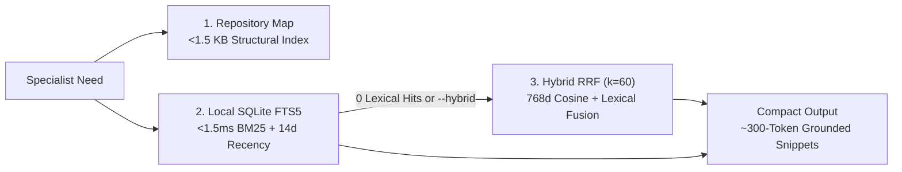
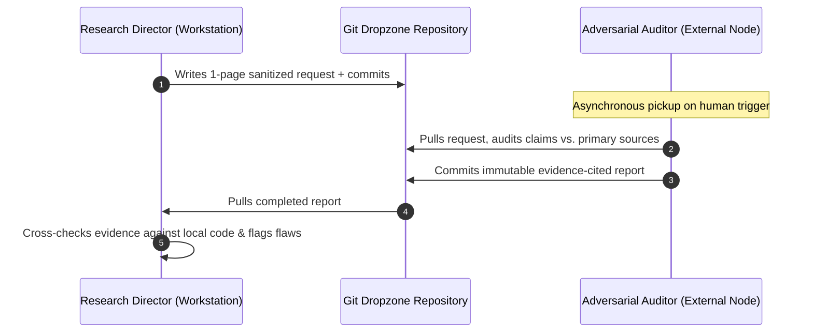

# Memory, Context Budgets & Adversarial Verification

Long-lived AI engineering workflows suffer from two twin failures: **context rot** (dumping 50,000 tokens of stale logs into every prompt until attention degrades) and **echo-chamber confirmation** (the same model family rationalizing its own bugs, invented APIs, or marketing claims).

Our build infrastructure solves both mechanically through compact structural indexing, sub-millisecond local retrieval, hard token ceilings on subagent prompts, and an external adversarial auditor with zero shared conversational state.

---

## 1. Five-Tier Memory & Context Retrieval

Instead of loading massive flat Markdown histories at session startup, specialists pull only the exact slice of institutional knowledge required for the active task:

1. **Structural Repo Maps:** Every repository maintains a concise `<1.5 KB` structural map listing core entrypoints, state stores, component directories, and verification commands. A specialist locates target modules in a single read instead of burning 6–8 blind directory searches.
2. **Sub-Millisecond Lexical Retrieval (FTS5):** Institutional learnings, archived handoffs, playbooks, and domain skills are indexed in a WAL-mode SQLite FTS5 database backed by high-speed NVMe storage, weighting titles (`5.0`), tags (`2.0`), and content (`1.0`) with a gentle 14-day recency tie-breaker. Typical lookup latency stays under **`1.5 ms`**, returning compact ~120-word snippets (`<300` tokens)—over a **99% token reduction** compared to reading raw archive files.
3. **Hybrid Reciprocal Rank Fusion (`k = 60`):** When exact keywords miss (`--auto-hybrid`) or conceptual similarity is requested (`--hybrid`), the retriever embeds queries locally using `768`-dimensional vectors (`nomic-embed-text`, zero cloud token cost) and fuses lexical and vector rankings via Reciprocal Rank Fusion:

$$\text{RRF}(d) = \frac{1}{k + \text{rank}_{\text{FTS}}(d)} + \frac{1}{k + \text{rank}_{\text{vector}}(d)}, \quad k = 60$$

4. **Rolling Handoff Compaction with Atomic Locking:** A shared mission blackboard holds strictly the **8 most recent active handoffs**. Writing a new entry acquires an exclusive POSIX advisory file lock (`fcntl.flock`), prepends the update, archives older entries losslessly into cold storage, re-indexes FTS5 in `<5 ms`, and triggers a non-blocking delta embedding worker.

---

## 2. Strict `<= 2,000`-Token Differential Dispatches

Passing bloated multi-turn chat histories to a subagent ruins signal-to-noise ratio. Every subagent invocation prompt is compiled and validated by a deterministic context harness before dispatch:

- **Hard Token Ceiling (`<= 2,000` tokens):** Prompts exceeding the threshold (`ceil(chars / 3.8)`) fail validation with a non-zero exit code.
- **What Goes In:** Task brief + acceptance criteria, compact repo-map routes, targeted symbol slices (`<= 35` lines per symbol), top two memory snippets, and a two-line recent handoff summary.
- **What Is Banned:** Raw full-file dumps (`>80` contiguous code lines) and unpruned conversational history. Specialists retrieve additional symbols on demand.
- **Mandatory Reasoning Guardrails:** The context validator enforces high-reasoning model locks whenever the target is clinical verification, database security rules, backend auth/webhooks, or multi-device sync races.

---

## 3. Two-Node Adversarial Research ("Bullshit Detection")

An agent that writes an assumption and checks its own work inside the same conversation exhibits confirmation bias. To break that monoculture, our primary **Research Director** works alongside an **Independent Adversarial Auditor** node running in a completely separate compute environment with zero shared conversation history.

- **Strict Sanitization Firewall:** Research requests never include secrets, API keys, employee names, internal IPs, or raw data dumps.
- **Immutable Reports:** Completed reports are never edited in place; follow-up challenges spawn a new linked request so the audit trail remains intact.
- **Catching Slop Early:** Whether verifying statutory meal-break exceptions, state police licensing rules, Safari WebKit CSS regressions, or hardware barcode timing tolerances, unsupported claims and vendor marketing fluff get rejected before code is written.

---

## 4. Mechanical Pre-Commit & Pre-Push Gates

Human willpower does not scale to 200+ commits; automated tooling does:
- **Pre-Commit Gate:** Runs high-entropy secret regex sweeps, fast `oxlint` checks, and automatic repo-map freshness checks.
- **Pre-Push Gate:** Blocks remote pushes unless TypeScript compilation (`tsc`) and deterministic test suites (`vitest`) pass cleanly.
- **Release Gate:** Headless Playwright checks DOM overflow, touch target sizing, and WCAG 2.2 AA contrast, while final security sweeps verify `0600` local credential permissions and zero private keys inside compiled `dist/` bundles.
