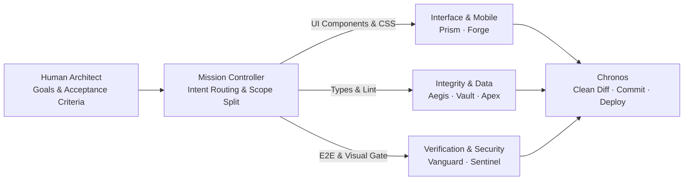

# The 18-Specialist Engineering Model

Single-thread AI coding sessions fail in predictable ways as a codebase grows. Asking one generalist prompt to write React UI, design Firestore security rules, audit clinical ultrasound equations, configure USB scanner wedges, and manage Git releases in the same context window produces subtle regressions: security rules drift toward permissive defaults, UI views collapse into identical dark-slate card grids, and unverified medical or statutory claims slip past cursory self-checks.

Instead of one monolithic assistant, Hathcock Labs runs a **human-governed Mission Controller** backed by **18 domain-specialized engineering roles**, each scoped to tight file boundaries, dedicated domain runbooks, and an explicit cost/reasoning tier.

---

## Orchestration & Parallel File Isolation

When a feature spans frontend surfaces, backend functions, hardware wedges, and automated tests, the Mission Controller fans tasks out concurrently while enforcing **strict file-write isolation**:

No two concurrent specialists are ever assigned the same target file in a single dispatch cycle. One specialist may read peer interfaces for contract alignment, but write permissions stay strictly partitioned until changes converge at a final release gate.

---

## The 18 Specialist Roles by Wing

Every role maps to a narrow operational responsibility and a dedicated domain runbook:

### Core Architecture, Data & Backend
| Role | Codename | Domain Ownership |
| :--- | :--- | :--- |
| **Code Integrity** | `Aegis` | Strict TypeScript compilation, linter sweeps (`oxlint`), dead code pruning, circular dependency resolution, React 19 patterns. |
| **Database & Rules** | `Vault` | Firestore security boundaries (`firestore.rules`, `storage.rules`), composite indexes, atomic transactions, schema enforcement. |
| **Cloud Backend** | `Apex` | Cloud Functions v2, serverless APIs, JWT/HMAC auth guards, idempotent webhooks, third-party integrations. |
| **Distributed Sync** | `Nexus` | Real-time `onSnapshot` listeners, offline IndexedDB/outbox hydration, zero-clobber timestamp smart-merging. |
| **ETL & Ingestion** | `Cipher` | Dirty CSV/ODS spreadsheet parsers, multi-week schedule normalization, header heuristic mapping, batch validation. |

### Interface, Mobile & Hardware
| Role | Codename | Domain Ownership |
| :--- | :--- | :--- |
| **Visual Craft** | `Prism` | Domain-adaptive design systems, OKLCH palettes, typography pairings, WCAG contrast, eliminating generic AI layout clones. |
| **Mobile & Packaging** | `Forge` | Single-handed phone thumb-zone physics (`100dvh`, safe-area insets), PWA manifests, Rollup `manualChunks` (`<500 KB`), iOS Capacitor packaging. |
| **Hardware Signals** | `Beacon` | `<35ms` HID barcode/RFID scanner wedges, Web NFC NDEF parsing, procedural Web Audio synthesizers and PTT radio tones. |
| **CAD & Fabrication** | `Vulcan` | Parametric 3D CAD (OpenSCAD), additive slicing profiles, snap-fit enclosures, pause-print magnet/NFC cavities. |

### Regulated Domain, Research & Communications
| Role | Codename | Domain Ownership |
| :--- | :--- | :--- |
| **Clinical Verifier** | `Echo` | Zero-hallucination ARDMS RVT/SPI medical verification, Doppler velocity thresholds, hemodynamics, board distractor audits. |
| **Research Director** | `Scout` | W3C/WCAG standards, browser engine bug research, engineering playbooks, and coordinating external adversarial audits. |
| **Coaching & Writing** | `Scribe` | Grounded executive documentation, structured SBI/GROW coaching write-ups, 70/20/10 plans, zero-fluff communications. |
| **Knowledge Archivist** | `Hermes` | Mobile dispatch triage, vault hygiene, wikilink integrity, Dataview schemas, and daily session retrospectives. |

### Infrastructure, QA, Security & Release
| Role | Codename | Domain Ownership |
| :--- | :--- | :--- |
| **Systems & Silicon** | `Torque` | Linux kernel/sysctl tuning, scratch NVMe I/O scheduling, memory/OOM safeguards, container watchdogs, edge appliances. |
| **AI & Memory Ops** | `Synapse` | Sub-millisecond FTS5 + Hybrid RRF memory engine, `<=2,000`-token context compiler, Gemini `responseSchema` hardening. |
| **QA & Browser Gate** | `Vanguard` | Deterministic Vitest suites, headless Playwright E2E, `<35ms` scanner burst stress tests, DOM overflow & accessibility gates. |
| **Security Sentinel** | `Sentinel` | Zero-trust secret scanning, `0600` key hygiene, client bundle (`dist/`) leak checks, CVE/Renovate supply-chain triage, IAM boundaries. |
| **Git & Releases** | `Chronos` | Conventional commits, branch/merge hygiene, automated disaster-recovery backups, Firebase Hosting/Rules production deploys. |

---

## Dynamic Model-Tier Routing

Throwing maximum-reasoning models at `git status` or CSS padding tweaks wastes latency and token quota. Conversely, routing security rules or medical fact-checking through fast lightweight models invites subtle errors. We assign a weighted cost discipline across three tiers:

$$\text{Weighted Cost} = (1.0 \times \text{Deep Reasoning}) + (0.25 \times \text{Fast Execution}) + (0.10 \times \text{Lightweight Scan})$$

- **Deep Reasoning (`1.0x`, Mandatory Locks):** Programmatically enforced for clinical criteria (`Echo`), database security rules and atomic transactions (`Vault`), backend auth/webhooks (`Apex`), distributed sync race conditions (`Nexus`), and complete design architectures (`Prism`).
- **Fast Execution (`0.25x`):** Drives roughly 85–90% of daily engineering volume—lint passes, unit test updates, ETL scripts, standard builds, and routine deploys.
- **Lightweight Scans (`0.10x`):** Handles rapid regex audits, column header validation, and directory checks.

---

## Risk-Based Tiered Pre-Release Audits

Running all 18 specialists on every minor patch slows iteration unnecessarily. Release reviews scale strictly to domain risk:

| Audit Tier | Target Domain | Required Sign-Offs | Focus |
| :--- | :--- | :--- | :--- |
| **Tier A** | Commercial / Medical / Multi-Tenant SaaS | **9 Specialists** | Clinical accuracy or backend auth, zero-leak rules, mobile packaging, E2E + visual gate, bundle secret scan, release tag. |
| **Tier B** | High-Velocity Floor & Hardware PWAs | **8 Specialists** | Type/lint hygiene, ETL parsing, zero-clobber sync, scanner/audio hardware tests, mobile viewport gate, secret scan. |
| **Tier C** | Infrastructure & Homelab Services | **5 Specialists** | Host resource invariants, SQLite/backup verification, DOM contrast check, `0600` secret enforcement, clean sync. |
| **Tier 1** | Constitutional / Cross-Fleet Overhauls | **All 18 Specialists** | System-wide architecture shifts, major framework upgrades, or cross-product policy changes. |
