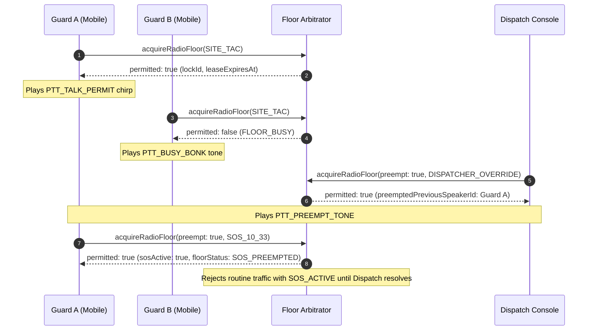

# Half-Duplex Push-to-Talk Over LTE

Physical two-way tactical radios cost `$800–$1,500` per handset, depend on line-of-sight FCC repeaters, and fail across multi-site regional deployments. Yet naive VoIP or full-duplex conference calls fail just as badly on patrol: officers talk over each other ("doubling"), interrupt emergency traffic, burn cellular data continuously, and lose transmissions inside concrete garages.

To bring authentic radio discipline to LTE smartphones and dispatch browsers inside [Arclight Security](../01_Products/Arclight-Security-ERP.md), we architected a **half-duplex Push-to-Talk (PTT) subsystem** combining server-enforced floor leases, emergency preemption, synthesized radio tones, and a hybrid WebRTC + store-and-forward transport layer.

> [!NOTE]
> **Implementation Status:** Arclight's PTT domain contracts, Zod channel invariants, Firestore security rules, Motorola-style Web Audio chirps, scanner-safe hotkey filters, and a 13-suite Tier-1 E2E specification are landed in the codebase, driving full Web Command and Mobile Guard rollout.

---

## 1. Lease-Backed Floor Control & Preemption

A half-duplex radio channel permits **at most one active speaker** at any instant. Rather than trusting clients to release locks politely, floor ownership uses atomic lease-backed state transitions (`IDLE`, `TRANSMITTING`, `SOS_PREEMPTED`):

### Key Floor Invariants
- **Auto-Expiring Leases (`leaseDurationMs`):** If an officer drops LTE signal or loses phone power while holding the mic, the channel never wedges permanently. Once `now > leaseExpiresAt`, the next valid `acquireRadioFloor` request reclaims the floor cleanly.
- **Deterministic Denials:** Contending callers receive explicit machine-readable reasons (`FLOOR_BUSY`, `SOS_ACTIVE`, `PERMISSION_DENIED`) so UI and audio cues react deterministically.
- **Role-Gated Overrides vs. `10-33 SOS`:** Only `DISPATCHER`, `SUPERVISOR`, `ADMIN`, or `OWNER` roles may invoke `DISPATCHER_OVERRIDE` to interrupt routine traffic. Any authenticated field officer, however, can trigger **`SOS_10_33`**, which preempts any active speaker immediately, flags `isEmergencySos: true` and `preemptedFloor: true` on the audit transmission, and locks out non-SOS transmissions until dispatch explicitly invokes `resolveRadioSos`.

---

## 2. Channel Archetypes & `CLIENT_VIEWER` Isolation

Radio channels span five operational types:
- `DISPATCH_ALL_CALL`: Org-wide dispatch broadcast channel.
- `SITE_TAC`: Site-scoped patrol tactical channel.
- `SUPERVISOR_COMMAND`: Restricted management channel.
- `DIRECT_HAIL`: Point-to-point participant-scoped hail.
- `EMERGENCY_SOS`: High-priority duress channel.

Two non-negotiable security boundaries are validated both in **Zod schema refinements (`superRefine`)** and in **Firestore security rules**:
1. **`CLIENT_VIEWER` Total Exclusion:** Client property managers can inspect live patrols and approved incident reports in the Client Portal, but `CLIENT_VIEWER` is strictly forbidden from channel `allowedRoles`, `activeSpeakerRole`, token issuance, and radio UI docks.
2. **Command Channel Guard:** `SUPERVISOR_COMMAND` rejects `OFFICER` and `HR_PAYROLL` membership at schema validation time, while `DIRECT_HAIL` validates explicit `participantIds`.

---

## 3. Synthesized Radio Chirps & Hardware Collision Defense

Two-way radio operators rely on muscle-memory audio cues without staring at screens. Our browser synthesizer generates four distinct `AudioContext` profiles directly in code—zero audio asset downloads required:
- **`PTT_TALK_PERMIT`:** Ascending confirmation chirp scheduled once the server grants the floor lock.
- **`PTT_ROGER_BEEP`:** Clean end-of-transmission confirmation tone when releasing the mic.
- **`PTT_BUSY_BONK`:** Immediate low rejection buzz when hitting `FLOOR_BUSY` or `SOS_ACTIVE`.
- **`PTT_PREEMPT_TONE`:** High-contrast alert tone signaling `DISPATCHER_OVERRIDE` or `SOS_10_33`.

### Preventing Spacebar PTT vs. Barcode Scanner Collisions
In a dispatch room or armory desk, an operator holds **Spacebar** to talk while also scanning officer badges and firearm barcodes via a USB HID scanner wedge. A naive `keydown` listener would key up the radio microphone every time a barcode contained a space or punctuation burst.

Our `isPttHotkeyAllowed` guard rejects Spacebar activation whenever:
- The event arrives inside a `<35ms` hardware barcode scanner keystroke burst.
- The key event is an auto-repeat (`event.repeat === true`), inside an IME composition (`isComposing` / `keyCode === 229`), focused on an editable input/textarea/select, or inside an open `<dialog>` modal.

On ruggedized Android field phones, mobile hardware integration binds physical **`KEYCODE_PTT`** down/up events for hold-to-talk and Bluetooth earpiece **`MEDIA_BUTTON_PRESS`** toggles for hands-free patrol use.

---

## 4. Hybrid LiveKit WebRTC SFU & Dead-Zone Store-and-Forward

Urban concrete basements, elevators, and parking structures break pure live VoIP streams. Arclight bridges both regimes through dual transport modes:
- **`LIVEKIT_SFU` (Online):** Authenticated callers exchange short-lived scoped tokens tied to deterministic room names (`{orgId}:{channelId}`), streaming low-latency Opus audio with live `AnalyserNode` waveform telemetry and optional archival recording.
- **`STORE_AND_FORWARD` (RF / LTE Dead Zones):** When `FieldStore` detects an offline partition (`syncStatus: 'OFFLINE'`), holding the PTT bar records a local compressed voice clip (`Opus` or `AAC`) into the offline queue with `queuedOffline: true`. Crucially, the queued entry preserves the original **`recordedAt`** timestamp separately from **`uploadedAt`** upon reconnect and stamps a deterministic **`idempotencyKey`** so flaky network retries never duplicate transmissions in the channel history.
