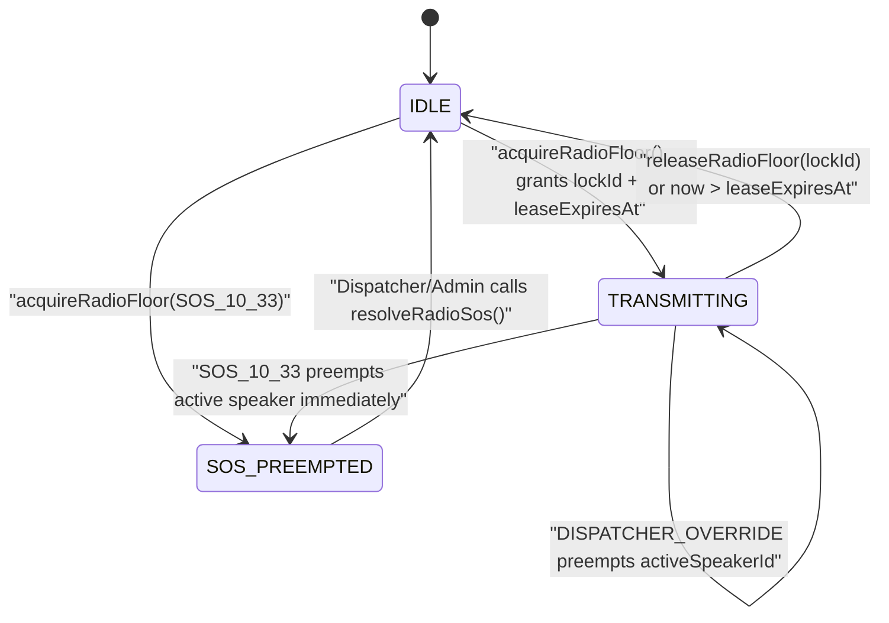

# Half-Duplex Push-to-Talk Over LTE

Physical two-way tactical radios (P25 / DMR / LMR handsets) cost **`$800–$1,500` per unit**, depend on line-of-sight FCC repeaters, and fail completely when contract security agencies manage dozens of dispersed sites across state lines. Yet naive VoIP apps or full-duplex conference rooms perform poorly in active patrol operations: officers talk over each other ("doubling"), interrupt emergency duress calls, burn cellular bandwidth continuously, and lose critical audio inside subterranean parking decks or concrete stairwells.

Inside [Arclight Security](../01_Products/Arclight-Security-ERP.md), we engineered and deployed a **half-duplex Push-to-Talk (PTT) communications layer (`v0.4.0`)** bringing strict two-way radio discipline to web dispatch consoles (`GlobalRadioDock.tsx`, `457.24 kB` max chunk) and rugged mobile guard handsets (`HoldToTalkBar.tsx` `76pt` min-height bar, `bluetoothPttService.ts`, `radioAudioService.ts`) over LTE and Wi-Fi.

> [!NOTE]
> **Production Status (`v0.4.0` Shipped Live):** Complete half-duplex PTT floor arbitration (`IDLE` / `TRANSMITTING` / `SOS_PREEMPTED`), HS256 LiveKit token minting (`livekitAdapter.ts`), all **19 Cloud Functions v2 (`nodejs22`)** staged cleanly via `esbuild`, immutable append-only audio logs, **`433/433` unit tests**, **`164/164` E2E specs across 10 adversarial rounds**, and `0` `oxlint` warnings across `108` files are live in production.

---

## 1. Floor State Machine & Lease-Backed Arbitration

In a half-duplex radio net, **at most one speaker owns the floor** on a channel at any moment. Letting client browsers coordinate floor ownership politely fails under packet loss and concurrent key-ups. Instead, a centralized atomic floor arbitrator manages deterministic transitions across three states (`IDLE`, `TRANSMITTING`, `SOS_PREEMPTED`):



### Multi-Actor Contention & Preemption Flow

```mermaid
sequenceDiagram
    autonumber
    participant A as Officer A (Mobile)
    participant B as Officer B (Mobile)
    participant ARB as Floor Arbitrator (Atomic Lease)
    participant DISP as Dispatch Console

    A->>ARB: acquireRadioFloor(SITE_TAC)
    ARB-->>A: permitted: true (lockId, leaseExpiresAt)
    Note over A: Plays PTT_TALK_PERMIT chirp

    B->>ARB: acquireRadioFloor(SITE_TAC)
    ARB-->>B: permitted: false (FLOOR_BUSY, activeSpeaker: Officer A)
    Note over B: Plays PTT_BUSY_BONK tone

    DISP->>ARB: acquireRadioFloor(preempt: true, DISPATCHER_OVERRIDE)
    ARB-->>DISP: permitted: true (preemptedPreviousSpeakerId: Officer A)
    Note over A,DISP: Broadcasts PTT_PREEMPT_TONE; Officer A tx closes

    A->>ARB: acquireRadioFloor(preempt: true, reason: SOS_10_33)
    ARB-->>A: permitted: true (sosActive: true, floorStatus: SOS_PREEMPTED)
    Note over ARB: Rejects non-SOS requests with SOS_ACTIVE until Dispatch resolves
```

### Four Floor Arbitration Invariants
1. **Auto-Expiring Floor Leases (`leaseDurationMs`):** Every granted talk permit stamps a unique `lockId`, `lockAcquiredAt`, and `leaseExpiresAt`. If a mobile officer loses cellular signal or battery power mid-sentence without issuing `releaseRadioFloor`, the channel never permanently locks. Once `now > leaseExpiresAt`, the next valid `acquireRadioFloor` request automatically reclaims the expired lease.
2. **Explicit Machine-Readable Denials (`RadioFloorDeniedReason`):** Contending callers never spin blindly; failed acquisitions return deterministic reasons (`FLOOR_BUSY`, `SOS_ACTIVE`, `PERMISSION_DENIED`) driving immediate audio/haptic cues.
3. **Strict Override Hierarchy (`DISPATCHER_OVERRIDE` vs. `SOS_10_33`):**
   - Standard `OFFICER` accounts are rejected (`PERMISSION_DENIED`) if they attempt non-emergency overrides against an active speaker.
   - `DISPATCHER`, `SUPERVISOR`, `ADMIN`, and `OWNER` roles may invoke **`DISPATCHER_OVERRIDE`**, cleanly recording `preemptedPreviousSpeakerId` and `preemptedById` for audit traceability.
   - Any authenticated field officer can key **`SOS_10_33`**, which preempts active traffic unconditionally, stamps `isEmergencySos: true` and `preemptedFloor: true` on the audit transmission, activates a flashing CAD duress banner, and rejects routine transmissions (`SOS_ACTIVE`) until Dispatch explicitly executes `resolveRadioSos`.
4. **Lock-Owner Release Guard:** `releaseRadioFloor` verifies matching `lockId` and speaker identity (or Dispatch override) so a stale timeout packet from an older speaker cannot release a newer speaker's active lock.

---

## 2. Channel Archetypes, Zod Refinements & `CLIENT_VIEWER` Exclusion

Arclight models five distinct channel types (`DISPATCH_ALL_CALL`, `SITE_TAC`, `SUPERVISOR_COMMAND`, `DIRECT_HAIL`, `EMERGENCY_SOS`) governed identically by runtime Zod validation (`RadioChannelSchema`) and database security rules:

```typescript
export const RadioChannelSchema = z
  .object({
    id: nonEmptyString(),
    orgId: nonEmptyString(),
    type: RadioChannelTypeSchema,
    name: nonEmptyString(),
    siteId: nonEmptyString().optional(),
    participantIds: z.array(nonEmptyString()).optional(),
    liveKitRoomName: nonEmptyString(),
    allowedRoles: z.array(RoleSchema).min(1),
    floorStatus: RadioFloorStatusSchema.default('IDLE'),
    activeLockId: nonEmptyString().optional(),
    lockExpiresAt: isoDateTime().optional(),
    sosActive: z.boolean().default(false),
    // ...
  })
  .superRefine((data, ctx) => {
    if (data.allowedRoles.includes('CLIENT_VIEWER')) {
      ctx.addIssue({
        code: z.ZodIssueCode.custom,
        path: ['allowedRoles'],
        message: 'CLIENT_VIEWER is strictly prohibited from radio channel allowedRoles',
      });
    }
    if (data.activeSpeakerRole === 'CLIENT_VIEWER') {
      ctx.addIssue({
        code: z.ZodIssueCode.custom,
        path: ['activeSpeakerRole'],
        message: 'CLIENT_VIEWER cannot hold active radio floor',
      });
    }
    const expectedRoomName = `${data.orgId}:${data.id}`;
    if (data.liveKitRoomName !== expectedRoomName) {
      ctx.addIssue({
        code: z.ZodIssueCode.custom,
        path: ['liveKitRoomName'],
        message: `liveKitRoomName must equal "${expectedRoomName}"`,
      });
    }
    if (
      data.type === 'SUPERVISOR_COMMAND' &&
      (data.allowedRoles.includes('OFFICER') || data.allowedRoles.includes('HR_PAYROLL'))
    ) {
      ctx.addIssue({
        code: z.ZodIssueCode.custom,
        path: ['allowedRoles'],
        message: 'SUPERVISOR_COMMAND channels cannot allow OFFICER or HR_PAYROLL roles',
      });
    }
  });
```

### Why Multi-Layer `CLIENT_VIEWER` Exclusion Matters
Client property managers need live patrol transparency, yet tactical dispatch audio routinely contains unverified suspect descriptions, employee phone numbers, and confidential duress dispatches. Enforcing `CLIENT_VIEWER` exclusion across **four independent layers**—Zod schema validation, Firestore/Storage security rules (`/radioChannels`, `/radioTransmissions`), LiveKit token auth guards, and hiding `GlobalRadioDock` in the web client—guarantees zero cross-role audio leakage.

---

## 3. Motorola-Style Web Audio Chirps & Scanner Hotkey Guards

Field personnel judge radio readiness by **ear**, never by watching spinners on a phone screen while inspecting doors or checking vehicles.

### Synthesized `AudioContext` Signal Profiles
Instead of fetching external `.mp3` clips that break under strict CSP/CORS rules or dead zones, Arclight synthesizes four distinct radio cues procedurally via oscillators:
- **`PTT_TALK_PERMIT`:** Ascending multi-tone confirmation chirp scheduled only *after* `acquireRadioFloor` returns `permitted: true`, preventing officers from speaking before the mic channel opens.
- **`PTT_ROGER_BEEP`:** Short crisp end-of-transmission chirp played cleanly on floor release.
- **`PTT_BUSY_BONK`:** Immediate low buzz played when hitting `FLOOR_BUSY` or `SOS_ACTIVE`.
- **`PTT_PREEMPT_TONE`:** Urgent high-contrast alert signal notifying operators when `DISPATCHER_OVERRIDE` or `SOS_10_33` claims the floor.

All synthesis honors persistent mute state (`localStorage` with sandboxed in-memory fallback), auto-resumes suspended contexts inside user interactions, and disconnects audio nodes deterministically in `onended`.

### Protecting Spacebar PTT Against `<35ms` Barcode Scanners
In an operations desk or armory window, dispatchers use **Spacebar** for hold-to-talk while scanning officer badges and weapon serial barcodes via USB HID scanner wedges. Without active timing isolation, rapid scanner bursts containing spaces or Enter keys key up the radio mic accidentally mid-checkout.

Our **`isPttHotkeyAllowed`** guard explicitly rejects Spacebar PTT activation whenever:
- Inter-keystroke intervals match a **`<35ms`** hardware scanner burst.
- The key event is an OS auto-repeat (`event.repeat === true`).
- Focus resides inside any `<input>`, `<textarea>`, `<select>`, `[contenteditable="true"]`, active IME composition (`isComposing` / `keyCode === 229`), or an open `<dialog>` modal:

```typescript
export function isPttHotkeyAllowed(
  e: KeyboardEvent,
  lastPrintableKeyDeltaMs: number,
): boolean {
  if (e.code !== "Space" || e.repeat || e.isComposing || e.keyCode === 229) return false;
  if (lastPrintableKeyDeltaMs > 0 && lastPrintableKeyDeltaMs < 35) return false;
  const target = e.target as HTMLElement | null;
  if (
    target &&
    (["INPUT", "TEXTAREA", "SELECT", "BUTTON"].includes(target.tagName) || target.isContentEditable)
  ) {
    return false;
  }
  return !document.querySelector("dialog[open]");
}
```

On ruggedized Android handsets (`Sonim`, `CAT`, `Samsung XCover`), mobile hardware layers bind physical **`KEYCODE_PTT`** down/up hooks directly to hold-to-talk lifecycles and Bluetooth remote speaker-mic / earpiece **`MEDIA_BUTTON_PRESS`** toggles for hands-free patrol communications alongside required Android foreground audio service permissions.

### Database Security Rules Parity for Radio Nets
Because tactical channels carry active guard locations and emergency calls, `firestore.rules` duplicates the exact role exclusion enforced inside Zod:

```javascript
match /orgs/{orgId}/radioChannels/{channelId} {
  allow read: if isOrgMember(orgId)
    && !isClientViewer(orgId)
    && hasAnyRole(resource.data.allowedRoles);
  allow write: if false; // Mutations restricted exclusively to Cloud Function floor arbitrator
}
```

Dispatchers and officers read channel status directly, yet floor lock acquisitions (`acquireRadioFloor`) and releases (`releaseRadioFloor`) pass strictly through authenticated Cloud Functions so contending clients can never forge arbitrary lock timestamps.

---

## 4. Hybrid LiveKit WebRTC SFU + Dead-Zone Store-and-Forward

Concrete parking structures, elevator shafts, and subterranean mechanical rooms break continuous VoIP calls silently. Arclight bridges live dispatch and dead-zone resilience using dual transport modes (`RadioTransportMode`):

| Transport Mode | Network Condition | Audio Pipeline & Evidence Guarantees |
| :--- | :--- | :--- |
| **`LIVEKIT_SFU`** | Online LTE / Wi-Fi | Exchanges scoped JWT room tokens (`orgId:channelId`, `canPublish`, `canSubscribe`), streams low-latency Opus WebRTC audio via SFU, drives live `AnalyserNode` waveform meters, and logs Cloud Storage recordings. |
| **`STORE_AND_FORWARD`** | Offline Partition / Dead Zone | Captures local compressed Opus/AAC voice clips (`<15 MB`) into `FieldStore` marked `queuedOffline: true`. |

### Dead-Zone Replay, Timestamp Guarantees & Wiretap Consent Carve-Out
1. **True Event Chronology (`recordedAt` vs. `uploadedAt`):** When an officer keys the mic inside an offline garage at `T0`, the mobile store records the exact `recordedAt: T0` timestamp locally (bridging `<50ms` dead-man cutover and dual ring-buffer basement capture cleanly). Once cellular coverage returns at `T1` and `FieldStore.syncQueue()` drains, server persistence stamps `uploadedAt >= T1` **without mutating `recordedAt`**—preserving accurate timelines during incident reconstruction.
2. **Idempotent Retry Replay (`idempotencyKey`):** Each offline voice clip hashes payload + timestamp into a deterministic `idempotencyKey`. If LTE cuts out mid-upload after Cloud Functions already recorded the metadata, replaying the queue item deduplicates cleanly without creating duplicate audio entries.
3. **MD & PA Two-Party Wiretap Consent (`10-33 SOS` `recordAudio: false` Carve-Out):** Both Maryland (`MD Cts. & Jud. Proc. § 10-402`) and Pennsylvania (`18 Pa. C.S. § 5703`) are **two-party (all-party) wiretap consent jurisdictions** with criminal and civil penalties for unconsented ambient audio capture. Routine archived channel transmissions enforce explicit documented acknowledgment/banner consent prior to recording (`livekitAdapter.ts` / `logRadioTransmission`), while emergency **`SOS_10_33`** duress interrupts activate an immediate **live-dispatch life-safety listen mode with `recordAudio: false`**—allowing dispatchers to hear threats in real time while preventing covert third-party ambient wiretapping violations.

---

## Verified `v0.4.0` Live PTT Verification Coverage

The shipped PTT layer passes **`433/433` unit tests** and **`164/164` E2E tests** verified across 10 white-box adversarial rounds (`tests/e2e/tier1..tier4`) with all **19 Cloud Functions v2 (`nodejs22`)** running via `esbuild` monorepo bundling (`issueLiveKitRadioToken`, `acquireRadioFloor`, `releaseRadioFloor`, `logRadioTransmission`, `resolveRadioSos`):
- **Contracts, Rules & Token Minting (`f01`–`f02`, `f06`):** Zod schema refinements, composite indexes, `100%` `CLIENT_VIEWER` Firestore/Storage denial tests, and HS256 JWT issuance.
- **Floor Arbitration & Preemption (`f03`–`f05`):** Idle lease grants, `FLOOR_BUSY` rejection, stale `leaseDurationMs` expiration, `DISPATCHER_OVERRIDE`, `10-33 SOS` lockouts with `recordAudio: false` carve-out, and immutable audit flags (`isEmergencySos`, `preemptedFloor`).
- **Audio, Hotkeys & UI (`f07`–`f10`):** Oscillator lifecycle & mute suppression, `<35ms` scanner-burst Spacebar exclusion (`GlobalRadioDock.tsx`, `457.24 kB` max chunk), `AnalyserNode` Opus capture, `CLIENT_VIEWER` UI hiding, and live CAD SOS banner alerts.
- **Mobile Rugged & Dead-Zone (`f11`–`f13`):** `HoldToTalkBar.tsx` (`76pt` min-height), Android foreground audio/Bluetooth permissions, `MEDIA_BUTTON_PRESS` toggles, `KEYCODE_PTT` down/up lifecycles, and offline dead-zone `enqueueRadioClip` replay preserving `recordedAt`.
