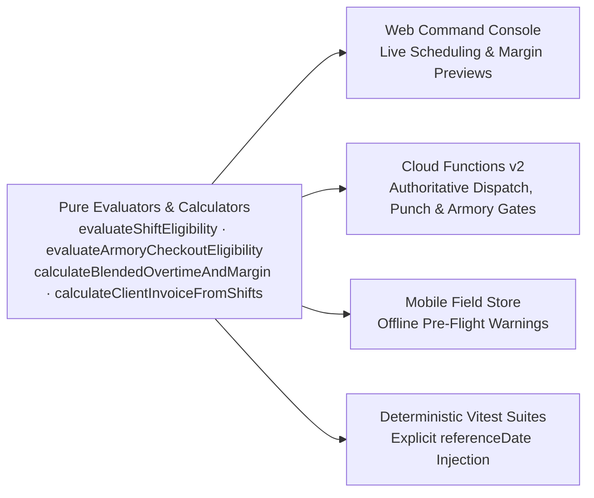

# Statutory Compliance as Deterministic Code

In contract security, software defects are never merely cosmetic bugs. Assigning a guard whose state license expired at midnight onto an armed post, issuing an expandable baton without lethal-weapons certification, subtracting unlawful meal breaks from a lone Delaware guard's pay, or miscalculating blended overtime across uneven hourly rates creates immediate state police audit risk, DOL back-wage liability, and client SLA penalties.

Rather than leaving regulatory rules inside HR PDFs, building brittle headless state-portal scrapers, or trusting client-side toast warnings, [Arclight Security](../01_Products/Arclight-Security-ERP.md) implements all jurisdictional eligibility rules, FLSA / state overtime calculations, and SLA invoice math inside **pure, zero-dependency TypeScript modules** (`@arclight/compliance-engine` and `@arclight/domain`) audited under **Read-Only Primary-Statute Veto Power** and executed identically across every layer of the platform.

### Zero State-Portal Scrapers & Two-Person Cryptographic Document Proof
Automating headless scrapers against state licensing portals invites IP blocks, CAPTCHA bypass hazards, and fragile HTML selectors. Instead, compliance ingestion locks around **deterministic artifact provenance**:
1. **SHA-256 Document Fingerprinting:** Uploaded state guard cards and firearms certifications store an immutable `SHA-256` binary digest alongside normalized issuer metadata.
2. **Hard Midnight Expiry Lockouts:** Missing or expired certifications trigger automatic `BLOCKING` denials deterministically on `evaluateShiftEligibility` and armory checkout without scraping remote portals.
3. **Two-Person HR Sign-Off & Evidentiary PDF Disclosure:** Sensitive armed designations (`MD_WEAR_CARRY`, `DE_RED_CARD`, `PA_ACT_235`) require independent second-reviewer verification (`twoPersonVerifiedBy`), while any courtroom-facing PDF rendering an AI-punctuated report stamps **`"AI-Assisted"` disclosure metadata** explicitly beside verbatim immutable `rawOfficerTranscript`.

---

## Single Core, Four Execution Surfaces



Crucially, `evaluateShiftEligibility` accepts an explicit `referenceDate` argument rather than calling `new Date()` internally. Every boundary condition—midnight Dec 31 expirations, 14-day warning horizons, and 40-hour overtime crossings—is 100% reproducible in automated tests without flaky system-clock coupling.

---

## 1. Shift & Armory Eligibility Pipeline (`evaluateShiftEligibility`)

Every shift assignment runs through six sequential deterministic checks before returning `{ eligible, blockingReasons, warnings, projectedWeeklyHours, triggersOvertime }`:

```typescript
export function evaluateShiftEligibility(input: ShiftEligibilityInput): ShiftEligibilityResult {
  const refDate = input.referenceDate ? new Date(input.referenceDate) : new Date(input.shift.startTime);
  const blockingReasons: ComplianceViolation[] = [];
  const warnings: ComplianceWarning[] = [];

  // 1. Active HR Roster Check (OFFICER_INACTIVE -> BLOCKING)
  // 2. Jurisdiction Switch (MD -> evaluateMarylandRules | DE -> evaluateDelawareRules | PA -> evaluatePennsylvaniaRules)
  // 3. Site-Required LMS Courses (evaluateCourseRequirements)
  // 4. Signed Site Post Orders Revision (evaluatePostOrderAcknowledgment)
  // 5. Mandatory SOP & Policy E-Signatures (evaluatePolicyRequirements)
  // 6. Weekly Overtime Projection (> 40h threshold -> SHIFT_TRIGGERS_OVERTIME WARNING)

  return {
    eligible: blockingReasons.length === 0,
    blockingReasons,
    warnings,
    projectedWeeklyHours,
    triggersOvertime,
  };
}
```

### Tri-State Regulatory Rules Implemented

#### Maryland (`evaluateMarylandRules`)
- **Guard Card (`MD_MSP_GUARD_CARD`):** Blocks dispatch (`MD_MISSING_GUARD_CARD`, `MD_GUARD_CARD_UNVERIFIED`, `MD_GUARD_CARD_EXPIRED`) unless verified and valid at `refDate`.
- **Maryland SB 760 Training (`MD_SB760_TRAINING`):** Enforces statutory `12h` initial / `8h` renewal curriculum covering de-escalation, CPR/first aid, and use of force.
- **Armed Posts (`MD_WEAR_CARRY`):** Requires an active `16h` Maryland Wear & Carry Permit whenever `site.armedRequired === true`.
- **48-Hour Use-of-Force Watchdog:** Any reported incident involving physical force, baton deployment, chemical spray, or firearm display/discharge calculates `forceReportDeadline = incidentTime + 48 hours` automatically—triggering live CAD countdown alerts and generating a formatted Maryland State Police addendum.

#### Delaware (`evaluateDelawareRules` + `19 Del. C. § 707`)
Under **24 Del. C. Ch. 13**, Delaware distinguishes unarmed vs. armed licenses cleanly:

```typescript
if (site.armedRequired) {
  // Strictly requires active DE_RED_CARD (40h firearms, annual Dec 31 expiry + 3-shoot rule)
} else {
  // Unarmed post accepts EITHER valid DE_RED_CARD (supersedes) OR valid DE_YELLOW_CARD (16h, 5-yr)
  const hasValidRed = redCard && isRedCardValid(redCard);
  const hasValidYellow = yellowCard && isYellowCardValid(yellowCard);
  if (!hasValidRed && !hasValidYellow) { /* emit DE_MISSING_SECURITY_CARD / EXPIRED */ }
}
```

- **Solitary Guard Paid Meal Break (`19 Del. C. § 707`):** Delaware mandates 30-minute meal breaks on `7.5+`-hour shifts *with an explicit statutory carve-out for lone security officers* who cannot abandon a post—provided all on-post meal time remains **100% paid**. Arclight's timekeeping engine protects lone-post officers from unlawful automatic 30-minute wage deductions.

#### Pennsylvania (`evaluatePennsylvaniaRules` + Armory Interlock)
- **Act 235 (`22 P.S. § 41`):** Enforces active Pennsylvania State Police Lethal Weapons certification (`40h` training + physical/psychological clearance, strict 5-year hard reset) across all armed Pennsylvania shifts (`PA_MISSING_ACT_235`, `PA_ACT_235_EXPIRED`).
- **Expandable Baton & TASER Trap (`18 Pa. C.S. § 908`):** Unlike jurisdictions where unarmed guards carry expandable batons freely, Pennsylvania classifies batons and electronic control weapons alongside firearms under Act 235. Arclight's armory checkout evaluator checks `PA_ACT_235` automatically before issuing `FIREARM`, `BATON_ASP`, or `TASER_CEW` items at Pennsylvania posts—turning compliance into an unbypassable physical gate:

```typescript
export function evaluateArmoryCheckoutEligibility(input: {
  assetType: ArmoryAssetType;
  siteState: "MD" | "DE" | "PA";
  credentials: OfficerCredential[];
  referenceDate: Date;
}): { allowed: boolean; blockingReason?: string } {
  if (input.assetType === "PATROL_VEHICLE") {
    const dl = findActiveCredential(input.credentials, "DRIVERS_LICENSE", input.referenceDate);
    return dl ? { allowed: true } : { allowed: false, blockingReason: "EXPIRED_OR_MISSING_DRIVERS_LICENSE" };
  }
  const lethalTypes: ArmoryAssetType[] = ["FIREARM", "TASER_CEW", "BATON_ASP"];
  if (!lethalTypes.includes(input.assetType)) return { allowed: true };

  if (input.siteState === "PA") {
    // 18 Pa. C.S. § 908 + 22 P.S. § 41 require Act 235 across firearms, TASER & batons
    const act235 = findActiveCredential(input.credentials, "PA_ACT_235", input.referenceDate);
    return act235 ? { allowed: true } : { allowed: false, blockingReason: "PA_ACT_235_REQUIRED_FOR_LETHAL_ASSET" };
  }
  if (input.assetType === "FIREARM") {
    const reqType = input.siteState === "MD" ? "MD_WEAR_CARRY" : "DE_RED_CARD";
    const permit = findActiveCredential(input.credentials, reqType, input.referenceDate);
    return permit ? { allowed: true } : { allowed: false, blockingReason: `${reqType}_REQUIRED` };
  }
  return { allowed: true };
}
```

### `BLOCKING` Violations vs. `14-Day` Warnings
Every missing, unverified, or expired credential produces a `BLOCKING` violation carrying an actionable `remediationAction` string telling dispatch or HR exactly how to resolve the block. Valid credentials within **`14 days`** of expiration emit non-blocking `WARNING` flags so schedulers initiate renewals before posts turn dark.

```typescript
// Solitary Guard Meal Break Shield (19 Del. C. § 707)
export function applyDelawareMealBreakRule(shiftHours: number, siteIsSolitaryPost: boolean): {
  autoDeductMealMinutes: number;
  requiresPaidOnPostMealNotice: boolean;
} {
  if (shiftHours < 7.5) return { autoDeductMealMinutes: 0, requiresPaidOnPostMealNotice: false };
  // Never deduct unpaid 30 minutes when one guard operates post alone without relief
  return siteIsSolitaryPost
    ? { autoDeductMealMinutes: 0, requiresPaidOnPostMealNotice: true }
    : { autoDeductMealMinutes: 30, requiresPaidOnPostMealNotice: false };
}
```

---

## 2. FLSA `29 C.F.R. § 778.115` & PA `34 Pa. Code § 231.43(d)(2)` Blended Overtime Math

Security guards routinely work varying post pay rates within one 7-day workweek. Under federal law (**FLSA `29 C.F.R. § 778.115`**), Pennsylvania regulation (**`34 Pa. Code § 231.43(d)(2)`** defaulting multi-rate hourly workweeks to weighted-average calculation unless pre-agreed prior to work), and Pennsylvania Supreme Court precedent (*Chevalier v. GNC*, barring salaried `0.5x` fluctuating-workweek shortcuts under PMWA), overtime calculates strictly against the **integer-cents weighted-average regular rate** across all hours worked.

### Integer-Cents Formulation (`calculateBlendedOvertimeAndMargin`)

$$\text{Straight Pay}_{\text{cents}} = \sum_{s \in \text{shifts}} \text{round}\!\left(\text{hours}_s \times (\text{payRate}_s + \text{differential}_s)\right)$$

$$\text{Weighted Regular Rate}_{\text{cents}} = \text{round}\!\left(\frac{\text{Straight Pay}_{\text{cents}}}{\text{Total Hours}}\right)$$

$$\text{Overtime Premium}_{\text{cents}} = \text{round}\!\left(\max(0, \text{Total Hours} - 40) \times 0.5 \times \text{Weighted Regular Rate}_{\text{cents}}\right)$$

$$\text{Total Gross Pay}_{\text{cents}} = \text{Straight Pay}_{\text{cents}} + \text{Overtime Premium}_{\text{cents}}$$

### Worked Multi-Rate, Multi-State Calculation
Suppose **Officer A** works `30` hours on an unarmed Maryland lobby post (`$19.00/hr`, billed at `$31.00/hr`) and `16` hours on an armed Pennsylvania patrol post (`$29.00/hr`, billed at `$46.00/hr`) in the same week (`46` total hours):
1. **Straight Pay (`1.0x` on all `46` hours):** `(30 × $19.00) + (16 × $29.00) = $570.00 + $464.00 = $1,034.00` (`103,400` cents).
2. **Weighted Average Regular Rate:** `103,400 / 46 = 2,248` cents (`$22.48/hr`).
3. **Overtime Premium (`0.5x` on `6` OT hours):** `round(6 × 2,248 × 0.5) = 6,744` cents (`$67.44`). *(Paying `0.5x` because `1.0x` straight time for those 6 hours is already included inside `$1,034.00`.)*
4. **Total Gross Pay:** `$1,034.00 + $67.44 = $1,101.44`.
5. **Total Client Bill & Margin:** `(30 × $31.00) + (16 × $46.00) = $930.00 + $736.00 = $1,666.00` -> Net margin **`$564.56` (`33.89%`)**.
6. **Proportional Jurisdiction Allocation:** Overtime allocates cleanly by state hour share (`MD: 30/46 = 65.22% -> $43.98 OT`; `PA: 16/46 = 34.78% -> $23.46 OT`), while local straight-pay buckets track `PA Act 32` PSD codes, Philadelphia Wage Tax (`3.75%`/`3.44%`), Wilmington (`1.25%`), and Maryland county withholdings cleanly.

---

## 3. "Dark Hours" SLA Penalty Liquidation Math

Enterprise guard contracts penalize unstaffed shifts ("dark hours") directly against monthly invoices. Rather than reconciling spreadsheets manually, `calculateClientInvoiceFromShifts` computes exact liquidated adjustments:

$$\text{Dark Hours} = \max(0, \text{Contracted Hours} - \text{Delivered Hours})$$

$$\text{Coverage \%} = \frac{\text{Delivered Hours}}{\text{Contracted Hours}} \times 100$$

### Worked SLA Penalty Invoice Example
Suppose a client contracts for `168` weekly coverage hours (`24/7` post) at `$38.00/hr`, and a late call-off leaves the post dark for `8` hours (`160` GPS-verified hours delivered):
1. **Coverage Delivered:** `160 / 168 = 95.24%` (strictly `< 98.0%` SLA threshold).
2. **Base Billable Subtotal:** `160 × $38.00 = $6,080.00` (client is never billed for the `8` unperformed dark hours).
3. **Automatic `10%` SLA Penalty Credit:** `$6,080.00 × 0.10 = -$608.00`.
4. **Net Amount Due:** **`$5,472.00`**, itemized cleanly on a formal `Newsreader` serif invoice (`INV-YYYY-XXXX`) and exposed in read-only client portals only once transitioned from `DRAFT` to `ISSUED`.

---

## 4. Integer-Cents Blended Payroll Engine (`payroll.ts`)

Computing financial rounding purely in floating-point dollars accumulates subtle penny errors across 400+ officer line items per run. Converting rate inputs cleanly into cents once prevents penny drift across gross earnings, prorated state overtime shares, and client billing margin checks:

```typescript
export function calculateBlendedOvertimeAndMargin(segments: WorkedShiftSegment[]) {
  const totalHours = segments.reduce((acc, s) => acc + s.hours, 0);
  const straightPayCents = segments.reduce(
    (acc, s) => acc + Math.round(s.hours * Math.round((s.payRate + (s.differential ?? 0)) * 100)),
    0,
  );
  const totalBillCents = segments.reduce(
    (acc, s) => acc + Math.round(s.hours * Math.round(s.billRate * 100)),
    0,
  );

  const regularRateCents = totalHours > 0 ? Math.round(straightPayCents / totalHours) : 0;
  const overtimeHours = Math.max(0, totalHours - 40);
  const overtimePremiumCents = Math.round(overtimeHours * regularRateCents * 0.5);
  const totalGrossPayCents = straightPayCents + overtimePremiumCents;
  const grossMarginCents = totalBillCents - totalGrossPayCents;
  const marginPct = totalBillCents > 0 ? Number(((grossMarginCents / totalBillCents) * 100).toFixed(2)) : 0;

  return { straightPayCents, regularRateCents, overtimeHours, overtimePremiumCents, totalGrossPayCents, totalBillCents, grossMarginCents, marginPct };
}
```

Running this single pure TypeScript module inside both live scheduling UI previews and authoritative Cloud Function payroll previews guarantees exact cent-for-cent parity before paychecks or QuickBooks journals emit.
