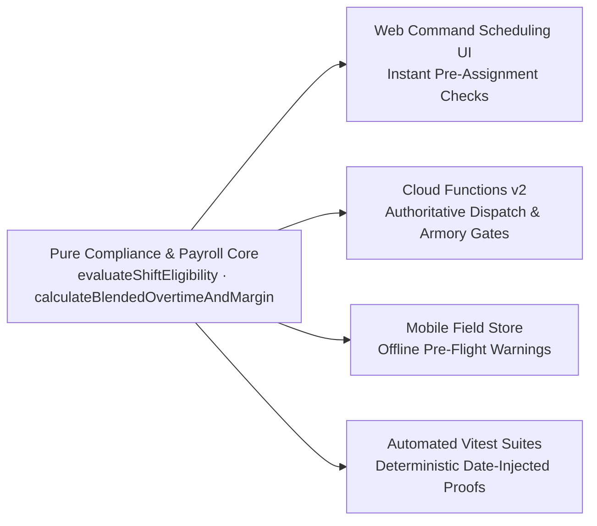

# Statutory Compliance as Deterministic Code

In contract security, compliance errors carry statutory and civil liability. Assigning a guard whose state license lapsed yesterday to an armed post, issuing an expandable baton without lethal-weapons certification, or miscalculating blended overtime across uneven pay rates cannot be left to memory or sticky notes.

Inside [Arclight Security](../01_Products/Arclight-Security-ERP.md), regulatory rules and payroll statutes execute inside a **pure, zero-dependency TypeScript core** shared identically across browser UIs, Cloud Functions dispatch gates, mobile field stores, and unit test suites.

---

## Single Core, Four Execution Surfaces

Because `evaluateShiftEligibility` accepts an explicit `referenceDate` instead of reading ambient wall-clock state (`new Date()`) blindly, every statutory edge case—midnight expirations, 14-day renewal windows, and post-shift overtime crossings—is deterministic and reproducible in CI.

---

## 1. Tri-State Statutory Gate Matrix

Every shift assignment runs through `evaluateShiftEligibility`, which aggregates roster status, state police jurisdiction rules (`MD`, `DE`, `PA`), site LMS completions, signed post orders, mandatory policy e-signatures, and weekly hour projections:

### Maryland (`evaluateMarylandRules`)
- **Active MSP Guard Card (`MD_MSP_GUARD_CARD`)** and **MD SB 760 Training (`MD_SB760_TRAINING`)** are mandatory across all posts (`12h` initial / `8h` renewal).
- **Armed Posts (`site.armedRequired`):** Enforce an active, verified **Maryland Wear & Carry Permit (`MD_WEAR_CARRY`)**.
- **48-Hour Use-of-Force Watchdog:** Under Maryland SB 760, reportable use-of-force incidents (physical takedown, chemical agent, baton strike, firearm display/discharge) automatically compute a strict 48-hour ISO deadline (`forceReportDeadline`) for Maryland State Police submission.

### Delaware (`evaluateDelawareRules`)
- **Unarmed Posts:** Require either a **Delaware DSP Yellow Card** (unarmed, 5-year renewal) or a valid **Red Card**, which validly supersedes Yellow Card on unarmed sites.
- **Armed Posts:** Strictly require an active **Delaware DSP Red Card** (40h training, annual Dec 31 expiration, and 3-shoot qualification cycle).

### Pennsylvania (`evaluatePennsylvaniaRules` + Armory Gate)
- **Armed Posts & Lethal Armory Items:** Enforce **Pennsylvania Act 235 (`22 P.S. § 41`)**, a 40-hour training + physical/psychological clearance with a strict 5-year expiration window.
- **Expandable Batons & TASERs:** Unlike states where only firearms trigger armed licensure, Pennsylvania classifies expandable batons (`18 Pa. C.S. § 908`) and electronic control weapons as lethal instruments under Act 235. Arclight's armory checkout evaluator enforces `PA_ACT_235` before releasing `FIREARM`, `BATON_ASP`, or `TASER_CEW` items at Pennsylvania posts.

### Blocking Violations vs. Proactive Warnings
- **`BLOCKING` (`eligible: false`):** Missing, unverified (`PENDING` / `REJECTED`), or expired credentials, incomplete required LMS modules, unsigned post orders, or missing SOP acknowledgments halt dispatch and weapon issue immediately, returning an explicit `remediationAction`.
- **`WARNING` (`eligible: true`):** Credentials within **`14 days`** of expiration or shifts pushing weekly totals over **`40 hours`** surface clear operational warnings without blocking legal coverage.

---

## 2. FLSA `29 C.F.R. § 778.115` Blended Overtime Math

A security guard often works multiple pay rates in the same workweek—for example, `32` hours at `$18.00/hr` on an unarmed gatehouse post and `14` hours at `$28.00/hr` on an armed patrol post (`46` total hours). Paying overtime solely at `1.5x` the last shift's rate violates federal Fair Labor Standards Act rules.

Under **FLSA `29 C.F.R. § 778.115`** and Pennsylvania Minimum Wage Act standards, Arclight computes exact integer-cents payroll using the **weighted-average regular rate**:

$$\text{Straight Pay} = \sum_{i} \text{hours}_i \times (\text{payRate}_i + \text{differential}_i)$$

$$\text{Weighted Regular Rate} = \text{round}\!\left(\frac{\text{Straight Pay}}{\text{Total Hours}}\right)$$

$$\text{Overtime Premium} = \text{round}\!\left(\max(0, \text{Total Hours} - 40) \times 0.5 \times \text{Weighted Regular Rate}\right)$$

$$\text{Total Gross Pay} = \text{Straight Pay} + \text{Overtime Premium}$$

Because straight time for all `46` hours is already included in `Straight Pay`, the overtime adjustment adds the `0.5x` half-time premium across overtime hours—avoiding floating-point penny drift by holding all money in integer cents (`payRateCents`, `billRateCents`). Multi-state weeks allocate overtime proportionally across jurisdictions and compute exact client bill-to-pay gross margin (`marginPct`) per state and local tax bucket.

---

## 3. "Dark Hours" SLA Liquidated Damages

Enterprise security contracts penalize unstaffed shifts ("dark hours") directly on client invoices. Our billing calculator (`calculateClientInvoiceFromShifts`) reconciles contracted coverage against verified GPS clock-in durations deterministically:

$$\text{Dark Hours} = \max(0, \text{Contracted Hours} - \text{Delivered Hours})$$

$$\text{Coverage \%} = \frac{\text{Delivered Hours}}{\text{Contracted Hours}} \times 100$$

When coverage drops below the contracted SLA threshold (`98%`), the billing engine flags the SLA breach, computes the automated **`10%` SLA penalty credit**, and renders a line-item adjustment directly onto the client's invoice—eliminating billing disputes before finance closes the month.
