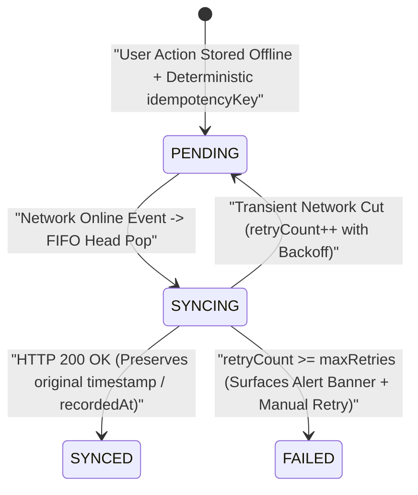

# Zero-Clobber Real-Time Synchronization

Multi-device operational software rarely breaks during a quiet single-user test on gigabit fiber. It breaks under messy real-world timing:
- **Cold-Start Tap Races:** An associate taps an NFC tag on a lockup bay; the phone launches straight into an instant checkout route and writes local state *before* pulling updates written 10 seconds earlier by a teammate's tablet.
- **Peak-Hour Simultaneous Edits:** Two dispatchers update different shifts—or return different handheld scanners—within the same second.
- **RF Dead-Zone Partitions:** A field officer scans interior NFC checkpoints, acknowledges a site BOLO, and records a PTT audio clip inside a concrete basement where LTE drops completely, then reconnects minutes later.

With naive full-document writes ("last writer wins"), any cold-start phone or reconnecting tablet silently wipes recent peer work. Across both [Arclight Security](../01_Products/Arclight-Security-ERP.md) and our [Retail Operations PWAs](../01_Products/Retail-Operations-PWAs.md), we eliminate silent overwrites using four synchronized mechanisms.

---

## Concurrent Transaction Merge Sequence

```mermaid
sequenceDiagram
    autonumber
    participant Phone as Cold-Start Phone (NFC Tap)
    participant Tablet as Active Supervisor Tablet
    participant Txn as Firestore runTransaction Engine

    Note over Tablet: Checks out Asset #09 at t=10:00:02
    Tablet->>Txn: Atomic read-merge-write (Asset #09 checked_out)
    Txn-->>Tablet: Committed (Asset #09 ts = 10:00:02)

    Note over Phone: Wakes from cold start; stale local cache\nScans Asset #04 at t=10:00:05
    Phone->>Txn: runTransaction starts
    Txn-->>Phone: Reads authoritative remote doc (contains Asset #09 @ 10:00:02)
    Note over Phone: mergeStoreState unions devices & rosters;\ncompares per-asset timestamps (09 remote > local; 04 local > remote)
    Phone->>Txn: Commits converged state (Asset #04 AND Asset #09 both preserved!)
    Txn-->>Tablet: Real-time onSnapshot delivers converged view
```

---

## 1. Atomic Read-Merge-Write with Per-Entity Arbitration

Every write to shared operational state executes inside an atomic Cloud Firestore **`runTransaction`** (falling back to `getDoc` + `setDoc` only when a device is running offline where server transactions cannot complete).

### Collection Merging (`mergeCollectionById`)
For multi-document arrays (shifts, incidents, DARs, armory items), merging resolves conflicts per record ID rather than per document:

```typescript
export function mergeCollectionById<
  T extends { id: string; updatedAt?: string; createdAt?: string }
>(remote: T[] = [], local: T[] = []): T[] {
  const mergedMap = new Map<string, T>();
  for (const item of remote) {
    if (item?.id) mergedMap.set(item.id, item);
  }
  for (const localItem of local) {
    if (!localItem?.id) continue;
    const remoteItem = mergedMap.get(localItem.id);
    if (!remoteItem) {
      mergedMap.set(localItem.id, localItem);
      continue;
    }
    const localTs = Date.parse(localItem.updatedAt || localItem.createdAt || '') || 0;
    const remoteTs = Date.parse(remoteItem.updatedAt || remoteItem.createdAt || '') || 0;
    mergedMap.set(localItem.id, localTs >= remoteTs ? localItem : remoteItem);
  }
  return Array.from(mergedMap.values());
}
```

### Independent Custody vs. Label Arbitration (`mergeStoreState`)
Inside shared hardware custody documents, an item can receive a custom label rename on a desktop while getting checked out on a mobile phone. A single whole-object timestamp would drop one of those two independent edits. Instead, `mergeStoreState` arbitrates fields along independent axes:
1. **Roster & Device Unions:** `employees` and `registeredDevices` union deterministically by normalized identifier/device ID, keeping whichever device holds the newer `lastActiveAt` heartbeat while filtering out legacy placeholder records.
2. **Independent Custody Timestamps:** On each asset, custody transitions compare `Math.max(checkedOutAt, lastCheckedInAt)` between local and remote snapshots (`remoteTs > localTs` preserves remote `status`, `currentAssignment`, `lastCheckedInAt`, and `Math.max(local.totalCheckouts, remote.totalCheckouts)`).
3. **Custom Label & Slot Protection (`renamedAt`):** Display metadata (`assetNumber`, `model`, `locationSlot`, `rfidTag`) compares independent `renamedAt` timestamps—and explicitly detects when a cold-start client holds a factory default slot name while remote holds a custom rename—so a freshly booted phone never overwrites custom floor labels:

```typescript
export function mergeAssetRecord(remote: AssetItem, local: AssetItem): AssetItem {
  const remoteCustodyTs = Math.max(remote.checkedOutAt ?? 0, remote.lastCheckedInAt ?? 0);
  const localCustodyTs = Math.max(local.checkedOutAt ?? 0, local.lastCheckedInAt ?? 0);
  const keepRemoteCustody = remoteCustodyTs >= localCustodyTs;

  const remoteRenameTs = remote.renamedAt ?? 0;
  const localRenameTs = local.renamedAt ?? 0;
  const keepRemoteMeta = remoteRenameTs >= localRenameTs;

  return {
    ...local,
    status: keepRemoteCustody ? remote.status : local.status,
    currentAssignment: keepRemoteCustody ? remote.currentAssignment : local.currentAssignment,
    checkedOutAt: keepRemoteCustody ? remote.checkedOutAt : local.checkedOutAt,
    lastCheckedInAt: keepRemoteCustody ? remote.lastCheckedInAt : local.lastCheckedInAt,
    totalCheckouts: Math.max(remote.totalCheckouts ?? 0, local.totalCheckouts ?? 0),
    assetNumber: keepRemoteMeta ? remote.assetNumber : local.assetNumber,
    model: keepRemoteMeta ? remote.model : local.model,
    locationSlot: keepRemoteMeta ? remote.locationSlot : local.locationSlot,
    rfidTag: keepRemoteMeta ? remote.rfidTag : local.rfidTag,
    renamedAt: Math.max(remoteRenameTs, localRenameTs),
  };
}
```

Notice how an associate waking a phone via NFC checks out an asset (`localCustodyTs` newer) at the exact second a supervisor renames its bay location (`remoteRenameTs` newer), and `mergeAssetRecord` preserves **both edits cleanly in one atomic pass**.

---

## 2. `undefined` Sanitization & Firestore `1 MiB` Ceiling Defense

Two operational hazards crash real-world Firestore sync silently if left unguarded:
1. **Nested `undefined` Properties:** Optional JavaScript properties serialized as `undefined` trigger fatal SDK write exceptions. Every Firestore client initializes with **`initializeFirestore(app, { ignoreUndefinedProperties: true })`** AND executes an explicit recursive `stripUndefined()` pass prior to transaction submission:

```typescript
export function stripUndefined<T>(value: T): T {
  if (Array.isArray(value)) {
    return value.filter((v) => v !== undefined).map(stripUndefined) as unknown as T;
  }
  if (value !== null && typeof value === "object") {
    const clean: Record<string, unknown> = {};
    for (const [k, v] of Object.entries(value)) {
      if (v !== undefined) clean[k] = stripUndefined(v);
    }
    return clean as T;
  }
  return value;
}
```

2. **Hard `1,048,576`-Byte (`1 MiB`) Document Limit:** High-frequency check-in logs and bay audits accumulate over months. Before committing shared state documents, a UTF-8 byte counter (`TextEncoder`) measures serialized payload footprint against a **`750 KB` safety watermark**:

```typescript
const docBytes = new TextEncoder().encode(JSON.stringify(cleanPayload)).length;
if (docBytes > 750_000) {
  // Prune oldest ephemeral event tails deterministically to preserve >250 KB headroom
  if (cleanPayload.logs?.length > 50) cleanPayload.logs = cleanPayload.logs.slice(0, 50);
  if (cleanPayload.checkEvents?.length > 50) cleanPayload.checkEvents = cleanPayload.checkEvents.slice(0, 50);
  if (cleanPayload.audits?.length > 20) cleanPayload.audits = cleanPayload.audits.slice(0, 20);
}
```

Crucially, pruning trims strictly historical event tails (`logs`, `checkEvents`, `audits`), leaving active assets, custody assignments, rosters, and registered devices 100% untouched so a live warehouse database never hits Firestore's `1 MiB` rejection wall mid-shift.

---

## 3. Idempotent FIFO Offline Outboxes (`FieldStore`)

When mobile security officers walk into basements or parking decks where cellular signal drops completely, live transactions cannot reach Firestore. Arclight's **`FieldStore`** captures offline mutations inside a strict **FIFO action queue** spanning 12 operational action types (`CLOCK_IN`, `CLOCK_OUT`, `CHECKPOINT_SCAN`, `DAR_SUBMIT`, `INCIDENT_SUBMIT`, `LONE_WORKER_HEARTBEAT`, `QUIZ_COMPLETE`, `POLICY_SIGN`, `ARMORY_CHECKOUT`, `ARMORY_RETURN`, `BOLO_ACK`, `RADIO_CLIP_UPLOAD`).



### Three Offline Replay Guarantees
1. **Deterministic Payload Hash Keys (`idempotencyKey`):** Every queued action computes a deterministic hash over `(type, payload, timestamp)` (`{TYPE}-{hexHash}-{epochMs}`). If connectivity drops right after the server executes an action—before the client hears the HTTP `200` acknowledgment—replaying the outbox item passes the exact same `idempotencyKey`, preventing duplicate clock punches, double weapon checkouts, or duplicated voice transmissions.
2. **Explicit Retry Lifecycle (`PENDING -> SYNCING -> SYNCED | FAILED`):** Actions track `retryCount` and `maxRetries`, preserving failed items visibly with `lastError` instead of silently discarding un-synced field reports.
3. **Immutable Event Chronology:** Offline scans, punches, and dead-zone PTT clips preserve their true creation `timestamp` / `recordedAt` separately from `syncedAt` / `uploadedAt`—ensuring patrol tour SLA audits and legal incident timelines stay accurate to the second.

---

## Failure-Mode Prevention Matrix

| Real-World Edge Case | Naive `setDoc` Behavior | Zero-Clobber Architecture Behavior |
| :--- | :--- | :--- |
| **Cold-start phone scans NFC tag before syncing** | Overwrites active tablet checkouts with stale cache | `runTransaction` pulls live remote state first; merges both checkouts cleanly |
| **Desktop renames key ring while phone checks it out** | Last writer wipes either the rename or the checkout | Independent `renamedAt` vs. `checkedOutAt` comparison preserves both edits |
| **Nested optional property is JavaScript `undefined`** | Fatal Firestore SDK write crash | `ignoreUndefinedProperties: true` + recursive `stripUndefined()` pass |
| **Log tail crosses `1 MiB` after months of floor scans** | Every subsequent write throws `INVALID_ARGUMENT` | `750 KB` UTF-8 watermark trims old event history automatically |
| **LTE drops right after client sends armory checkout** | Retry double-logs checkout event on reconnect | Payload-derived `idempotencyKey` deduplicates replay safely |
| **Client portal subscribes to live patrol dashboard** | Risk of streaming wages/PII inside shared state doc | Scoped filtered listeners query only `clientVisible == true` sub-collections |

---

## 4. Cold-Start Listener Hydration & Reconnect Discipline

Even atomic transactions fail if UI components accept early local listener emissions (`snapshot.metadata.fromCache === true` before server hydration completes) and immediately echo partial state right back to Firestore:

```typescript
// Guard against stale cold-start cache echoes triggering redundant writebacks
export function shouldDeferInitialSnapshot(snapshot: { metadata: { fromCache: boolean } }, isHydrated: boolean): boolean {
  return !isHydrated && snapshot.metadata.fromCache;
}
```

1. **Deferred Echo Until Authoritative Hydration:** Cold-start NFC routes process local quick-actions strictly inside `runTransaction` against authoritative remote server state rather than trusting stale cached `onSnapshot` snapshots.
2. **Clean Listener Detach on Tenant Switch:** Switching active sites or logging out cancels pending `Unsubscribe` handles deterministically inside React effect cleanups—eliminating zombie background subscriptions leaking cross-tenant state or consuming battery unnecessarily.
3. **Serialized Write Mutex Around FIFO Drain:** Reconnecting after an underground garage dead-zone executes `FieldStore.syncQueue()` behind a single in-flight mutex lock so overlapping `online` browser events never dispatch identical outbox payloads in parallel.
