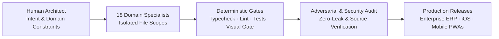

# Engineering & Product Documentation — Hathcock Labs

Most software failures in operational environments do not happen because a framework was slow. They happen because someone treated a statutory rule as optional UI copy, let two offline devices overwrite each other's state, shipped unverified domain facts, or designed a field tool as if the user sits at a dual-monitor desk with gigabit fiber.

At **Hathcock Labs**, every product and internal tool is built around a single standard: **human-directed, verification-first engineering**.

---

## Three Non-Negotiable Engineering Commitments

### 1. Rules Execute in Code, Not in Policy PDFs
When a security post in Pennsylvania requires an active Act 235 lethal-weapons certification before issuing a firearm or expandable baton, or when a medical board question cites a carotid stenosis velocity threshold, the software itself must enforce truth deterministically. We encode statutory eligibility, labor math, and clinical physics inside pure, side-effect-free modules backed by automated test suites.

### 2. Real-World Physics First (Gloves, Dead Zones & Cold Starts)
Field tools live in parking garages, bright storefronts, hospital breakrooms, and patrol vehicles:
- Hardware barcode scanners fire keystroke bursts faster than `35ms` per character and collide with keyboard shortcuts unless explicitly filtered.
- Mobile browsers suspend `AudioContext` instances until a user gesture or page visibility recovery fires.
- LTE connectivity drops underground, requiring FIFO offline outboxes with deterministic idempotency keys and conflict-free transaction merging on reconnect.

### 3. Verification-First AI Collaboration
We treat AI models as specialized engineering instruments rather than autonomous black boxes. Rather than stuffing everything into one degrading conversation window, work is partitioned across 18 focused domain roles, fed `<2,000`-token differential context slices from a sub-millisecond FTS5/vector memory store, cross-checked by an independent adversarial auditor, and gated by deterministic compilers, Playwright DOM geometry checks, and bundle secret scanners.

---

## Explore the Documentation

| Area | Focus | Key Documents |
| :--- | :--- | :--- |
| **Products** | End-to-end systems built for regulated security, clinical education, and floor operations | [Arclight Security ERP](01_Products/Arclight-Security-ERP.md) · [SonoPrep Pro (iOS)](01_Products/SonoPrep-iOS.md) · [Retail Floor & Asset PWAs](01_Products/Retail-Operations-PWAs.md) |
| **Engineering Process** | How specialized AI roles, tight memory budgets, and anti-slop UI standards work together | [Specialist Squad Model](02_How-We-Build/Specialist-Squad-Model.md) · [Memory & Verification](02_How-We-Build/Memory-and-Verification.md) · [Anti-Slop Design System](02_How-We-Build/Anti-Slop-Design-System.md) |
| **Deep Dives** | Granular technical patterns, state machines, and compliance math | [Half-Duplex PTT Over LTE](03_Architecture-Deep-Dives/Half-Duplex-PTT-Over-LTE.md) · [Statutory Compliance as Code](03_Architecture-Deep-Dives/Statutory-Compliance-As-Code.md) · [Zero-Clobber Real-Time Sync](03_Architecture-Deep-Dives/Zero-Clobber-Realtime-Sync.md) |
| **Build Log** | Public release history and verified benchmarks | [November 2026 Milestones](04_Build-Log/2026-11-Milestones.md) |
