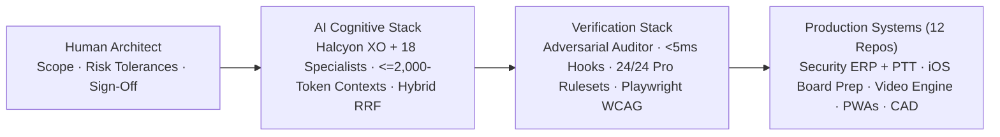

# Engineering & Product Documentation — Hathcock Labs

Most software failures in regulated operations, clinical education, programmatic media rendering, and physical floor tooling do not happen because a UI framework lacked animations. They happen because someone left statutory licensing rules in a PDF binder instead of TypeScript evaluators, let cold-start mobile devices overwrite live database records, trusted an unconstrained LLM to verify its own clinical claims, or shipped a mobile web layout without testing how iOS Safari handles `<dialog>` and `AudioContext`.

At **Hathcock Labs**, every codebase and AI engineering workflow follows one core standard: **human-directed, verification-first craftsmanship** orchestrated across **12 repositories** under **`Halcyon` (XO & Flight Director)**, **18 specialized roles**, and external adversarial auditor **`Muse`**.

---

## Core Engineering Axioms

### 1. Deterministic Code Over Prose Rules
Whether checking if a Pennsylvania security officer holds an active Act 235 card before releasing an expandable baton (`18 Pa. C.S. § 908`), calculating FLSA `29 C.F.R. § 778.115` weighted-average overtime in integer cents, or enforcing a `<= 2,000`-token ceiling on subagent dispatches, critical invariants belong in deterministic, tested code—not wishful prompts or manual checklists.

### 2. Heterogeneous Compute & Zero-Waste Token Economics
Rather than burning cloud frontier quotas on every mechanical task, workloads distribute intentionally across hardware tiers:
- **Sub-Millisecond Scratch NVMe:** SQLite WAL FTS5 retrieval (`<1.5 ms`), compiler caches, and atomic `fcntl.flock` handoff locks.
- **Always-On Local Apple Silicon Inference Node v1.2 (`squad-local`):** 3-model co-residency inside `32 GiB` unified RAM (**`15.13 GB` total**: `nomic-embed-text` `0.34 GB` + `qwen3:8b` `5.12 GB` @ **`36.9 tok/s`**, **`93–95%` payload compression** + `qwen2.5-coder:14b` `9.67 GB` @ **`21.4 tok/s`** Wave 0 Zod/Vitest scaffolding) under `OLLAMA_MAX_LOADED_MODELS=3`, `OLLAMA_FLASH_ATTENTION=1`, `OLLAMA_KV_CACHE_TYPE=q8_0`, `OLLAMA_KEEP_ALIVE=30m` at **`0` evictions, `0 MB` swap, and `0` cloud tokens**.
- **HALCYON Flight Deck & 27-Model Cloud Frontier Tiers (Pool 1 + Pool 2):** Interactive Android/iPadOS voice PWA cutting warm first-token latency by **~4× (`8.5–11.5s` → `2.32s`)** via a persistent warm NDJSON bridge, `16 kHz` WAV TTS (`0.29s`), 3-way sentence streaming, zero-token Tailscale Serve auth, and an in-house knowledge graph (`62` notes / `94` nodes / `743` edges)—routing `>95%` of frontier work across `20` Pool 1 Gemini models (`Gemini 4 Neon` / `Hydrogen` / `/swarm` pinning) while keeping root-cause debugging and security audits strictly on cloud frontier auditors.

### 3. Physical Reality First (Gloves, Dead Zones & WebKit Quirks)
Software runs in bright daylight offices, concrete basements with zero LTE, hurried stockrooms, and handheld devices operated one-handed. Our modules filter `<35ms` laser scanner bursts away from Spacebar PTT hotkeys, recover iOS WebKit `'interrupted'` audio states on lock-screen wake, bridge dead zones with `idempotencyKey`-deduplicated FIFO queues, and print solid plastic NFC enclosures mid-layer in OpenSCAD.

### 4. Adversarial Truth & Zero-Slop Design Discipline
Every unverified legal claim or browser quirk passes an independent, context-isolated external audit (`Scout` ↔ `Muse`), production AI runs locked behind `temperature: 0.0` Zod contracts preserving raw officer testimony verbatim, and automated headless Playwright DOM/WCAG verification prevents dark-slate UI clones or clipped controls from ever reaching builds.

---

## How the AI Stack Connects Directly to Shipped Systems

| Cognitive Layer / Mechanism | Production Guarantee Delivered Across Products | Primary Reference |
| :--- | :--- | :--- |
| **SSOT Native Agents & Lifecycle Hooks** | `squadron.json` → `18` `agents/*.md` (`-82.6%` roster, `commandExecutionPolicy: off`, `skills: []`) + **`204` hook tests** (`>400→350L` read clamp, `--reporter=dot`, OOM `flock` & Air-Gap) | [01 · The 18-Specialist Squadron](02_AI-Systems-Architecture/01-The-18-Specialist-Squadron.md) |
| **Optane FTS5 + Hybrid RRF (`k = 60`)** | `<100 ms` `<= 4 KB` sharded symbol maps, `<= 3.5 KB` blackboard & `<1.5 ms` recall of WebKit, FLSA `29 C.F.R. § 778.115` & `pnpm` fixes | [02 · Five-Tier Memory & Hybrid RRF](02_AI-Systems-Architecture/02-Five-Tier-Memory-and-Hybrid-RRF.md) |
| **18-Upgrade Context & Quota Governance** | `11.5 KB` rules (`-45.6%`), `4 → 1` MCP prune & `<=2,000`-token dispatches delivering **~20× token reduction (`80.5m` / `~1.38M` tok / `0` quota walls)** | [03 · Differential Context & Quota](02_AI-Systems-Architecture/03-Differential-Context-and-Quota-Governance.md) |
| **Two-Node Dropzone, Evals & MWG Audit** | Catches PA/DE/MD statutory & Safari `<dialog>` traps; filters `26/47` raw web-scanner false positives; `12`-case adversarial evals & standalone Wave 3 Break-It Gate (`0 CRIT/HIGH`) | [04 · Adversarial & Fact-Locked AI](02_AI-Systems-Architecture/04-Adversarial-Verification-and-Fact-Locked-AI.md) |
| **Squadron Harness v1, Hooks & `30/30` Doctor** | Code-enforced 4-Wave DAG runner (`squad-harness`), atomic NVMe state, consume-once `HEAD^{tree}` stamps, `24/24` Pro rulesets & `30/30` doctor | [05 · Autonomous DevOps & Gates](02_AI-Systems-Architecture/05-Autonomous-DevOps-and-Zero-Trust-Gates.md) |
| **HALCYON Flight Deck & Local Inference v1.2** | `2.32s` warm voice PWA (~4× cut, zero-token Tailscale Serve auth, `62`-note graph), `0 MB` `inotify` capture, and `15.13 GB` 3-model M1 Max co-residency (`36.9` / `21.4 tok/s`, `0` cloud tokens) | [06 · Flight Deck & Local LLM](02_AI-Systems-Architecture/06-Ambient-Mobile-Dispatch-and-Local-Inference.md) |

---

## Verified Quantitative Snapshot

- **Arclight Security (`v0.7.1` Sprint 2 + Wave 0 + Sprint 2.5):** **`1,098/1,098` automated tests** (`670` unit, `394` Vitest E2E, `34` Playwright browser E2E across `1440px` desktop & `375px` mobile), **`42` Gen-2 Cloud Functions (`enforceAppCheck: true`)**, **`0` `oxlint` warnings/errors across `360` files**, **`474.9 KB` max JS chunk (`<500 KB`)**, Wave 0 state decomposition (`10,895 → 421` LOC web + `12` slices; `5,583 → 384` LOC mobile + `7` slices), clean production provisioning + `orgMode` immutability lock, and **`0 CRITICAL / 0 HIGH`** across **`3` independent adversarial break-it rounds**.
- **SonoPrep Pro (`iOS`):** `421` audited RVT/SPI questions, `132` SVGs, `18` interactive hotspots, `34/34` unit/App Store compliance tests, `15/15` E2E stages, `0` `oxlint` warnings, `<500 KB` bundles.
- **Deterministic Video Engine (`v0.1.0`):** `4/4` packages typecheck clean; **`33/33` pipeline unit tests**; `17/17` seeded episodes clearing the 9-rule Grade `6.6–9.0` anti-slop voice gate; `1080×1920` `60fps` H.264 + `-14 LUFS` AAC stereo; `<35 KB` companion bio hubs.
- **Squadron Harness v1, Flight Deck, 10-App MWG Audit & Apple Silicon v1.2:** Code-enforced 4-Wave DAG runner (`squad-harness`, 12-case adversarial evals, standalone Wave 3 Break-It Gate), **HALCYON Flight Deck** (`2.32s` warm first token, ~4× faster, `0.29s` `16 kHz` WAV, zero-token Tailscale Serve auth, `62`-note / `94`-node / `743`-edge graph), on-demand `npx modern-web-guidance@latest` 10-app fleet audit (**`26/47` false positives filtered**), and **M1 Max v1.2 3-model co-residency (`15.13 GB` / `32 GiB`:** `nomic-embed-text` `0.34 GB` + `qwen3:8b` `5.12 GB` @ `36.9 tok/s` `93–95%` compression + `qwen2.5-coder:14b` `9.67 GB` @ `21.4 tok/s` Wave 0 scaffolding, `0` evictions, `0 MB` swap, `0` cloud tokens).
- **18-Upgrade Engineering ROI & Fleet Governance:** **`11.5 KB` global rules** (`-45.6%` from `21.0 KB`), **`-82.6%` compact roster**, progressive-disclosure skills, **`<= 3.5 KB` active blackboard**, **`4 → 1` global MCP prune**, **`204` lifecycle hook tests** (`>400→350L` read clamp, `--reporter=dot`, scoped Anti-Slop, consume-once `HEAD^{tree}` `0700` `60s` tree stamps), `<100 ms` `<= 4 KB` sharded symbol maps, **`24/24` zero-bypass GitHub Pro Rulesets** across `12` repos, **`30/30 PASS`** diagnostic doctor (w/ stale-model hygiene), and verified **~20× production token reduction** (**`80.5m`**, **`~1.38M` est tokens** across `20` runs, **`0` quota walls** vs `~29.6M` raw read tokens across `2` resets).

---

## Three-Node Compute Allocation Summary

| Node Role | Hardware Profile | Dedicated Workloads | Endurance & Protection Model |
| :--- | :--- | :--- | :--- |
| **Workstation Node** | 4C/8T Laptop · `12 GB` RAM + `11.4 GB` zram · **Optane NVMe Scratch** | Auto-hydrated Optane `fleet wt` worktrees, `hooks.json` (`204` tests), `<100 ms` `<= 4 KB` symbol maps, `memory.db` WAL FTS5 (`1.29 ms`), `ccache`/Rust/Node caches, `inotify` dispatch triggers | `vm.vfs_cache_pressure=50`, `[none]` I/O scheduler, `earlyoom`, `fcntl.flock` heavy-build serialization (`15m` TTL), 24/7 no-sleep & Wi-Fi `power_save=0` |
| **Inference & Backup Node** | Always-On Unified-Memory **Apple Silicon M1 Max (`32 GiB`)** | Tuned Ollama v1.2 (`OLLAMA_MAX_LOADED_MODELS=3`, Flash Attn, `q8_0` KV, `30m` keep-alive): **`nomic-embed-text` (`0.34 GB`) + `qwen3:8b` (`5.12 GB`, `36.9 tok/s`, `93–95%` compression) + `qwen2.5-coder:14b` (`9.67 GB`, `21.4 tok/s`, Wave 0 scaffold) = `15.13 GB`**, iOS builds, 4-step DR verification | **`0` evictions · `0 MB` swap**; `launchd` container & `300s` vector watchdogs; `0` cloud tokens burned locally |
| **Edge Network Node** | `8 GB` **ARM SBC** | Primary network DNS filter + unified plain-English control telemetry HUD | Volatile RAM `journald`, `noatime,commit=60` mount, `300s` SQLite flush batching |

---

## Complete Documentation Map (`19` Chapters)

### 01 · Shipped Products & Hardware Systems (`5`)
- [Arclight Security ERP & CAD](01_Products/Arclight-Security-ERP.md) — Replacing the 4-vendor contract security stack across MD/DE/PA (`v0.7.1`: Sprint 2 watchdogs/anti-spoof/QBR, Wave 0 modular state slices, Sprint 2.5 clean production onboarding & `orgMode` lock, `1,098/1,098` tests, `42` Gen-2 App-Check functions).
- [SonoPrep Pro (iOS)](01_Products/SonoPrep-iOS.md) — Commercial ARDMS RVT/SPI vascular board prep with a 100% On-Device Study Vault and live Doppler physics simulation.
- [Deterministic Programmatic Video Production Engine](01_Products/Deterministic-Video-Production-Engine.md) — Multi-channel `1080×1920` `60fps` Remotion composition, `-14 LUFS` FFmpeg mastering, Grade `6.6–9.0` anti-slop voice gate, and idempotent publishing.
- [High-Velocity Retail Floor & Asset PWAs](01_Products/Retail-Operations-PWAs.md) — Single-handed mobile custody and execution tooling built for `<35ms` barcode wedges and instant NFC cold starts.
- [Parametric Additive CAD & Hardware Fixtures](01_Products/Additive-CAD-and-Hardware-Fixtures.md) — OpenSCAD CSG mounts, cantilever snap-fits, and pause-at-layer embedded RFID/NFC enclosures.

### 02 · AI Systems Architecture (7-Chapter Flagship Series)
- [00 · Cognitive Architecture Overview](02_AI-Systems-Architecture/00-Cognitive-Architecture-Overview.md) — Why single-context coding collapses and how `Halcyon` (XO) orchestrates 18 specialists across 3 compute nodes.
- [01 · The 18-Specialist Squadron](02_AI-Systems-Architecture/01-The-18-Specialist-Squadron.md) — Single-source `squadron.json` (`-82.6%` compact roster → `18` native `agents/*.md`), `4-Wave` OOM-safe doctrine with Wave 3 Adversarial Break-It Passes (`Sentinel` + `Aegis` → `0 CRIT/HIGH`), and `Tier A1/A2/B/C/D` audits.
- [02 · Five-Tier Memory & Hybrid RRF Retrieval](02_AI-Systems-Architecture/02-Five-Tier-Memory-and-Hybrid-RRF.md) — `<100 ms` `<= 4 KB` sharded symbol maps, `<= 3.5 KB` `fcntl.flock` rolling blackboards, progressive-disclosure skills, FTS5 BM25 + 14-day recency, and `k = 60` Reciprocal Rank Fusion.
- [03 · Differential Context & Quota Governance](02_AI-Systems-Architecture/03-Differential-Context-and-Quota-Governance.md) — `<= 2,000`-token compiler, 18-upgrade static prompt tax cuts (`11.5 KB` rules, `4 → 1` MCP prune), **`204` lifecycle hook tests**, 27-model routing, and the **~20× production token benchmark** (`80.5m`, `~1.38M` est tok, `0` quota walls).
- [04 · Adversarial Verification & Fact-Locked AI](02_AI-Systems-Architecture/04-Adversarial-Verification-and-Fact-Locked-AI.md) — Two-node adversarial research (`Scout` ↔ `Muse`), zero-bloat `modern-web-guidance` Keep/Drop filtering (`26/47` FPs dropped), 12-case adversarial evals, and schema-locked, raw-transcript-preserving production AI.
- [05 · Autonomous DevOps & Zero-Trust Gates](02_AI-Systems-Architecture/05-Autonomous-DevOps-and-Zero-Trust-Gates.md) — **Squadron Harness v1 + Micro-Chunk DAG Swarm**, auto-hydrated local NVMe `fleet wt` worktrees, `<5ms` blob/secret & scoped Anti-Slop hooks, consume-once `HEAD^{tree}` (`0700`, `60s` TTL) tree stamps, **`24/24` zero-bypass Pro Rulesets**, **`30/30` diagnostic doctor**, and DR restores.
- [06 · Ambient Mobile Dispatch, HALCYON Flight Deck & Local Inference](02_AI-Systems-Architecture/06-Ambient-Mobile-Dispatch-and-Local-Inference.md) — **HALCYON Flight Deck** (`2.32s` warm voice PWA, ~4× cut, zero-token Tailscale Serve auth, `62`-note graph), zero-RAM `inotify` triggers, and **Apple Silicon M1 Max v1.2** 3-model co-residency (`15.13 GB` / `32 GiB`, `36.9 tok/s` `93–95%` compression, `21.4 tok/s` Wave 0 scaffolding).

### 03 · Systems & UI Deep Dives
- [Half-Duplex Push-to-Talk Over LTE](03_Architecture-Deep-Dives/Half-Duplex-PTT-Over-LTE.md) — Lease-backed floor locks, `10-33 SOS` preemption, synthesized radio chirps, and LiveKit + dead-zone replay.
- [Statutory Compliance as Deterministic Code](03_Architecture-Deep-Dives/Statutory-Compliance-As-Code.md) — MD/DE/PA evaluators, integer-cents FLSA `29 C.F.R. § 778.115` overtime, and Dark-Hours SLA liquidation math.
- [Zero-Clobber Real-Time Synchronization](03_Architecture-Deep-Dives/Zero-Clobber-Realtime-Sync.md) — Atomic `runTransaction` per-entity timestamp merging, `750 KB` log pruning ahead of `1 MiB` caps, and FIFO outboxes.
- [Anti-Slop UI Engineering & WebKit Resilience](03_Architecture-Deep-Dives/Anti-Slop-UI-Engineering.md) — Domain archetypes, `OKLCH` + `color-mix()` tokens, native `<dialog>` coordinate guards, and Safari platform fixes.

### 04 · Engineering Build Log
- [November 2026 Engineering Milestones](04_Build-Log/2026-11-Milestones.md) — Verified production benchmarks, test counts, and platform releases.
