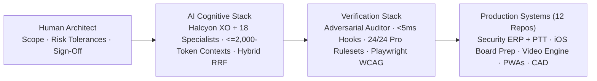

# Engineering & Product Documentation — Hathcock Labs

Most software failures in regulated operations, clinical education, programmatic media rendering, and physical floor tooling do not happen because a UI framework lacked animations. They happen because someone left statutory licensing rules in a PDF binder instead of TypeScript evaluators, let cold-start mobile devices overwrite live database records, trusted an unconstrained LLM to verify its own clinical claims, or shipped a mobile web layout without testing how iOS Safari handles `<dialog>` and `AudioContext`.

At **Hathcock Labs**, every codebase and AI engineering workflow follows one core standard: **human-directed, verification-first craftsmanship** orchestrated across **12 repositories** under **`Halcyon` (XO & Flight Director)**, **18 specialized roles**, and external adversarial auditor **`Muse`**.

---

## Core Engineering Axioms

### 1. Deterministic Code Over Prose Rules
Whether checking if a Pennsylvania security officer holds an active Act 235 card before releasing an expandable baton (`18 Pa. C.S. § 908`), calculating FLSA `29 C.F.R. § 778.115` weighted-average overtime in integer cents, or enforcing a `<= 2,000`-token ceiling on subagent dispatches, critical invariants belong in deterministic, tested code—not wishful prompts or manual checklists.

### 2. Heterogeneous Compute & Zero-Waste Token Economics
Rather than burning cloud frontier quotas on every mechanical task, workloads distribute intentionally across hardware tiers:
- **Sub-Millisecond Scratch NVMe:** SQLite WAL FTS5 retrieval (`<1.5 ms`), compiler caches, and atomic `fcntl.flock` handoff locks.
- **Always-On Apple Silicon M1 Max Inference (`squad-local`):** 5-model zero-cloud-token CLI serving `nomic-embed-text` (`768d` vectors), `hermes3:8b` (automatic `01_Dispatch/` JSON triage & 5-bullet digests), `qwen2.5-coder:14b` (code/regex/SQL reviews), `deepseek-r1:14b` (step-by-step sanity checks), and `qwen3:14b` (general local Q&A), plus automated round-trip DR verification.
- **27-Model Cloud Frontier Tiers (Pool 1 + Pool 2):** Routes `>95%` of work across `20` Pool 1 Gemini models—combining runtime subagent delegation (`inherit` → **Gemini 4 Neon High**, `pro`/`flash` → **Gemini 4 Hydrogen** tiered coding) with explicit `/swarm` pinning (`gemini-4-neon-xhigh`) for safety-critical reasoning (`Echo` clinical accuracy, `Vault` security rules, `Apex` auth/webhooks, `Nexus` sync races, `Sentinel` IAM boundaries)—while reserving `7` Pool 2 cross-vendor models (Claude 5.5; excluding sunsetting GPT-OSS 120B) selectively for release-gate cross-checks.

### 3. Physical Reality First (Gloves, Dead Zones & WebKit Quirks)
Software runs in bright daylight offices, concrete basements with zero LTE, hurried stockrooms, and handheld devices operated one-handed. Our modules filter `<35ms` laser scanner bursts away from Spacebar PTT hotkeys, recover iOS WebKit `'interrupted'` audio states on lock-screen wake, bridge dead zones with `idempotencyKey`-deduplicated FIFO queues, and print solid plastic NFC enclosures mid-layer in OpenSCAD.

### 4. Adversarial Truth & Zero-Slop Design Discipline
Every unverified legal claim or browser quirk passes an independent, context-isolated external audit (`Scout` ↔ `Muse`), production AI runs locked behind `temperature: 0.0` Zod contracts preserving raw officer testimony verbatim, and automated headless Playwright DOM/WCAG verification prevents dark-slate UI clones or clipped controls from ever reaching builds.

---

## How the AI Stack Connects Directly to Shipped Systems

| Cognitive Layer / Mechanism | Production Guarantee Delivered Across Products | Primary Reference |
| :--- | :--- | :--- |
| **Mandatory `pro` / `Neon` Clinical & Rules Locks** | Zero unverified medical ratios (`Echo`) & airtight 13-collection `CLIENT_VIEWER` isolation (`Vault` / `Apex`) | [01 · The 18-Specialist Squadron](02_AI-Systems-Architecture/01-The-18-Specialist-Squadron.md) |
| **Optane FTS5 + Hybrid RRF (`k = 60`)** | Surfaces solved WebKit, FLSA `29 C.F.R. § 778.115`, and `pnpm` build fixes in `<1.5 ms` | [02 · Five-Tier Memory & Hybrid RRF](02_AI-Systems-Architecture/02-Five-Tier-Memory-and-Hybrid-RRF.md) |
| **`<=2,000`-Token Differential Compiler** | Eliminates context rot during 5-package refactors while gating dual quota caps live | [03 · Differential Context & Quota](02_AI-Systems-Architecture/03-Differential-Context-and-Quota-Governance.md) |
| **Two-Node Dropzone + Schema-Locked AI** | Catches PA/DE/MD statutory & Safari `<dialog>` traps pre-code; preserves immutable raw testimony | [04 · Adversarial & Fact-Locked AI](02_AI-Systems-Architecture/04-Adversarial-Verification-and-Fact-Locked-AI.md) |
| **Chained Git/Playwright Gates & DR** | Enforces clean TypeScript, passing tests, DOM contrast, `0600` keys & tested off-box restores | [05 · Autonomous DevOps & Gates](02_AI-Systems-Architecture/05-Autonomous-DevOps-and-Zero-Trust-Gates.md) |
| **Kernel `inotify` + Apple Silicon Inference** | Turns on-foot field voice notes into routed tasks at `0 MB` idle RAM & `0` local vector tokens | [06 · Mobile Dispatch & Local LLM](02_AI-Systems-Architecture/06-Ambient-Mobile-Dispatch-and-Local-Inference.md) |

---

## Verified Quantitative Snapshot

- **Arclight Security (`v0.4.0` PTT Live):** `5/5` workspace packages typecheck clean; **`433/433` unit tests** & **`164/164` E2E specs** across 10 adversarial rounds; **all `19` Cloud Functions v2 (`nodejs22`)** live via `esbuild`; `457.24 kB` max chunk; `0` visual/WCAG defects across `1440×900` and `375×812`.
- **SonoPrep Pro (`iOS`):** `421` audited RVT/SPI questions, `132` SVGs, `18` interactive hotspots, `34/34` unit/App Store compliance tests, `15/15` E2E stages, `0` `oxlint` warnings, `<500 KB` bundles.
- **Deterministic Video Engine (`v0.1.0`):** `4/4` packages typecheck clean; **`33/33` pipeline unit tests**; `17/17` seeded episodes clearing the 9-rule Grade `6.6–9.0` anti-slop voice gate; `1080×1920` `60fps` H.264 + `-14 LUFS` AAC stereo; `<35 KB` companion bio hubs.
- **Cognitive Tooling & Fleet Governance:** `1.29 ms` Optane FTS5 search (`1,015/1,015` embedded sections), `20.4 KB` deduplicated global rules (`<24 KB` injection cap, down from `40.7 KB`), `93%` blackboard initialization token drop (`8` active slots), **27-model** dual-pool routing with `32.5M`/`325M` live `/usage` telemetry (`XX% LIVE`, `Cld:XX%/XdXXh`), **`24/24` zero-bypass GitHub Pro Rulesets** across `12` repos, and **`23/23 PASS` (`0.55s`)** 3-node drift verification.

---

## Three-Node Compute Allocation Summary

| Node Role | Hardware Profile | Dedicated Workloads | Endurance & Protection Model |
| :--- | :--- | :--- | :--- |
| **Workstation Node** | 4C/8T Laptop · `12 GB` RAM + `11.4 GB` zram · **Optane NVMe Scratch** | Optane `fleet wt` worktrees, `memory.db` WAL FTS5 (`1.29 ms`), `ccache`/Rust/Node caches, `inotify` dispatch triggers | `vm.vfs_cache_pressure=50`, `[none]` I/O scheduler, `earlyoom`, 24/7 no-sleep & Wi-Fi `power_save=0` |
| **Inference & Backup Node** | Always-On Unified-Memory **Apple Silicon M1 Max (`32 GB`)** | `squad-local` 5-model lineup (`nomic-embed-text`, `hermes3:8b`, `qwen2.5-coder:14b`, `deepseek-r1:14b`, `qwen3:14b`), containers, iOS builds, 4-step DR verification | `launchd` container & `300s` vector watchdogs; `0` cloud tokens burned locally |
| **Edge Network Node** | `8 GB` **ARM SBC** | Primary network DNS filter + unified plain-English control telemetry HUD | Volatile RAM `journald`, `noatime,commit=60` mount, `300s` SQLite flush batching |

---

## Complete Documentation Map (`19` Chapters)

### 01 · Shipped Products & Hardware Systems (`5`)
- [Arclight Security ERP & CAD](01_Products/Arclight-Security-ERP.md) — Replacing the 4-vendor contract security stack + live `v0.4.0` half-duplex PTT across Maryland, Delaware, and Pennsylvania.
- [SonoPrep Pro (iOS)](01_Products/SonoPrep-iOS.md) — Commercial ARDMS RVT/SPI vascular board prep with a 100% On-Device Study Vault and live Doppler physics simulation.
- [Deterministic Programmatic Video Production Engine](01_Products/Deterministic-Video-Production-Engine.md) — Multi-channel `1080×1920` `60fps` Remotion composition, `-14 LUFS` FFmpeg mastering, Grade `6.6–9.0` anti-slop voice gate, and idempotent publishing.
- [High-Velocity Retail Floor & Asset PWAs](01_Products/Retail-Operations-PWAs.md) — Single-handed mobile custody and execution tooling built for `<35ms` barcode wedges and instant NFC cold starts.
- [Parametric Additive CAD & Hardware Fixtures](01_Products/Additive-CAD-and-Hardware-Fixtures.md) — OpenSCAD CSG mounts, cantilever snap-fits, and pause-at-layer embedded RFID/NFC enclosures.

### 02 · AI Systems Architecture (7-Chapter Flagship Series)
- [00 · Cognitive Architecture Overview](02_AI-Systems-Architecture/00-Cognitive-Architecture-Overview.md) — Why single-context coding collapses and how `Halcyon` (XO) orchestrates 18 specialists across 3 compute nodes.
- [01 · The 18-Specialist Squadron](02_AI-Systems-Architecture/01-The-18-Specialist-Squadron.md) — Full profiles of all 18 roles, `4-Wave` OOM-safe execution doctrine, `Tier A1/A2/B/C/D` audits, read-only statutory vetoes, and inter-agent seams.
- [02 · Five-Tier Memory & Hybrid RRF Retrieval](02_AI-Systems-Architecture/02-Five-Tier-Memory-and-Hybrid-RRF.md) — Structural repo maps, `fcntl.flock` rolling blackboards, FTS5 BM25 + 14-day recency, and `k = 60` Reciprocal Rank Fusion.
- [03 · Differential Context & Quota Governance](02_AI-Systems-Architecture/03-Differential-Context-and-Quota-Governance.md) — `<= 2,000`-token compiler, 27-model `Gemini 4 Neon` + `Hydrogen` + `/swarm` routing, `<24 KB` rule hygiene, and `32.5M`/`325M` calibrated `/usage` gauges.
- [04 · Adversarial Verification & Fact-Locked AI](02_AI-Systems-Architecture/04-Adversarial-Verification-and-Fact-Locked-AI.md) — Two-node adversarial research (`Scout` ↔ `Muse`) and schema-locked, raw-transcript-preserving production AI.
- [05 · Autonomous DevOps & Zero-Trust Gates](02_AI-Systems-Architecture/05-Autonomous-DevOps-and-Zero-Trust-Gates.md) — Optane `fleet wt` worktrees, `<5ms` blob/secret hooks, **`24/24` zero-bypass Pro Rulesets** across `12` repos, **`23/23` drift doctor (`0.55s`)**, and DR restores.
- [06 · Ambient Mobile Dispatch & Local Inference](02_AI-Systems-Architecture/06-Ambient-Mobile-Dispatch-and-Local-Inference.md) — Zero-RAM `inotify` inbox triggers, automatic `hermes3:8b` JSON dispatch triage, and 5-model `squad-local` offloading.

### 03 · Systems & UI Deep Dives
- [Half-Duplex Push-to-Talk Over LTE](03_Architecture-Deep-Dives/Half-Duplex-PTT-Over-LTE.md) — Lease-backed floor locks, `10-33 SOS` preemption, synthesized radio chirps, and LiveKit + dead-zone replay.
- [Statutory Compliance as Deterministic Code](03_Architecture-Deep-Dives/Statutory-Compliance-As-Code.md) — MD/DE/PA evaluators, integer-cents FLSA `29 C.F.R. § 778.115` overtime, and Dark-Hours SLA liquidation math.
- [Zero-Clobber Real-Time Synchronization](03_Architecture-Deep-Dives/Zero-Clobber-Realtime-Sync.md) — Atomic `runTransaction` per-entity timestamp merging, `750 KB` log pruning ahead of `1 MiB` caps, and FIFO outboxes.
- [Anti-Slop UI Engineering & WebKit Resilience](03_Architecture-Deep-Dives/Anti-Slop-UI-Engineering.md) — Domain archetypes, `OKLCH` + `color-mix()` tokens, native `<dialog>` coordinate guards, and Safari platform fixes.

### 04 · Engineering Build Log
- [November 2026 Engineering Milestones](04_Build-Log/2026-11-Milestones.md) — Verified production benchmarks, test counts, and platform releases.
